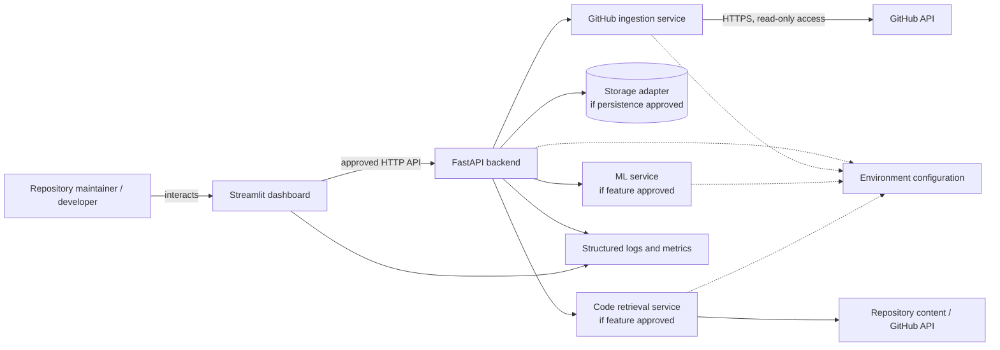
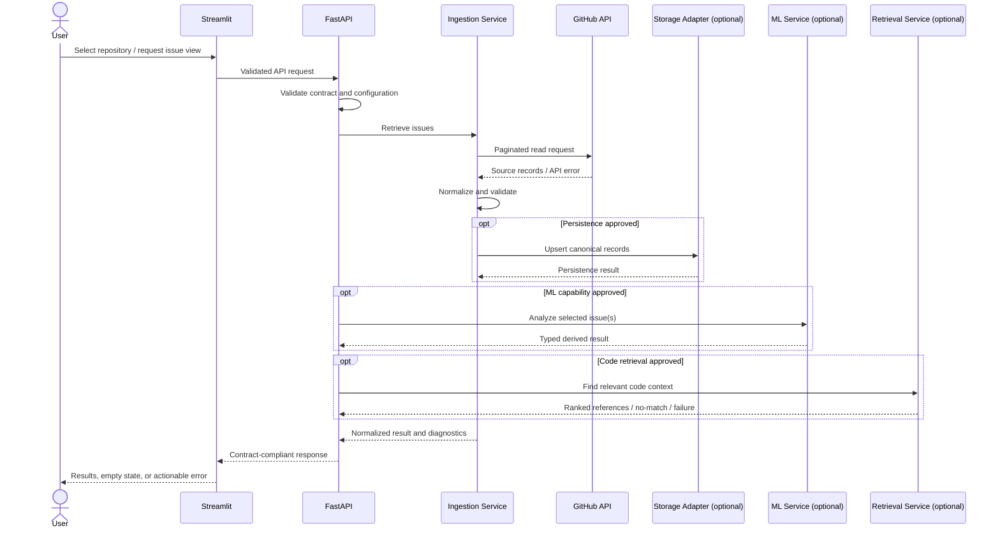
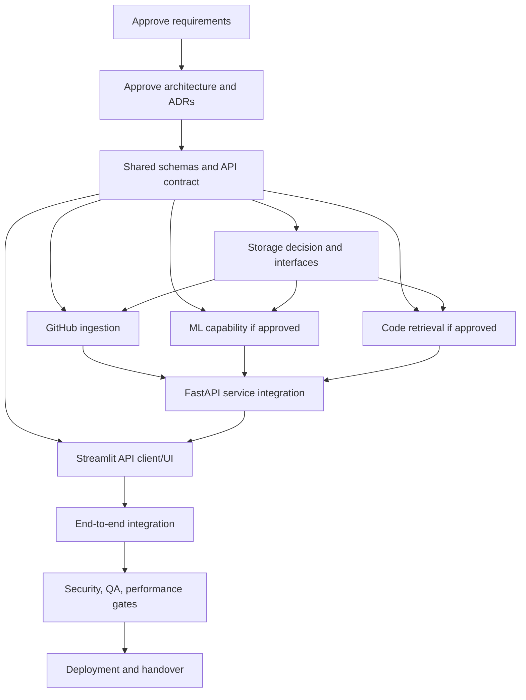

# ORDO System Architecture and Technical Design Blueprint

**Project:** ORDO — AI-powered GitHub Issue Intelligence Platform  
**Status:** Proposed architecture baseline; approval pending  
**Date:** 2026-10-27  
**Repository:** Not created yet according to project context; this is a standalone design artifact.

> This document is a design proposal, not evidence that the repository, services, database, tests, or deployment exist. The project requirements and API-contract manuals remain authoritative for approved scope and interfaces. Existing role manuals are planning artifacts and should be reconciled before implementation.

## Table of Contents
1. [Purpose and Status](#1-purpose-and-status)
2. [Requirements Review](#2-requirements-review)
3. [Architectural Goals and Constraints](#3-architectural-goals-and-constraints)
4. [System Context Diagram](#4-system-context-diagram)
5. [Container and Component Architecture](#5-container-and-component-architecture)
6. [Proposed Repository Structure](#6-proposed-repository-structure)
7. [Technology and Decision Register](#7-technology-and-decision-register)
8. [Data Flow Architecture](#8-data-flow-architecture)
9. [Database and Storage Architecture](#9-database-and-storage-architecture)
10. [API and Shared Contracts](#10-api-and-shared-contracts)
11. [Error Handling and Resilience](#11-error-handling-and-resilience)
12. [Security and Privacy Architecture](#12-security-and-privacy-architecture)
13. [Configuration and Environment Strategy](#13-configuration-and-environment-strategy)
14. [Observability Architecture](#14-observability-architecture)
15. [Testing Architecture](#15-testing-architecture)
16. [Component Dependencies and Execution Order](#16-component-dependencies-and-execution-order)
17. [Architecture Decision Records](#17-architecture-decision-records)
18. [Architecture Risks and Trade-Offs](#18-architecture-risks-and-trade-offs)
19. [Requirements Traceability](#19-requirements-traceability)
20. [Open Questions and Approval Requirements](#20-open-questions-and-approval-requirements)
21. [Architecture Definition of Done](#21-architecture-definition-of-done)

## 1. Purpose and Status

Define a coherent, dependency-aware design for ORDO. The goal is to keep modules independently testable while avoiding premature infrastructure and inconsistent schemas.

### Status terms
- **Confirmed context:** ORDO is intended to be an AI-powered GitHub Issue Intelligence Platform; planning manuals repeatedly identify FastAPI and Streamlit.
- **Proposed:** component placement and behavior recommended here.
- **Undecided:** requires evidence, experiment, or owner approval.
- **Not verified:** no implementation evidence exists.

## 2. Requirements Review

The requirements baseline is being drafted in `ORDO_Project_Requirements_and_Scope_Blueprint.md`. Current candidate capabilities include read-only GitHub issue retrieval, normalization, issue presentation, optional ML analysis, optional code retrieval, a FastAPI API, and Streamlit UI. Exact first-release scope, authentication, persistence, ML features, and deployment remain open.

### Architectural implications
1. Do not implement a feature solely because it appears in a candidate list.
2. The API Contract and Integration Standards manual owns final HTTP routes, request/response schemas, and error shape.
3. The Data Engineer owns ingestion and canonicalization; the Storage Engineer owns persistence interfaces and migration design if persistence is approved.
4. ML and code retrieval remain replaceable behind small interfaces.
5. The UI must call the API; it must not directly access the database or duplicate domain logic.
6. Start as a modular monolith unless approved workload or isolation needs justify separate services.
7. The existing Data Engineer blueprint describes a Python 3.12+ / GitHub REST API / Pydantic / SQLAlchemy / SQLite path as a proposal. It is not treated as final approval until reconciled with the requirements and storage decision.

## 3. Architectural Goals and Constraints

### Goals
- Clear ownership and dependency direction.
- Reproducible local development.
- Stable contracts and schema validation.
- Secure credential and sensitive-data handling.
- Safe external API behavior.
- Unit and contract testing without live credentials.
- Observable failures without secret leakage.
- ML and retrieval replaceability.
- Minimal operational complexity.

### Constraints
- Streamlit and FastAPI are repeated planned components, but exact release scope requires approval.
- No repository exists yet; all paths below are proposed.
- No database, vector store, broker, cache, cloud provider, or deployment platform is assumed approved.
- Do not add a JavaScript frontend framework when Streamlit is the approved UI.
- Avoid circular imports; shared models must not import application layers.

## 4. System Context Diagram



**Status:** illustrative proposed architecture. Storage, ML, and code retrieval may be omitted from the first release if not approved.

The user interacts only with the Streamlit dashboard. The dashboard calls FastAPI using the agreed contract. FastAPI orchestrates domain services and maps failures into stable responses. The ingestion component communicates with GitHub. Optional storage, ML, and retrieval components are internal interfaces rather than necessarily separate deployable services. Observability is cross-cutting.

## 5. Container and Component Architecture

Recommended initial deployment shape: one repository and, unless operational requirements say otherwise, one modular codebase with independently runnable API and Streamlit processes. Do not create distributed services by default.

| Component | Purpose / owns | Explicitly does not own | Interface and dependencies | Errors/tests | Owner/manual |
|---|---|---|---|---|---|
| `apps/web/` | Streamlit pages, session/UI state, API client | GitHub ingestion, SQL queries, ML algorithms | Calls public FastAPI contract | UI states, API client tests, smoke tests | Frontend manual |
| `apps/api/` | FastAPI startup, routes, validation, response mapping, orchestration | Duplicate ingestion logic, UI rendering, raw SQL scattered in routes | Uses shared schemas and service interfaces | API/contract tests; safe errors | Backend + API contract manuals |
| `packages/data_ingestion/` | GitHub HTTP client, pagination, normalization, source diagnostics | UI/API route ownership, ML decisions | Emits canonical issue models | Mocked HTTP, pagination, retry tests | Data Engineer manual |
| `packages/storage/` or approved storage subpackage | Persistence adapters, transactions, migrations if needed | Business-level classification, HTTP routing | Repository interfaces | Isolated storage tests | Storage manual; path to confirm |
| `packages/ml_engine/` | Approved classification/similarity/summarization logic | GitHub API access unless explicitly delegated; UI/API routing | Typed input/output contract | Evaluation and model-failure tests | ML manual |
| `packages/code_retrieval/` | Indexing/retrieval and source references | Authorization policy decisions without security contract | Typed retrieval interface | Relevance and access-scope tests | Retrieval manual |
| `shared/` | Domain schemas, API DTOs or contract package, error models, common identifiers | Runtime service implementations | Imported by producers and consumers | Schema/compatibility tests | API/Integration owner |
| `tests/` | Cross-module and end-to-end verification | Production data access | Fixtures and controlled test services | All test levels | QA manual |
| `docs/` | Requirements, architecture, decisions, API and operations docs | Source-of-truth duplication of live schemas | Links to contracts and implementation | Review and link checks | Documentation manual |
| `infra/` | Approved CI, container, deployment assets | Application business logic | Consumes approved runtime/config contracts | Pipeline and deployment smoke tests | DevOps/Release manuals |

### Dependency direction
- `shared` imports no application or service packages.
- `data_ingestion`, `ml_engine`, `code_retrieval`, and storage adapters depend on shared domain contracts, not FastAPI.
- API routes depend on application services, which depend on component interfaces.
- Streamlit depends only on the public HTTP contract and UI-local code.
- Tests may depend on any component; production modules must not import test utilities.

## 6. Proposed Repository Structure

```text
ordo-monorepo/
├── .github/
│   ├── workflows/                    # Required after CI design approval
│   └── CODEOWNERS                    # Recommended for role boundaries
├── docs/
│   ├── implementation/
│   │   ├── ORDO_Project_Requirements_and_Scope_Blueprint.md
│   │   ├── ORDO_System_Architecture_Technical_Design_Blueprint.md
│   │   ├── ORDO_Database_Data_Storage_Engineer_Blueprint.md
│   │   └── ORDO_Master_Implementation_Runbook.md
│   ├── api/                          # Approved API contract and examples
│   ├── architecture/                 # ADRs and diagrams
│   └── operations/                   # Runbooks, release and recovery
├── shared/
│   └── schemas/                      # Canonical models/contracts, exact layout TBD
├── apps/
│   ├── api/                          # FastAPI entry point, routes, services/adapters
│   └── web/                          # Streamlit entry point, pages, API client
├── packages/
│   ├── data_ingestion/
│   ├── storage/                      # Include only if separate package is approved
│   ├── ml_engine/                    # Include only approved capabilities
│   └── code_retrieval/               # Include only approved capabilities
├── tests/
│   ├── unit/
│   ├── contract/
│   ├── integration/
│   ├── e2e/
│   └── fixtures/
├── infra/                            # Only approved container/CI/deployment assets
├── .env.example                      # Placeholders only
├── .gitignore
├── README.md
└── pyproject.toml                    # Single dependency manifest if packaging decision agrees
```

This is a proposed tree, not an existing repository. Avoid adding `packages/storage/` if storage is a small internal adapter better owned by another agreed package. Avoid duplicate dependency manifests until the packaging approach is approved. No Docker, database migration, workflow, or vector-index file is required until the corresponding decision is approved.

## 7. Technology and Decision Register

| ID | Decision | Current status | Recommendation / rationale | Alternatives and trade-offs | Approver |
|---|---|---|---|---|---|
| ADR-001 | Runtime version | Proposed | Evaluate Python 3.12+ compatibility with all dependencies; pin supported minor version | Newer runtime may have package gaps; older may constrain support | Architecture owner |
| ADR-002 | API framework | Repeated planned choice | FastAPI fits typed HTTP API and OpenAPI; confirm scope | Other frameworks possible but add change cost | Project owner/architect |
| ADR-003 | Dashboard | Repeated planned choice | Streamlit; aligns with current planning | Custom web frontend adds complexity | Project owner |
| ADR-004 | Validation/schema library | Proposed | Pydantic-compatible schemas if FastAPI/Python design approves | Dataclasses/custom validation less integrated | API owner |
| ADR-005 | HTTP client | Undecided | Choose one maintained sync/async client consistent with execution model | Sync simpler; async may help concurrency but complicates code | Architect |
| ADR-006 | Dependency management | Undecided | Prefer one reproducible root tool/manifest; choose after environment check | pip/requirements, uv, Poetry; avoid duplicate sources of truth | DevOps |
| ADR-007 | Persistence | Undecided | Begin storage-light only if workflows permit; otherwise compare SQLite and PostgreSQL using concurrency/deployment needs | SQLite simple local dev; PostgreSQL better multi-process/server concurrency | Owner + storage |
| ADR-008 | ORM/migrations | Undecided | If relational DB chosen, evaluate SQLAlchemy and Alembic | Raw SQL may be simpler for tiny scope; ORM adds abstraction | Storage owner |
| ADR-009 | ML framework/model | Undecided | Establish simple baseline and evaluate on approved dataset before selecting | Hosted/local models trade cost, latency, privacy, resources | ML owner + security |
| ADR-010 | Embeddings/vector storage | Undecided | Do not introduce until retrieval experiment demonstrates need | Keyword search, in-memory index, file-based index, vector store | Retrieval owner |
| ADR-011 | Code retrieval | Undecided | Benchmark keyword/hybrid/semantic approaches on curated issue-to-code queries | More advanced retrieval costs resources and operations | Retrieval owner |
| ADR-012 | Test framework | Proposed | pytest with fixtures and mocked external services | unittest viable; pytest ecosystem is convenient | QA |
| ADR-013 | Formatting/linting | Undecided | Select one formatter and linter, run in CI | Tool choice less important than consistent enforcement | DevOps/QA |
| ADR-014 | Containerization | Undecided | Use only if deployment/reproducibility needs justify it | Local native processes simpler | DevOps |
| ADR-015 | CI/CD | Proposed | CI should run install, formatting/lint, tests, approved security checks | Provider/workflow depends on repository host | DevOps |
| ADR-016 | Observability | Proposed | Structured logs, correlation IDs, health checks before external telemetry | Centralized stack adds cost/operations | Observability owner |
| ADR-017 | Deployment target | Undecided | Select after workload, access model, budget and operational owner are known | Local demo, VM/container platform, managed service | Owner/Release |

No technology decision above is approved merely by appearing in this table. Record actual approvals in ADRs.

## 8. Data Flow Architecture

### Sequence diagram



### Flow rules
1. Validate request and configuration before making external calls.
2. Treat GitHub as authoritative for source issue state.
3. Normalize at the ingestion boundary; downstream consumers use canonical models.
4. Persist only approved fields and only if storage is approved.
5. Derived ML/retrieval results must not overwrite source issue fields.
6. API response schemas are controlled by the API contract manual.
7. Logs contain request IDs, outcome categories, durations and counts where useful, not secrets or entire issue bodies by default.

### Retries, partial failures, consistency
- Use explicit connection/read timeouts.
- Retry transient GET failures only with bounded backoff and rate-limit awareness.
- Respect GitHub rate-limit and retry-after guidance.
- Return partial results only if the contract defines how partiality is represented; otherwise fail clearly rather than imply completeness.
- If ingestion persists data, define transaction boundaries and idempotency before implementation.
- Background execution is not required by default. Add a job system only when measured latency/workload or product requirements justify it.

## 9. Database and Storage Architecture

Storage decision is open. Possible categories include transient request state, normalized issues, repository metadata, analysis results, retrieval index/artifacts, and processing diagnostics. None should be persisted by default without a purpose and retention decision.

| Category | Initial proposal | Decision needed |
|---|---|---|
| Current request/result | In-memory for request lifetime if feasible | Whether repeatable queries/caching are needed |
| Normalized issue records | Persist only if incremental sync/history or performance requires it | SQLite vs PostgreSQL vs no DB |
| ML outputs | Recompute unless caching/history is required | Versioning and invalidation |
| Embeddings/index | No external vector DB by default | Retrieval evaluation and corpus size |
| Model artifacts | Store according to selected model approach | Local vs provider vs artifact store |
| User preferences | Not required unless user accounts/preferences are approved | Product scope |
| Audit events | Minimal structured operational logs by default | Compliance/product need and retention |
| Raw GitHub payload | Do not retain by default | Debug/reproducibility need versus privacy |

If relational storage is selected, keep schema design in the Storage Engineer manual and shared models in the agreed contract location. GitHub issue number is only unique within a repository; use a globally stable source ID or a compound repository + issue key. Define deletion/staleness policy before production.

The Data Engineer manual currently proposes SQLite + SQLAlchemy. Reconcile that proposal with expected concurrency, deployment target, backup needs and data lifecycle before approving it.

## 10. API and Shared Contracts

- Public HTTP API is owned by FastAPI.
- Request/response schemas and error conventions are owned by the API Contract and Integration Standards manual, approved by the architecture owner.
- Internal package interfaces are typed Python contracts, not HTTP calls unless a separate service boundary is justified.
- Shared contracts must not import API routes, Streamlit, storage implementations, or model providers.
- Streamlit uses a single configured API client. It must not query the database directly.
- Data ingestion owns canonical source normalization; the API maps those models to public response schemas.
- ML/retrieval outputs have separate derived-result schemas and include provenance/version fields where required.
- Breaking schema changes require a change request, compatibility review, tests, and coordinated updates to producer and consumers.
- Do not define exact endpoint paths here; the API contract manual is authoritative.

### Preliminary interface inventory

| Producer | Consumer | Interface | Owner | Readiness |
|---|---|---|---|---|
| Streamlit | FastAPI | Approved HTTP endpoints | API contract owner | Blocked on contract approval |
| FastAPI | Ingestion | Python service interface | Data/API owners | Blocked on canonical model |
| Ingestion | Storage | Repository/upsert interface if persistence approved | Data/Storage | Blocked on storage decision |
| FastAPI | ML | Typed analysis interface if approved | ML/API | Blocked on feature decision |
| FastAPI | Retrieval | Typed query interface if approved | Retrieval/API | Blocked on feature decision |
| All components | Shared schemas | Versioned canonical DTOs | Integration/API owner | Blocked on contract review |
| Components | Observability | Logger/metrics conventions | Observability owner | Can begin as proposal |

## 11. Error Handling and Resilience

### Error classes and handling ownership

| Failure | Handle at | External behavior |
|---|---|---|
| Invalid request | API validation boundary | Stable validation error; no external call |
| Missing required configuration | Startup/config layer | Clear variable name; no secret values |
| GitHub 401/403 | Ingestion adapter | Distinguish authentication/permission failure |
| GitHub 404 | Ingestion adapter | Safe unavailable/not-found result |
| GitHub 429/rate limit | Ingestion adapter | Bounded wait/retry where safe; explicit retry guidance |
| Network timeout/5xx | External adapter | Bounded retries; then typed upstream failure |
| Invalid source payload | Normalizer | Validation diagnostic; do not silently coerce critical fields |
| Storage failure | Repository layer | Roll back transaction; typed internal error |
| ML failure | ML adapter/service | Feature-specific unavailable state or explicit failure |
| Retrieval no-match | Retrieval layer | Successful empty result if search completed |
| Retrieval failure | Retrieval layer | Distinguish failure from no-match |
| Unexpected exception | API boundary | Generic safe response; correlation ID; detailed internal log |

Use a correlation/request ID where helpful. Never swallow exceptions and return success. Do not retry validation errors or permission errors blindly. Retries must be bounded to avoid retry storms. Error schema must be finalized by the API contract owner.

## 12. Security and Privacy Architecture

- Store credentials in environment-specific secret storage; `.env` is local-only and ignored by Git.
- `.env.example` contains placeholder names, never real values.
- Use read-only GitHub permissions unless write actions are approved.
- Validate repository references and all untrusted inputs.
- Do not log authorization headers, tokens, raw credentials, full private issue bodies, or complete source files by default.
- Ensure retrieval filters are tied to the authorized repository scope.
- Treat issue content and code as untrusted input, including possible prompt injection if LLMs are introduced.
- Review model-provider data retention/training terms before sending private issue or source text externally.
- Return safe errors; keep stack traces and internal paths out of production responses.
- Pin and scan dependencies according to approved CI policy.
- Define access control only if the product requirements require it; do not invent user accounts or RBAC.
- Security reviewer must approve token scope, private-repository behavior, data retention/deletion, model data handling, deployment secrets, and logging.

## 13. Configuration and Environment Strategy

Configuration is loaded once per process through a typed settings layer. Names below are illustrative and require approval.

| Setting | Purpose | Sensitivity | Required? |
|---|---|---|---|
| `ORDO_ENV` | Environment name | Low | Proposed |
| `ORDO_LOG_LEVEL` | Logging verbosity | Low | Optional |
| `GITHUB_TOKEN` or approved app credentials | GitHub API authentication | Secret | Required only for chosen access model |
| `GITHUB_API_BASE_URL` | GitHub API endpoint override for tests/enterprise | Low/moderate | Optional |
| `ORDO_STORAGE_URL` | Storage connection | May contain secret | Required only if storage selected |
| `ORDO_API_BASE_URL` | Frontend API location | Low | Required for frontend process |
| `ORDO_REQUEST_TIMEOUT_SECONDS` | Outbound timeout | Low | Proposed |
| `ORDO_ML_PROVIDER` / model setting | ML selection | Low | Only if ML approved |
| `ORDO_RETRIEVAL_INDEX_PATH` | Local index location | May expose path | Only if relevant |

Use placeholders in `.env.example`. Validate required values on startup. Do not duplicate defaults across UI and API. Tests should inject settings explicitly and not depend on the developer's real environment. Separate development/test/production configuration, and document which features are disabled when optional configuration is absent.

## 14. Observability Architecture

Initial-release proposal:
- Structured application logs with timestamp, severity, component, request ID, event name, duration, and outcome.
- Health/readiness endpoints where operationally needed.
- Ingestion counters: pages/records processed, invalid records, rate-limit events, retry count.
- API latency and error categories.
- ML/retrieval execution duration and failure category if those capabilities exist.
- Secret and sensitive-data redaction tests.
- No centralized metrics backend or tracing vendor until justified.

Operational dashboards and alerts are not existing features. Define service-level objectives after workload expectations are known. Verify observability by deliberately triggering representative failures in a controlled test environment.

## 15. Testing Architecture

| Test layer | What it verifies | External dependencies |
|---|---|---|
| Unit | Normalization, validation, business rules, error mapping | None |
| Contract/schema | Stable DTOs and compatibility | None |
| HTTP adapter | Pagination, headers, retries, rate limits | Mocked HTTP |
| Storage integration | Constraints, transactions, idempotency, migrations | Isolated temporary/test DB if selected |
| ML evaluation | Quality metrics, regressions, malformed inputs | Fixed dataset; model may be stubbed for ordinary tests |
| Retrieval evaluation | Relevance, no-match, scope restrictions | Synthetic repository fixtures |
| API | Status codes, schemas, error responses | Test client and injected services |
| UI smoke | Startup, API errors, empty/success state | Mock API or test server |
| E2E | Approved user workflow | Controlled integrated test environment |
| Security | Secret leaks, unauthorized scope, unsafe input | Isolated test fixtures |
| Performance/reliability | Latency, resource use, retry behavior | Representative test environment |
| Deployment smoke | Startup, health, config, rollback assumptions | Deployment-like environment |

Tests must not require production credentials or call live GitHub unless explicitly marked as opt-in integration tests. Every test result must be recorded as actual `PASS`, `FAIL`, `BLOCKED`, or `NOT RUN`; no result is implied by this document.

## 16. Component Dependencies and Execution Order

| Component | Prerequisites | Artifact produced | Consumers | Owner | Readiness |
|---|---|---|---|---|---|
| Requirements | Product-owner review | Approved scope/IDs | All roles | Project Lead | Not approved |
| Architecture/ADR | Scope and workload assumptions | Component boundaries, decisions | All roles | Architect | Proposed |
| Shared contracts | Requirements + API decision | Domain and error schemas | API, ingestion, ML, retrieval, UI | API/Integration | Blocked |
| Storage | Approved persistence decision | Schema/repository/migrations | Ingestion/API/ML as required | Storage | Blocked |
| Ingestion | GitHub permissions + canonical model | Normalized issues and diagnostics | API/storage/ML | Data | Blocked |
| ML | Approved feature + dataset | Inference contract and evaluation | API/UI | ML | Optional/blocked |
| Retrieval | Approved code-context scope | Query/index contract | API/UI | Retrieval | Optional/blocked |
| Backend | API contract + services | HTTP API | Frontend | Backend | Blocked |
| Frontend | API contract and API client | Dashboard | Users | Frontend | Blocked |
| Integration | Producer/consumer readiness | E2E workflows | Release | Integration/QA | Blocked |
| QA/security/performance | Implemented baseline | Evidence and defect reports | Owner/release | QA + specialists | Not started |
| Deployment | Approved target/secrets | Deployable release | Operators | DevOps/Release | Blocked |



## 17. Architecture Decision Records

Create one ADR per cross-component decision. Suggested template:

```markdown
# ADR-NNN: <Decision title>
- Status: Proposed | Approved | Rejected | Superseded
- Date:
- Owner / approver:
## Context
## Decision drivers
## Options considered
## Decision
## Consequences and trade-offs
## Security/privacy impact
## Validation/evidence
## Related requirements and manuals
```

Initial ADRs:
- ADR-001 runtime and dependency management.
- ADR-002 initial-release scope and optional feature set.
- ADR-003 storage and persistence.
- ADR-004 API contract, error schema and compatibility policy.
- ADR-005 GitHub authentication and permission model.
- ADR-006 ML feature/model/provider.
- ADR-007 code retrieval and index strategy.
- ADR-008 sync vs background processing.
- ADR-009 caching and freshness.
- ADR-010 deployment target and operational ownership.
- ADR-011 logging/retention and privacy policy.

## 18. Architecture Risks and Trade-Offs

| ID | Risk | Mitigation | Owner |
|---|---|---|---|
| AR-001 | Overengineering with DB, queue, vector DB, cache too early | Modular monolith; ADR and workload evidence before infrastructure | Architect |
| AR-002 | API/package schema drift | One contract owner, contract tests, change control | API/Integration |
| AR-003 | Tight coupling/circular imports | Shared layer has no runtime service imports; enforce dependency tests/review | Architect |
| AR-004 | GitHub rate limits or permission failures | Bounded retries, clear errors, controlled integration tests | Data/Security |
| AR-005 | ML quality insufficient | Baseline, labelled dataset, approved threshold, human review | ML |
| AR-006 | Irrelevant or unauthorized code results | Scope filters, commit/path metadata, relevance and permission tests | Retrieval/Security |
| AR-007 | Duplicate/stale data | Explicit source identity, idempotency and freshness policy | Data/Storage |
| AR-008 | Sensitive content in logs or model provider | Data minimization, redaction, provider review | Security |
| AR-009 | Storage mismatch for deployment concurrency | Validate deployment topology; test before choosing DB | Storage/DevOps |
| AR-010 | Unclear ownership causes duplicate implementation | RACI, CODEOWNERS, PR review, role manuals | Project Lead |

The principal trade-off is simplicity versus capabilities that may require persistence, indexing, background jobs, or external services. Add complexity only when an approved requirement and evidence justify it.

## 19. Requirements Traceability

| Requirement | Architectural element | Owner | Verification | Status |
|---|---|---|---|---|
| FR-001/002 | API validation + ingestion adapter | Backend/Data | API + mocked HTTP tests | Proposed |
| FR-003/004 | Canonical model + storage adapter if approved | Data/Storage | Validation/idempotency tests | Proposed |
| FR-005/011 | Streamlit + API client | Frontend | UI smoke/API client tests | Proposed |
| FR-006/007 | ML service interface | ML | Evaluation tests | Awaiting approval |
| FR-008 | Retrieval service interface | Retrieval | Relevance and access tests | Awaiting approval |
| FR-010 | FastAPI public interface | Backend/API owner | Contract tests | Proposed |
| NFR-004 | Modular package boundaries | Architect | Import/dependency review | Proposed |
| NFR-006 | Logging and health checks | Observability | Controlled failure tests | Proposed |
| SEC-001–009 | Configuration, adapter boundaries, redaction | Security/DevOps | Secret scans and security tests | Proposed |

## 20. Open Questions and Approval Requirements

1. Approve initial release scope and mark optional ML/retrieval features as included or deferred.
2. Confirm public versus private GitHub repositories and authentication mechanism.
3. Decide whether issue data must persist between sessions or sync incrementally.
4. Reconcile SQLite/SQLAlchemy proposal from Data Engineer manual with expected deployment and concurrency.
5. Approve canonical issue schema and public API contract.
6. Decide whether pull requests are included.
7. Approve model/provider and data-sharing policy if ML is included.
8. Approve code retrieval strategy after evaluation.
9. Set latency, workload, quality, retention, backup and recovery targets.
10. Choose packaging, CI provider, deployment target, and operational owner.
11. Decide whether application-level authentication/authorization is required.
12. Confirm logging policy and sensitive-data redaction requirements.

### Decisions required before dependent implementation
- **Blocker A:** requirements and P0 scope approval.
- **Blocker B:** API/domain contracts and error format.
- **Blocker C:** storage/persistence decision.
- **Blocker D:** GitHub access permissions and credential handling.
- **Blocker E:** ML/retrieval scope and evaluation criteria, if these features are not deferred.
- **Blocker F:** runtime/package and deployment decisions.

## 21. Architecture Definition of Done

- [ ] Scope requirements and statuses reviewed with project owner.
- [ ] Repository tree approved; no claim that proposed paths already exist.
- [ ] Component ownership and dependency direction documented.
- [ ] Shared domain and API contracts approved.
- [ ] Storage, ML, retrieval, and deployment decisions recorded as ADRs.
- [ ] Configuration names and secret handling reviewed.
- [ ] Error taxonomy and retry boundaries agreed.
- [ ] Security/privacy threat review completed for selected scope.
- [ ] Test strategy covers unit through end-to-end levels.
- [ ] Observability minimum and redaction policy agreed.
- [ ] Dependency graph and implementation order reviewed.
- [ ] No critical decision is represented as approved without evidence.
