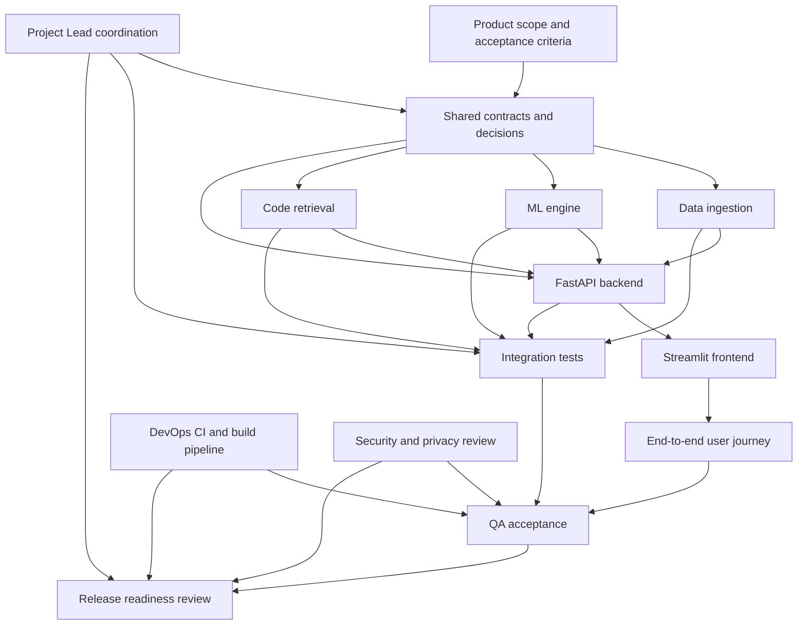
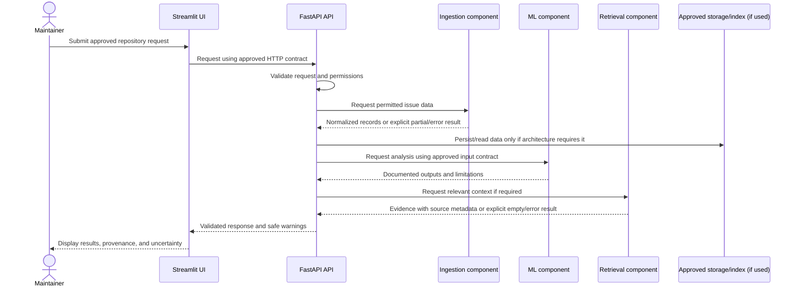

# ORDO Project Lead and Technical Coordinator Implementation Blueprint

**Document:** `ORDO_Project_Lead_Technical_Coordinator_Blueprint.md`  
**Project:** ORDO — AI-Powered GitHub Issue Intelligence Platform  
**Document type:** Project execution and engineering governance manual  
**Status:** Planning baseline; repository audit pending  
**Last updated:** 2026-10-27

> **Evidence rule:** This manual is a coordination baseline, not proof of implementation. The user has indicated that the ORDO repository has not yet been created. Therefore, repository files, branches, remotes, tests, deployed services, issue-tracker configuration, approvals, and team-member assignments are not verified. Any architecture, path, command, contract, milestone, or workflow described as proposed must be confirmed before being treated as an existing project fact.

## Table of contents

1. [Document Overview](#1-document-overview)
2. [ORDO Project Context](#2-ordo-project-context)
3. [Repository and Project Audit](#3-repository-and-project-audit)
4. [Confirmed Facts, Assumptions, and Blockers](#4-confirmed-facts-assumptions-and-blockers)
5. [Project Lead Responsibilities](#5-project-lead-responsibilities)
6. [Role Ownership Matrix](#6-role-ownership-matrix)
7. [RACI Matrix](#7-raci-matrix)
8. [Scope and Requirements Register](#8-scope-and-requirements-register)
9. [Architecture Governance and ADRs](#9-architecture-governance-and-adrs)
10. [Dependency Map](#10-dependency-map)
11. [Shared Contract Governance](#11-shared-contract-governance)
12. [Project Roadmap](#12-project-roadmap)
13. [Milestone Register](#13-milestone-register)
14. [Work Breakdown Structure](#14-work-breakdown-structure)
15. [Git and Pull Request Workflow](#15-git-and-pull-request-workflow)
16. [Code Review Standards](#16-code-review-standards)
17. [Risk and Blocker Management](#17-risk-and-blocker-management)
18. [Communication and Progress Reporting](#18-communication-and-progress-reporting)
19. [Testing and Quality Gates](#19-testing-and-quality-gates)
20. [Integration Coordination](#20-integration-coordination)
21. [Security and Privacy Governance](#21-security-and-privacy-governance)
22. [DevOps and Release Management](#22-devops-and-release-management)
23. [Release Readiness Review](#23-release-readiness-review)
24. [Change Management](#24-change-management)
25. [Documentation and Knowledge Transfer](#25-documentation-and-knowledge-transfer)
26. [Project Tracking System](#26-project-tracking-system)
27. [Reusable Project Templates](#27-reusable-project-templates)
28. [Final Handover](#28-final-handover)
29. [Definition of Done](#29-definition-of-done)
30. [Team Lead Questions and Outstanding Decisions](#30-team-lead-questions-and-outstanding-decisions)

---

## 1. Document Overview

### 1.1 Purpose

This manual gives the Project Lead / Technical Coordinator a repeatable way to guide ORDO from planning to a verified release. It defines how to:

- Establish a reliable baseline before implementation.
- Assign work without crossing component ownership boundaries.
- approve architecture and shared contracts.
- Coordinate parallel engineering work and integration dependencies.
- Review evidence rather than progress claims.
- Manage defects, risks, security findings, and scope changes.
- Gate releases and prepare operational handover.

### 1.2 How to use this manual

1. **Before repository creation:** resolve the decisions in Section 30, approve the initial scaffold, select the Git workflow, and identify role owners.
2. **At repository bootstrap:** run the audit commands in Section 3 and replace every `Needs verification` entry with evidence-backed status.
3. **Before component implementation:** approve requirements, ownership, and interface contracts.
4. **During implementation:** use task, PR, blocker, risk, and contract-change templates.
5. **Before integration:** confirm each producer's and consumer's contract and test readiness.
6. **Before release:** complete the release-readiness checklist and collect required approvals.
7. **At handover:** publish actual state, known limitations, operating instructions, and unresolved decisions.

### 1.3 Status vocabulary

| Status | Meaning |
|---|---|
| Confirmed | Direct evidence exists and has been reviewed. |
| In progress | Work has started and evidence identifies the current partial state. |
| Blocked | Work cannot safely proceed without a specific dependency or decision. |
| Not started | An owner or plan exists, but work has not begun. |
| Needs verification | There is insufficient evidence to classify the item more precisely. |
| Not applicable | The item is demonstrably outside the approved scope. |
| Proposed | A suggested future state; not an existing fact. |
| Accepted risk | An authorized person has explicitly accepted a documented residual risk. |

A status must always have an evidence link, command output, PR, test report, or decision record where applicable. Do not treat a planning document as proof that the corresponding implementation exists.

---

## 2. ORDO Project Context

### 2.1 Product intent

ORDO is described in the planning materials as an **AI-powered GitHub Issue Intelligence Platform**. Its anticipated engineering areas include:

- GitHub issue data ingestion and normalization.
- Machine-learning analysis or prioritization.
- Code and issue-context retrieval.
- FastAPI backend orchestration.
- Streamlit maintainer interface.
- Shared schemas and component contracts.
- Integration, automated testing, security, CI/CD, observability, and release operations.

The intended value is to help maintainers inspect issue information and relevant evidence. The exact product scope, data sources, user permissions, model behavior, and launch requirements still require explicit product approval.

### 2.2 Proposed high-level flow

The following flow is a planning hypothesis, not a verified implementation:

1. A maintainer submits or selects a repository.
2. The system validates the repository reference and authorization.
3. Ingestion retrieves permitted issue data, respecting pagination and rate limits.
4. Data is validated, normalized, and deduplicated.
5. Approved ML and retrieval components analyze issues and return explainable results or evidence.
6. FastAPI coordinates the approved services and exposes documented contracts.
7. Streamlit presents results, uncertainty, warnings, and source links.
8. A human maintainer makes consequential decisions; the application must not imply that a model recommendation is a verified fix.

Large ingestion jobs may require asynchronous processing, but this is a product/architecture decision, not a confirmed requirement.

### 2.3 Planning principles

- **One governed repository:** do not create separate component repositories unless the Team Lead explicitly approves a change.
- **Evidence over assertion:** recommendations should link to source evidence where the product supports it.
- **Human control:** public read access must not imply permission to write, modify, or execute actions.
- **Contract first:** independent teams can use mocks and agreed schemas while implementations proceed in parallel.
- **Ownership boundaries:** component owners implement their component; cross-component changes require coordination.
- **Status honesty:** planned folders, diagrams, and sample commands do not prove that code has been written or tested.
- **Minimal necessary scope:** optional enhancements must not silently delay the approved core workflow.

### 2.4 Architecture reference versus approved architecture

Planning materials refer to a possible monorepo with paths such as `apps/api/`, `apps/web/`, `packages/data_ingestion/`, `packages/ml_engine/`, `packages/code_retrieval/`, `shared/`, `tests/`, and `infra/`. These are candidate paths only until the repository scaffold and ownership map are approved.

A prior planning deck also describes FastAPI, Streamlit, Pydantic, Python, SQLite/SQLAlchemy, and local development ports as proposed defaults. The Team Lead must confirm these against the governing project decisions before any engineer treats them as immutable requirements.

---

## 3. Repository and Project Audit

### 3.1 Current baseline

The user has stated that the repository has not yet been created. Consequently, this document cannot truthfully report a current branch, remote, directory tree, CI result, test result, running application, or deployed environment. The first execution milestone is to establish the repository and capture an auditable baseline.

The available planning documents are useful inputs for design and coordination. They are not a substitute for inspecting the future codebase.

### 3.2 First audit checklist

After the Team Lead supplies or creates the approved repository, run the following from its root.

#### Windows PowerShell

```powershell
# Confirm current directory and repository root
Get-Location
git rev-parse --show-toplevel

# Git state
git status --short --branch
git branch --show-current
git branch --all
git remote -v
git log -10 --oneline --decorate

# Root inventory (avoid dumping secrets from .env files)
Get-ChildItem -Force
Get-ChildItem -Recurse -File |
  Where-Object { $_.FullName -notmatch '[\\/](.git|.venv|venv|__pycache__|node_modules)[\\/]' } |
  Select-Object -ExpandProperty FullName

# Find likely project entry points and tests
Get-ChildItem -Recurse -File -Include main.py,app.py,pyproject.toml,requirements*.txt,pytest.ini,conftest.py,Dockerfile,docker-compose.yml,compose.yml |
  Select-Object -ExpandProperty FullName

# Inspect tracked changes and whitespace errors
git diff --stat
git diff --check
```

#### Bash

```bash
pwd
git rev-parse --show-toplevel
git status --short --branch
git branch --show-current
git branch --all
git remote -v
git log -10 --oneline --decorate
find . -path './.git' -prune -o \
  -path './.venv' -prune -o \
  -path './venv' -prune -o \
  -path './node_modules' -prune -o \
  -type f -print
git diff --stat
git diff --check
```

**Purpose and interpretation**

| Command/group | What it reveals | Caution |
|---|---|---|
| `git rev-parse --show-toplevel` | Confirms the repository root. | If it fails, the shell is not inside a Git repository. |
| `git status --short --branch` | Current branch and working-tree changes. | Never discard existing changes merely to get a clean tree. |
| `git branch --all` | Local and fetched remote branches. | A branch listing does not prove its protection rules. |
| `git remote -v` | Configured remotes. | Do not infer the canonical remote if several exist; ask the Team Lead. |
| `git log -10 --oneline --decorate` | Recent commit history. | Empty history may indicate a newly initialized repository. |
| File inventory | Actual files and structure. | Exclude generated and secret-bearing files from shared reports. |
| `git diff --check` | Whitespace errors in the current diff. | It is not a correctness or security test. |

If the repository does not exist yet, these commands will fail by design. Do not fabricate output. Create the repository only through the approved process, then repeat the audit.

### 3.3 Audit root configuration and application entry points

After the scaffold exists, inspect:

- `README.md` and developer setup instructions.
- `pyproject.toml`, `requirements*.txt`, lock files, and Python version constraints.
- API application creation, routers, schemas, services, and error handlers.
- Streamlit startup file and HTTP API client.
- Ingestion entry points, GitHub API client, normalization, checkpointing, and retry logic.
- ML model loading, feature preparation, inference interface, and model artifact provenance.
- Retrieval indexing, query interface, result metadata, and source references.
- Shared schemas and serialization helpers.
- Tests, fixtures, sample data, and test configuration.
- GitHub Actions workflows, Docker files, compose files, deployment configuration, and health checks.
- Logging, configuration, authentication, permissions, and secret handling.
- Documentation, TODOs, issues, PRs, and release records where accessible.

Do not print `.env` values, tokens, private issue content, or credentials in the audit report. Report whether required variables are present without disclosing their values.

### 3.4 Repository audit table

Populate this table from evidence after repository creation. Until then, the status is `Needs verification` or `Not started`, not `Confirmed`.

| Area | Confirmed status | Evidence to collect | Gap or risk | Required action | Owner role |
|---|---|---|---|---|---|
| Repository and remote | Not started / needs verification | Approved repository URL; `git remote -v` | Canonical remote not established | Team Lead establishes one source of truth | Project Lead |
| Branch rules | Needs verification | Team Lead decision; repository settings | Integration branch/protection unknown | Approve branch model and protection rules | Project Lead + DevOps |
| Root config | Needs verification | Root file inventory | Runtime/dependency policy unknown | Agree Python version and dependency strategy | DevOps + component owners |
| Shared contracts | Needs verification | Actual schema files and consumers | Incompatible assumptions may arise | Create contract register | Integration Engineer |
| Data ingestion | Needs verification | Source tree, tests, documented output | Data permissions/rate limits unknown | Audit and document source/output | Data Engineer |
| ML engine | Needs verification | Model code, artifacts, tests | Model lifecycle and expected outputs unknown | Document inference contract and limitations | ML Engineer |
| Code retrieval | Needs verification | Indexer, query code, tests | Index availability and evidence format unknown | Document index lifecycle and result contract | Retrieval Engineer |
| FastAPI | Needs verification | App entry point, routes, OpenAPI | Routes and error conventions unknown | Inventory actual API | Backend Engineer |
| Streamlit | Needs verification | UI entry point, API client | UI assumptions may diverge from API | Inventory API calls and states | Frontend Engineer |
| QA | Needs verification | Test files and executed reports | No verified baseline | Run and record baseline checks | QA Engineer |
| CI/CD | Needs verification | Workflow files and run logs | Required checks not established | Configure approved gates | DevOps Engineer |
| Security/privacy | Needs verification | Threat review, secret scan, access model | Sensitive-data controls unknown | Perform risk-based review | Security Reviewer |
| Deployment | Needs verification | Approved target and deployment evidence | Target and release authority unknown | Obtain approval before deployment work | DevOps + release owner |
| Documentation | Needs verification | Reviewed docs and command checks | Instructions may be hypothetical | Verify setup/test/start instructions | All owners |

### 3.5 External project tracking

Check GitHub issues, pull requests, Projects, or another tracker only if access is explicitly available and authorized. Record what was inspected and when. If access is unavailable, state “not inspected” rather than “none exist.”

---

## 4. Confirmed Facts, Assumptions, and Blockers

### 4.1 Facts currently supported

- The project is named ORDO.
- Its stated purpose is an AI-powered GitHub Issue Intelligence Platform.
- The project is being planned through role-specific implementation blueprints.
- The user indicated that the repository has not yet been created.
- A project-lead manual is required to coordinate ownership, dependencies, quality, and release governance.

### 4.2 Proposed, not yet approved

- A single monorepo.
- Candidate directory structure and owner boundaries.
- FastAPI backend and Streamlit frontend.
- Shared Pydantic schemas.
- Specific local ports, database, model, retrieval, or cloud choices.
- Branch naming and branch-protection policy.
- Exact API endpoints and request/response fields.
- Asynchronous ingestion, caching, background jobs, and deployment topology.
- Any quality threshold, SLA, coverage target, or release date.

### 4.3 Initial blockers and decision queue

| ID | Blocker / decision | Why it matters | Owner to resolve | Evidence needed to close |
|---|---|---|---|---|
| B-001 | Approved repository and canonical remote | All engineers need a single source of truth | Team Lead | Repository URL and initial commit |
| B-002 | Integration branch and branch workflow | Prevents conflicting assumptions about merges | Team Lead | Written workflow and repository settings |
| B-003 | Approved MVP requirements | Prevents feature drift | Product owner / Team Lead | Requirement register with acceptance criteria |
| B-004 | Role assignments | Makes accountability actionable | Team Lead | Named people or confirmed role assignments |
| B-005 | Shared contracts | Allows safe parallel implementation | Project Lead + component owners | Reviewed contract register |
| B-006 | Runtime and dependency strategy | Prevents incompatible environments | DevOps + owners | Approved Python/dependency configuration |
| B-007 | Data access and GitHub permissions | Determines what ingestion can lawfully retrieve | Product owner + Security Reviewer | Approved access and data-handling rules |
| B-008 | Deployment target and release authority | Prevents unauthorized infrastructure work | Team Lead / authorized release owner | Written decision |
| B-009 | Security review scope | Defines required checks and acceptance authority | Security Reviewer | Review plan and finding severity policy |

Do not mark a blocker resolved when someone has merely proposed a workaround. Record the decision and verify the dependent work can proceed.

---

## 5. Project Lead Responsibilities

### 5.1 Core duties

The Project Lead is accountable for coordinating delivery, not for implementing or approving every component personally.

1. **Architecture alignment:** ensure components share a coherent design and respect agreed boundaries.
2. **Requirement clarification:** translate product goals into testable requirements; escalate ambiguous business choices.
3. **Role assignment:** give each task one accountable owner and clear reviewers.
4. **Contract approval coordination:** ensure producers and consumers agree before implementation diverges.
5. **Dependency management:** sequence work only where necessary and enable safe parallel development.
6. **Milestone planning:** define evidence-based entry and exit criteria.
7. **Risk management:** maintain risks, blockers, triggers, owners, and mitigations.
8. **PR coordination:** make sure the right specialists review changes; avoid becoming a bottleneck for every low-risk edit.
9. **Integration oversight:** schedule cross-component checks and require regression coverage.
10. **Quality gates:** coordinate QA and DevOps; never report a test as passed unless its run is recorded.
11. **Security governance:** ensure findings reach the authorized security decision-maker.
12. **Release readiness:** assemble evidence and obtain the required authorization.
13. **Documentation:** require docs to be tested and updated with behavior changes.
14. **Communication:** keep reports short, factual, and oriented toward decisions and blockers.
15. **Handover:** transfer operational ownership, limitations, recovery procedures, and open work.

### 5.2 Authority boundaries

| Decision/action | Project Lead role | Required additional authority |
|---|---|---|
| Split work into tasks and coordinate sequencing | Coordinate and maintain plan | Team Lead if it changes agreed ownership or scope |
| Approve a component's internal implementation | Coordinate review | Component owner and required reviewers |
| Change a shared schema/API | Coordinate impact analysis | Producer, all affected consumers, and Team Lead/contract authority |
| Change authentication, permissions, or sensitive-data handling | Ensure review is requested | Security Reviewer and designated product/security authority |
| Change CI/CD credentials, deployment permissions, or infrastructure | Coordinate risk and review | DevOps/infrastructure owner; security where relevant |
| Accept a residual security risk | Track decision and evidence | Explicitly authorized security/business authority |
| Approve product scope or user-facing behavior | Document impact and recommendation | Product owner / Team Lead |
| Merge a PR | Verify gates and authority | Authorized repository maintainer under branch policy |
| Deploy to production | Verify release packet | Authorized release owner |
| Declare release verified | Assemble evidence | Release owner and operational verification owner |

The Project Lead must not automatically override component ownership, bypass specialist review, or approve their own high-risk changes without an agreed independent review.

### 5.3 Decision record rule

For material decisions, record: decision ID, question, options, impact, decision owner, consulted roles, date, evidence, and follow-up. Verbal decisions that affect shared contracts or release risk should be written down before dependent implementation proceeds.

---

## 6. Role Ownership Matrix

The paths below are **candidate ownership boundaries** based on planning documents. Confirm the actual scaffold and assign specific people before treating them as repository rules.

| Role | Primary responsibility | Candidate owned area | Expected deliverables | Dependencies | Required reviews | Acceptance / handover |
|---|---|---|---|---|---|---|
| Data Engineer | Collect, validate, normalize, and refresh authorized issue data | `packages/data_ingestion/` | Ingestion client, normalized records, pagination/retry behavior, checkpointing if approved, tests, setup docs | Data access, source limits, approved issue schema | Integration Engineer for output contract; Security Reviewer for data handling | Deterministic tests, documented failures/limits, sample sanitized fixture, stable output contract |
| ML Engineer | Implement approved analysis, classification, or prioritization | `packages/ml_engine/` | Feature pipeline, model/rule inference, artifact/config handling, output schema, tests, model limitations | Approved inputs, labels/requirements, model artifact strategy | Data Engineer for feature inputs; Integration Engineer for output contract; QA for behavior | Repeatable inference tests, documented outputs/uncertainty, no unsupported probability claims |
| Code Retrieval Engineer | Index and retrieve relevant code/issue context | `packages/code_retrieval/` | Index build/update, query API, ranking, evidence metadata, tests, index operations guide | Repository access policy, query/context contract, storage/index choice | Backend/Integration owners; Security Reviewer for file access | Stable results schema, source traceability, empty/error behavior, index rebuild instructions |
| FastAPI Backend Engineer | Expose approved API and orchestrate services | `apps/api/` | App/router/service/adapters, schemas, error handling, config, API tests, OpenAPI docs | Shared contracts and service interfaces | Integration Engineer, QA, Security Reviewer for sensitive routes | Request/response validation, bounded failure behavior, documented startup/config, passing API tests |
| Streamlit Frontend Engineer | Build maintainer UI consuming backend API | `apps/web/` | Pages/components, API client, loading/empty/error states, UI tests, usage docs | Approved API contract and auth UX | Backend/Integration Engineer; QA; Security Reviewer for sensitive data | UI uses public API only, handles timeout/invalid responses, source evidence and warnings are visible where required |
| Integration Engineer | Validate producer-consumer boundaries | `docs/integration/` or agreed integration area; tests as approved | Contract register, integration harness, compatibility checks, reproducible failure reports | Contracts and component builds | All affected component owners; QA | Cross-component tests cover agreed critical flows and reproduce failures reliably |
| QA & Test Automation Engineer | Design and run quality strategy | `tests/` and agreed test config | Test plan, fixtures, unit/contract/integration/E2E tests, execution reports, defect triage | Testable contracts, stable environment, acceptance criteria | Project Lead and component owners; independent review of high-risk behavior | Results include commands/environment, failures are tracked, regressions are added for defects |
| DevOps & CI/CD Engineer | Reproducible development/CI and approved deployment operations | `.github/workflows/`, `infra/`, Docker/compose/root build files as approved | CI workflows, container/build setup, environment templates, health/smoke checks, rollback and operations docs | Runtime decisions, security requirements, release target | Project Lead, Security Reviewer, affected component owners | Clean reproducible build, least-privilege workflows, verified deployment and rollback steps |
| Security/Privacy Reviewer | Assess and advise on security/privacy risks | Review across all directories; no automatic implementation ownership | Threat/risk findings, remediation advice, verification evidence, residual-risk decisions by authorized approver | Data flows, auth model, deployment design, logs/secrets | Project Lead, DevOps, affected owners | Findings are prioritized and verified; accepted residual risks have explicit authorized sign-off |
| Project Lead / Technical Coordinator | Coordinate delivery and maintain project-level truth | `docs/`, tracker, decision/risk registers; no exclusive ownership of other roles' code | Roadmap, ownership/RACI, contracts governance, status reports, release packet, handover | All roles and product decisions | Team Lead/product authority; specialists for their domains | Evidence-backed status, decisions traceable, no unauthorized merge/release |

### 6.1 Shared files and ownership

Root dependency files, shared schemas, package metadata, application-wide configuration, Docker Compose, CI workflows, deployment manifests, and cross-component tests must not be changed unilaterally. Require the owner(s) of affected components and the designated Team Lead/DevOps/security reviewer to participate according to impact.

Directory ownership is a coordination convention; Git does not enforce it by itself. Use PR reviews, CODEOWNERS, branch protection, and least-privilege permissions where available and approved.

---

## 7. RACI Matrix

**R** = Responsible (does the work); **A** = Accountable (owns the final outcome); **C** = Consulted; **I** = Informed. One `A` per row is the default. The table is proposed and must be adjusted to the actual team and delegated authority.

| Deliverable / decision | Project Lead | Data | ML | Retrieval | Backend | Frontend | Integration | QA | DevOps | Security | Product / Team Lead |
|---|---|---|---|---|---|---|---|---|---|---|---|
| MVP scope and acceptance criteria | R | C | C | C | C | C | C | C | I | C | A |
| Repository scaffold and branch rules | R | I | I | I | C | C | C | I | R | C | A |
| Ingestion implementation | C | A/R | C | I | C | I | C | C | I | C | I |
| ML implementation | C | C | A/R | C | C | I | C | C | I | C | I |
| Retrieval implementation | C | I | C | A/R | C | I | C | C | I | C | I |
| Backend API implementation | C | C | C | C | A/R | C | C | C | C | C | I |
| Frontend implementation | C | I | I | I | C | A/R | C | C | I | C | I |
| Shared contract approval | A/R | C | C | C | C | C | R | C | I | C | I |
| Cross-component integration | A | C | C | C | C | C | R | R | C | C | I |
| QA strategy and test reporting | C | C | C | C | C | C | C | A/R | C | C | I |
| CI/build/release pipeline | C | I | I | I | C | C | C | C | A/R | C | I |
| Security review and findings | C | C | C | C | C | C | C | C | C | A/R | I |
| Scope change decision | R | C | C | C | C | C | C | C | C | C | A |
| Production deployment authorization | C | I | I | I | C | I | C | C | R | C | A |
| Release evidence packet | A/R | I | I | I | C | C | C | R | R | C | I |
| Operational handover | R | C | C | C | C | C | C | C | A/R | C | I |

If product owner, Team Lead, and Project Lead are the same person, document that fact and still preserve independent review for security-sensitive or high-risk changes where possible.

---

## 8. Scope and Requirements Register

### 8.1 Requirement classes

- **Confirmed:** explicitly approved by the product authority and written with acceptance criteria.
- **Proposed:** plausible candidate behavior awaiting approval.
- **Optional enhancement:** useful but not required for the agreed MVP.
- **Out of scope:** explicitly excluded for the current release.
- **Unresolved:** cannot be implemented safely until a product/technical decision is made.

### 8.2 Initial requirement register

These entries are a starting point. Treat them as **proposed or unresolved** until the product authority approves them.

| ID | Requirement candidate | Benefit | Components | Dependencies | Acceptance criteria / verification | Owner | Status |
|---|---|---|---|---|---|---|---|
| REQ-001 | Accept a repository reference and validate it | Prevents malformed or unsupported requests | Frontend, API, ingestion | Product scope, authorization rules | Valid/invalid input tests; error is safe and understandable | Product + Backend | Proposed |
| REQ-002 | Retrieve authorized GitHub issue data | Supplies source data for analysis | Ingestion | Credentials/access policy, rate limits | Fixtures and integration test demonstrate pagination and bounded retries | Data | Proposed |
| REQ-003 | Normalize issue records consistently | Makes downstream consumers predictable | Ingestion, shared contracts | Approved canonical schema | Schema validation and edge-case tests pass | Data + Integration | Proposed |
| REQ-004 | Produce approved ML outputs | Helps classify or prioritize issues | ML, API | Input schema, model strategy, acceptance criteria | Defined test fixtures and documented output semantics | ML | Unresolved |
| REQ-005 | Retrieve relevant code/issue evidence | Helps explain findings | Retrieval, API, UI | Access rules, index strategy, evidence contract | Results identify source and handle empty/no-index states | Retrieval | Proposed |
| REQ-006 | Expose supported functionality through FastAPI | Provides a stable service boundary | API | Approved API contracts | API tests validate request, response, and error schemas | Backend | Proposed |
| REQ-007 | Present results through Streamlit | Enables maintainers to inspect findings | Frontend | API contract and interaction design | Main approved journey works with loading, empty, and error states | Frontend | Proposed |
| REQ-008 | Preserve evidence and uncertainty | Reduces unsupported recommendations | ML, retrieval, API, UI | Output semantics | UI displays available source evidence and does not overstate scores | Product + ML + Retrieval | Proposed |
| REQ-009 | Provide repeatable quality checks | Prevents regressions | All, QA, DevOps | Toolchain decision | Required checks run locally/CI and produce retained results | QA + DevOps | Proposed |
| REQ-010 | Protect credentials and sensitive data | Reduces privacy/security exposure | All | Threat review and access model | Secrets are not committed/logged; required security findings addressed | Security | Proposed |

### 8.3 Questions for product clarification

1. Who are the intended users, and what access level do they have?
2. Is the first release read-only, or are any write actions required?
3. Which GitHub repositories and issue types are supported?
4. Which exact insights are required for MVP: classification, priority scoring, duplicate detection, code context, or something else?
5. What is the minimum evidence required to display a recommendation?
6. What must happen when ingestion is partial, rate-limited, or stale?
7. Are users allowed to submit private repositories? If yes, what authorization and retention policy applies?
8. What constitutes an accepted MVP user journey?
9. What is explicitly out of scope for the first release?

Do not add a feature merely because a component blueprint mentions a possible implementation.

---

## 9. Architecture Governance and ADRs

### 9.1 When an ADR is required

Create an Architecture Decision Record (ADR) for decisions that materially affect:

- Shared data models and API contracts.
- Package boundaries or import direction.
- Authentication and authorization.
- Data retention and logging.
- ML model inputs, outputs, artifacts, or lifecycle.
- Retrieval engine, indexing, or evidence provenance.
- Dependency management and runtime support.
- CI/CD permissions and deployment architecture.
- Storage, caching, job processing, or operational recovery.

Small local implementation choices do not require an ADR unless they create a cross-component impact.

### 9.2 ADR workflow

1. Any engineer raises a decision request with context and affected components.
2. Project Lead identifies the decision owner and consulted specialists.
3. Compare realistic alternatives, including doing nothing.
4. Assess compatibility, security/privacy, cost, operations, testing, and migration.
5. Obtain approval from the authority responsible for that decision.
6. Store the ADR in the approved documentation location, for example `docs/decisions/ADR-0001-title.md`.
7. Link the ADR from relevant issues and PRs.
8. Revisit it only when new evidence justifies a change; supersede rather than silently rewriting a historical decision.

### 9.3 ADR template

```markdown
# ADR-NNNN: <Decision title>

- Status: Proposed | Accepted | Rejected | Superseded
- Date: YYYY-MM-DD
- Decision owner:
- Authors:
- Consulted roles:
- Affected components:
- Related tasks / PRs:

## Context
What facts, constraints, and existing behavior led to this decision?

## Problem statement
What decision must be made, and why now?

## Requirements and constraints
- Functional:
- Compatibility:
- Security/privacy:
- Operational:
- Cost/performance:

## Options considered
### Option A
Advantages:
Disadvantages:
Risks:

### Option B
Advantages:
Disadvantages:
Risks:

## Decision
State the selected option and its rationale. If still proposed, state what evidence or approval is missing.

## Consequences
- Positive:
- Negative / trade-offs:
- Migration work:
- Observability and support impact:

## Security and operational implications
Describe permissions, data handling, failure modes, monitoring, backup, and recovery implications.

## Verification
List tests, measurements, or evidence that will demonstrate the decision works.

## Approval
- Decision authority:
- Approval date:
- Outstanding objections:

## Review trigger
Describe what new evidence would cause this decision to be revisited.
```

### 9.4 Cross-component change detection

A change is cross-component if it alters a public function signature, shared schema, serialized field, error behavior, package dependency, environment variable, data lifecycle, API route, UI assumption, build workflow, or deployment behavior consumed by another role. The author must list affected producers and consumers in the PR. If impact is unknown, pause merge and ask the Integration Engineer to map it.

---

## 10. Dependency Map

### 10.1 Proposed dependency graph

This diagram illustrates a possible flow only. Replace it with the actual graph after code and contracts exist.



### 10.2 Critical dependencies

- Product acceptance criteria must exist before the team can judge whether behavior is correct.
- Shared schemas and error behavior must be agreed before producer and consumer implementations diverge.
- Data ingestion needs approved access rules and a normalized output contract.
- ML and retrieval need stable inputs, output semantics, and explicit failure behavior.
- The backend needs approved service interfaces and must not depend on undocumented internals.
- The frontend needs a stable API contract and must not bypass the backend to access storage or internal packages.
- QA needs reproducible fixtures, a test environment, and testable acceptance criteria.
- DevOps needs an approved runtime, configuration model, and deployment target before release automation can be finalized.
- Security review needs visibility into data flows, permissions, logging, secrets, and deployment changes.

### 10.3 Parallel work

Work can proceed in parallel when the relevant contract is stable and testable. Examples:

- Data, ML, and retrieval owners can create unit tests and internal implementations against approved interfaces.
- Frontend can develop against a contract-backed mock while backend implementation proceeds.
- DevOps can establish lint/test/build scaffolding while component code is being developed.
- Security can review threat models and data-flow designs before production code is complete.
- QA can create test plans and sanitized fixtures while implementation is in progress.

### 10.4 Potential critical path

A likely critical path is: product scope → core contracts → minimum component implementations → API/UI integration → end-to-end validation → security/QA gates → release approval. Confirm the actual critical path based on task dependencies and blockers. Do not force independent tasks to wait unnecessarily.

### 10.5 High-risk integration points

- Identifier types and source issue identity.
- Missing versus null fields and timestamp/timezone handling.
- ML score semantics, confidence, and missing model outputs.
- Retrieval result provenance, source links, and stale/missing indexes.
- API timeout, retry, and error behavior.
- Ingestion rate limits, partial results, and checkpoint consistency.
- Configuration differences between local, CI, and deployment environments.
- Sensitive repository data appearing in logs, fixtures, traces, or error responses.

---

## 11. Shared Contract Governance

### 11.1 Contract register

Create and maintain a register after inspecting the real interfaces. Do not populate it with fictional endpoints or fields.

| Contract ID | Producer | Consumer | Interface type | Input/output definition | Error behavior | Owner | Test evidence | Status |
|---|---|---|---|---|---|---|---|---|
| CT-001 | Ingestion | ML / API / storage as approved | Python object or persisted record | Awaiting inspection and approval | Awaiting definition | Data + Integration | Not available yet | Proposed |
| CT-002 | ML engine | API | Python interface or service call | Awaiting ML output decision | Awaiting definition | ML | Not available yet | Proposed |
| CT-003 | Retrieval | API | Python interface or service call | Awaiting retrieval result decision | Awaiting definition | Retrieval | Not available yet | Proposed |
| CT-004 | API | Streamlit | HTTP/JSON if confirmed | Exact routes and schemas not yet verified | Awaiting API design | Backend | Not available yet | Proposed |
| CT-005 | CI workflow | Repository contributors | Workflow/job contract | Required checks and permissions to be approved | Fail closed for required checks | DevOps | Not available yet | Proposed |

The first task is to replace each proposed row with actual interfaces discovered in code. If an interface does not exist, keep it proposed and obtain approval before implementing it.

### 11.2 Required contract fields

For every interface, record:

- Unique ID and human-readable name.
- Producer and all known consumers.
- Interface mechanism: Python call, file, database, queue, HTTP, or other verified mechanism.
- Input/output types and schema location.
- Required and optional fields.
- Identifier and timestamp conventions.
- Empty-result and partial-result behavior.
- Error type/shape and retryability.
- Timeout, resource, and size constraints where relevant.
- Versioning and backward-compatibility expectations.
- Contract tests and test fixture location.
- Owner, reviewers, approval status, and migration instructions.

### 11.3 Contract-change process

1. Author opens a contract-change request.
2. Integration Engineer maps all consumers and compatibility impact.
3. Producer and consumer owners review the proposal.
4. Security, QA, DevOps, or product are consulted if the change affects their areas.
5. Project Lead records the decision and migration sequence.
6. Producer implementation and consumer updates are coordinated in linked PRs.
7. Contract and regression tests are updated.
8. CI and relevant integration tests run.
9. Documentation and deprecation notes are updated.
10. The change is merged only after required approvals; task closes only after dependent consumers are verified.

### 11.4 Compatibility guidance

| Change type | Typical risk | Required action |
|---|---|---|
| Add an optional response field | Often lower, but consumer parsing may be strict | Test old consumers and document semantics |
| Add a required request field | Breaking for existing callers | Version/migration plan and consumer updates |
| Rename/remove a field | Breaking | Explicit migration/deprecation and coordinated rollout |
| Change identifier type or timestamp semantics | High | Impact analysis, fixtures, data migration if needed, compatibility tests |
| Change enum values or error shape | Medium/high | Enumerate consumers, tests for known/unknown values, update docs |
| Change internal function signature used by another package | Potentially breaking | Map imports/callers and update contract tests |
| Change auth, permissions, or data exposure | High | Security review and explicit authorization |
| Change CI required checks or deployment permissions | High operational impact | DevOps review, test on branch, approved settings change |

Do not impose API version prefixes or a schema registry without evidence that the existing design and product requirements need them.

---

## 12. Project Roadmap

The roadmap uses phases, not dates. The Project Lead assigns dates only after scope, capacity, dependencies, and estimates are understood.

| Phase | Entry criteria | Activities | Deliverables | Responsible roles | Exit criteria / evidence | Key risks |
|---|---|---|---|---|---|---|
| 1. Discovery and requirements | Project sponsor/Team Lead identified | Confirm product scope, repository plan, roles, current documents, blockers | Requirement register, ownership draft, decision queue | Project Lead + product authority | MVP acceptance criteria approved; blockers assigned | Ambiguous scope, missing access |
| 2. Repository and contracts | Initial repo approved; scope draft exists | Establish scaffold, branch rules, runtime, shared contracts, setup docs | Repo baseline, contract register, ADRs | Team Lead, Integration, DevOps, component owners | Clean clone/setup verified; critical contracts approved | Contract drift, incompatible dependencies |
| 3. Component development | Component tasks and interfaces are Ready | Build ingestion, ML, retrieval, API, frontend independently | Component implementations and unit tests | Component owners | Each component meets its acceptance criteria with recorded test evidence | Missing artifacts, environment mismatch |
| 4. Integration | Producers/consumers have buildable versions | Install packages, connect services, validate errors and schemas | Integration harness, contract/integration reports | Integration + component owners + QA | Critical cross-component flows pass in controlled environment | Interface mismatch, flaky dependencies |
| 5. Quality and security | Integrated build available | Expand regression/E2E tests, review data flows, fix findings | QA report, security findings and dispositions | QA + Security + owners | Required gates pass; unresolved risks have authorized disposition | Hidden failure paths, unsafe logging |
| 6. Deployment preparation | Candidate build and target approved | Build artifacts, configure secrets, health/smoke tests, rollback drill | Deployment runbook, identified artifact, recovery steps | DevOps + release owner | Build reproducible; target deployment and rollback steps verified | Unapproved infra, secret exposure |
| 7. Release and handover | Release packet complete | Acceptance review, approval, deployment, post-release checks, knowledge transfer | Release record, known limitations, handover | Release owner + Project Lead + QA + DevOps | Explicit approval and recorded verification evidence | Incomplete operational ownership |

### Phase control

At each phase review, the Project Lead asks:

1. What deliverable changed since the previous review?
2. What evidence demonstrates completion?
3. Which acceptance criteria remain unmet?
4. Which decision or dependency is blocking the next phase?
5. Can unaffected work continue in parallel?
6. What is the next smallest verifiable milestone?

Do not advance a phase merely because its target date arrives.

---

## 13. Milestone Register

Use the following as proposed milestones. Status remains `Not started` until the evidence exists.

| ID | Milestone | Objective | Dependencies | Owner | Acceptance evidence | Approval authority | Status |
|---|---|---|---|---|---|---|---|
| MS-01 | Project baseline approved | Establish scope, repository authority, roles, and governance | Team Lead/product decisions | Project Lead | Approved requirement register, role matrix, initial decisions | Team Lead/product owner | Not started |
| MS-02 | Repository foundation verified | Provide a reproducible developer setup and basic checks | Approved repo and runtime | DevOps + Project Lead | Fresh clone setup succeeds; baseline checks recorded | Team Lead | Not started |
| MS-03 | Core contracts approved | Prevent producer-consumer drift | Requirements and component boundaries | Integration Engineer | Reviewed contract register and relevant ADRs | Project Lead + affected owners | Not started |
| MS-04 | Components individually accepted | Demonstrate each component works independently | Contracts, fixtures, dependencies | Each component owner | Tests and component handover docs | Component owner + QA as agreed | Not started |
| MS-05 | Critical integration flow verified | Prove the agreed end-to-end path | MS-03, buildable components | Integration + QA | Integration and E2E test report | Project Lead + QA | Not started |
| MS-06 | Security and quality gates met | Resolve or formally disposition release risks | Integrated candidate | Security + QA + DevOps | Signed-off findings, test report, CI results | Authorized reviewers | Not started |
| MS-07 | Deployment candidate verified | Prove deployment and recovery steps | Approved target and release config | DevOps | Artifact ID, smoke test, rollback evidence | Release owner | Not started |
| MS-08 | Release and handover complete | Transfer support and operational responsibility | MS-06 and MS-07 | Project Lead + release owner | Approval record, release notes, handover checklist | Authorized release owner | Not started |

A milestone is not `Done` until evidence is linked and the required approver has accepted it.

---

## 14. Work Breakdown Structure

Create small tasks that can be independently implemented and reviewed. Do not estimate effort until the repository, scope, and team capacity provide a defensible basis.

### 14.1 Initial work packages

| Task ID | Work package | Owner role | Priority | Dependencies | Acceptance criteria | Status |
|---|---|---|---|---|---|---|
| PL-001 | Approve MVP scope and user journey | Product / Team Lead + Project Lead | P0 | None | Requirement IDs, exclusions, and acceptance criteria approved | Not started |
| PL-002 | Create canonical repository and initial scaffold | Team Lead / DevOps | P0 | PL-001 or approved bootstrap scope | Canonical URL, initial commit, branch policy recorded | Not started |
| PL-003 | Capture baseline audit | Project Lead + role owners | P0 | PL-002 | Audit table includes evidence, gaps, and owner for each area | Not started |
| PL-004 | Approve runtime and dependency management | DevOps + owners | P0 | PL-002 | Supported runtime, dependency files, clean setup procedure verified | Not started |
| PL-005 | Approve initial architecture and package boundaries | Project Lead + component owners | P0 | PL-001 | ADRs or decisions recorded; ownership map accepted | Not started |
| PL-006 | Draft and approve core contracts | Integration + producer/consumer owners | P0 | PL-001, PL-005 | Register identifies schema, errors, consumers, tests, approvals | Not started |
| PL-007 | Establish local quality commands | QA + DevOps | P1 | PL-004 | Documented checks run locally and in CI | Not started |
| PL-008 | Implement ingestion component | Data Engineer | Based on MVP | PL-006, access approval | Tests demonstrate normalization and documented failure handling | Not started |
| PL-009 | Implement ML component | ML Engineer | Based on MVP | PL-006, model decision | Input/output tests and limitations documented | Not started |
| PL-010 | Implement retrieval component | Retrieval Engineer | Based on MVP | PL-006, access/index decision | Query/result tests and index operations documented | Not started |
| PL-011 | Implement API orchestration | Backend Engineer | Based on API/service contracts | PL-006, component interfaces | API tests validate agreed behavior and errors | Not started |
| PL-012 | Implement Streamlit client/UI | Frontend Engineer | API contract | PL-006 | Main approved journey and error states tested | Not started |
| PL-013 | Build integration test harness | Integration + QA | Component contracts | PL-008 to PL-012 as applicable | Critical boundaries tested reproducibly | Not started |
| PL-014 | Security/privacy review | Security Reviewer | Data-flow and implementation visibility | Required findings recorded and dispositioned by authorized authority | Not started |
| PL-015 | Deployment and rollback rehearsal | DevOps + release owner | Target approval, build candidate | Deployment and recovery evidence captured | Not started |
| PL-016 | Release readiness and handover | Project Lead + QA + DevOps + release owner | Required milestones | Release checklist complete; outstanding limitations assigned | Not started |

### 14.2 Task decomposition rules

Split a task when it spans multiple owners, cannot be reviewed independently, lacks a testable result, or bundles unrelated behavior. Examples:

- “Build backend” is too broad. Split into app bootstrap, config validation, individual route/service work, error handling, API tests, and documentation.
- “Finish ML” is too broad. Split into input contract, baseline model/rule implementation, output semantics, artifact loading, failure cases, and tests.
- “Integrate everything” is too broad. Split by interface boundary and critical user journey.
- “Deploy app” is too broad. Split into build reproducibility, configuration/secrets, deployment approval, health/smoke checks, rollback, and monitoring.

Each task must have one owner, acceptance criteria, dependencies, a verification method, and an expected deliverable.

---

## 15. Git and Pull Request Workflow

### 15.1 Establish the workflow first

Do not assume `main`, `develop`, or any branch is the approved integration branch. The Team Lead must decide and record:

- Canonical repository and remote.
- Protected branch or branches.
- Whether feature branches merge directly into the integration branch or use another reviewed path.
- Required reviewers and status checks.
- Merge strategy and commit convention.
- Release/tagging process.
- Emergency-fix process.

A candidate branch naming pattern is `feature/<role>/<short-description>`. This is a proposal, not an existing rule.

### 15.2 Safe contributor workflow

```bash
# Run from the repository root
git status --short --branch
git branch --show-current
git remote -v
git fetch --all --prune

# After confirming the approved base branch and task:
git switch <approved-base-branch>
git pull --ff-only <approved-remote> <approved-base-branch>
git switch -c feature/<role>/<short-description>

# Implement only the scoped task, then inspect the change
git status --short
git diff --stat
git diff --check
git diff

# Stage only reviewed files; avoid blindly adding everything
git add <specific-file-or-directory>
git diff --cached --check
git diff --cached

# Commit and push only after local checks
git commit -m "<team-approved commit message>"
git push -u <approved-remote> feature/<role>/<short-description>
```

Replace placeholders with values verified in the repository. Do not execute a push, merge, protected-branch change, or deployment unless authorized. Do not stash, reset, clean, or overwrite another engineer's work without understanding its ownership and obtaining permission.

### 15.3 Pull request template

```markdown
## Summary
What changed and why?

## Related task / issue
- Task ID:
- Issue/PR links:

## Changed files and ownership
- Files:
- Component owner(s):
- Cross-component impact:

## Architecture and contract changes
- [ ] None
- [ ] ADR updated / linked
- [ ] Shared contract change approved
Details:

## Tests and verification
- Commands executed:
- Environment/runtime:
- Results:
- Test report or CI link:

## Security and privacy
- Input validation / authorization impact:
- Logging and sensitive-data impact:
- Dependencies/secrets/config changes:

## Compatibility and migration
- Consumers affected:
- Backward compatibility:
- Migration/deprecation plan:

## Operational impact
- Configuration changes:
- Monitoring/health-check impact:
- Rollback considerations:

## Screenshots or sample output
Add only where useful and ensure data is sanitized.

## Risks, limitations, and follow-up
- Known limitations:
- Outstanding work:
- Follow-up task IDs:

## Required approvals
- Component owner:
- Contract owner:
- Security / DevOps / QA reviewer as applicable:
```

### 15.4 Prevent unrelated or unsafe changes

Before opening a PR:

- Confirm the branch started from the approved base.
- Inspect staged and unstaged diffs.
- Exclude `.env`, tokens, private data, local caches, virtual environments, generated artifacts, and unrelated edits.
- Do not overwrite another role's unfinished files.
- Include tests and documentation for behavior changes.
- Keep the PR small enough to review.
- Confirm the diff does not silently alter contracts or dependency versions.
- Do not mark checks passed unless the checks actually ran.

### 15.5 Merge discipline

Merge only when required reviews and CI checks pass, conflict resolution is understood, and the authorized maintainer approves. After merge, verify the target branch contains the change, update the task, and run dependent integration tests. A merged PR is not by itself proof that the complete user journey works.

---

## 16. Code Review Standards

### 16.1 General review checklist

- [ ] Behavior matches the task's acceptance criteria.
- [ ] Inputs are validated at the correct trust boundary.
- [ ] Errors are handled without exposing secrets or private data.
- [ ] Component responsibilities and package boundaries remain clear.
- [ ] Shared contracts are compatible and documented.
- [ ] Edge cases include empty, missing, malformed, and partial data where relevant.
- [ ] Tests verify behavior rather than implementation details only.
- [ ] Dependencies are justified and compatible with the approved runtime.
- [ ] Configuration is externalized; secrets are not hard-coded.
- [ ] Logs are useful, structured where appropriate, and sanitized.
- [ ] Performance and resource use are bounded for expected workloads.
- [ ] Documentation and examples reflect actual behavior.
- [ ] CI and deployment implications are understood.
- [ ] Rollback or recovery is feasible for risky changes.

### 16.2 Review requirements by risk

| Change category | Required review |
|---|---|
| Local low-risk component change | Component owner or designated peer; required CI |
| Shared schema/API/interface | Producer and affected consumer owners; Integration Engineer; Project Lead approval process |
| Authentication/authorization or sensitive-data handling | Security Reviewer plus affected component owner |
| CI workflows, credentials, permissions, or deployment | DevOps owner; Security Reviewer if permissions/secrets are affected |
| Infrastructure or production configuration | DevOps/infrastructure owner and authorized release authority |
| Model semantics or priority scoring | ML owner, product authority, QA; explainability and limitations reviewed |
| Retrieval ranking, citations, or evidence semantics | Retrieval owner, Integration, QA; source provenance verified |
| Emergency fix | Required minimum specialist review under emergency policy, followed by documented post-change review |

Do not require every engineer to approve every PR. Choose the smallest qualified review group that covers the affected behavior and risk.

### 16.3 Review etiquette and resolution

Reviewers should distinguish blocking defects from suggestions. Authors must answer or resolve comments, add regression tests for defects, and request re-review when material code changes. The Project Lead may facilitate disagreement but should not overrule a specialist's safety finding without the authorized escalation process.

---

## 17. Risk and Blocker Management

### 17.1 Risk register

Initial entries below are **potential risks**, not confirmed incidents.

| ID | Risk | Probability | Impact | Severity | Affected areas | Owner | Mitigation | Contingency / trigger | Status |
|---|---|---|---|---|---|---|---|---|---|
| R-001 | Scope remains ambiguous | Medium until clarified | High | High | All | Project Lead + product authority | Approve MVP and exclusions | Pause affected implementation if acceptance criteria conflict | Open |
| R-002 | Producer-consumer contracts diverge | Medium | High | High | Ingestion, ML, retrieval, API, UI | Integration Engineer | Contract register, tests, review | Roll back or coordinate compatible migration after mismatch | Open |
| R-003 | GitHub rate limits or missing access | Unknown | High | Medium/High | Ingestion | Data Engineer | Authorized access, bounded retries, pagination tests | Show partial/failure state; do not silently claim complete data | Open |
| R-004 | Model artifacts unavailable or non-reproducible | Unknown | Medium/High | Medium/High | ML, deployment | ML Engineer + DevOps | Artifact provenance, startup validation, test fixture | Disable feature or fail safely; no fake output | Open |
| R-005 | Retrieval index missing or stale | Unknown | Medium/High | Medium/High | Retrieval, API, UI | Retrieval Engineer | Index lifecycle, freshness metadata, explicit empty/error states | Rebuild/reindex using approved procedure | Open |
| R-006 | Dependency conflicts across packages | Medium | High | High | All Python components | DevOps + owners | Shared runtime policy, lock/constraint strategy, clean install test | Pin/resolve dependencies in reviewed PR | Open |
| R-007 | Local and CI environments differ | Medium | High | High | All | DevOps | Reproducible setup and CI parity | Reproduce in clean environment before merge | Open |
| R-008 | Secrets or private issue data are exposed | Unknown | Very high | High | All, CI, logs | Security Reviewer + affected owner | Secret scanning, redaction, least privilege, sanitized fixtures | Incident response and credential rotation under policy | Open |
| R-009 | Deployment target/authority unclear | High until decided | High | High | DevOps/release | Team Lead / release owner | Written decision before deployment work | Keep release blocked | Open |
| R-010 | Flaky or excessively slow integration tests | Unknown | Medium | Medium | QA/CI | QA Engineer | Stable fixtures, isolation, timing evidence | Quarantine only with owner, expiry, and tracked defect | Open |
| R-011 | No clear operational owner | Medium | High | High | Deployment/operations | Project Lead | Assign support and escalation ownership | Do not release until handover ownership accepted | Open |
| R-012 | Documentation commands are untested | Medium | Medium | Medium | Developer experience | Each doc owner | Fresh-clone verification | Correct docs and rerun procedure before handover | Open |

Probability values should be revised after evidence is collected; `Unknown` is acceptable when no basis exists. Do not create fake numeric risk scores.

### 17.2 Blocker escalation process

1. Record the blocker and time discovered.
2. Attach exact error, command, environment, sanitized logs, and reproduction steps.
3. Identify the affected task, component boundary, and dependent tasks.
4. Assign a directly responsible owner and a decision owner if different.
5. Propose options with trade-offs; do not prescribe a workaround as if approved.
6. Escalate if it crosses ownership, scope, security, cost, or release authority.
7. Record the decision and any new tasks/ADRs.
8. Verify the fix with the original reproduction and a regression test.
9. Update the blocker and dependent task statuses only after verification.

### 17.3 Severity guidance

- **Release blocker:** core acceptance journey fails, a critical required check fails, or an unacceptable security/privacy risk remains.
- **High:** major functionality or data integrity is at risk; workaround may be possible but requires authorized acceptance.
- **Medium:** bounded defect with limited impact and a documented workaround.
- **Low:** minor issue or improvement not preventing approved release.

Final severity and risk acceptance must follow the project's approved policy. Do not let a schedule target automatically downgrade a risk.

---

## 18. Communication and Progress Reporting

### 18.1 Daily update template

```markdown
## Daily engineering update — YYYY-MM-DD
**Role / owner:**
**Task IDs:**

### Completed (with evidence)
- [Task] — [PR, commit, test report, or artifact]

### Next
- [Task and intended deliverable]

### Blockers / decisions needed
- [Blocker ID, impact, owner, decision deadline if genuinely known]

### Dependencies / review requests
- [Who is needed and what question must be answered]
```

### 18.2 Weekly project summary

```markdown
# ORDO weekly summary — week ending YYYY-MM-DD

## Verified deliverables
- [Deliverable] — [evidence link and acceptance state]

## Milestone status
| Milestone | Status | Evidence | Gap / next action | Owner |
|---|---|---|---|---|

## Risks and blockers
- [ID, impact, mitigation, decision needed]

## Decisions made
- [Decision ID, authority, affected work]

## Priorities for next week
1. [Outcome, not activity]
2. [Outcome]
3. [Outcome]

## Release outlook
- Current state:
- Required gates still open:
- Do not infer a release date without capacity and dependency evidence.
```

### 18.3 Blocker report

```markdown
# Blocker: [short title]
- ID:
- Discovered:
- Reporter:
- Responsible owner:
- Decision owner:
- Severity:
- Affected task/component/milestone:

## Observed behavior
Exact error or mismatch:

## Reproduction
1.
2.
3.

## Expected versus actual
- Expected:
- Actual:

## Evidence
Commands, sanitized logs, PR/test links:

## Options considered
- Option A / trade-off:
- Option B / trade-off:

## Decision and follow-up
- Decision:
- Approved by:
- Regression test:
- Verification evidence:
- Status:
```

### 18.4 Architecture decision request

```markdown
# Decision request: [question]
- Request ID:
- Requester:
- Decision owner:
- Needed by: [only if dependency-backed]
- Affected components:
- Related tasks / ADRs:

## Context and problem
## Options and trade-offs
## Security / compatibility / operations impact
## Recommendation and rationale
## Required reviewers
## Decision
## Follow-up tasks and verification
```

### 18.5 Contract change request

```markdown
# Contract change: [contract ID and summary]
- Producer:
- Consumers:
- Requester:
- Change type: additive / breaking / semantic / operational
- Reason and user benefit:

## Current contract (link)
## Proposed contract (link or schema diff)
## Consumer impact
## Compatibility and migration plan
## Security/privacy implications
## Tests and fixtures to update
## Required approvals
## Rollback plan
## Decision and verification evidence
```

### 18.6 Risk escalation

```markdown
# Risk escalation: [risk ID]
- Risk owner:
- Escalated to:
- Probability / impact / severity:
- Trigger observed:
- Affected milestone:
- Mitigations attempted:
- Options and trade-offs:
- Decision required:
- Decision authority:
- Deadline rationale:
- Resolution evidence:
```

### 18.7 Release readiness update

```markdown
# Release readiness — [candidate/version]
- Candidate commit or artifact:
- QA owner:
- Security reviewer:
- DevOps owner:
- Release authority:

| Gate | State | Evidence | Open issue / owner |
|---|---|---|---|
| Functional acceptance | | | |
| Contract/integration tests | | | |
| Required CI | | | |
| Security findings | | | |
| Deployment/rollback | | | |
| Documentation/handover | | | |

**Current release state:** Not ready / Ready for review / Blocked / Approved for release / Released and verified
**Decision needed:**
```

Keep reporting lightweight. Completed activity is not the same as an accepted deliverable; prioritize links to artifacts, test runs, merged PRs, and decisions.

---

## 19. Testing and Quality Gates

### 19.1 First establish the actual test setup

Inspect the repository for `pyproject.toml`, test configuration, fixtures, workflow files, and existing commands. Use existing tools before adding new ones. The following are candidate categories, not proof that the project currently uses them:

- Formatting and linting.
- Type checking where configured.
- Unit tests.
- Contract/schema tests.
- Component integration tests.
- API tests.
- Frontend tests.
- End-to-end tests.
- Dependency/security checks.
- Container/build validation.
- Deployment smoke tests.

### 19.2 Quality gates by stage

| Stage | Proposed required checks | Evidence |
|---|---|---|
| Local development | Relevant unit tests, formatter/linter, diff review | Command output and local environment |
| Pull request | Formatting/lint, targeted tests, relevant contract tests, required CI | PR check results |
| Integration branch | Full required unit/contract/integration suite; build validation | CI run tied to commit |
| Release candidate | E2E acceptance, security findings review, dependency/build checks, deployment smoke test where applicable | Release test packet |
| Production deployment | Explicit authorization, identified artifact, health/smoke verification, rollback readiness | Deployment record and post-deploy checks |

The team must approve exact commands and thresholds after inspecting the codebase. Do not invent a coverage percentage, test count, performance SLA, or security standard.

### 19.3 Suggested quality-gate policy

- Required checks must fail the pipeline when they fail.
- A skipped check is not a passed check.
- Test failures must be classified as product defect, test defect, environment issue, or dependency issue with evidence.
- Flaky tests require an owner, tracked defect, mitigation, and review/expiry date. Quarantine is temporary and must not silently become permanent suppression.
- Any exception must name the approver, reason, scope, compensating checks, and expiry/review date.
- Security scans complement, but do not replace, manual threat review and code review.
- Coverage is a diagnostic measure; a high percentage alone does not prove meaningful behavior coverage.
- Tests must not depend on live private data or real credentials unless an explicitly approved, controlled integration environment requires it.

### 19.4 Test evidence format

Record commit SHA, branch/PR, command, runtime and relevant dependency versions, environment (without secrets), start/end time where useful, pass/fail/skip counts, failure details, and report link. Do not paste private issue bodies or credentials into reports.

### 19.5 Failure and flaky-test procedure

1. Preserve the failed run and exact command.
2. Reproduce locally or in the same CI image.
3. Determine whether the failure is deterministic.
4. Identify the owner and impact.
5. Fix the product/test/environment issue; add a regression test where appropriate.
6. If temporarily quarantined, record reason, owner, expiry, and compensating coverage.
7. Re-run the original check and dependent suite.
8. Close only with evidence.

---

## 20. Integration Coordination

### 20.1 Integration readiness checklist

Before connecting two components, confirm:

- [ ] Producer and consumer are identified.
- [ ] Contract is approved and version/current revision is known.
- [ ] Input/output and error semantics are documented.
- [ ] Required configuration and dependencies are available.
- [ ] A deterministic fixture or controlled test environment exists.
- [ ] Timeout, retry, empty, partial, and failure behavior are defined where relevant.
- [ ] Logging does not disclose secrets or private issue content.
- [ ] Contract tests exist or are included in the integration task.
- [ ] Owner and escalation path are known.

### 20.2 Proposed sequence diagram

This diagram represents a candidate workflow only. Replace it with actual route names and service calls after the implementation is known.



### 20.3 Integration defect triage

1. Reproduce the failure using a recorded request, fixture, or test.
2. Locate the failing boundary: UI→API, API→service, service→package, storage/index, or external API.
3. Compare the producer's actual output with the approved contract.
4. Check configuration, package versions, timeout behavior, and data assumptions.
5. Assign the correction to the owner of the faulty behavior; involve the consumer owner if assumptions need changing.
6. Add/update a regression or contract test.
7. Re-run the boundary test and dependent suites.
8. Record commit/PR, test result, and verification evidence.
9. Close only after the original reproduction passes and no dependent tests regress.

Do not “fix” an interface mismatch by adding undocumented coercions in multiple consumers. Correct the source contract or agree on a compatibility layer.

### 20.4 Local integration runbook

Once actual entry points are known, document exact commands for:

- Installing dependencies from a clean checkout.
- Setting non-secret local configuration from a template.
- Starting backend and frontend in separate terminals.
- Checking the approved health endpoint, if one exists.
- Running component and integration tests.
- Using a sanitized fixture or mock external service.
- Diagnosing port conflicts, missing dependencies, invalid configuration, unavailable models/indexes, and upstream rate limits.

Do not publish commands with assumed paths or routes as verified instructions until tested in the actual repository.

---

## 21. Security and Privacy Governance

### 21.1 Changes requiring security review

Escalate for specialist review when changes affect:

- GitHub tokens, OAuth, credentials, or authentication.
- Authorization, repository access, or role permissions.
- Public API exposure and CORS/network policy.
- Issue contents, private repository data, data retention, exports, or deletion.
- Logging, telemetry, tracing, error messages, and test fixtures.
- CI secrets, workflow permissions, third-party actions, build artifacts, or container base images.
- File access, repository checkout, path traversal, archive extraction, or subprocess execution.
- Dependency changes with meaningful security impact.
- Deployment permissions, secret stores, network access, or public endpoints.
- ML/retrieval prompts or context that could expose private data or cause untrusted input to be treated as instructions.

### 21.2 Review and remediation workflow

1. Identify the affected data, actor, trust boundary, and possible misuse.
2. Record the finding with reproducible evidence and minimum necessary sensitive detail.
3. Assign severity using the approved policy.
4. Assign an implementation owner and an authorized risk decision-maker.
5. Define a remediation and verification plan.
6. Add regression tests or controls where practical.
7. Re-run relevant checks and obtain reviewer confirmation.
8. If risk remains, obtain formal acceptance from the authorized authority; the Project Lead cannot assume this authority.
9. Track accepted risks with owner, expiry/review trigger, and compensating controls.

### 21.3 Release-blocking principles

A critical exploitable defect, unauthorized data exposure, leaked credential, broken access control, or unreviewed high-risk deployment permission should block release unless the authorized security/risk authority explicitly decides otherwise under the approved policy. Record the decision; never silently waive it to meet a date.

Passing an automated scanner does not prove the application is secure. Review actual data flows, permissions, logs, error handling, and deployment settings.

### 21.4 Safe handling rules

- Never commit real credentials or private `.env` files.
- Provide `.env.example` with placeholder names and non-secret sample values only.
- Redact authorization headers, tokens, private issue bodies, and personal data from logs and reports.
- Use least privilege for local tokens, CI identities, and deployment roles.
- Sanitize fixtures and screenshots before attaching them to PRs.
- Keep external inputs untrusted; validate repository references and paths.
- Define data retention and deletion behavior with the product/security authority rather than assuming defaults.

---

## 22. DevOps and Release Management

### 22.1 DevOps coordination checklist

- Confirm supported runtime and dependency installation method.
- Define deterministic build and test commands.
- Keep configuration separate from code and secrets outside source control.
- Configure CI with least-privilege permissions.
- Identify and pin or constrain third-party actions/dependencies according to approved policy.
- Build a reproducible artifact/image and record its identifier.
- Define health checks, smoke tests, logs, and failure diagnostics.
- Obtain approval for deployment target and permissions.
- Document rollback and recovery.
- Verify the deployed version matches the approved artifact.
- Record post-deployment status and any incidents.

### 22.2 Deployment target

No cloud provider, registry, production environment, or hosting target is confirmed by this manual. Do not configure paid infrastructure or expose public services until the authorized owner approves target, cost, access, and security controls.

### 22.3 Candidate release pipeline

```mermaid
flowchart LR
    PR[Pull request] --> CI[Lint, unit and contract tests]
    CI --> Review[Required code and specialist reviews]
    Review --> Merge[Authorized merge]
    Merge --> Build[Reproducible build and artifact identity]
    Build --> RC[Release candidate]
    RC --> QA[QA acceptance and security disposition]
    QA --> Approval[Authorized release approval]
    Approval --> Deploy[Controlled deployment]
    Deploy --> Smoke[Health and smoke verification]
    Smoke -->|Pass| Record[Release record and handover]
    Smoke -->|Fail| Rollback[Rollback / recovery procedure]
    Rollback --> Verify[Verify restored service and record incident]
```



### 22.4 Release evidence packet

Required items should include:

- Approved change set and commit SHA.
- Passing required CI results tied to that commit.
- QA acceptance report.
- Security review status and disposition of high-risk findings.
- Identified artifact or image.
- Approved configuration and secret-management method.
- Deployment instructions and rollback/recovery plan.
- Health/smoke-test results.
- Updated documentation and known limitations.
- Approval from the authorized release owner.

A green CI run does not itself authorize a production deployment. A deployment command being executed does not prove the service is healthy. Record post-deployment verification.

---

## 23. Release Readiness Review

### 23.1 Checklist

#### Functionality
- [ ] Approved product requirements are implemented or explicitly identified as deferred.
- [ ] The main user journey passes in the target-like test environment.
- [ ] Known defects have severity, owner, and disposition.
- [ ] Partial data, unavailable dependencies, and model/index failure states are handled as agreed.
- [ ] Recommendations and scores are not represented more strongly than their documented semantics support.

#### Integration
- [ ] Producer-consumer contracts are approved and tested.
- [ ] API/frontend compatibility is verified.
- [ ] Error propagation and empty results are tested.
- [ ] Critical cross-component workflows pass.
- [ ] Regression tests cover fixed integration defects.

#### Quality
- [ ] Required tests ran against the identified candidate commit.
- [ ] Results and skipped checks are recorded honestly.
- [ ] Required lint/type/build checks pass where configured.
- [ ] Release-blocking failures are resolved.
- [ ] Exceptions have an authorized owner, rationale, expiry, and compensating control.

#### Security and privacy
- [ ] Secrets/configuration and permissions have been reviewed.
- [ ] Required security checks are complete.
- [ ] High-risk findings are resolved or formally accepted by the authorized authority.
- [ ] Logs, fixtures, exports, and error responses do not expose prohibited sensitive data.
- [ ] Data access/retention rules are documented and followed.

#### Operations
- [ ] Build is reproducible and artifact identity is recorded.
- [ ] Deployment target and release authority are approved.
- [ ] Configuration and secrets are available through the approved mechanism.
- [ ] Health checks and smoke tests are available where applicable.
- [ ] Logs and diagnostics are accessible to authorized operators.
- [ ] Rollback/recovery has been reviewed and verified to the agreed level.
- [ ] Operational owner and escalation path are assigned.

#### Documentation and handover
- [ ] Setup/test/start instructions have been tested from a clean environment.
- [ ] API and component contracts match implementation.
- [ ] Known limitations and deferred work are listed.
- [ ] Release notes are prepared.
- [ ] Support/operations responsibilities are accepted.

### 23.2 Release states

| State | Entry evidence | Permitted next action |
|---|---|---|
| Not ready | Baseline or required implementation/gates incomplete | Continue implementation and verification |
| Ready for review | Candidate identified; evidence packet assembled; open items visible | Review and decide; no implied authorization to deploy |
| Blocked | A release gate or required approval is unmet | Resolve blocker or obtain formally authorized disposition |
| Approved for release | Required QA/security/DevOps gates and explicit release authorization recorded | Deploy only through approved process |
| Released and verified | Deployment record exists; target and artifact are identified; post-deploy checks pass | Handover, monitor, and handle follow-up defects |

### 23.3 Release decision record

Record candidate/version, commit, artifact identifier, test evidence, open defects, security disposition, deployment plan, rollback plan, decision authority, approval timestamp, deployment result, and post-release verification. If any field is unknown, label it unknown rather than infer it.

---

## 24. Change Management

### 24.1 Scope change process

For every material change, capture:

- Requested change and requester.
- Reason and user/operational benefit.
- Whether it is a required defect fix or optional enhancement.
- Affected components and contracts.
- New dependencies and security/privacy impact.
- Test/documentation impact.
- Effort/schedule impact only when estimable from actual evidence.
- Decision owner and approval.
- Migration, rollback, and verification plan.

### 24.2 Change classes

| Class | Example | Approval path |
|---|---|---|
| Routine internal change | Refactor within one component without behavior change | Component owner and normal PR review |
| Defect fix | Correct documented behavior or regression | Component owner + QA/reviewer as applicable |
| Shared contract change | Modify schema or error behavior | All affected owners + Integration + Project Lead process |
| Product scope change | Add a new user capability | Product owner / Team Lead |
| Security-sensitive change | Alter access control, data retention, secret handling | Security Reviewer and authorized decision-maker |
| Infrastructure/cost change | New hosted service, database, public endpoint, or paid resource | DevOps/infrastructure and budget authority |
| Emergency change | Urgent remediation | Emergency policy and required minimum specialist review; post-change review mandatory |

### 24.3 Avoid scope creep

Optional improvements should be placed in the backlog with benefit, dependencies, and acceptance criteria. They should not enter the active milestone unless the product authority explicitly reprioritizes work. A necessary defect fix may be prioritized immediately, but its impact and regression coverage still need recording.

---

## 25. Documentation and Knowledge Transfer

### 25.1 Documentation ownership

Reuse the actual documentation structure if it exists. A proposed layout is:

```text
docs/
├── architecture/
├── development/
├── integration/
├── testing/
├── security/
├── deployment/
├── operations/
└── decisions/
```

Do not create duplicate structures if a coherent existing structure has already been approved.

| Document | Owner | Audience | Update trigger | Review / completion evidence |
|---|---|---|---|---|
| README / quick start | Project Lead coordinates; DevOps + owners contribute | All developers | Scaffold/runtime/startup changes | Fresh-clone commands tested |
| Architecture overview | Project Lead / architect | Engineering team | Material component/data-flow change | Matches code and accepted ADRs |
| Component README | Component owner | Consumers and maintainers | Interface/setup/behavior changes | Inputs, outputs, tests, limits documented |
| Contract register | Integration Engineer | All producers/consumers | Interface changes | All consumers, tests, owner approvals listed |
| API docs | Backend Engineer | Frontend, testers, integrators | Route/schema/error change | OpenAPI and examples match implementation |
| Test guide | QA Engineer | Contributors/release owner | Test setup/gates change | Commands executed in clean environment |
| Security notes | Security Reviewer + owners | Authorized maintainers | Threat/risk/control change | Findings and decisions traceable |
| Deployment runbook | DevOps Engineer | Release and operations owners | Build/deploy/rollback changes | Rehearsal or verification evidence |
| Release notes | Project Lead coordinates; owners contribute | Users/operators | Release candidate approved | Features, fixes, limits, migrations accurately listed |
| ADRs | Decision author; Project Lead maintains index | Future maintainers | Material architecture decision | Decision status and approval recorded |

### 25.2 Documentation verification

A document is not complete merely because the file exists. Verify commands, paths, environment variables, endpoint names, screenshots, and expected results against the current code. Use sanitized example data. Add a documentation review to PRs that alter user-facing behavior, interfaces, configuration, or operations.

### 25.3 Handover knowledge checklist

Another developer/operator should be able to:

- Set up from a clean checkout.
- Run the required test suite.
- Start the API and UI using verified commands.
- Find current component and API contracts.
- Diagnose common configuration and dependency failures.
- Understand data permissions, model/retrieval limitations, and stale/partial-data behavior.
- Deploy through the approved process.
- Identify the artifact currently deployed.
- Roll back or recover using documented steps.
- Contact the correct owner for unresolved risks and operational incidents.

---

## 26. Project Tracking System

### 26.1 Tool choice

Use the team's approved tracker. Do not assume GitHub Projects or any other tracker is configured. If a GitHub Project is approved, map the fields below to project fields; if an issue tracker is already in use, reuse it rather than creating a parallel system.

### 26.2 Recommended task fields

- Task ID and title.
- Description and expected deliverable.
- Component / workstream.
- Owner role and assigned person where known.
- Priority.
- Status.
- Milestone.
- Dependencies.
- Acceptance criteria.
- Review status and required reviewers.
- Test evidence.
- Blocker ID.
- Last update.
- Related PR/ADR/contract IDs.

### 26.3 Status definitions

| Status | Entry criteria | Exit criteria |
|---|---|---|
| Backlog | Work is identified but not ready | Scope, owner, dependencies, and acceptance criteria are clarified |
| Ready | Task is sufficiently specified and dependencies are available or explicitly mocked | Owner begins implementation |
| In progress | Work has started and an owner is active | Implementation ready for review or blocked |
| In review | PR or artifact is submitted and required reviewers are identified | Review accepted or changes requested |
| Blocked | A specific dependency or decision prevents safe progress | Blocker resolved and verification proves work can continue |
| Done | Acceptance criteria met; required review/tests passed; evidence linked; docs updated where needed | Reopen if new evidence shows acceptance was false |

### 26.4 Completion integrity

A task is not `Done` merely because code was committed or a PR was opened. The acceptance criteria must be met, required review completed, tests run, and evidence linked. If tests are not applicable, record why and obtain the agreed approval.

---

## 27. Reusable Project Templates

### 27.1 Task definition

```markdown
# [TASK-ID] <Title>
- Component:
- Owner:
- Priority: P0 / P1 / P2 / P3
- Status:
- Milestone:
- Dependencies:
- Related contracts / ADRs:

## Goal
What user or engineering outcome is required?

## Scope
Included:
Excluded:

## Acceptance criteria
- [ ] Observable criterion 1
- [ ] Observable criterion 2

## Verification
- Commands/tests:
- Expected result:
- Evidence location:

## Risks / security / compatibility
## Deliverable
## Handover / documentation
```

### 27.2 Milestone definition

```markdown
# [MS-ID] <Milestone name>
- Objective:
- Accountable owner:
- Contributors:
- Status:
- Dependencies:
- Approval authority:

## Entry criteria
- [ ] 

## Required tasks
- [ ] [TASK-ID] — owner

## Deliverables
- [ ] 

## Exit / acceptance criteria
- [ ] 
- [ ] 

## Verification evidence
## Risks and blockers
## Decision
- Accepted / Rework required / Blocked
- Reviewer:
- Date:
- Evidence:
```

### 27.3 Pull request

Use the complete PR template in Section 15.3. It must identify the task, changed files, contract impact, tests actually executed, security/privacy considerations, compatibility, rollback, limitations, and required approvals.

### 27.4 Architecture decision record

Use the complete ADR template in Section 9.3. Do not mark it `Accepted` until the responsible decision authority has approved it.

### 27.5 Risk register entry

```markdown
# [RISK-ID] <Short risk title>
- Description:
- Probability: Low / Medium / High / Unknown
- Impact: Low / Medium / High / Very high
- Severity:
- Affected components/milestones:
- Owner:
- Status: Open / Mitigating / Accepted / Closed

## Trigger / warning signs
## Preventive mitigation
## Contingency
## Evidence and review date
## Acceptance authority (if accepted)
## Closure verification
```

### 27.6 Blocker report

Use the complete blocker report in Section 18.3. Include the original error, reproduction, expected/actual behavior, affected work, owner, decision, and verification evidence.

### 27.7 Contract change request

Use the complete contract-change request in Section 18.5. No shared-contract change should merge until affected owners have reviewed compatibility and migration impact.

### 27.8 QA execution report

```markdown
# QA execution report — [build/commit]
- QA owner:
- Date:
- Branch / commit:
- Environment and runtime:
- Test plan/version:
- Related milestone:

## Test results
| Test suite | Command | Passed | Failed | Skipped | Evidence |
|---|---|---:|---:|---:|---|

## Defects
- ID / severity / owner / status / evidence

## Environment issues or limitations
## Security-relevant observations
## Acceptance criteria covered
## Acceptance decision
- Pass / Pass with approved exceptions / Fail / Blocked
- Decision authority:
- Outstanding actions:
```

### 27.9 Release readiness review

```markdown
# Release readiness review — [candidate]
- Candidate commit:
- Artifact/image ID:
- Release owner:
- QA reviewer:
- Security reviewer:
- DevOps owner:

## Functionality
- [ ] Approved acceptance criteria met
- [ ] Main journey verified
- [ ] Known defects reviewed

## Integration and quality
- [ ] Contract/integration tests pass
- [ ] Required CI passes
- [ ] Build reproducible

## Security and operations
- [ ] Security findings resolved or formally accepted
- [ ] Configuration and permissions reviewed
- [ ] Deployment and rollback verified
- [ ] Health/smoke checks pass

## Documentation / handover
- [ ] Setup and operations docs verified
- [ ] Known limitations and owners recorded

## Open blockers and exceptions
## Decision
Not ready / Ready for review / Blocked / Approved for release / Released and verified

- Decision authority:
- Approval date:
- Evidence links:
```

### 27.10 Retrospective

```markdown
# ORDO retrospective — [milestone/release]
- Date:
- Facilitator:
- Participants/roles:
- Scope reviewed:

## What went well
- Outcome and evidence:

## What did not go well
- Observable issue, not blame:

## Root causes / contributing factors
## Actions
| Action ID | Improvement | Owner | Due date (if agreed) | Verification | Status |
|---|---|---|---|---|---|

## Decisions to revisit
## Risks carried forward
## Follow-up review date
```

---

## 28. Final Handover

### 28.1 Handover report structure

```markdown
# ORDO project handover — YYYY-MM-DD

## 1. Verified project status
- Repository URL:
- Branch / commit:
- Current milestone:
- Release state:
- Evidence inspected and date:

## 2. Completed deliverables
| Deliverable | Acceptance evidence | Owner | Status |
|---|---|---|---|

## 3. Outstanding work
| Task | Impact | Owner | Dependency | Next action |
|---|---|---|---|---|

## 4. Known limitations
## 5. Open risks and blockers
## 6. Decisions awaiting approval
## 7. Failed, skipped, or blocked checks
## 8. Deployment and rollback state
## 9. Operational owner and escalation path
## 10. Documentation and support links
## 11. Recommended next actions
```

### 28.2 Handover rules

- Name actual role owners only when assignments are known.
- Include evidence for every claimed completed deliverable.
- Record the exact commit/artifact associated with test and deployment evidence.
- List unresolved findings and who is authorized to accept them.
- Identify any test that was skipped, quarantined, or not run.
- Distinguish deployed from merely built, and built from merely merged.
- Ensure the receiving owner explicitly accepts operational responsibilities.

### 28.3 Current handover baseline

At the time this document was prepared, the repository has been reported as not yet created. Therefore, no code, branch, CI run, integration test, deployment, or release can be declared verified by this manual. The immediate next action is repository creation under the Team Lead's authority, followed by the baseline audit in Section 3.

---

## 29. Definition of Done

A task, milestone, or release is complete only when its applicable criteria are met.

### 29.1 Task-level Definition of Done

- [ ] Scope and acceptance criteria were agreed before implementation.
- [ ] Implementation remains within ownership and package boundaries.
- [ ] Relevant tests were executed and results recorded.
- [ ] Contract impact was assessed and approvals obtained where required.
- [ ] Code review completed by the required reviewers.
- [ ] Security/privacy implications were addressed.
- [ ] Configuration and dependency changes are documented.
- [ ] Documentation and examples match actual behavior.
- [ ] No unrelated files, secrets, or private data were introduced.
- [ ] Evidence is linked in the tracker/PR.
- [ ] Remaining limitations and follow-up tasks are recorded.

### 29.2 Component-level Definition of Done

- [ ] Public interfaces and error behavior are documented.
- [ ] Component tests cover valid, invalid, empty, and failure cases as relevant.
- [ ] Dependencies and setup instructions are reproducible.
- [ ] Consumers can use the approved interface without undocumented assumptions.
- [ ] Logs and outputs do not disclose prohibited sensitive data.
- [ ] Failure modes, limitations, and operational steps are documented.
- [ ] Component owner and required reviewers accept the handover.

### 29.3 Release-level Definition of Done

- [ ] Approved MVP requirements have acceptance evidence.
- [ ] Critical cross-component contracts and user journey are verified.
- [ ] Required QA and CI gates pass or have formally approved exceptions.
- [ ] Security findings are resolved or accepted by the authorized authority.
- [ ] Build/artifact is identified and reproducible.
- [ ] Deployment and rollback/recovery instructions are verified.
- [ ] Release notes, known limitations, and documentation are current.
- [ ] Authorized release approval is recorded.
- [ ] Post-deployment health/smoke verification is recorded.
- [ ] Operational ownership and escalation are accepted.

No completion percentage should be estimated without a defined denominator and evidence. Do not convert unknowns into successes.

---

## 30. Team Lead Questions and Outstanding Decisions

Resolve these questions before the relevant work depends on them. Not every question must block all work; use the dependency map to identify which tasks can proceed safely.

### 30.1 Product and scope

1. What exact capabilities are in the first MVP?
2. What is the primary user journey and its pass/fail acceptance criteria?
3. Is ORDO read-only, or may it create/update GitHub issues or perform other write actions?
4. Are private repositories supported? What authorization model and retention rules apply?
5. Which issue types, repository sizes, and data freshness expectations are in scope?
6. Which features are explicitly out of scope for the first release?

### 30.2 Repository and team

7. What is the approved repository URL and canonical remote?
8. Is the proposed monorepo structure approved, and what paths will actually be created?
9. Which branch is the integration branch? What branch protection, review, and merge rules are required?
10. Who is assigned to each role, and who is authorized to approve merges and releases?
11. Is CODEOWNERS or equivalent review ownership required?
12. Which tracker will hold tasks, blockers, milestones, and evidence?

### 30.3 Architecture and contracts

13. What runtime and dependency-management strategy is approved?
14. Which data model represents a normalized GitHub issue?
15. What are the ML component's approved inputs, outputs, score semantics, and model lifecycle?
16. What does retrieval return, and how are source evidence and freshness represented?
17. Which service calls are direct Python interfaces versus HTTP or other mechanisms?
18. What error format, timeout, retry, and partial-result behavior should consumers expect?
19. What persistence, caching, background-job, or index technologies are actually required?
20. Which changes require ADRs and who is the decision authority?

### 30.4 Security and operations

21. What GitHub authorization mechanism and permission scope are approved?
22. What data may be logged, stored, exported, or retained, and for how long?
23. Who owns security findings and who may accept residual risk?
24. Which deployment target, budget authority, and operational owner are approved?
25. What health checks, monitoring, recovery, and rollback evidence are required?
26. Which CI checks are mandatory for PR, integration, and release?
27. What is the emergency-fix process?

### 30.5 Closeout rule

Every answer that affects product scope, architecture, shared contracts, security, cost, deployment, or release authority must be recorded in the appropriate requirement, contract register, ADR, risk register, or project tracker. The Project Lead maintains the decision log and follows through until dependent work is unblocked.

---

## Appendix A. Quick-start commands for the Project Lead

Use these after the canonical repository exists and you have confirmed the approved remote and branch. Do not substitute guessed values.

```bash
# Establish location and Git state
git rev-parse --show-toplevel
git status --short --branch
git branch --show-current
git remote -v
git log -10 --oneline --decorate

# Inspect the latest change safely
git diff --stat
git diff --check
git diff

# After tests are configured, run only the approved commands
# Examples below are illustrative until confirmed by repository configuration:
# python -m pytest
# ruff check .
# mypy <approved-path>
```

PowerShell equivalents for initial inventory are in Section 3.2. Use the actual test commands documented in the repository rather than assuming the illustrative examples are installed.

## Appendix B. Project Lead operating cadence

Use only the meetings and reports that add decision value.

- **Daily or asynchronous:** capture verified progress, blockers, and review requests.
- **At contract changes:** bring together producer, consumer, Integration, and Project Lead before incompatible changes merge.
- **At milestone boundaries:** review acceptance evidence, unresolved risks, and dependencies.
- **Before release candidate:** hold a focused QA/security/DevOps readiness review.
- **After release or a significant incident:** capture outcomes, root causes, and assigned improvement actions.

The Project Lead's measure of progress is accepted, verifiable outcomes—not the number of commits, meetings, or files created.

---

**End of document.**
