# ORDO Data Engineer Implementation Blueprint

**Role:** Data Engineer  
**Project:** ORDO — AI-powered GitHub Issue Intelligence  
**Artifact type:** Sequential implementation manual  
**Status:** Reference implementation pending repository reconnaissance and Team Lead approval

> **Important:** The repository structure, APIs, package names, dependency manager, data models, and downstream interfaces described below are not confirmed to exist in the actual ORDO repository. Start with Phase 0, inspect the real repository, and adapt this guide to its conventions. Do not overwrite existing code or shared contracts just to match this example.

## Contents

1. Purpose and responsibilities
2. Critical monorepo workflow mandate
3. Prerequisites
4. Repository reconnaissance and baseline
5. Architecture and ownership
6. Proposed package structure
7. Data contract
8. Phase 1 — Configuration and GitHub API client
9. Phase 2 — Issue retrieval and pagination
10. Phase 3 — Validation and normalization
11. Phase 4 — Retries, rate limits, timeouts, and errors
12. Phase 5 — Data quality and duplicate handling
13. Phase 6 — Unit and integration tests
14. Phase 7 — Downstream integration
15. Phase 8 — Logging, privacy, and documentation
16. Phase 9 — End-to-end verification
17. Pull request and handover
18. Troubleshooting
19. Final acceptance checklist
20. Appendix — command reference, examples, and report templates

---

# 1. Purpose and role responsibilities

The Data Engineer builds a reliable boundary between GitHub's external issue API and the internal ORDO components that analyze, retrieve, or present issue data.

The work should proceed in this order:

1. Confirm repository and branch.
2. Inspect current architecture and record baseline failures.
3. Identify the canonical issue data contract and downstream consumers.
4. Agree on any unresolved assumptions with the Team Lead.
5. Implement the smallest working retrieval path.
6. Add pagination and bounded request behavior.
7. Validate and normalize records.
8. Add duplicate handling and quality summaries where required.
9. Test without live credentials or network access.
10. Integrate only through approved interfaces.
11. Document operations and security.
12. Review, commit, push, open a pull request, and hand over.

## 1.1 Primary ownership

Primary ownership is `packages/data_ingestion/`, specifically assigned ingestion tests in the repository's established test layout, and approved ingestion documentation under `docs/`.

The following are **not automatically owned** by this role:

- `apps/web/`
- `apps/api/`
- `packages/ml_engine/`
- `packages/code_retrieval/`
- `shared/`
- `infra/`
- Root dependency manifests and project configuration
- Other roles' tests and CI workflows
- Database schemas and migrations owned by another role

If the pipeline needs a shared model, API contract, database, CI workflow, or downstream package change, write down the mismatch and ask the relevant owner for approval. Make cross-boundary changes only when explicitly authorized.

## 1.2 What a finished contribution means

A finished contribution has a defined contract, bounded network behavior, deterministic unit tests, safe logging, clear errors, verified integration points, documented limitations, and a reviewed pull request. A diagram or README alone is not a finished implementation.

---

# 2. Critical monorepo workflow mandate

## 2.1 Clone only the approved repository

**Shell:** PowerShell, Git Bash, Linux, or macOS  
**Working directory:** the parent directory where you keep source repositories  
**Purpose:** setup

Use the repository URL supplied by the Team Lead. Do not guess it.

```bash
git clone <TEAM_LEAD_APPROVED_REPOSITORY_URL>
cd ordo-monorepo
git status
git fetch origin
git branch --all
```

**Expected result:** the clone exists, `git status` reports the current branch and working-tree state, and remote branches are listed. If the repository directory has a different name, use the actual cloned directory instead of `ordo-monorepo`.

If `develop` is the approved integration branch:

```bash
git switch develop
git pull --ff-only origin develop
```

If `develop` does not exist, stop and ask the Team Lead which branch is the integration target. Do not create, rename, or replace shared branches independently.

Inspect the current state:

```bash
git status
git log -5 --oneline
git ls-files
```

## 2.2 Ownership map

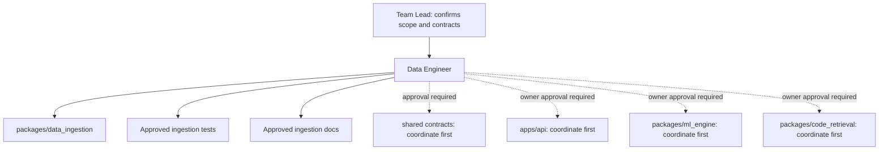

The solid paths represent normal ownership. Dashed paths represent coordination, not permission to modify those areas.

## 2.3 Branch and pull-request workflow

Use the approved integration branch and the role-specific branch:

`feature/data-engineer/github-issue-ingestion`

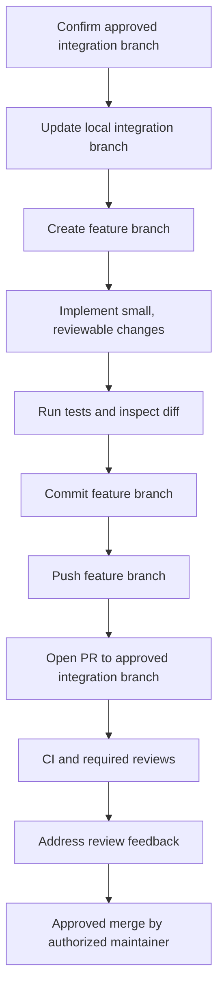

Check whether the branch already exists before creating it:

```bash
git branch --list "feature/data-engineer/github-issue-ingestion"
git branch -r --list "origin/feature/data-engineer/github-issue-ingestion"
```

If it exists, inspect its status and history before switching. If it does not exist and the integration branch is confirmed:

```bash
git switch develop
git pull --ff-only origin develop
git switch -c feature/data-engineer/github-issue-ingestion
```

Replace `develop` only with the branch the Team Lead has approved.

Throughout the work, run these commands from the repository root:

```bash
git status
git diff --check
git diff
```

Do not force-push, overwrite another developer's changes, or merge directly into a protected branch without authorization.

---

# 3. Prerequisites and tools

## 3.1 Inspect versions before installing anything

**Shell:** PowerShell or Bash  
**Working directory:** repository root  
**Purpose:** environment discovery

```bash
python --version
git --version
```

Inspect root files and directories before deciding how to install dependencies. Look for `pyproject.toml`, `requirements.txt`, lockfiles, `uv.lock`, `poetry.lock`, `Pipfile`, Conda environment files, and existing virtual-environment instructions.

### Environment-manager decision

- If the repository uses **uv**, follow its documented workflow and lockfile.
- If it uses **Poetry**, follow `pyproject.toml` and the Poetry lockfile.
- If it uses **Conda**, follow the existing environment file.
- If it uses another manager, use that manager.
- Use `venv` only when no repository-standard environment manager already exists.
- Do not update root dependency manifests without approval.

Example only, when the repository has no environment manager and the team approves `venv`:

**PowerShell, repository root:**

```powershell
python -m venv .venv
.\.venv\Scripts\Activate.ps1
python -m pip --version
```

If PowerShell blocks activation, do not change machine-wide execution policy automatically. Ask whether the team permits using the environment's interpreter directly:

```powershell
.\.venv\Scripts\python.exe --version
```

**Linux/macOS/Git Bash, repository root:**

```bash
python3 -m venv .venv
source .venv/bin/activate
python --version
```

Do not commit `.venv/`. Confirm the repository's `.gitignore` already excludes it or ask for approval to update the ignore file.

## 3.2 Dependency policy

The example implementation later in this manual uses `requests` and `pytest` to make the example concrete. These are **not claims about current ORDO dependencies**. Before adopting the example:

1. Inspect the existing HTTP client and test framework.
2. Reuse existing dependencies wherever possible.
3. If `requests` is absent and another client is already standard, adapt the example to that client instead of adding a duplicate.
4. If a new dependency is necessary, explain why and get approval for the correct dependency manifest.
5. Never install a package globally merely to work around a project configuration problem.

---

# 4. Repository reconnaissance and baseline

Complete this phase before writing implementation code.

## 4.1 Inspect the repository

**Shell:** PowerShell  
**Working directory:** repository root  
**Purpose:** reconnaissance

```powershell
git status
git log -5 --oneline
git ls-files
Get-ChildItem -Force
Get-ChildItem packages -Force
Get-ChildItem tests -Force -ErrorAction SilentlyContinue
```

**Shell:** Git Bash/Linux/macOS  
**Working directory:** repository root

```bash
git status
git log -5 --oneline
git ls-files
find packages -maxdepth 3 -type f
find tests -maxdepth 4 -type f 2>/dev/null
```

These listing commands are diagnostic. If a directory does not exist, do not create it automatically just to make the command succeed.

## 4.2 Inspect these files and interfaces

Locate and read the relevant files before changing anything:

- Existing `packages/data_ingestion/` code and README.
- Root project configuration and dependency manifests.
- Lockfiles and Python-version constraints.
- Existing GitHub API client, if any.
- Existing issue models and shared contracts.
- Environment-variable loading and configuration patterns.
- Logging setup and exception conventions.
- Test fixtures, mocking patterns, and test commands.
- Actual downstream function signatures.
- CI workflows and lint/type-check commands.
- `.gitignore` and secret-management guidance.

Use the repository's search tools or editor to find terms such as `github`, `issues`, `repository`, `rate_limit`, `BaseModel`, `Issue`, `pytest`, and `logging`. Do not assume the first search result is the canonical implementation.

## 4.3 Record baseline results

Run the existing test suite using the project's documented command. If it uses pytest, an example is:

```bash
python -m pytest -v
```

Record:

- Command and working directory.
- Test runner and version.
- Passed, failed, and skipped tests.
- Import/dependency/environment failures.
- Existing failures that predate this work.
- Linting and type-checking results, if configured.

Do not claim a test passes unless it was executed. Do not attribute a baseline failure to your changes.

**Deliverable:** add a short baseline note to the approved engineering task or ingestion README. Do not create a new project-wide reporting convention without approval.

### Baseline record template

```text
Date:
Branch:
Python version:
Dependency manager:
Test command:
Passed / failed / skipped:
Existing failures:
Lint/type-check commands:
Environment limitations:
Owner questions:
```

**Definition of Done:** repository conventions, baseline, ownership boundaries, and open questions are documented.

---

# 5. Architecture and data flow

## 5.1 Conceptual data flow

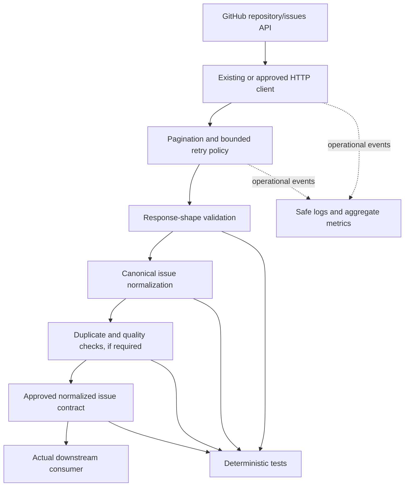

This diagram is a starting point, not confirmation of ORDO's actual wiring. Map each box to real modules and functions during reconnaissance.

Keep these formats distinct:

1. **External response:** fields and types returned by GitHub.
2. **Normalized internal contract:** stable field names and types agreed by ORDO.
3. **Storage format:** only if the actual architecture has persistence.
4. **Consumer input:** the contract required by the real API, ML, or retrieval component.

Do not introduce a database simply because a pipeline exists.

## 5.2 Ingestion sequence

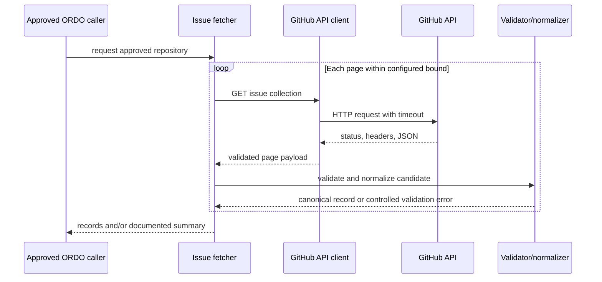

Before implementation, decide with the Team Lead whether invalid records fail the entire ingestion or are rejected individually and counted. Do not silently choose a policy that changes product behavior.

---

# 6. Proposed package structure

The real repository structure takes precedence. If the package is small and the repository has no existing pattern, the following is a possible modular design:

```text
packages/
└── data_ingestion/
    ├── __init__.py
    ├── config.py
    ├── exceptions.py
    ├── models.py
    ├── client.py
    ├── validators.py
    ├── normalizer.py
    ├── issue_fetcher.py
    └── README.md

tests/
└── data_ingestion/
    ├── test_config.py
    ├── test_client.py
    ├── test_validators.py
    ├── test_normalizer.py
    ├── test_issue_fetcher.py
    └── test_pipeline.py
```

This is a proposal, not a requirement. Tests may belong inside the package or another established test directory. Do not create duplicate modules if equivalent functionality already exists.

## 6.1 Package import considerations

Check whether the repository uses a `src/` layout, editable installation, namespace packages, or a different package name. The imports in the example code assume `packages` is importable from the repository root and that `packages/data_ingestion/__init__.py` exists. If that is not true, use the project's package conventions rather than adding ad hoc `sys.path` manipulation to production code.

---

# 7. Define the data contract before coding

## 7.1 Inspect the canonical contract

Search for the existing issue model and inspect its producers and consumers. If a canonical model already exists, reuse it. Do not introduce a competing `Issue`, `GitHubIssue`, or `NormalizedIssue` model without agreement.

The candidate fields below are illustrative. Their required/optional status must be confirmed with the Team Lead and actual consumers.

| Candidate field | Example type | Contract question |
|---|---|---|
| `id` | integer | Is GitHub's stable issue ID the canonical identity? |
| `number` | integer | Is the repository-local issue number needed? |
| `repository` | string | Is `owner/name` the standard representation? |
| `title` | string | Must empty titles be rejected? |
| `body` | string or null | Should missing body remain null or become an empty string? |
| `state` | string | Which states are supported? |
| `author` | string or null | Is author information needed and appropriate? |
| `labels` | list of strings | Are label names sufficient, or are IDs/colors needed? |
| `created_at` | timestamp string | UTC ISO-8601 or another representation? |
| `updated_at` | timestamp string | How is an absent value handled? |
| `closed_at` | timestamp string or null | Is null the canonical representation for open issues? |
| `html_url` | string | Must this be validated as an HTTPS GitHub URL? |
| `is_pull_request` | boolean | Should pull requests be excluded from issue results? |

Do not silently discard fields needed by a downstream consumer. Do not invent unknown field values.

## 7.2 Synthetic example

Illustrative external input:

```json
{
  "id": 123456,
  "number": 42,
  "title": "Login fails after token refresh",
  "body": null,
  "state": "open",
  "user": {"login": "example-user"},
  "labels": [{"name": "bug"}, {"name": "auth"}],
  "created_at": "2026-01-02T03:04:05Z",
  "updated_at": "2026-01-03T04:05:06Z",
  "closed_at": null,
  "html_url": "https://github.com/example/project/issues/42"
}
```

Illustrative normalized output:

```json
{
  "id": 123456,
  "number": 42,
  "repository": "example/project",
  "title": "Login fails after token refresh",
  "body": null,
  "state": "open",
  "author": "example-user",
  "labels": ["bug", "auth"],
  "created_at": "2026-01-02T03:04:05Z",
  "updated_at": "2026-01-03T04:05:06Z",
  "closed_at": null,
  "html_url": "https://github.com/example/project/issues/42",
  "is_pull_request": false
}
```

These values are synthetic and do not describe real ORDO records. The example preserves a null body rather than pretending the issue has content. Confirm whether the actual consumer expects `null`, `""`, or another representation.

---

# 8. Phase 1 — Configuration and GitHub API client

## Objective

Create or adapt a reusable client that uses approved configuration, explicit timeouts, safe authentication, testable transport behavior, and controlled errors.

## 8.1 Choose the implementation only after inspection

The example below uses Python's standard library plus `requests` for the HTTP transport, and pytest for tests. It is suitable only if it fits the repository. If ORDO already uses `httpx`, PyGithub, a shared API client, or another transport, adapt the behavior to that implementation instead of introducing a second HTTP stack.

The implementation deliberately does not load `.env` files itself. It reads process environment variables so the repository's existing configuration loader remains authoritative. Add `.env.example` only if the repository already uses that convention or the Team Lead approves it.

### File: `packages/data_ingestion/exceptions.py`

**Action:** Create only if an equivalent exception module does not already exist.  
**Purpose:** Provide safe, predictable error types without embedding credentials or response bodies.

```python
class IngestionError(Exception):
    """Base class for controlled data-ingestion failures."""


class ConfigurationError(IngestionError):
    """Raised when required ingestion configuration is invalid."""


class GitHubAPIError(IngestionError):
    """Raised when a GitHub API request cannot be completed safely."""

    def __init__(
        self,
        message: str,
        *,
        status_code: int | None = None,
        retryable: bool = False,
    ) -> None:
        super().__init__(message)
        self.status_code = status_code
        self.retryable = retryable


class ResponseValidationError(IngestionError):
    """Raised when an API response violates the expected response shape."""


class RecordValidationError(IngestionError):
    """Raised when a single issue record violates the agreed contract."""
```

### File: `packages/data_ingestion/config.py`

**Action:** Create or adapt after inspecting current configuration conventions.  
**Purpose:** Validate repository identity, API base URL, token, timeout, and bounded retrieval settings.

```python
from __future__ import annotations

import os
import re
from dataclasses import dataclass
from urllib.parse import urlparse

from .exceptions import ConfigurationError

_REPOSITORY_PATTERN = re.compile(r"^[A-Za-z0-9_.-]+/[A-Za-z0-9_.-]+$")


@dataclass(frozen=True)
class IngestionConfig:
    repository: str
    api_base_url: str = "https://api.github.com"
    token: str | None = None
    timeout_seconds: float = 15.0
    max_pages: int = 10
    per_page: int = 100
    max_attempts: int = 3
    backoff_base_seconds: float = 0.5
    backoff_cap_seconds: float = 8.0

    def __post_init__(self) -> None:
        repository = self.repository.strip()
        if not _REPOSITORY_PATTERN.fullmatch(repository):
            raise ConfigurationError(
                "repository must use the approved 'owner/name' format"
            )
        object.__setattr__(self, "repository", repository)

        parsed = urlparse(self.api_base_url)
        if parsed.scheme != "https" or not parsed.netloc:
            raise ConfigurationError("api_base_url must be a valid HTTPS URL")
        if parsed.username or parsed.password:
            raise ConfigurationError("api_base_url must not contain credentials")
        if parsed.query or parsed.fragment:
            raise ConfigurationError(
                "api_base_url must not contain a query or fragment"
            )
        object.__setattr__(self, "api_base_url", self.api_base_url.rstrip("/"))

        if self.timeout_seconds <= 0:
            raise ConfigurationError("timeout_seconds must be greater than zero")
        if self.max_pages < 1:
            raise ConfigurationError("max_pages must be at least 1")
        if not 1 <= self.per_page <= 100:
            raise ConfigurationError("per_page must be between 1 and 100")
        if self.max_attempts < 1:
            raise ConfigurationError("max_attempts must be at least 1")
        if self.backoff_base_seconds < 0 or self.backoff_cap_seconds < 0:
            raise ConfigurationError("backoff values cannot be negative")

    @classmethod
    def from_env(cls) -> "IngestionConfig":
        repository = os.getenv("ORDO_GITHUB_REPOSITORY", "").strip()
        if not repository:
            raise ConfigurationError(
                "ORDO_GITHUB_REPOSITORY is required; set it using the "
                "approved configuration mechanism"
            )

        def read_float(name: str, default: float) -> float:
            raw = os.getenv(name)
            if raw is None:
                return default
            try:
                return float(raw)
            except ValueError as exc:
                raise ConfigurationError(f"{name} must be numeric") from exc

        def read_int(name: str, default: int) -> int:
            raw = os.getenv(name)
            if raw is None:
                return default
            try:
                return int(raw)
            except ValueError as exc:
                raise ConfigurationError(f"{name} must be an integer") from exc

        return cls(
            repository=repository,
            api_base_url=os.getenv(
                "ORDO_GITHUB_API_BASE_URL", "https://api.github.com"
            ),
            token=os.getenv("GITHUB_TOKEN") or None,
            timeout_seconds=read_float("ORDO_GITHUB_TIMEOUT_SECONDS", 15.0),
            max_pages=read_int("ORDO_GITHUB_MAX_PAGES", 10),
            per_page=read_int("ORDO_GITHUB_PER_PAGE", 100),
            max_attempts=read_int("ORDO_GITHUB_MAX_ATTEMPTS", 3),
            backoff_base_seconds=read_float(
                "ORDO_GITHUB_BACKOFF_BASE_SECONDS", 0.5
            ),
            backoff_cap_seconds=read_float(
                "ORDO_GITHUB_BACKOFF_CAP_SECONDS", 8.0
            ),
        )
```

The configuration names above are **proposed example names**, not existing ORDO settings. Obtain approval before making them part of the project's supported interface. A token is optional in this example, but private repositories and some API operations require authentication. Never fall back to a developer's or production's secret during tests.

### File: `packages/data_ingestion/client.py`

**Action:** Create or adapt to the existing HTTP client.  
**Purpose:** Centralize HTTP requests, timeouts, bounded retries, response parsing, and safe error messages.

```python
from __future__ import annotations

import random
import time
from collections.abc import Callable, Mapping
from typing import Any
from urllib.parse import urlparse

import requests

from .config import IngestionConfig
from .exceptions import GitHubAPIError, ResponseValidationError

_SLEEP = Callable[[float], None]
_RANDOM = Callable[[], float]


class GitHubClient:
    def __init__(
        self,
        config: IngestionConfig,
        *,
        session: requests.Session | None = None,
        sleep: _SLEEP = time.sleep,
        random_value: _RANDOM = random.random,
    ) -> None:
        self.config = config
        self.session = session or requests.Session()
        self._sleep = sleep
        self._random_value = random_value
        self.request_count = 0
        self.retry_count = 0

        self.session.headers.update(
            {
                "Accept": "application/vnd.github+json",
                "X-GitHub-Api-Version": "2022-11-28",
                "User-Agent": "ORDO-data-ingestion",
            }
        )
        if config.token:
            self.session.headers["Authorization"] = f"Bearer {config.token}"

    def _backoff(self, attempt: int, headers: Mapping[str, str]) -> float:
        retry_after = headers.get("Retry-After")
        if retry_after:
            try:
                return min(max(float(retry_after), 0.0), self.config.backoff_cap_seconds)
            except ValueError:
                pass

        # GitHub may signal primary rate limiting with these headers.
        remaining = headers.get("X-RateLimit-Remaining")
        reset = headers.get("X-RateLimit-Reset")
        if remaining == "0" and reset:
            try:
                seconds_until_reset = max(float(reset) - time.time(), 0.0)
                return min(seconds_until_reset, self.config.backoff_cap_seconds)
            except ValueError:
                pass

        exponential = self.config.backoff_base_seconds * (2 ** attempt)
        jitter = self._random_value() * min(exponential * 0.25, 1.0)
        return min(exponential + jitter, self.config.backoff_cap_seconds)

    @staticmethod
    def _is_rate_limited(status: int, headers: Mapping[str, str]) -> bool:
        return (
            status == 429
            or (
                status == 403
                and (
                    headers.get("X-RateLimit-Remaining") == "0"
                    or "rate limit" in headers.get("X-RateLimit-Resource", "").lower()
                )
            )
        )

    def get_json(self, url: str, *, params: dict[str, Any] | None = None) -> tuple[Any, Mapping[str, str]]:
        parsed = urlparse(url)
        base = urlparse(self.config.api_base_url)
        if parsed.scheme != "https" or parsed.netloc != base.netloc:
            raise GitHubAPIError("Refusing request to an unapproved API host")

        last_error: Exception | None = None
        for attempt in range(self.config.max_attempts):
            self.request_count += 1
            try:
                response = self.session.get(
                    url,
                    params=params,
                    timeout=self.config.timeout_seconds,
                )
            except (requests.Timeout, requests.ConnectionError) as exc:
                last_error = exc
                if attempt + 1 >= self.config.max_attempts:
                    raise GitHubAPIError(
                        "GitHub request failed after bounded retries",
                        retryable=True,
                    ) from None
                self.retry_count += 1
                delay = self._backoff(attempt, {})
                self._sleep(delay)
                continue

            status = response.status_code
            headers = response.headers
            transient = status >= 500 or status in (408, 429) or self._is_rate_limited(status, headers)
            if status >= 400:
                if transient and attempt + 1 < self.config.max_attempts:
                    self.retry_count += 1
                    self._sleep(self._backoff(attempt, headers))
                    continue

                # Do not include response body, URL query, or headers: these can
                # contain issue content or other data that should not enter logs.
                raise GitHubAPIError(
                    f"GitHub API request failed with HTTP {status}",
                    status_code=status,
                    retryable=transient,
                )

            try:
                payload = response.json()
            except (ValueError, requests.exceptions.JSONDecodeError):
                raise ResponseValidationError(
                    "GitHub API returned invalid JSON"
                ) from None

            return payload, headers

        # Defensive fallback; the loop should either return or raise.
        raise GitHubAPIError("GitHub request exhausted its retry budget", retryable=True) from last_error
```

**Review notes before adoption:**

- Confirm the team's timeout and retry budget.
- The example caps server-directed waits; a capped wait may cause the client to stop before a rate-limit window resets. For a long wait, fail with a clear retryable error rather than sleeping beyond the agreed request budget.
- The sample restricts requests to the configured API host to avoid sending credentials to an arbitrary host.
- Do not log full URLs if they may contain query values, request headers, response bodies, or tokens.
- `requests` versions differ in their JSON exception classes. If the repository's version does not expose `requests.exceptions.JSONDecodeError`, catch `ValueError` only.
- The client does not own persistence or database behavior.

### File: `packages/data_ingestion/__init__.py`

**Action:** Create only if needed by the existing package layout.

```python
"""GitHub issue ingestion components for ORDO."""

from .config import IngestionConfig
from .exceptions import (
    ConfigurationError,
    GitHubAPIError,
    IngestionError,
    RecordValidationError,
    ResponseValidationError,
)

__all__ = [
    "IngestionConfig",
    "ConfigurationError",
    "GitHubAPIError",
    "IngestionError",
    "RecordValidationError",
    "ResponseValidationError",
]
```

## 8.2 Configuration setup

Use the project's existing secret/configuration system. For local PowerShell testing only, set a non-secret public repository value:

```powershell
$env:ORDO_GITHUB_REPOSITORY = "octocat/Hello-World"
```

If authentication is required, set `GITHUB_TOKEN` using the approved secret manager or local environment mechanism. Never paste a token into source code, screenshots, logs, or a committed `.env` file. The public repository value is an example, not an ORDO target.

## 8.3 Client verification

Use the existing test runner and dependency manager. Unit tests must use a mocked session; they must not need a live token.

Example import check, from repository root after the package is importable:

```bash
python -c "from packages.data_ingestion.client import GitHubClient; print('client import OK')"
```

Expected output: `client import OK`. If the import fails because `packages` is not the package root in this repository, follow the actual packaging conventions rather than changing production imports blindly.

**Definition of Done:** configuration rejects invalid values; credentials are never hardcoded; requests have explicit timeouts; HTTP and JSON failures become controlled exceptions; transport can be mocked.

---

# 9. Phase 2 — Issue retrieval and pagination

## Objective

Fetch issues for the approved repository, handle multiple pages, stop predictably, and avoid an unlimited collection request.

GitHub's issue-list endpoint can return both issues and pull requests. Each returned object may include a `pull_request` field. Confirm whether ORDO wants both. Do not silently filter pull requests unless the contract says to do so.

GitHub pagination is commonly communicated through a `Link` response header. Follow the actual client library's documented pagination mechanism when available. Do not construct a next-page URL from untrusted response content without validating its host.

### File: `packages/data_ingestion/issue_fetcher.py`

**Action:** Create or adapt after confirming the client and contract.  
**Purpose:** Fetch pages and pass each candidate record through validation and normalization.

```python
from __future__ import annotations

from collections.abc import Iterator, Mapping
from typing import Any
from urllib.parse import parse_qs, urlparse

from .client import GitHubClient
from .config import IngestionConfig
from .exceptions import ResponseValidationError
from .normalizer import normalize_issue
from .validators import validate_issue_payload


def _next_link(link_header: str | None, *, api_base_url: str) -> str | None:
    """Return the rel=next URL only when it points at the configured API host."""
    if not link_header:
        return None

    base = urlparse(api_base_url)
    for item in link_header.split(","):
        parts = item.strip().split(";")
        if not parts:
            continue
        target = parts[0].strip()
        relation = next(
            (
                part.strip()[5:-1]
                for part in parts[1:]
                if part.strip().startswith('rel="') and part.strip().endswith('"')
            ),
            None,
        )
        if relation != "next" or not target.startswith("<") or not target.endswith(">"):
            continue

        candidate = target[1:-1]
        parsed = urlparse(candidate)
        if parsed.scheme != "https" or parsed.netloc != base.netloc:
            raise ResponseValidationError("Pagination link points to an unapproved host")
        return candidate
    return None


def iter_issue_payloads(
    client: GitHubClient,
    config: IngestionConfig,
) -> Iterator[Mapping[str, Any]]:
    """Yield raw issue objects from a bounded number of pages."""
    url = f"{config.api_base_url}/repos/{config.repository}/issues"
    params: dict[str, Any] | None = {
        "state": "all",
        "per_page": config.per_page,
        "page": 1,
    }
    visited: set[str] = set()

    for _page_number in range(1, config.max_pages + 1):
        payload, headers = client.get_json(url, params=params)
        if not isinstance(payload, list):
            raise ResponseValidationError("Issue collection response must be a JSON array")

        for item in payload:
            if not isinstance(item, dict):
                raise ResponseValidationError("Issue collection contains a non-object item")
            yield item

        next_url = _next_link(headers.get("Link"), api_base_url=config.api_base_url)
        if not next_url:
            return
        if next_url in visited or next_url == url:
            raise ResponseValidationError("Repeated pagination link detected")
        visited.add(next_url)
        url = next_url
        params = None  # Link URL already contains its page/query parameters.

    # Reaching max_pages is a deliberate bound, not proof that all issues were read.
    # The caller/summary must make the truncation visible to the operator.


def fetch_issues(
    client: GitHubClient,
    config: IngestionConfig,
    *,
    include_pull_requests: bool = False,
) -> list[dict[str, Any]]:
    """Fetch, validate, normalize, and deduplicate issues in stable order."""
    records: list[dict[str, Any]] = []
    seen: dict[tuple[str, int], dict[str, Any]] = {}

    for payload in iter_issue_payloads(client, config):
        is_pull_request = "pull_request" in payload
        if is_pull_request and not include_pull_requests:
            continue

        validate_issue_payload(payload)
        record = normalize_issue(payload, repository=config.repository)
        key = (record["repository"].casefold(), record["id"])

        if key not in seen:
            seen[key] = record
            records.append(record)
        else:
            # GitHub's later page copy may contain newer fields. Keep the record
            # with the later updated_at timestamp; document this policy with the
            # Team Lead before relying on it for production synchronization.
            if (record.get("updated_at") or "") > (seen[key].get("updated_at") or ""):
                previous = seen[key]
                index = records.index(previous)
                records[index] = record
                seen[key] = record

    return records
```

**Important implementation review:** a page limit prevents unbounded retrieval, but the sample's return type does not itself report whether the limit truncated the collection. Before production use, either (a) extend the return contract to include `truncated` and counters, or (b) fail clearly when another page exists after the configured maximum. Do not let downstream consumers mistake a bounded partial dataset for a complete one. The actual GitHub client may already have a safer pagination abstraction; prefer it if it fits the contract.

The sample assumes `Link` is present when there is a next page. If the existing client exposes pagination differently, adapt this function accordingly. Keep tests for repeated links and invalid hosts.

## 9.1 Pagination diagram

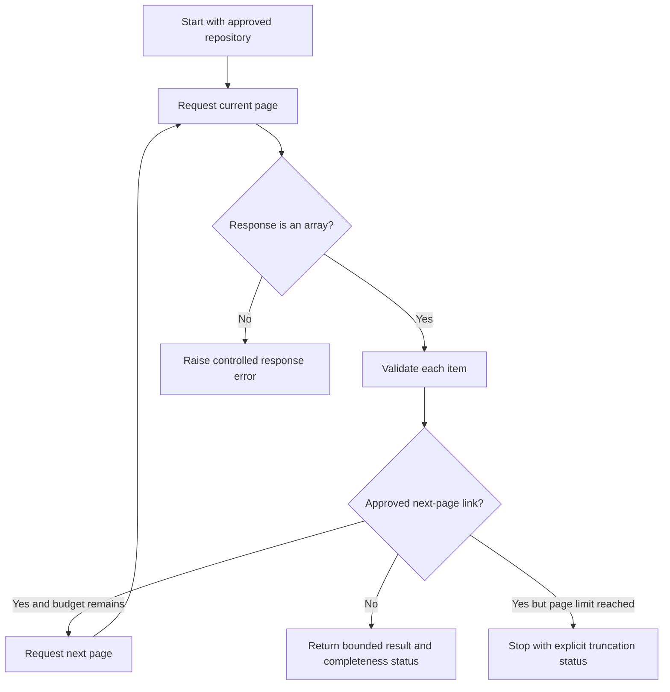

## 9.2 Expected behavior

- One page: returns its valid records.
- Several pages: follows the next links without duplicating request parameters.
- Empty array with no next link: returns an empty result.
- Unexpected response shape: raises `ResponseValidationError`.
- Repeated next link: fails safely instead of looping.
- Page limit reached: completeness/truncation is explicit.
- Pull requests: inclusion/exclusion follows an explicit option and contract.

## 9.3 Tests required for this phase

Use mocked responses to cover one page, multiple pages, empty results, invalid JSON, HTTP failures, repeated links, malformed links, unexpected payloads, and pull-request filtering. Do not use a live repository as a unit-test dependency.

**Definition of Done:** pagination is bounded, safe, deterministic under fixtures, and does not falsely report a partial fetch as complete.

---

# 10. Phase 3 — Validation and normalization

## Objective

Convert external GitHub payloads into the agreed internal contract without losing required data or allowing malformed records to contaminate consumers.

## 10.1 Validation policy

Agree on the behavior for an invalid record before implementation:

- **Fail-fast:** stop the run when any record is invalid.
- **Reject-and-count:** skip invalid records, collect safe error details, and report counts.
- **Quarantine:** store invalid records separately only if the architecture explicitly supports that behavior.

Do not log full issue bodies or raw payloads when reporting a validation failure.

### File: `packages/data_ingestion/validators.py`

**Action:** Create only if no equivalent validator exists.  
**Purpose:** Validate the minimum candidate GitHub issue shape without requiring optional fields.

```python
from __future__ import annotations

from datetime import datetime
from typing import Any, Mapping
from urllib.parse import urlparse

from .exceptions import RecordValidationError


def _is_int_not_bool(value: Any) -> bool:
    return isinstance(value, int) and not isinstance(value, bool)


def _valid_timestamp(value: Any, *, field: str, optional: bool = False) -> bool:
    if value is None:
        return optional
    if not isinstance(value, str) or not value.strip():
        return False
    try:
        datetime.fromisoformat(value.replace("Z", "+00:00"))
        return True
    except ValueError:
        return False


def validate_issue_payload(payload: Mapping[str, Any]) -> None:
    """Raise a safe error if required fields have invalid shapes or types."""
    if not isinstance(payload, Mapping):
        raise RecordValidationError("Issue record must be an object")

    if not _is_int_not_bool(payload.get("id")) or payload["id"] <= 0:
        raise RecordValidationError("Issue record has an invalid id")
    if not _is_int_not_bool(payload.get("number")) or payload["number"] <= 0:
        raise RecordValidationError("Issue record has an invalid number")

    title = payload.get("title")
    if not isinstance(title, str) or not title.strip():
        raise RecordValidationError("Issue record has an empty or invalid title")

    state = payload.get("state")
    if not isinstance(state, str) or state.lower() not in {"open", "closed"}:
        raise RecordValidationError("Issue record has an unsupported state")

    url = payload.get("html_url")
    if not isinstance(url, str):
        raise RecordValidationError("Issue record has an invalid html_url")
    parsed = urlparse(url)
    if parsed.scheme != "https" or parsed.hostname != "github.com":
        raise RecordValidationError("Issue record html_url must use github.com HTTPS")

    if not _valid_timestamp(payload.get("created_at"), field="created_at"):
        raise RecordValidationError("Issue record has an invalid created_at")
    if not _valid_timestamp(payload.get("updated_at"), field="updated_at"):
        raise RecordValidationError("Issue record has an invalid updated_at")
    if not _valid_timestamp(payload.get("closed_at"), field="closed_at", optional=True):
        raise RecordValidationError("Issue record has an invalid closed_at")

    body = payload.get("body")
    if body is not None and not isinstance(body, str):
        raise RecordValidationError("Issue record body must be a string or null")

    labels = payload.get("labels", [])
    if labels is not None and not isinstance(labels, list):
        raise RecordValidationError("Issue record labels must be a list or null")
    for label in labels or []:
        if not isinstance(label, dict) or not isinstance(label.get("name"), str):
            raise RecordValidationError("Issue record contains a malformed label")

    user = payload.get("user")
    if user is not None:
        if not isinstance(user, dict):
            raise RecordValidationError("Issue record user must be an object or null")
        login = user.get("login")
        if login is not None and not isinstance(login, str):
            raise RecordValidationError("Issue record author login must be a string")
```

The `field` argument in `_valid_timestamp` is kept for readability but is not used to build an error message; avoid including raw values in errors. Adapt validation to the actual contract. In particular, verify whether GitHub Enterprise URLs are supported before requiring the public `github.com` host.

### File: `packages/data_ingestion/normalizer.py`

**Action:** Create only if no canonical normalizer exists.  
**Purpose:** Map supported fields to a stable internal representation.

```python
from __future__ import annotations

from typing import Any, Mapping

from .exceptions import RecordValidationError
from .validators import validate_issue_payload


def normalize_issue(
    payload: Mapping[str, Any],
    *,
    repository: str,
) -> dict[str, Any]:
    """Return a normalized record; callers must validate before consuming it."""
    validate_issue_payload(payload)

    user = payload.get("user")
    author = user.get("login") if isinstance(user, dict) else None

    labels = payload.get("labels") or []
    label_names = [label["name"].strip() for label in labels if label["name"].strip()]

    return {
        "id": payload["id"],
        "number": payload["number"],
        "repository": repository.strip(),
        "title": payload["title"].strip(),
        # Preserve null body; do not invent text for an absent description.
        "body": payload.get("body"),
        "state": payload["state"].lower(),
        "author": author,
        "labels": label_names,
        "created_at": payload["created_at"],
        "updated_at": payload["updated_at"],
        "closed_at": payload.get("closed_at"),
        "html_url": payload["html_url"],
        "is_pull_request": "pull_request" in payload,
    }
```

The code preserves timestamp strings from the API after validating them. If the canonical contract requires normalized UTC timestamps, implement that transformation explicitly and test timezone offsets. Do not silently change timestamp semantics.

## 10.2 Validation flow

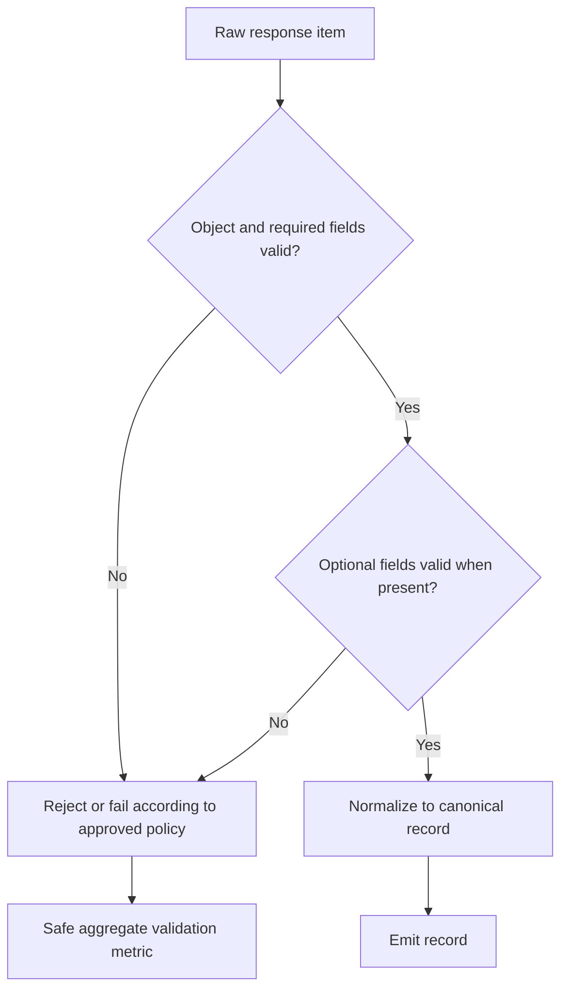

## 10.3 Test matrix

Cover at least:

- Valid issue with labels and author.
- Null body.
- Missing labels.
- Null author.
- Invalid/missing ID and issue number.
- Boolean used where an integer is required.
- Empty title.
- Unsupported state.
- Invalid timestamp.
- Invalid URL.
- Malformed label object.
- Unexpected object types.
- Optional fields absent.
- A malformed record among otherwise valid records.

Verify normalization is deterministic and does not mutate the input dictionary. Confirm one malformed record cannot corrupt unrelated records.

**Definition of Done:** required fields and optional-field policy are explicit; normalization preserves required information; failures are controlled and safe.

---

# 11. Phase 4 — Rate limits, retries, timeouts, and errors

## 11.1 Error categories and handling

| Failure | Typical handling | Retry? |
|---|---|---|
| Connection error / timeout | Retry within a bounded budget; then controlled error | Usually |
| HTTP 401 | Fix authentication/configuration | No |
| HTTP 403 permission failure | Fix repository permissions or scope | Usually no |
| HTTP 403 primary rate limit | Respect rate-limit metadata within budget | Sometimes |
| HTTP 404 | Verify owner/name, resource existence, and permissions | No by default |
| HTTP 429 | Respect `Retry-After` within the configured budget | Usually |
| HTTP 5xx | Bounded backoff and retry | Usually |
| Invalid JSON | Controlled response error | No by default |
| Unexpected response shape | Controlled validation error | No |
| Repeated pagination link | Stop; treat as malformed pagination | No |
| Retry budget exhausted | Return a clear retryable/non-retryable error | No further retries |

A 404 can sometimes conceal a private resource that the caller cannot access. Do not automatically disclose repository existence in logs or user-facing errors.

## 11.2 Retry policy

A retry policy must define:

- Maximum attempts, including the first request.
- Connection and read timeout.
- Exponential backoff and optional jitter.
- Handling of `Retry-After` and GitHub rate-limit headers.
- A maximum wait and total operation budget.
- Which statuses/exceptions are retryable.
- Whether retry state resets for each page.
- What happens when the retry budget is exhausted.

Do not retry authentication failures, invalid input, malformed JSON, or permanent missing-resource responses by default. Do not retry indefinitely. A page request that fails must not silently cause the entire dataset to be presented as complete.

## 11.3 Retry flow

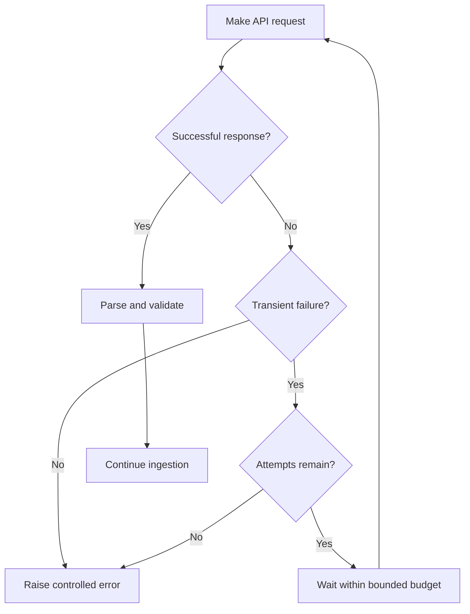

## 11.4 Testing retry behavior

Inject a fake sleep function and deterministic jitter value, as the example client permits. Tests should assert the number of attempts and sleep calls without waiting in real time.

Test:

- One transient error followed by success.
- All attempts fail.
- HTTP 401 is not retried.
- HTTP 404 is not retried by default.
- HTTP 5xx is retried within budget.
- 429 and rate-limit metadata are handled.
- Invalid JSON is not retried by default.
- Timeout is passed to the HTTP session.
- Error messages do not contain tokens or response bodies.

**Definition of Done:** retry behavior is bounded, testable, and does not disguise permanent failures.

---

# 12. Phase 5 — Data quality and duplicate handling

## 12.1 Select the correct deduplication boundary

Inspect whether duplicate handling already exists in the fetcher, persistence layer, or downstream consumer. Do not duplicate deduplication across multiple layers without a clear reason.

Do not deduplicate by title: separate issues can have identical titles.

A candidate stable key is `(repository.casefold(), issue_id)`, but confirm that this matches the canonical contract. The example fetcher keeps the first position and replaces its record when a later copy has a lexically later `updated_at` value. This policy is safe only if timestamps are normalized to a comparable representation. If timestamps may use different offsets, parse them into timezone-aware datetimes before comparing.

## 12.2 Data-quality summary

The production interface should report safe aggregate counts, where useful:

- Pages requested.
- Records retrieved.
- Records validated.
- Records rejected.
- Pull requests excluded.
- Duplicate records skipped or replaced.
- Records emitted.
- Request attempts and retries.
- Whether retrieval was truncated.
- Total elapsed time, if measured.

Do not add metrics fields to a shared return contract without approval. A local dataclass or summary object can be proposed, but its shape must match actual callers.

## 12.3 Duplicate-handling diagram

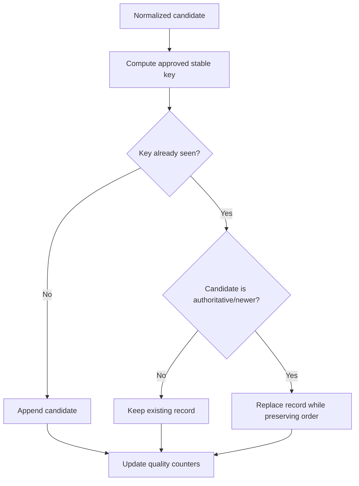

## 12.4 Tests

Test duplicate records on separate pages, conflicting versions, stable output order, empty datasets, duplicate titles with different IDs, malformed records, and count accuracy. Ensure a duplicate with an older update does not replace a newer record.

**Definition of Done:** deduplication uses a stable key, conflict resolution is documented, and aggregate results accurately describe exclusions and truncation.

---

# 13. Phase 6 — Unit and integration tests

## 13.1 Test architecture

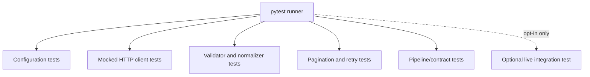

Ordinary unit tests must not need live GitHub credentials or uncontrolled network access. Use synthetic fixtures. Never include a real token in tests or test output.

## 13.2 Example test support

The following tests assume pytest and `requests` are approved and that the proposed module paths are used. Adapt to the actual test framework and import structure.

### File: `tests/data_ingestion/test_config.py`

```python
import pytest

from packages.data_ingestion.config import IngestionConfig
from packages.data_ingestion.exceptions import ConfigurationError


def test_config_accepts_valid_repository():
    config = IngestionConfig(repository="owner/repo")
    assert config.repository == "owner/repo"
    assert config.max_pages >= 1


@pytest.mark.parametrize("repository", ["", "owner", "/repo", "owner/repo/extra", "owner name/repo"])
def test_config_rejects_invalid_repository(repository):
    with pytest.raises(ConfigurationError):
        IngestionConfig(repository=repository)


def test_config_rejects_non_https_api_url():
    with pytest.raises(ConfigurationError):
        IngestionConfig(repository="owner/repo", api_base_url="http://example.com")


def test_config_rejects_invalid_page_size():
    with pytest.raises(ConfigurationError):
        IngestionConfig(repository="owner/repo", per_page=101)
```

### File: `tests/data_ingestion/test_validators.py`

```python
import pytest

from packages.data_ingestion.exceptions import RecordValidationError
from packages.data_ingestion.validators import validate_issue_payload


@pytest.fixture
def valid_payload():
    return {
        "id": 123456,
        "number": 42,
        "title": "Example issue",
        "body": None,
        "state": "open",
        "user": {"login": "example-user"},
        "labels": [{"name": "bug"}],
        "created_at": "2026-01-02T03:04:05Z",
        "updated_at": "2026-01-03T04:05:06Z",
        "closed_at": None,
        "html_url": "https://github.com/example/project/issues/42",
    }


def test_valid_payload_is_accepted(valid_payload):
    validate_issue_payload(valid_payload)


@pytest.mark.parametrize(
    ("field", "value"),
    [
        ("id", True),
        ("number", 0),
        ("title", ""),
        ("state", "unknown"),
        ("created_at", "not-a-date"),
        ("html_url", "http://github.com/example/project/issues/42"),
        ("labels", "bug"),
    ],
)
def test_invalid_payload_field_is_rejected(valid_payload, field, value):
    valid_payload[field] = value
    with pytest.raises(RecordValidationError):
        validate_issue_payload(valid_payload)


def test_null_body_is_allowed(valid_payload):
    valid_payload["body"] = None
    validate_issue_payload(valid_payload)


def test_missing_optional_user_is_allowed(valid_payload):
    valid_payload["user"] = None
    validate_issue_payload(valid_payload)
```

### File: `tests/data_ingestion/test_normalizer.py`

```python
from copy import deepcopy

import pytest

from packages.data_ingestion.exceptions import RecordValidationError
from packages.data_ingestion.normalizer import normalize_issue


@pytest.fixture
def payload():
    return {
        "id": 123456,
        "number": 42,
        "title": "  Example issue  ",
        "body": None,
        "state": "OPEN",
        "user": {"login": "example-user"},
        "labels": [{"name": "bug"}, {"name": " auth "}],
        "created_at": "2026-01-02T03:04:05Z",
        "updated_at": "2026-01-03T04:05:06Z",
        "closed_at": None,
        "html_url": "https://github.com/example/project/issues/42",
    }


def test_normalize_issue_maps_fields_and_trims_text(payload):
    result = normalize_issue(payload, repository="example/project")
    assert result["title"] == "Example issue"
    assert result["state"] == "open"
    assert result["labels"] == ["bug", "auth"]
    assert result["body"] is None
    assert result["repository"] == "example/project"
    assert result["is_pull_request"] is False


def test_normalize_issue_does_not_mutate_input(payload):
    original = deepcopy(payload)
    normalize_issue(payload, repository="example/project")
    assert payload == original


def test_normalize_issue_rejects_invalid_payload(payload):
    payload["id"] = None
    with pytest.raises(RecordValidationError):
        normalize_issue(payload, repository="example/project")
```

### File: `tests/data_ingestion/test_client.py`

```python
import requests
import pytest

from packages.data_ingestion.client import GitHubClient
from packages.data_ingestion.config import IngestionConfig
from packages.data_ingestion.exceptions import GitHubAPIError, ResponseValidationError


class FakeResponse:
    def __init__(self, status_code=200, payload=None, headers=None, json_error=False):
        self.status_code = status_code
        self._payload = payload
        self.headers = headers or {}
        self._json_error = json_error

    def json(self):
        if self._json_error:
            raise ValueError("bad JSON")
        return self._payload


class FakeSession:
    def __init__(self, outcomes):
        self.outcomes = list(outcomes)
        self.headers = {}
        self.calls = []

    def get(self, url, *, params=None, timeout=None):
        self.calls.append((url, params, timeout))
        outcome = self.outcomes.pop(0)
        if isinstance(outcome, Exception):
            raise outcome
        return outcome


def make_client(outcomes, sleeps=None, max_attempts=3):
    config = IngestionConfig(
        repository="owner/repo",
        max_attempts=max_attempts,
        backoff_base_seconds=0,
        backoff_cap_seconds=0,
    )
    session = FakeSession(outcomes)
    client = GitHubClient(
        config,
        session=session,
        sleep=(sleeps if sleeps is not None else lambda _: None),
        random_value=lambda: 0.0,
    )
    return client, session


def test_client_returns_json_and_headers():
    client, session = make_client([FakeResponse(payload=[{"id": 1}])])
    payload, headers = client.get_json("https://api.github.com/repos/owner/repo/issues")
    assert payload == [{"id": 1}]
    assert headers == {}
    assert session.calls[0][2] == client.config.timeout_seconds


def test_client_retries_server_error_then_succeeds():
    client, session = make_client([
        FakeResponse(status_code=503),
        FakeResponse(payload=[]),
    ])
    payload, _ = client.get_json("https://api.github.com/repos/owner/repo/issues")
    assert payload == []
    assert len(session.calls) == 2
    assert client.retry_count == 1


def test_client_does_not_retry_unauthorized():
    client, session = make_client([FakeResponse(status_code=401)])
    with pytest.raises(GitHubAPIError) as error:
        client.get_json("https://api.github.com/repos/owner/repo/issues")
    assert error.value.status_code == 401
    assert len(session.calls) == 1


def test_client_rejects_unapproved_host():
    client, session = make_client([FakeResponse(payload=[])])
    with pytest.raises(GitHubAPIError):
        client.get_json("https://example.com/repos/owner/repo/issues")
    assert session.calls == []


def test_client_rejects_invalid_json():
    client, _ = make_client([FakeResponse(json_error=True)])
    with pytest.raises(ResponseValidationError):
        client.get_json("https://api.github.com/repos/owner/repo/issues")
```

### File: `tests/data_ingestion/test_issue_fetcher.py`

```python
from packages.data_ingestion.config import IngestionConfig
from packages.data_ingestion.issue_fetcher import _next_link, fetch_issues
from packages.data_ingestion.exceptions import ResponseValidationError
import pytest


class FakeClient:
    def __init__(self, responses):
        self.responses = list(responses)

    def get_json(self, url, *, params=None):
        return self.responses.pop(0)


def issue(issue_id=1, number=1, title="Example", updated="2026-01-03T04:05:06Z"):
    return {
        "id": issue_id,
        "number": number,
        "title": title,
        "body": None,
        "state": "open",
        "user": {"login": "example-user"},
        "labels": [],
        "created_at": "2026-01-02T03:04:05Z",
        "updated_at": updated,
        "closed_at": None,
        "html_url": f"https://github.com/owner/repo/issues/{number}",
    }


def test_fetches_one_page():
    config = IngestionConfig(repository="owner/repo")
    client = FakeClient([([issue()], {})])
    records = fetch_issues(client, config)
    assert len(records) == 1
    assert records[0]["id"] == 1


def test_fetches_multiple_pages_using_next_link():
    config = IngestionConfig(repository="owner/repo")
    next_url = "https://api.github.com/repos/owner/repo/issues?per_page=100&page=2"
    link = f'<{next_url}>; rel="next"'
    client = FakeClient([([issue()], {"Link": link}), ([issue(2, 2)], {})])
    records = fetch_issues(client, config)
    assert [record["id"] for record in records] == [1, 2]


def test_next_link_rejects_external_host():
    with pytest.raises(ResponseValidationError):
        _next_link(
            '<https://example.com/issues?page=2>; rel="next"',
            api_base_url="https://api.github.com",
        )


def test_empty_page_returns_empty_list():
    config = IngestionConfig(repository="owner/repo")
    client = FakeClient([([], {})])
    assert fetch_issues(client, config) == []


def test_pull_request_is_excluded_by_default():
    payload = issue()
    payload["pull_request"] = {"url": "https://api.github.com/repos/owner/repo/pulls/1"}
    config = IngestionConfig(repository="owner/repo")
    client = FakeClient([([payload], {})])
    assert fetch_issues(client, config) == []


def test_duplicate_id_keeps_newer_updated_timestamp():
    config = IngestionConfig(repository="owner/repo")
    client = FakeClient([
        ([issue(updated="2026-01-03T04:05:06Z")], {"Link": '<https://api.github.com/repos/owner/repo/issues?page=2>; rel="next"'}),
        ([issue(updated="2026-01-04T04:05:06Z")], {}),
    ])
    records = fetch_issues(client, config)
    assert len(records) == 1
    assert records[0]["updated_at"] == "2026-01-04T04:05:06Z"
```

These tests are a starting suite, not proof of correctness. Review all tests against the actual contract. In particular, expand coverage for repeated links, page-limit truncation, rate-limit headers, timeouts, and exact API request behavior. The fake client should implement the same interface as the real client. Do not make a test pass by weakening production validation.

## 13.3 Run tests

From repository root, using the approved environment manager:

```bash
python -m pytest tests/data_ingestion/ -v
```

Target one module:

```bash
python -m pytest tests/data_ingestion/test_normalizer.py -v
```

Expected result: pytest reports each test and a nonzero exit code if any test fails. If imports fail, verify the package root and project test configuration before changing application code.

## 13.4 Optional live integration test

A live test must be opt-in, documented, and separate from ordinary unit tests. It should require an explicit environment variable or marker, use a repository the developer is authorized to access, and avoid modifying GitHub data. Do not put live tests in the default test run. Do not use a real production token in fixtures.

**Definition of Done:** unit tests are deterministic, network calls are mocked, edge cases are covered, and integration tests are opt-in.

---

# 14. Phase 7 — Downstream integration

## Objective

Verify the actual consumer can use the normalized records without an undocumented contract change.

Possible consumers include an API service, ML processing, code retrieval/search indexing, persistence, or a dashboard-facing service. These are possibilities, not confirmation that each component directly imports the ingestion package.

## 14.1 Integration procedure

1. Identify the real downstream consumer and its owner.
2. Read the consumer's current input model and call site.
3. Identify which fields are required, optional, transformed, or ignored.
4. Compare the consumer contract to normalized output.
5. Record every mismatch.
6. Agree on changes with the Team Lead and relevant owner.
7. Make only approved changes.
8. Add contract tests at the boundary.
9. Test normal, empty, malformed, and upstream-failure cases.
10. Document the integration boundary and limitations.

Do not import another role's internal modules when a stable public interface exists. Avoid adding unnecessary package dependencies.

## 14.2 Integration diagram

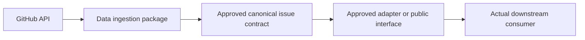

The diagram must be edited to show the real module/function names after inspection.

## 14.3 Contract test checklist

- Required fields are present with correct types.
- Optional fields follow the documented null/missing policy.
- Labels and timestamps use the agreed representation.
- Pull-request behavior is explicit.
- Empty result is valid and predictable.
- Upstream errors are not converted into a false empty-success result.
- Partial/truncated retrieval is visible.
- No unauthorized shared-contract changes are included.

**Definition of Done:** a real consumer has been identified, the interface has been verified, and boundary tests pass. If the consumer is not ready, document the unverified integration rather than claiming completion.

---

# 15. Phase 8 — Logging, privacy, and operational documentation

## 15.1 Logging policy

Use the repository's existing logging configuration. Do not add another logging framework without justification.

Good events include ingestion start/completion, page retrieved, retry scheduled, validation failure, duplicate skipped, truncation detected, and ingestion failed. Prefer counts and stable issue identifiers over full content.

Never log:

- Tokens or authorization headers.
- Passwords, session cookies, or full environment dumps.
- Full issue bodies unless explicitly necessary and approved.
- Raw payloads containing user-generated content.
- Unredacted request/response headers.
- Unnecessary personal information.

Use safe messages such as:

```python
logger.info("GitHub issue page retrieved: page=%s count=%s", page_number, count)
logger.warning("Issue record rejected: reason=%s", safe_reason_code)
logger.info("Ingestion completed: retrieved=%s emitted=%s", retrieved, emitted)
```

The variables above are illustrative. Use the actual variable names and logger convention in the implementation.

## 15.2 Privacy and secrets review

- Use the team's approved secret store or environment mechanism.
- Do not commit `.env` or real credentials.
- Confirm `.gitignore` protects local secrets and virtual environments.
- Do not print configuration objects that contain tokens.
- Keep test fixtures synthetic.
- Avoid unnecessary collection of author or issue-body information.
- Check retention and logging requirements with the Team Lead if the pipeline persists data.
- If a credential is accidentally committed, revoke/rotate it and follow the incident process; removing it in a later commit is not sufficient.

## 15.3 Documentation

### File: `packages/data_ingestion/README.md`

**Action:** Create or update after the implementation is finalized.  
**Purpose:** Document the actual package rather than a hypothetical future design.

Use this complete starter document, then replace any example names or commands with the actual implemented interface:

```markdown
# ORDO Data Ingestion

## Purpose
Describe the package's verified responsibility and ownership boundary.

## Current implementation
List the actual modules, public functions, and supported retrieval behavior.
Do not list modules that do not exist.

## Requirements
List the Python version, dependency manager, and dependencies confirmed by the repository.

## Configuration
Document each approved environment/configuration key, its meaning, default, and whether it is required. Never include a real secret.

## Setup
Use the repository's actual environment-manager commands.

## Usage
Show a copyable invocation using the actual public entry point. Do not invent a CLI or endpoint.

## Data contract
Link to the canonical model or document the approved output schema, including nullability and timestamp semantics.

## Pagination and rate limits
Document page limits, completeness/truncation behavior, retries, timeouts, and rate-limit handling.

## Error handling
List actual exception types and explain which failures are retryable.

## Tests
List the actual commands for unit and optional integration tests.

## Logging and privacy
Explain which events are logged and which payloads/secrets are intentionally excluded.

## Known limitations
Record unverified consumers, incomplete behavior, and open approvals.

## Troubleshooting
Document failures observed during implementation and verified resolutions.
```

Do not leave this README with generic statements after implementation. Replace them with real function names, configuration keys, commands, test results, and limitations.

**Definition of Done:** logs are useful but safe, configuration is documented, and the README matches the code actually committed.

---

# 16. Phase 9 — End-to-end verification

Run the checks below from the repository root using the actual project environment manager. Skip or adapt a command if the repository does not use that tool; do not add tools solely to match this guide.

## 16.1 Verify repository state

```bash
git status
git diff --check
git diff
```

Expected: no whitespace errors, no unrelated files, no secrets, and no unauthorized ownership-boundary changes.

## 16.2 Verify imports and configuration

Use the real package path and approved configuration mechanism. For the example layout:

```bash
python -c "from packages.data_ingestion.config import IngestionConfig; print('config import OK')"
```

If the project expects a package install first, use its documented editable-install or workspace command. Do not add `sys.path` hacks to production modules to hide packaging issues.

## 16.3 Run tests

Example only if pytest is configured:

```bash
python -m pytest tests/data_ingestion/ -v
```

Then run the project's full relevant suite:

```bash
python -m pytest -v
```

Run linting, formatting, type checks, and security checks only if configured by the project, using the exact repository commands. Record missing tools as environment limitations rather than silently installing unapproved alternatives.

## 16.4 Verify data contract and operational behavior

Confirm that:

- The normalized record matches the approved model.
- Empty repositories are handled predictably.
- Pagination reaches the correct stopping condition.
- Page-limit truncation is explicit.
- Rate-limit and retry behavior is bounded.
- Invalid records follow the approved policy.
- Duplicate resolution is stable.
- A failure is not reported as successful empty output.
- No secrets or full payloads appear in logs.
- The real downstream integration is tested or explicitly marked unverified.

## 16.5 Record actual results

```text
Branch:
Commit:
Python version:
Dependency manager:
Commands executed:
Unit-test result:
Integration-test result:
Lint/format/type-check result:
Security/secret review:
Data-contract verification:
Known failures:
Unverified integrations:
Outstanding approvals:
```

Never write “all tests pass” unless the commands were run and passed in the current environment.

**Definition of Done:** the relevant test suite and configured checks have been run, actual results are recorded, and outstanding limitations are visible.

---

# 17. Pull request and handover

## 17.1 Review staged changes

Stage only approved paths. First check which directories exist:

```bash
git status
git diff --check
git diff
```

If the package exists and contains only approved changes:

```bash
git add packages/data_ingestion/
```

Stage tests only if the directory exists and is approved:

```bash
git add tests/data_ingestion/
```

Stage documentation only if it is part of the approved change:

```bash
git add docs/
```

Do not stage a nonexistent directory. Do not use `git add .` without reviewing the full working tree.

Inspect staged changes:

```bash
git diff --cached --check
git diff --cached
git status
```

Check specifically for `.env`, tokens, local environments, generated output, unrelated modifications, and another role's files.

## 17.2 Commit

Initial commit message:

```text
feat(data-ingestion): implement validated GitHub issue ingestion pipeline
```

Commit only when the diff is reviewable and the relevant checks have been run:

```bash
git commit -m "feat(data-ingestion): implement validated GitHub issue ingestion pipeline"
```

If the work is too large for one reviewable change, propose a small sequence of commits and explain the split. Do not silently change the team's branch strategy.

## 17.3 Push the approved feature branch

```bash
git push -u origin feature/data-engineer/github-issue-ingestion
```

Expected: the feature branch is pushed to the configured remote. If push fails, inspect authentication and branch permissions; do not force-push as a workaround.

Open a pull request targeting the **approved** integration branch. Wait for CI and required reviews before merging.

## 17.4 Pull-request description template

Copy and fill in the actual values:

```markdown
## Summary
- Describe the implemented ingestion behavior.

## Files changed
- List the actual paths.

## Ingestion flow
- Explain the real request, pagination, validation, and normalization flow.

## Data contract
- Link to the approved contract and summarize required/optional fields.

## Tests executed
- `command`: actual result
- `command`: actual result

## Error handling
- Explain retryable/permanent failures, timeouts, and rate-limit behavior.

## Security and privacy
- Confirm secrets are not hardcoded or committed.
- Explain safe logging and test fixture policy.

## Known limitations
- List truncation behavior, unsupported cases, and unverified integrations.

## Cross-team changes
- List approvals or follow-up work needed from other owners.

## Delivery checklist
- [ ] Diff reviewed
- [ ] CI results checked
- [ ] No real secrets committed
- [ ] Ownership boundaries respected
- [ ] Handover notes included
```

Do not claim a branch was pushed or a pull request created unless that action actually occurred.

## 17.5 Final handover workflow

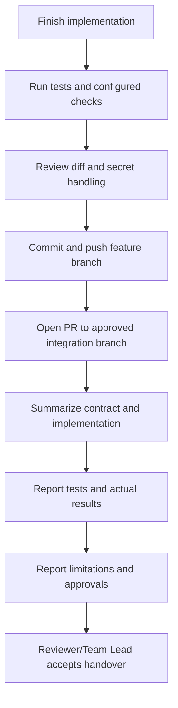

Handover should include the public entry point, data contract, configuration keys, test commands/results, failure semantics, known limitations, downstream owner, and any required approval. A pull request is not complete merely because it exists.

---

# 18. Troubleshooting

| Symptom | Likely cause | Diagnostics | Safe resolution |
|---|---|---|---|
| Python version mismatch | Local interpreter differs from project constraint | `python --version`; inspect project config | Select the repository-supported interpreter; do not upgrade project requirements unilaterally |
| Virtual environment not activated | Shell activation failed or wrong path | `python -c "import sys; print(sys.executable)"` | Use the correct environment-manager activation command or its interpreter directly |
| Missing dependency | Environment not synced or manifest not installed | Run the project's dependency sync/status command | Install via the approved manager; do not globally install as a shortcut |
| Package import error | Wrong working directory, package layout, or missing package install | `git ls-files`; inspect `pyproject.toml`; print `sys.path` for diagnosis | Use the documented package/workspace setup; avoid production `sys.path` mutation |
| Wrong working directory | Command run outside repository root | `git rev-parse --show-toplevel` | Change to the actual repository root |
| Environment variable missing | Key not set or config loader differs | Check key presence without printing its value | Set through the approved local/CI secret mechanism; never echo tokens |
| HTTP 401 | Missing, expired, or invalid credentials | Inspect status and safe configuration presence | Refresh credentials through approved process; do not log token |
| HTTP 403 | Insufficient permissions or rate limit | Inspect status and safe rate-limit metadata | Ask owner to verify access; apply bounded rate-limit handling |
| HTTP 404 | Wrong repository/resource or hidden private resource | Check approved owner/name and permissions | Correct configuration or permissions; do not infer that the resource is public |
| Rate limit exhausted | Too many requests or low unauthenticated limit | Inspect remaining/reset headers safely | Use approved authentication, lower request volume, and bounded backoff |
| Pagination repeats | Bad link parser or mock/header mismatch | Log safe page number and link relation, not secrets | Validate `Link` parsing and host; add a repeated-link test |
| Network timeout | Connectivity or timeout budget too small | Re-run a safe connectivity check; inspect timeout config | Adjust timeout only with rationale; keep retry budget bounded |
| Invalid JSON | API/proxy error or unexpected response | Test the response parser with a fixture | Raise controlled error; do not silently treat it as an empty list |
| Unexpected response shape | API/client contract differs from assumption | Inspect sanitized schema/fixture and API docs | Update validation after confirming the actual contract |
| Validation failure | Required field absent or contract too strict | Use a safe field/reason code, not raw payload | Decide whether the field is required; preserve valid optional omissions |
| Duplicate records | Overlapping pages or multiple retrieval paths | Compare stable IDs and timestamps in fixtures | Deduplicate by approved stable key, not title |
| Mock does not match HTTP client | Test double has wrong method/signature | Compare fake method with actual client call | Update the mock interface; do not alter correct production behavior to fit a bad mock |
| Downstream contract mismatch | Consumer expects different fields or null semantics | Inspect the consumer model and tests | Coordinate with the owner and add contract tests; do not silently change shared schema |
| Logging problem | Logger configuration missing or unsafe handler | Inspect logging setup and captured test logs | Reuse project logging configuration; redact secrets and payloads |
| CI failure | Dependency, lint, tests, Python version, or environment differs | Read the failing CI step and reproduce locally | Fix the cause; do not skip tests or weaken checks without approval |
| Git merge conflict | Integration branch changed during work | `git status`; inspect conflict markers | Resolve deliberately with owner context, run tests, and never discard another developer's work blindly |
| Push rejected | Permissions or remote branch divergence | `git status`; `git fetch origin`; inspect branch history | Ask for access or reconcile history under team guidance; do not force-push by default |

## 18.1 Safe recovery sequence

When a command fails:

1. Capture the exact command and error.
2. Confirm the current directory and branch.
3. Confirm the selected interpreter and dependency manager.
4. Check whether the failure existed in the baseline.
5. Reproduce with a small deterministic test or fixture.
6. Fix the root cause.
7. Re-run the targeted test, then the relevant full suite.
8. Document any remaining limitation.

Do not disable validation, remove failing tests, log secrets, or change shared contracts as a first response.

---

# 19. Final acceptance checklist

## Repository and ownership

- [ ] Approved repository URL used.
- [ ] Correct integration branch confirmed.
- [ ] Baseline recorded.
- [ ] Existing conventions inspected.
- [ ] Ownership boundaries respected.
- [ ] No unrelated files modified.

## Data-ingestion implementation

- [ ] API client follows existing project conventions.
- [ ] Configuration is validated.
- [ ] Credentials are not hardcoded.
- [ ] Timeouts are configured.
- [ ] Pagination is implemented correctly.
- [ ] Partial/truncated results are explicit.
- [ ] Response data is validated.
- [ ] Normalization follows the approved contract.
- [ ] Retry and rate-limit behavior is bounded.
- [ ] Errors are handled predictably.
- [ ] Duplicate behavior is documented.
- [ ] Logging does not leak secrets.
- [ ] Downstream interfaces are verified or clearly marked unverified.

## Tests

- [ ] Unit tests cover core behavior.
- [ ] Network calls are mocked in ordinary unit tests.
- [ ] Malformed input is tested.
- [ ] Pagination and retry behavior are tested.
- [ ] Data-contract tests are present.
- [ ] Integration tests are documented and opt-in when live.
- [ ] Actual test results are recorded.

## Delivery

- [ ] README updated to match the actual code.
- [ ] Git diff reviewed.
- [ ] Correct feature branch used.
- [ ] Commit message follows the agreed convention.
- [ ] Pull request targets the approved integration branch.
- [ ] CI and review requirements satisfied.
- [ ] Outstanding work is documented.
- [ ] Handover completed.

---

# 20. Appendix — command reference, data examples, and report templates

## 20.1 Command sequence reference

Commands below are examples. Use the actual branch, package layout, and dependency manager established during reconnaissance.

| Order | Purpose | Example command |
|---|---|---|
| 1 | Confirm root | `git rev-parse --show-toplevel` |
| 2 | Check working tree | `git status` |
| 3 | Confirm branch | `git branch --show-current` |
| 4 | Inspect files | `git ls-files` |
| 5 | Record baseline | `python -m pytest -v` |
| 6 | Check formatting errors | `git diff --check` |
| 7 | Run ingestion tests | `python -m pytest tests/data_ingestion/ -v` |
| 8 | Run one test module | `python -m pytest tests/data_ingestion/test_normalizer.py -v` |
| 9 | Review diff | `git diff` |
| 10 | Review staged diff | `git diff --cached` |
| 11 | Commit | `git commit -m "feat(data-ingestion): implement validated GitHub issue ingestion pipeline"` |
| 12 | Push feature branch | `git push -u origin feature/data-engineer/github-issue-ingestion` |

## 20.2 Example normalized record

```json
{
  "id": 123456,
  "number": 42,
  "repository": "example/project",
  "title": "Example issue",
  "body": null,
  "state": "open",
  "author": "example-user",
  "labels": ["bug", "auth"],
  "created_at": "2026-01-02T03:04:05Z",
  "updated_at": "2026-01-03T04:05:06Z",
  "closed_at": null,
  "html_url": "https://github.com/example/project/issues/42",
  "is_pull_request": false
}
```

This is synthetic example data. It is not a record from the ORDO repository.

## 20.3 Baseline and final verification report

```text
Project: ORDO
Role: Data Engineer
Feature branch:
Integration branch:
Python version:
Dependency manager:
Repository conventions inspected:
Canonical issue contract:
Downstream consumer and owner:

Baseline:
- Commands:
- Results:
- Pre-existing failures:

Implementation:
- Files created:
- Files modified:
- Configuration keys:
- Pagination and truncation policy:
- Validation and normalization policy:
- Retry and rate-limit policy:
- Duplicate policy:
- Logging/privacy controls:

Verification:
- Unit tests:
- Integration/contract tests:
- Lint/format/type checks:
- Secret review:
- Diff review:

Outstanding issues:
Approvals required:
PR URL:
Handover recipient:
```

## 20.4 Open questions to resolve with the Team Lead

- Which integration branch is approved?
- What is the canonical issue model and where is it defined?
- Which repositories are in scope and who authorizes access?
- Should pull requests be included or excluded?
- Is GitHub Enterprise supported, or only `api.github.com`?
- What is the expected policy for invalid individual records?
- What makes an ingestion result complete, and how is truncation represented?
- Where does deduplication belong?
- Which downstream component consumes the data first?
- Are storage, incremental sync, or scheduled ingestion in scope?
- Which retry, timeout, and observability conventions are required?
- Which dependency and test tools are approved?

Do not silently decide these questions if the answer changes a public interface or product behavior.

---

## Final instruction to the Data Engineer

Treat the actual repository as authoritative. Follow the phases in order, reuse existing conventions, keep ownership boundaries intact, and distinguish implemented behavior from proposed examples. Complete retrieval, pagination, validation, normalization, error handling, tests, integration, documentation, and handover. Record actual command results and leave no unverified claim disguised as a completed task.
