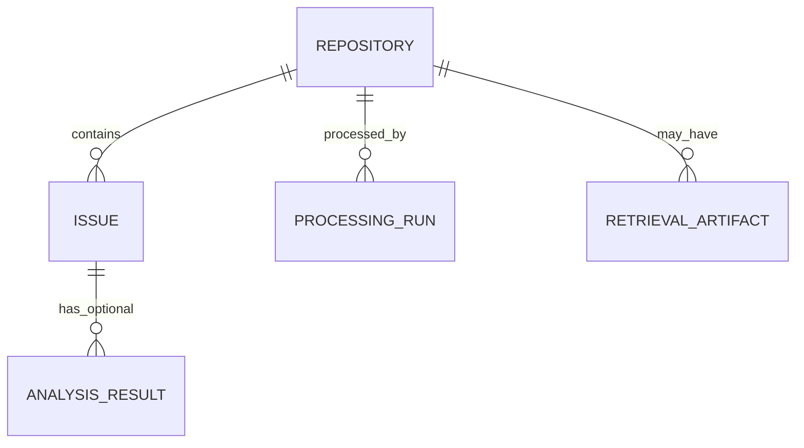

# ORDO Database and Data Storage Engineer Blueprint

**Project:** ORDO — AI-powered GitHub Issue Intelligence Platform  
**Document:** `docs/implementation/ORDO_Database_Data_Storage_Engineer_Blueprint.md`  
**Status:** Proposed storage design; technology approval pending  
**Date:** 2026-10-27  
**Repository:** Not yet created; no schema, migrations, database, or storage tests have been verified.

> **Evidence rule:** Existing ORDO manuals are design/planning artifacts. The Data Engineer blueprint proposes SQLite and SQLAlchemy, but this is not proof that the storage technology has been approved. This document deliberately keeps the persistence decision open until requirements, deployment topology, and access patterns are confirmed.

## Table of Contents
1. [Purpose and Status](#1-purpose-and-status)
2. [Requirements and Architecture Dependencies](#2-requirements-and-architecture-dependencies)
3. [Storage Requirements Assessment](#3-storage-requirements-assessment)
4. [Storage Technology Decision Matrix](#4-storage-technology-decision-matrix)
5. [Data Ownership and Lifecycle](#5-data-ownership-and-lifecycle)
6. [Conceptual Data Model](#6-conceptual-data-model)
7. [Physical Schema or Data Layout](#7-physical-schema-or-data-layout)
8. [Schema Migrations and Versioning](#8-schema-migrations-and-versioning)
9. [Data Access Layer](#9-data-access-layer)
10. [Data Ingestion Integration](#10-data-ingestion-integration)
11. [ML and Code Retrieval Integration](#11-ml-and-code-retrieval-integration)
12. [Data Validation and Integrity](#12-data-validation-and-integrity)
13. [Caching and Freshness](#13-caching-and-freshness)
14. [Security and Privacy](#14-security-and-privacy)
15. [Backup, Recovery, and Retention](#15-backup-recovery-and-retention)
16. [Testing Strategy](#16-testing-strategy)
17. [Performance and Capacity](#17-performance-and-capacity)
18. [Implementation File Structure](#18-implementation-file-structure)
19. [Troubleshooting Guide](#19-troubleshooting-guide)
20. [Open Questions and Decisions](#20-open-questions-and-decisions)
21. [Definition of Done](#21-definition-of-done)

## 1. Purpose and Status

Define the smallest safe storage solution that meets approved ORDO workflows. Persistence is a product/architecture decision, not an automatic consequence of using ML or code retrieval.

### Status definitions
- **Proposed:** design suggestion requiring review.
- **Awaiting approval:** must be resolved before dependent implementation.
- **Not applicable:** only after a scope decision explicitly excludes it.
- **Not verified:** no code/database/tests have been run.

## 2. Requirements and Architecture Dependencies

Relevant source manuals available in the user's Library include:
- `ORDO_Project_Lead_Technical_Coordinator_Blueprint.md`
- `ORDO_Data_Engineer_Blueprint.md`
- `ORDO_API_Contract_Integration_Standards_Blueprint.md`
- `ORDO_ML_Engineer_Blueprint.md`
- `ORDO_Code_Retrieval_Engineer_Blueprint.md`
- `ORDO_FastAPI_Backend_Engineer_Blueprint.md`
- `ORDO_Security_Privacy_Reviewer_Blueprint.md`
- `ORDO_QA_Test_Automation_Blueprint.md`

They are planning artifacts and must be checked against the approved requirements and architecture before implementation. The Project Requirements and System Architecture documents are being established as part of this deliverable set. The master runbook coordinates implementation sequence.

### Dependencies that must be resolved
1. Is persistence required for the first release, or can requests fetch and process data on demand?
2. Are multiple API workers/processes expected to write concurrently?
3. Must results survive process restarts or be shared across sessions?
4. Is incremental synchronization or historical analysis required?
5. Which fields may be stored, and for how long?
6. Are repositories private, and what isolation is required?
7. Are ML outputs/indexes persisted or reproducible from source?
8. Which deployment and backup model will be used?

## 3. Storage Requirements Assessment

| Data category | Initial stance | Reason / access pattern | Sensitivity | Retention decision |
|---|---|---|---|---|
| Request-local results | Temporary memory is acceptable if response-only workflow meets needs | Read once per request; no durable history | Depends on issue content | Request lifetime |
| Repository metadata | Persist only if needed for repeated lookups/sync | Low volume, keyed by repository identity | Moderate | Approval needed |
| Normalized issues | Undecided | Useful for repeatable views, sync, analytics; unnecessary if fetch-on-demand suffices | Issue body may be sensitive | Approval needed |
| Raw GitHub payloads | Do not persist by default | Helpful for debugging but duplicates data and can retain unnecessary fields | Potentially high | Avoid unless justified |
| Processing run records | Optional | Supports diagnostics and incremental checkpoints | Low/moderate | Need/retention to approve |
| ML results | Optional derived data | Cache/history only if needed; must invalidate when source changes | Inherits input sensitivity | Approval needed |
| Embeddings / retrieval index | Not required by default | Only if retrieval evaluation and scale justify | May encode private source information | Approval needed |
| Model files/artifacts | Depends on selected model | Local models may need separate artifacts; hosted model may not | Provider/model dependent | Separate artifact policy |
| User preferences | Not required unless user features approved | Adds identity and persistence requirements | Potentially personal | Product decision |
| Operational logs | Minimal structured logs | Diagnose failures; do not store entire issue bodies by default | Must be minimized | Retention to approve |
| Backups | Only for durable data | Required if loss of stored data matters | Contains same sensitivity as source | RPO/RTO/retention to approve |

### Recommended decision path
- If ORDO only retrieves and presents current issues on demand, begin without a database, while preserving clean service interfaces.
- If the first release requires durable normalized issues, repeatable incremental sync, or stored analysis results, evaluate a relational database.
- Do not add a vector database merely because ML is planned. Compare keyword retrieval, an in-process index, file-based artifacts, and vector infrastructure using a retrieval evaluation set.
- A no-database prototype is not equivalent to a production design if it needs multi-process writes, cross-session history, backup, or durable sync.

## 4. Storage Technology Decision Matrix

| Option | Strengths | Risks/limitations | Suitable when | Status |
|---|---|---|---|---|
| No persistent DB / request-local state | Simplest; no migration or database operations | Repeated API calls; no history; no cross-process shared state | On-demand read-only demo | Candidate |
| SQLite | Simple local setup, transactional relational storage, easy isolated tests | Write concurrency and deployment topology constraints; local-file backup/volume concerns | Single-host prototype or modest single-writer workload | Candidate; proposed by Data Engineer |
| PostgreSQL | Strong concurrent access, managed deployment options, mature backups and migrations | More setup and operational cost | Multi-process/multi-user service or production durable store | Candidate |
| Flat files/JSON | Simple artifact storage | Harder querying, concurrency, integrity and update semantics | Small derived artifacts or fixtures | Limited use |
| External vector database | Similarity retrieval at scale and operational separation | Added service, cost, security, index consistency | Only after retrieval needs justify it | Not approved |
| Local/file-backed search index | Lower operational complexity | Rebuild/staleness and concurrency considerations | Small corpus/prototype retrieval | Candidate if retrieval approved |

### Decision criteria
Evaluate source-of-truth needs, query patterns, expected repository/issue counts, write concurrency, deployment topology, backup/restore, security, operational ownership, cost, testability, and migration path. Do not choose based on familiarity alone.

## 5. Data Ownership and Lifecycle

| Stage | Owner | Expected behavior | Contract / control |
|---|---|---|---|
| Acquisition | Data Engineer | Retrieve approved GitHub fields, paginate, apply timeout/rate-limit policy | GitHub adapter interface |
| Validation | Data Engineer | Validate source types and required identifiers | Canonical issue schema |
| Normalization | Data Engineer | Normalize timestamps/labels/state and source references | Shared domain model |
| Duplicate detection | Data + Storage | Use stable source identity; do not rely on issue number globally | Unique key/identity policy |
| Persistence (if approved) | Storage Engineer | Transactional insert/update, idempotent retries | Repository interface |
| Enrichment | ML/Retrieval | Produce derived results separately from source data | Typed derived-result contract |
| Query | Storage/API | Use bounded, parameterized queries and stable pagination where needed | Repository methods |
| Source update | Data + Storage | Refresh changed records according to approved sync policy | Update/version policy |
| Deletion/inaccessibility | Product/Storage/Security | Decide tombstone, delete, or retain policy; avoid guessing | Retention and privacy decision |
| Retention/deletion | Owner + Security + Storage | Delete or expire data according to approved policy | Documented retention job/procedure |

### Lifecycle cases requiring explicit policy
- Same issue retrieved multiple times.
- Issue title/body/labels/state changes.
- Issue is closed or reopened.
- Issue is deleted, made private, or access is revoked.
- Partial ingestion fails after some pages.
- A record is malformed.
- Derived ML output becomes stale after issue text changes.
- Repository branch or commit changes and invalidates code retrieval artifacts.

No synchronization schedule, soft-delete policy, or retention period is approved by this document.

## 6. Conceptual Data Model

Only use entities justified by the approved storage requirement.

**Status:** conceptual proposal only. If no durable storage is needed, this model should not be implemented.

### Candidate entities

#### Repository
- **Purpose:** normalized identity for a GitHub repository.
- **Identity:** GitHub repository ID if available, otherwise a normalized owner/name pair subject to rename policy.
- **Possible attributes:** source ID, owner, name, canonical URL, visibility if permitted, last-sync timestamp.
- **Uniqueness:** source repository ID preferred; owner/name requires explicit rename handling.
- **Retention:** decision needed, especially after access is revoked.

#### Issue
- **Purpose:** normalized issue source record.
- **Identity:** stable GitHub issue ID; alternatively a repository-scoped key. An issue number alone is not globally unique.
- **Possible attributes:** repository reference, issue number, title, body (optional), state, labels, URL, created/updated/closed timestamps, fetched-at timestamp.
- **Validation:** required source ID and repository identity; timezone-aware timestamps normalized to UTC.
- **Update:** upsert according to source update semantics; avoid stale overwrite if a newer version is known.

#### ProcessingRun (optional)
- **Purpose:** capture ingestion/analysis execution status and diagnostics.
- **Possible attributes:** run ID, repository, start/end time, status, counts, error category, pipeline version.
- **Do not store:** tokens, full raw payloads, or private text by default.

#### AnalysisResult (optional)
- **Purpose:** store derived ML result when cache/history is approved.
- **Possible attributes:** source issue ID, task type, model/pipeline version, output, created time, source version/hash.
- **Freshness:** invalidate/recompute when relevant source fields change.

#### RetrievalArtifact (optional)
- **Purpose:** track index or retrieval artifact metadata.
- **Possible attributes:** repository ID, revision/commit, index version, built-at timestamp, status, artifact location.
- **Do not put large binary embeddings/code payloads in relational rows without an explicit storage decision.**

## 7. Physical Schema or Data Layout

No physical schema is approved yet. If a relational database is selected, use the following rules:
- Primary keys must be stable and not based solely on issue number.
- Enforce repository/issue relationships with foreign keys.
- Use a unique constraint on the selected stable GitHub issue identity.
- Normalize timestamps to UTC and document serialization format.
- Use explicit constraints for state fields only if the source semantics are understood; preserve unknown external enum values safely where appropriate.
- Index only measured query patterns, such as repository identity, issue state, and update timestamp.
- Parameterize all queries.
- Keep derived outputs separate from authoritative source fields.
- Store large index artifacts outside relational rows if appropriate.
- Avoid storing raw payloads by default.

A concrete SQL schema must be produced only after the storage choice, canonical fields, retention policy, and query patterns are approved.

## 8. Schema Migrations and Versioning

If relational storage is approved:
1. Select and approve migration tooling (Alembic is a candidate when SQLAlchemy is used).
2. Store migrations in one authoritative directory.
3. Give each migration a unique ordered revision and descriptive name.
4. Review generated migrations manually.
5. Apply migrations to isolated local/test databases before merge.
6. Run migration and data-integrity tests.
7. Use forward-compatible changes where possible: add nullable columns, deploy compatible code, backfill, then tighten constraints.
8. Do not silently modify production schema manually.
9. Document rollback limits; some data migrations cannot be safely reversed.
10. Require explicit release approval before production migration.

Example commands are intentionally omitted until the DB and migration tool are approved. Never run a migration against a production connection during routine tests.

## 9. Data Access Layer

### Proposed boundary
- API handlers validate and call domain/application services.
- Services call repository interfaces.
- Repository implementations own SQL/DB-specific code and transaction handling.
- Data ingestion calls a storage interface rather than implementing its own SQL queries.
- ML and retrieval consume canonical records through approved interfaces.
- Streamlit never opens database connections.

### Requirements
- Create and close sessions/connections within well-defined request or unit-of-work boundaries.
- Keep transaction scopes short.
- Roll back on failure.
- Parameterize queries.
- Translate database exceptions into typed internal errors; do not return raw driver messages to clients.
- Avoid one global long-lived mutable session.
- Ensure cleanup in `finally`/context-manager patterns.
- Keep repository interfaces small and domain-oriented.
- Mock the repository interface in service unit tests; use a real isolated test DB for repository integration tests.
- Do not add abstraction layers without a consumer or testability benefit.

## 10. Data Ingestion Integration

- Ingestion emits validated canonical records and diagnostics.
- Persistence layer accepts a batch through a defined interface if storage is approved.
- Upsert identity is based on stable GitHub identity, not issue number alone.
- Repeated ingestion should be idempotent.
- Use bounded batches and explicit transaction boundaries.
- Decide whether a whole repository page/batch commits atomically or whether partial commits are allowed.
- Record source `updated_at` and ingestion `fetched_at` separately.
- Do not overwrite a newer local record with an older response if a concurrency race is possible.
- Raw source payloads should be discarded after normalization unless an approved debugging/reproducibility requirement justifies retention.
- Partial failures must report what was processed and what remains; never claim a complete sync when pagination stopped early.
- Retries must not duplicate rows or create duplicate processing records.

## 11. ML and Code Retrieval Integration

### ML
- Consume canonical issue data, not raw DB sessions.
- Return typed outputs linked to stable issue identity.
- Persist results only if history/caching is required.
- If stored, record model/pipeline version and a source fingerprint/version when useful.
- Recompute or invalidate derived results when relevant source data changes.
- Do not store model artifacts in relational rows by default.

### Code retrieval
- Keep source data, index metadata, and derived embeddings conceptually separate.
- Scope index/query by repository and allowed revision.
- Track index version, source revision, and build status if indexes are persisted.
- Define rebuild and invalidation behavior.
- Test stale/missing index, inaccessible repository, and no-match cases.
- Avoid external vector storage until evaluation shows it is necessary.

## 12. Data Validation and Integrity

### Application validation
- Required IDs and repository references present.
- Field types checked.
- Text sizes bounded where appropriate.
- Timestamps parsed with timezone awareness.
- Labels and state mapped consistently.
- Unknown optional fields handled without crashes.
- Source URL and repository identifiers normalized.
- Invalid records rejected or quarantined with safe diagnostics.

### Storage constraints (if DB selected)
- Primary keys and foreign keys.
- Unique stable source identity.
- NOT NULL only for truly required fields.
- CHECK constraints only for stable, well-understood invariants.
- Parameterized queries.
- Indexes based on observed queries.
- Transactions for related writes.

### Required tests
- Missing IDs, malformed timestamps, wrong field types.
- Duplicate issue across repeated retrieval.
- Same issue number in two different repositories.
- Changed and stale source timestamps.
- Foreign-key/unique violations.
- Transaction rollback on batch failure.
- Concurrent upsert if concurrent writers are supported.
- Malformed external records do not corrupt valid records.

## 13. Caching and Freshness

Caching is not required by default. If measurements show value, document:
- Cached entity/result and cache key.
- Freshness requirements and TTL.
- Invalidation on source updates or access revocation.
- Memory/disk limits.
- Failure behavior and fallback.
- How stale results are labelled.
- Tests for expiration and invalidation.

Do not add Redis or another external cache solely to avoid repeated requests before rate-limit and latency measurements exist.

## 14. Security and Privacy

- Database credentials belong in environment-specific secret management, not source control.
- Use least-privilege database roles.
- Encrypt network connections where appropriate for deployment.
- Do not store GitHub tokens in issue records, logs, or metadata.
- Minimize stored issue bodies and code content.
- Parameterize SQL.
- Restrict data access by approved repository scope.
- Ensure logs contain counts/statuses rather than full issue payloads.
- Define deletion behavior for source access revocation and user-requested retention limits.
- Protect backups at least as strongly as primary storage.
- Return safe errors and keep raw DB exceptions internal.
- Security reviewer must review data sensitivity, access boundaries, retention, backups, and model-provider handling.

## 15. Backup, Recovery, and Retention

If persistent data is approved, the owner must define:
- What data and artifacts are backed up.
- Backup frequency based on change rate and business impact.
- Retention period.
- Encryption and access controls.
- Restore procedure and validation.
- RPO (maximum acceptable data loss) and RTO (recovery time) targets.
- Responsibility for monitoring backup success.
- Restore drill frequency.

No RPO, RTO, or retention values are approved. If the application is storage-light, protect required configuration and any persistent retrieval/model artifacts instead. A backup is not verified until a restore test succeeds.

## 16. Testing Strategy

| Test | Purpose | Required isolation |
|---|---|---|
| Schema/bootstrap | Create a clean schema or data layout | Temporary/test storage |
| Migration | Upgrade from previous version and verify state | Disposable DB |
| Repository CRUD | Query, insert/update, uniqueness | Isolated DB |
| Idempotency | Repeated issue ingestion avoids duplicates | Synthetic fixtures |
| Integrity | Foreign keys, constraints, invalid values | Isolated DB |
| Transaction | Rollback on partial failure | Test transaction/database |
| Concurrency | Competing upserts if supported | Controlled concurrent test |
| Ingestion integration | Normalize and persist expected records | Mock GitHub + test DB |
| API service integration | Storage errors mapped safely | Test DB and test client |
| Derived-data freshness | Input change invalidates old analysis/index | Deterministic fixtures |
| Backup restore | Recovery meets approved targets | Disposable restore environment |

Tests must never use production credentials or mutate production data. Make fixtures deterministic and reset test state safely.

## 17. Performance and Capacity

Measure actual:
- Repositories and issues per repository.
- Typical and worst-case batch size.
- Read/write frequency and concurrent writers.
- Query latency and index selectivity.
- Database file/volume growth.
- Derived artifact size and rebuild time.
- Connection pool behavior.
- Retention-driven growth.

Do not invent volumes or benchmark results. Avoid partitioning, sharding, or external storage until measurements show a need. If SQLite is selected, validate process topology, write concurrency, file persistence, and deployment volume behavior.

## 18. Implementation File Structure

Paths are proposals and must be reconciled with the architecture tree.

| Proposed path | Purpose | Owner | Requirement |
|---|---|---|---|
| `packages/storage/` | Storage adapter package if separate package approved | Storage Engineer | Conditional |
| `packages/storage/config.py` | Validated DB settings | Storage | Conditional |
| `packages/storage/connection.py` | Engine/session lifecycle | Storage | Conditional |
| `packages/storage/models.py` | ORM definitions if ORM selected | Storage | Conditional |
| `packages/storage/repositories.py` | Query/upsert methods | Storage | Conditional |
| `packages/storage/exceptions.py` | Typed storage errors | Storage | Conditional |
| `packages/storage/migrations/` | Schema migrations | Storage | Conditional |
| `tests/unit/test_storage_validation.py` | Validation tests | Storage/QA | Required if storage exists |
| `tests/integration/test_storage_repositories.py` | DB behavior and constraints | Storage/QA | Required if relational DB exists |
| `tests/integration/test_ingestion_storage.py` | Ingestion/storage contract | Data/Storage | Required if persisted ingestion exists |
| `docs/operations/storage-recovery.md` | Backup/restore procedures | Storage/Release | Required for durable production data |

Do not create duplicate schema definitions across packages. Exact filenames and dependencies must match approved packaging and contracts.

## 19. Troubleshooting Guide

| Symptom | Possible cause | Diagnostic check | Corrective action | Owner |
|---|---|---|---|---|
| Connection failure | Bad URL, unavailable DB, network | Check sanitized config and service status | Correct configuration or restore dependency | Storage/DevOps |
| Authentication failure | Wrong secret or role | Verify secret reference and least-privilege role | Rotate/fix secret securely; do not print it | Storage/Security |
| Migration failure | Schema drift or incompatible revision | Inspect migration history and test DB state | Stop release, reproduce on disposable DB, create reviewed migration | Storage |
| Duplicate issue rows | Wrong unique key or missing upsert | Compare repository and issue identities | Correct stable identity and add regression test | Data/Storage |
| Constraint violation | Invalid source data or schema mismatch | Inspect sanitized field/constraint name | Fix mapping or schema; do not bypass constraints blindly | Data/Storage |
| Stale analysis | Missing source fingerprint/invalidation | Compare source update and result version | Recompute/invalidate derived result | ML/Storage |
| Slow query | Missing/ineffective index or oversized result | Explain query plan and measure | Add justified index or bounded query | Storage/Performance |
| Transaction failure | Incorrect session/rollback lifecycle | Inspect transaction boundary | Fix unit-of-work cleanup and add rollback test | Storage |
| Disk/memory pressure | Growth or unbounded batch/index | Measure storage and artifact sizes | Bound batches, retention, or move artifacts with approval | Storage/DevOps |
| Restore failure | Invalid backup or untested procedure | Restore into isolated environment | Fix backup/restore steps and repeat drill | Storage/Release |
| Corrupt/incomplete input | External response changed or partial page | Inspect validation counters and pagination status | Reject/quarantine bad record and report incomplete run | Data Engineer |

## 20. Open Questions and Decisions

| ID | Decision | Options | Evidence needed | Approver |
|---|---|---|---|---|
| ST-001 | Persistence required? | On-demand/no DB; relational DB | Workflow, freshness, history needs | Product owner/architect |
| ST-002 | Relational technology | SQLite; PostgreSQL; other justified option | Deployment topology, concurrency, backup | Architect/Storage |
| ST-003 | ORM/migrations | SQLAlchemy/Alembic; another option | Existing stack and schema complexity | Storage |
| ST-004 | Raw payload retention | Discard; selective retention | Debugging vs privacy/storage cost | Security/owner |
| ST-005 | Incremental sync | On-demand; periodic; webhook-based | Freshness and rate-limit needs | Product/Data |
| ST-006 | Analysis persistence | Recompute; cache; history | Latency and audit need | ML/Product |
| ST-007 | Retrieval index | None; local/file index; vector store | Retrieval benchmark and corpus size | Retrieval/Architect |
| ST-008 | Retention/RPO/RTO | Stakeholder-defined values | Impact and operational budget | Owner/Release |
| ST-009 | Deletion on access revocation | Delete, tombstone, purge after interval | Privacy/security requirements | Security/owner |

## 21. Definition of Done

- [ ] Persistence need and storage technology approved.
- [ ] Data categories, retention and sensitivity reviewed.
- [ ] Canonical source identity and update semantics agreed.
- [ ] Schema/data layout matches approved requirements.
- [ ] Access interfaces match shared contracts.
- [ ] Validation, uniqueness and idempotency tested.
- [ ] Migrations documented and tested if applicable.
- [ ] Errors and transaction cleanup tested.
- [ ] Ingestion, API, ML and retrieval integrations verified where applicable.
- [ ] Backup/restore and retention addressed for durable data.
- [ ] Security review completed.
- [ ] Performance assumptions measured or clearly documented as unverified.
- [ ] Manual updated to reflect actual implementation, not merely intended design.

### Storage decisions that must be approved before implementation
1. Whether durable persistence is necessary.
2. Which fields may be stored and for how long.
3. Database technology and deployment topology, if needed.
4. Stable source identity and upsert policy.
5. Migration and transaction strategy.
6. ML/retrieval artifact persistence and invalidation.
7. Backup, restore, deletion, and access-revocation behavior.
