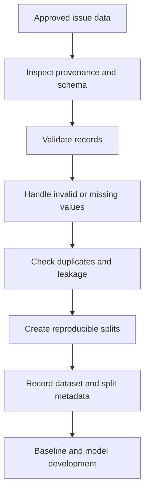
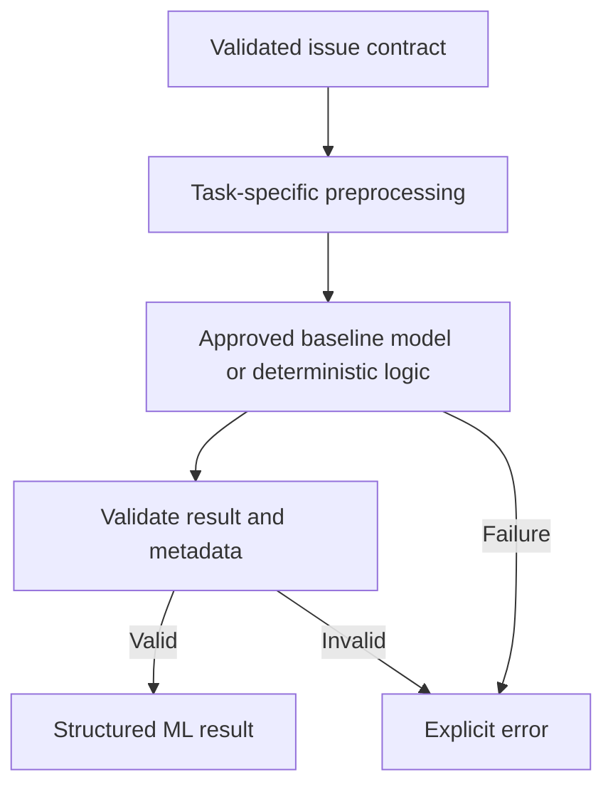
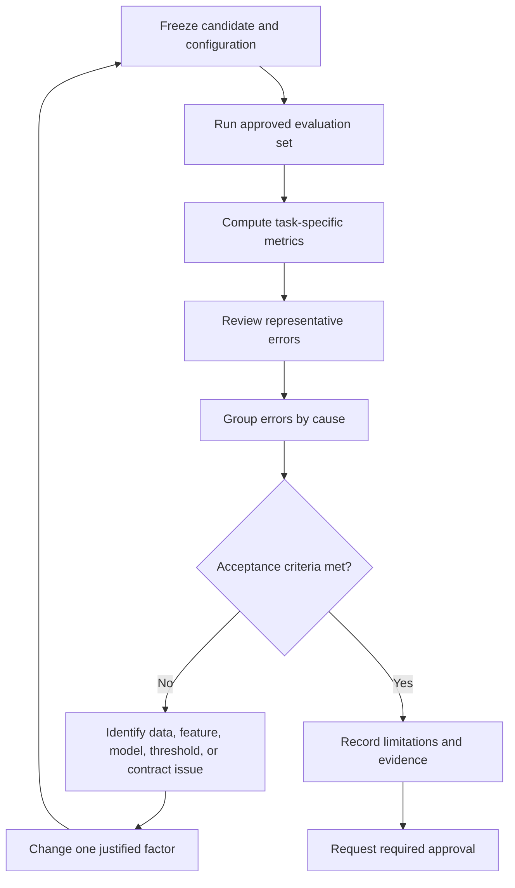
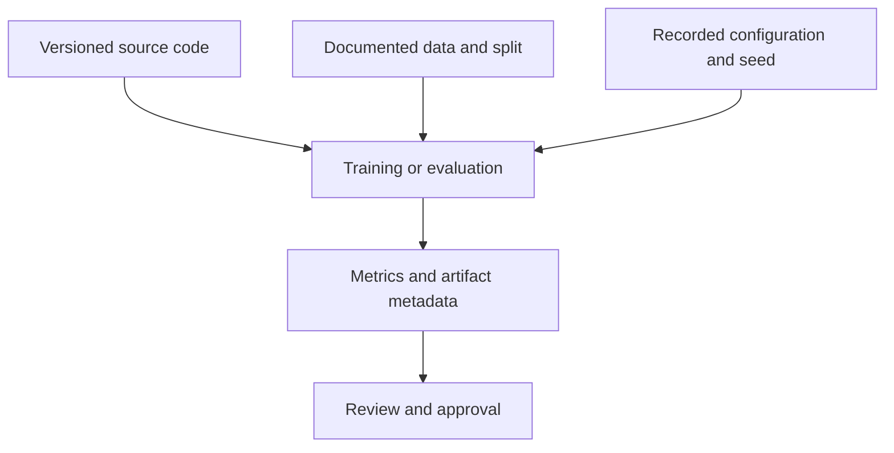
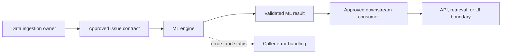
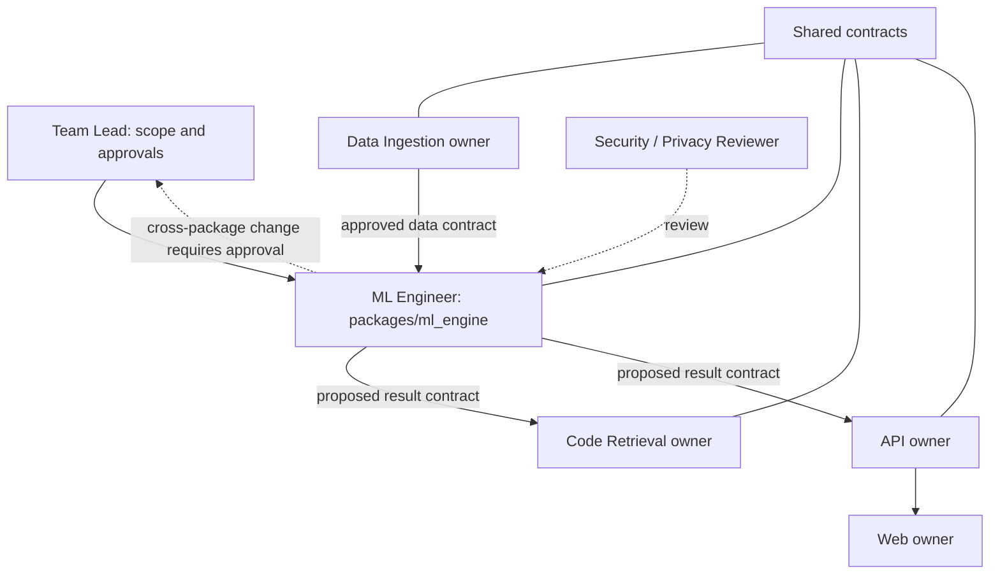
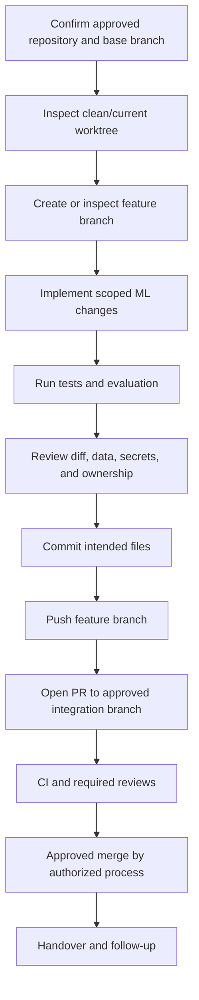
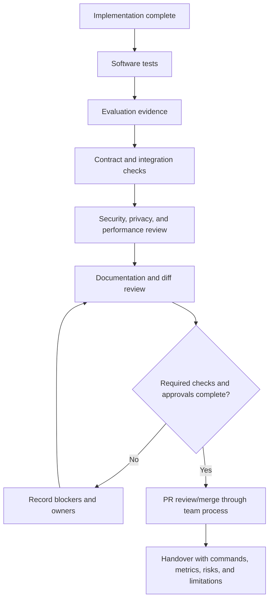

# ORDO ML Engineer Blueprint
## Sequential implementation manual for the ORDO monorepo

**Role:** Machine Learning Engineer  
**Project:** ORDO — AI-powered GitHub Issue Intelligence  
**Document status:** Implementation guide; repository-specific details must be verified before use  
**Primary ownership:** `packages/ml_engine/`, specifically assigned ML tests, and approved ML documentation  
**Feature branch:** `feature/ml-engine/issue-intelligence`

> **Important:** This manual is deliberately repository-first. The proposed repository structure, possible ML tasks, and example code below are not proof that those files, datasets, contracts, providers, or capabilities already exist. Inspect the real repository and obtain approval for unresolved product decisions before implementing a task. Do not claim tests, metrics, or integrations succeeded until you have run them.

---

## How to use this manual

Follow the phases in order. Phases 0–2 establish what must be built and what data/contracts are available. Do not train a model or connect a provider before those decisions are recorded. Phases 3–7 implement and validate the selected capability. Phases 8–11 cover integration, safety, documentation, and delivery.

For each phase, keep a short engineering log containing commands run, files inspected or changed, results, unresolved questions, and decisions requiring approval. Use the repository's existing package manager, formatting, linting, test layout, and logging conventions wherever they exist.

### Status vocabulary

Use these labels in the engineering log and pull request:

- **Implemented:** code exists in the working tree.
- **Tested:** named tests or checks were actually executed; include their command and result.
- **Evaluated:** the approved evaluation procedure was run against a documented dataset/model version.
- **Acceptance met:** the agreed task-specific thresholds were satisfied.
- **Production approved:** required owners/reviewers have explicitly approved production use.

These statuses are not interchangeable.

---

# Phase 0 — Start at the repository root

## 0.1 Obtain the approved repository URL

Use only the URL supplied by the Team Lead:

`<TEAM_LEAD_APPROVED_REPOSITORY_URL>`

Do not guess the remote URL. If it is not available, ask the Team Lead before cloning.

### Bash

**Working directory:** a parent directory in which you keep development repositories.  
**Purpose:** clone the approved monorepo and inspect Git state.

```bash
git clone <TEAM_LEAD_APPROVED_REPOSITORY_URL>
cd ordo-monorepo
git status
git fetch origin
git branch --all
git log -5 --oneline
git ls-files
```

**Success looks like:** the repository clones, `git status` reports a known state, remotes and branches are visible, and tracked files can be listed. If the repository directory is named differently, use the actual directory created by `git clone`; do not rename it merely to match this example.

### Windows PowerShell

```powershell
git clone <TEAM_LEAD_APPROVED_REPOSITORY_URL>
Set-Location .\ordo-monorepo
git status
git fetch origin
git branch --all
git log -5 --oneline
git ls-files
```

If `develop` is the team's approved integration branch:

```bash
git switch develop
git pull --ff-only origin develop
```

If `develop` does not exist, stop and ask which integration branch to use. Do not create or rename a shared branch independently.

## 0.2 Create the feature branch

The requested feature branch is:

`feature/ml-engine/issue-intelligence`

Before creating it, inspect whether it already exists.

```bash
git branch --list "feature/ml-engine/issue-intelligence"
git branch -r --list "origin/feature/ml-engine/issue-intelligence"
```

If neither exists, and the approved integration branch is `develop`:

```bash
git switch develop
git pull --ff-only origin develop
git switch -c feature/ml-engine/issue-intelligence
```

If the branch already exists, inspect its status and history before switching to it. Do not reset, force-push, or discard another developer's work.

## 0.3 Inspect the environment and dependency manager

**Working directory:** repository root.

```bash
python --version
python -m pip --version
git --version
```

Inspect the actual files:

```bash
git ls-files pyproject.toml requirements.txt requirements-dev.txt uv.lock poetry.lock pdm.lock Pipfile Pipfile.lock environment.yml
git ls-files .python-version
```

Use the dependency manager already established by the repository. Examples, only if applicable:

- `uv` project: follow its `pyproject.toml` and lockfile conventions.
- Poetry project: use Poetry's existing commands.
- Conda project: use the committed environment definition.
- `requirements.txt` project: follow the repository's current installation instructions.
- No established manager: propose one to the Team Lead before introducing it.

Do not install a second manager or rewrite root dependency files without approval.

### Virtual environment examples

Use these only if the project convention calls for a virtual environment.

**PowerShell:**

```powershell
python -m venv .venv
.\.venv\Scripts\Activate.ps1
python --version
```

If PowerShell blocks activation, do not weaken machine-wide security policy. Follow the team's approved environment setup; alternatively invoke `.venv\Scripts\python.exe` directly.

**Bash:**

```bash
python -m venv .venv
source .venv/bin/activate
python --version
```

Do not assume a particular Python minor version. Use the version specified by the repository and CI configuration.

## 0.4 Record the baseline before editing

Inspect:

```bash
git status
git diff
git ls-files packages/ml_engine
git ls-files packages/data_ingestion
git ls-files packages/code_retrieval
git ls-files shared
git ls-files tests
git ls-files .github/workflows
```

Then inspect relevant files rather than assuming their content from their names. Look for:

- Existing ML model loading, inference, feature extraction, training, and evaluation.
- Data-ingestion output schema and ownership.
- Code-retrieval input/output interfaces.
- Shared schemas and serialization rules.
- API consumer contracts and error conventions.
- Dependency manifests and lockfiles.
- Test fixtures, test markers, linting, formatting, and type-checking conventions.
- Environment-variable conventions and secret handling.
- CI workflows and required checks.
- Existing data/model artifact policy.

Run the checks already documented by the repository. If it uses pytest, a starting point is:

```bash
python -m pytest -v
```

Do not add optional tools simply to run this command. Record failures that existed before your changes, missing optional dependencies, unavailable data/model artifacts, and whether inference currently works. Do not call any result a model baseline unless it was measured.

**Deliverable:** a baseline note in the approved ML documentation location. If `packages/ml_engine/README.md` exists, update it without erasing valid information; otherwise create it when the implementation scope is confirmed.

### Phase 0 Definition of Done

- [ ] Approved repository URL and integration branch confirmed.
- [ ] Working tree state recorded.
- [ ] Feature branch checked/created without disturbing existing work.
- [ ] Python and dependency-manager conventions identified.
- [ ] ML, ingestion, retrieval, shared contracts, consumers, tests, and CI inspected.
- [ ] Existing test/check results and failures recorded.
- [ ] No implementation assumptions have been presented as verified facts.

---

# Phase 1 — Reconnaissance and task definition

## 1.1 Establish what ORDO actually needs

Read the product requirements and current implementation. Candidate tasks may include issue classification, prioritization, summarization, duplicate detection, embeddings, or structured issue analysis. These are possibilities, not a mandate to implement all of them.

Create a decision record containing:

| Decision | Required evidence |
|---|---|
| User-visible behavior | Approved requirements, issue, or acceptance criteria |
| Input data | Existing ingestion schema or approved dataset specification |
| Output consumer | Actual API, retrieval, processing, or other consumer |
| Task type | Classification, ranking, summarization, embedding, or other approved task |
| Baseline | Simple rule, existing model, or approved provider baseline |
| Evaluation | Dataset, metrics, split strategy, and review method |
| Runtime constraints | Latency, memory, availability, privacy, and cost requirements |
| Owner approvals | Team Lead and any affected package owner |

If the required task is ambiguous, write down the open questions and proposed default. Ask the Team Lead to approve unresolved product behavior before implementing it.

## 1.2 Define the input/output contract before model code

Reuse existing shared contracts where possible. Do not create duplicate representations of the same issue in multiple packages.

The contract must specify:

- Required and optional fields, types, and allowed values.
- Text normalization and maximum input size.
- Missing-value and malformed-input behavior.
- Output fields and types.
- Whether scores are probabilities, ranking scores, or cosine similarities.
- Error types and how callers should handle them.
- Determinism guarantees, if any.
- Model/schema versioning.
- Whether raw issue text may leave the local environment or be retained.

Use a short contract document or the project's existing schema mechanism. The following is a **design worksheet, not an assumed ORDO schema**:

```text
Capability:
Input contract reference:
Required input fields:
Optional input fields:
Validation rules:
Output contract reference:
Failure behavior:
Consumer:
Evaluation dataset:
Metrics:
Latency/memory/cost constraints:
Data/privacy constraints:
Approval owner:
```

## 1.3 Define measurable acceptance criteria

Select metrics appropriate to the approved task.

- **Classification:** accuracy, macro/micro F1, per-class precision/recall, confusion matrix, class distribution, and comparison with a baseline.
- **Ranking or prioritization:** precision/recall at k, ranking metrics where appropriate, and review of high-impact errors.
- **Similarity/duplicate detection:** precision and recall at a selected threshold, Precision@k or Recall@k, and false-positive/false-negative review.
- **Summarization/structured analysis:** schema validity, factual consistency, unsupported-claim rate, sensitive-data leakage checks, human-review criteria, latency, and cost.
- **Embeddings:** dimension/finite-value checks, retrieval-quality metrics using approved relevance judgments, compatibility by model version, and latency.

Do not invent thresholds. First measure a defensible baseline, then agree production thresholds with the Team Lead/product owner. Keep software correctness separate from model quality.

### Phase 1 Definition of Done

- [ ] One or more required capabilities are confirmed from project evidence.
- [ ] Out-of-scope candidate capabilities are explicitly excluded.
- [ ] Input/output contract is documented or linked.
- [ ] Evaluation method and data source are identified.
- [ ] Initial acceptance thresholds are approved or clearly marked pending.
- [ ] Cross-package changes are listed for approval rather than silently made.

---

# Phase 2 — Dataset inspection and preparation

## 2.1 Identify the approved data source

Inspect actual outputs from `packages/data_ingestion/`, existing approved fixtures, and any documented datasets. Do not assume a path, download an external dataset, scrape repositories, or commit private issue text without approval.

Record:

- Provenance and permission to use.
- Number of records and schema.
- Missing required fields and malformed records.
- Duplicate issue IDs and near-duplicate text.
- Label quality and class distribution, if labels exist.
- Text-length and language distributions, where relevant.
- Timestamp/repository characteristics.
- Potential personal or sensitive data.
- Known sampling bias and collection limitations.

If no suitable data exists, document what is missing and coordinate with the Data Engineer/Team Lead. Do not fabricate examples as if they were real evaluation data. Synthetic data may be used for unit tests, clearly labeled as synthetic.

## 2.2 Dataset workflow



The sequence prevents model development from hiding data-quality problems. Split strategy must be chosen for the task; a random split is not automatically valid.

## 2.3 A safe, adaptable JSONL inspection utility

Use this only if the approved source is JSON Lines and no equivalent repository utility already exists. If the real ingestion output is a database, Parquet file, API, or another format, adapt the inspection method instead of converting data unnecessarily.

**File:** `packages/ml_engine/tools/inspect_jsonl.py`  
**Action:** Create only if this tool fits the repository conventions.  
**Purpose:** Inspect record count, malformed lines, field presence, and text lengths without printing full issue content. This is an operational utility, not a training pipeline.

```python
from __future__ import annotations

import argparse
import json
import sys
from collections import Counter
from pathlib import Path
from typing import Any


def inspect_jsonl(path: Path, text_fields: tuple[str, ...]) -> dict[str, Any]:
    records = 0
    malformed_lines = 0
    missing_fields: Counter[str] = Counter()
    text_lengths: Counter[str] = Counter()
    empty_text: Counter[str] = Counter()

    with path.open("r", encoding="utf-8") as stream:
        for line_number, line in enumerate(stream, start=1):
            if not line.strip():
                continue
            try:
                record = json.loads(line)
            except json.JSONDecodeError:
                malformed_lines += 1
                continue

            if not isinstance(record, dict):
                malformed_lines += 1
                continue

            records += 1
            for field in text_fields:
                value = record.get(field)
                if value is None:
                    missing_fields[field] += 1
                elif not isinstance(value, str):
                    missing_fields[f"{field} (non-string)"] += 1
                else:
                    text_lengths[field] += len(value)
                    if not value.strip():
                        empty_text[field] += 1

    return {
        "path": str(path),
        "records": records,
        "malformed_lines": malformed_lines,
        "missing_or_invalid_fields": dict(sorted(missing_fields.items())),
        "total_characters_by_field": dict(sorted(text_lengths.items())),
        "empty_text_records_by_field": dict(sorted(empty_text.items())),
    }


def main() -> int:
    parser = argparse.ArgumentParser(
        description="Inspect approved JSONL data without printing issue text."
    )
    parser.add_argument("path", type=Path, help="Path to approved JSONL data")
    parser.add_argument(
        "--text-fields",
        nargs="+",
        default=["title", "body"],
        help="Text fields to inspect; defaults are examples and must match the schema",
    )
    args = parser.parse_args()

    if not args.path.is_file():
        print(f"Input file does not exist: {args.path}", file=sys.stderr)
        return 2

    try:
        report = inspect_jsonl(args.path, tuple(args.text_fields))
    except (OSError, UnicodeError) as exc:
        print(f"Could not read input file: {exc}", file=sys.stderr)
        return 2

    print(json.dumps(report, indent=2, ensure_ascii=False))
    return 0


if __name__ == "__main__":
    raise SystemExit(main())
```

**Command — Bash, repository root:**

```bash
python packages/ml_engine/tools/inspect_jsonl.py <APPROVED_JSONL_PATH> --text-fields title body
```

**Command — PowerShell, repository root:**

```powershell
python .\packages\ml_engine\tools\inspect_jsonl.py <APPROVED_JSONL_PATH> --text-fields title body
```

Replace the placeholder with the actual approved path and field names. Do not type angle-bracket placeholders literally. Success prints aggregate counts, not issue text. The utility does not validate task-specific labels, deduplicate records, or create train/test splits; add those only after the real schema and task are known.

## 2.4 Splits, leakage, and reproducibility

Document which records belong to training, validation, and held-out test sets. Consider:

- **Repository-aware split:** use when issues from the same repository share language or conventions that could inflate results.
- **Time-aware split:** use when predicting future issues and historical ordering matters.
- **Group-aware split:** keep related/duplicate issues together when their relationship could leak across splits.
- **Stratified split:** use for classification only when it fits the data and does not conflict with grouping/time constraints.

Use a fixed random seed where the chosen method supports it. Persist split identifiers or a reproducible split manifest, subject to data policy. Do not repeatedly tune on the held-out test set. Do not report metrics if the split has not been validated for leakage.

### Phase 2 Definition of Done

- [ ] Approved data provenance and permission recorded.
- [ ] Schema, missing values, duplicates, labels, and text characteristics inspected.
- [ ] Sensitive/private data handling reviewed.
- [ ] Split strategy chosen and leakage risks assessed.
- [ ] Dataset/split versions recorded.
- [ ] No private issue data or unapproved dataset committed.

---

# Phase 3 — Establish a minimal baseline

Choose the simplest defensible baseline for the confirmed task. Do not automatically add PyTorch, a vector database, a hosted model, or a GPU.

Examples, selected only when appropriate:

- Classification: majority-class baseline, rules, or a simple traditional model.
- Duplicate detection: normalized exact-match baseline before semantic similarity.
- Summarization: a deterministic extractive baseline or an already approved model.
- Structured analysis: a parser/validator and deterministic fallback behavior.
- Embeddings: the already approved embedding model, if one exists.

Record baseline behavior and limitations before tuning a more complex model.

## 3.1 Proposed package organization

Use the existing package structure first. If it needs modularization, a possible organization is:

```text
packages/ml_engine/
├── __init__.py
├── config.py
├── exceptions.py
├── schemas.py
├── preprocessing.py
├── pipeline.py
├── inference.py
├── evaluation.py
├── README.md
└── tests/                 # only if this matches repo conventions
```

Responsibilities:

- `config.py`: validated configuration, using existing conventions.
- `exceptions.py`: package-level exceptions that align with project error conventions.
- `schemas.py`: only contracts owned by ML; reuse shared schemas where possible.
- `preprocessing.py`: deterministic input transformation.
- `pipeline.py`: task-specific baseline/model orchestration.
- `inference.py`: stable public inference boundary.
- `evaluation.py`: metrics and report generation.
- `README.md`: actual implementation and operating instructions.

Do not create every file by default. Add only files needed by the confirmed task.

## 3.2 Safe starter contract utilities

The following is a generic, dependency-free example for validating a text input. It is not a replacement for an existing shared ORDO contract. Use it only if the actual task accepts a single text field and no established schema should be reused.

**File:** `packages/ml_engine/input_validation.py`  
**Action:** Create only if no equivalent validator exists.  
**Purpose:** Provide deterministic text validation that can be tested without model downloads or network calls.

```python
from __future__ import annotations

from dataclasses import dataclass


class InputValidationError(ValueError):
    """Raised when a caller provides invalid ML input."""


@dataclass(frozen=True)
class TextInput:
    text: str


def validate_text_input(
    value: object,
    *,
    max_characters: int = 20_000,
    allow_empty: bool = False,
) -> TextInput:
    """Validate a text value without logging its contents."""
    if not isinstance(value, str):
        raise InputValidationError("text must be a string")
    if max_characters < 1:
        raise ValueError("max_characters must be positive")
    if len(value) > max_characters:
        raise InputValidationError(
            f"text exceeds the configured limit of {max_characters} characters"
        )
    normalized = value.strip()
    if not normalized and not allow_empty:
        raise InputValidationError("text must not be empty")
    return TextInput(text=normalized)
```

**File:** `packages/ml_engine/tests/test_input_validation.py`  
**Action:** Create only if package-local tests are consistent with the repository; otherwise place the test in the established test directory.  
**Purpose:** Test normal and invalid inputs without requiring a model.

```python
import pytest

from packages.ml_engine.input_validation import (
    InputValidationError,
    validate_text_input,
)


def test_valid_text_is_trimmed():
    result = validate_text_input("  login fails  ")
    assert result.text == "login fails"


def test_empty_text_is_rejected():
    with pytest.raises(InputValidationError):
        validate_text_input("   ")


def test_non_string_is_rejected():
    with pytest.raises(InputValidationError):
        validate_text_input(None)


def test_oversized_text_is_rejected():
    with pytest.raises(InputValidationError):
        validate_text_input("abcd", max_characters=3)


def test_empty_text_can_be_explicitly_allowed():
    result = validate_text_input(" ", allow_empty=True)
    assert result.text == ""
```

**Import note:** The import path above assumes `packages` is importable in the repository's test environment. If the repository uses a `src/` layout, installed package, or another namespace, adjust the import to match its actual packaging. Do not add `sys.path` hacks to hide packaging problems.

**Commands — repository root, if pytest is the established runner:**

```bash
python -m pytest <ACTUAL_TEST_PATH> -v
```

Replace `<ACTUAL_TEST_PATH>` with the path used in this repository. Expected result: all five tests pass. If pytest is not installed or configured, use the existing test runner rather than changing root dependencies without approval.

## 3.3 Baseline and inference flow



Do not return a fabricated prediction when a model fails. The caller must be able to distinguish a valid low-confidence result from an inference failure.

### Phase 3 Definition of Done

- [ ] Baseline choice and rationale documented.
- [ ] Input validation and stable output contract implemented as needed.
- [ ] Deterministic unit tests exist.
- [ ] No network calls or large model downloads occur in ordinary tests.
- [ ] Baseline behavior and limitations recorded.

---

# Phase 4 — Implement training or inference for the confirmed task

Mark non-applicable subsections as **N/A** in the decision record. Do not implement all paths merely because they are described here.

## 4.1 If training is required

Before writing a training loop, confirm the label definition, dataset source, split strategy, metrics, runtime limits, and artifact policy.

The training entry point should:

1. Load the approved, versioned dataset.
2. Validate schema and labels.
3. Use the approved split manifest or reproducible split function.
4. Fit preprocessing on training data only.
5. Train the selected baseline/model.
6. Evaluate on validation data during model selection.
7. Evaluate the chosen candidate once on the held-out test set.
8. Save model artifacts only to an approved location.
9. Write metadata containing code revision, dataset/split version, configuration, dependency/model versions, seed, and metrics.
10. Fail explicitly if inputs or required dependencies are missing.

Never commit large binary artifacts or sensitive datasets without approval. Never serialize arbitrary untrusted objects and then load them from untrusted paths. Follow the team's approved artifact format and security policy.

## 4.2 If a pretrained model or external AI provider is approved

Inspect the existing provider abstraction and approved model identifier. The implementation must include:

- Configuration without hardcoded credentials.
- Request construction using the existing provider SDK/client.
- Input size and schema validation.
- Explicit timeout.
- Bounded retries only for transient, safe-to-retry failures.
- No blind retries for invalid requests or non-idempotent operations.
- Output parsing and schema validation.
- Clear provider errors and safe failure behavior.
- Mocked tests that do not require a live key.
- Privacy review of what issue text is sent to the provider.

If configuration is missing, fail at startup or return the established explicit configuration error. Do not silently switch to an unrelated model. For ordinary tests, inject a fake client that returns deterministic test responses.

Treat GitHub issue text, comments, labels, and code snippets as untrusted input. Prompt instructions inside issue content must not override system/developer instructions, authorize actions, expose secrets, or change access controls. A model's output must never authorize privileged operations.

## 4.3 If embeddings or similarity are required

Confirm the embedding model and downstream retrieval contract with the Code Retrieval owner before changing indexing or query behavior.

Specify:

- Text normalization and empty-input behavior.
- Model name/version and vector dimension.
- Output shape and finite-value validation.
- Similarity metric and score semantics.
- Threshold-selection procedure using labeled validation examples.
- Precision/recall or ranking metrics on held-out examples.
- Compatibility rules when model versions or dimensions change.
- Index/storage owner and re-embedding migration plan, if applicable.
- Data retention and deletion behavior.

Do not create a vector database unless the approved architecture requires it. Do not compare embeddings from incompatible model versions without an explicit compatibility plan.

## 4.4 If structured issue analysis is required

Define a schema and validate model output deterministically. Validate required fields, types, enum values, length limits, and identifiers against authoritative records where applicable. Reject or quarantine malformed outputs; do not “repair” hallucinated identifiers by guessing.

Keep authorization outside the model. Treat output as untrusted data. Use factuality review and representative adversarial tests. Do not rely solely on a prompt saying “do not hallucinate” as a validation mechanism.

## 4.5 Resource and failure handling

- Initialize a reusable model/client at the appropriate lifecycle boundary rather than loading a large model for every issue, if safe for the framework.
- Make thread/concurrency behavior explicit before sharing mutable model state.
- Bound input size, batch size, timeout, and retries.
- Log identifiers, status, duration, and error category where permitted—not full issue bodies, tokens, prompts, or credentials.
- Distinguish validation failures, model initialization failures, provider timeouts, malformed output, and internal errors.
- Do not return a default class or fabricated summary on failure unless that fallback is explicitly designed, labeled, and tested.

### Phase 4 Definition of Done

- [ ] Only the confirmed task path is implemented.
- [ ] Config, model/client lifecycle, input validation, and output validation match project conventions.
- [ ] Missing dependencies/configuration fail explicitly.
- [ ] External services are injectable and mockable.
- [ ] Model version and artifact metadata are recorded where applicable.
- [ ] Model outputs cannot bypass authorization or data-access controls.

---

# Phase 5 — Evaluation and error analysis

## 5.1 Evaluation protocol

Document the exact dataset version, split definition, model/config version, code revision, metrics, and command. The report must distinguish measured results from planned thresholds.

Suggested report structure:

```text
Task:
Evaluation date:
Code revision:
Dataset provenance/version:
Split manifest/version:
Model/baseline version:
Configuration:
Metrics:
Per-class/category results:
Latency and resource measurements:
Error categories:
Known limitations:
Acceptance thresholds:
Acceptance status: NOT ASSESSED / PASS / FAIL
Reviewer/approval:
```

If the dataset is unavailable, deliver the evaluation implementation and report template, with measured values marked **NOT RUN**. Do not invent numbers.

## 5.2 Error-analysis workflow



Classify errors into useful categories, for example: bad/missing labels, ambiguous issue, out-of-domain language, duplicate leakage, class imbalance, truncation, schema failure, unsupported claim, provider outage, or threshold error. Use synthetic or approved examples in reports.

Decide whether the fix belongs in data preparation, model choice, threshold selection, contract design, or downstream handling. Do not keep tuning without an agreed objective. If acceptance criteria are unclear or data is inadequate, stop and request a product/Team Lead decision.

## 5.3 Task-specific interpretation

- Classification: report per-class metrics, not only aggregate accuracy; inspect class imbalance and confusion patterns.
- Similarity: choose thresholds on validation data; do not select a threshold by repeatedly inspecting the held-out test set.
- Summarization/structured analysis: measure schema failures, unsupported claims, factual errors, privacy leaks, and human-review outcomes.
- Latency: state hardware/provider, warm/cold state, batch size, number of samples, and measurement method. Do not claim improvements without a comparable measurement.

A passing unit-test suite proves software behavior under tested conditions; it does not prove model quality.

### Phase 5 Definition of Done

- [ ] Evaluation procedure is reproducible.
- [ ] Actual results or explicit NOT RUN status are recorded.
- [ ] Errors and limitations are reviewed.
- [ ] Baseline comparison is completed where data permits.
- [ ] Acceptance thresholds are approved and evaluated honestly.
- [ ] Any production-readiness decision is made by the authorized owners.

---

# Phase 6 — Testing and regression coverage

Use the repository's existing test layout and naming conventions. A possible layout, only if it fits the repository, is:

```text
tests/ml_engine/
├── test_preprocessing.py
├── test_pipeline.py
├── test_inference.py
├── test_evaluation.py
└── test_contracts.py
```

Do not duplicate tests already covering the same behavior.

## 6.1 Required test categories

### Input and preprocessing
- Valid input.
- Missing required field and missing optional field.
- Empty text and whitespace-only text.
- Unexpected types.
- Oversized input.
- Malformed records and invalid enum values.
- Unicode and relevant language cases.
- Deterministic normalization.

### Model/inference
- Representative valid output.
- Invalid/empty model output.
- Stable schema and version metadata.
- Expected behavior on synthetic fixtures.
- Determinism only where promised.
- Model/artifact loading failure.
- Provider timeout, unavailable service, and malformed response.
- Explicit error behavior; no fabricated success result.

### Evaluation
- Metric calculation against a tiny known fixture.
- Invalid and empty evaluation inputs.
- Class imbalance behavior where relevant.
- Threshold boundary behavior.
- Stable report schema.
- No accidental use of training data as test data.

### Integration/contracts
- Ingestion-to-ML contract.
- ML-to-downstream contract.
- Missing optional dependencies.
- Configuration validation.
- Failure propagation and logging privacy.
- Compatibility with the approved public interface.

## 6.2 Test isolation

Mock external providers and model clients in ordinary unit tests. Do not require API keys, network access, model-weight downloads, or private datasets for the default test suite. Mark expensive integration tests and document prerequisites. Keep synthetic fixtures small and clearly identified.

## 6.3 Commands

**Working directory:** repository root. Use these examples only if pytest and the indicated paths are actually used.

```bash
python -m pytest <ACTUAL_ML_TEST_PATH> -v
python -m pytest <ACTUAL_ML_TEST_PATH> -q
```

Replace the placeholder with the real test path. The first command provides verbose test names; the second is a concise rerun. A successful run should report zero failures, but record skips and warnings as well. Run the full project test suite before opening the pull request, following the repository's established command.

### Phase 6 Definition of Done

- [ ] Normal, invalid, and failure paths are covered.
- [ ] Provider/model integrations are mocked in standard tests.
- [ ] Tests do not download large artifacts or leak private data.
- [ ] Contract tests cover both package boundaries.
- [ ] Test commands and actual outcomes are recorded.

---

# Phase 7 — Reproducibility, configuration, and artifacts

## 7.1 Configuration policy

Use the existing configuration system. Add only keys actually used by the implementation. Depending on the selected task, configuration might include a model identifier, timeout, retry limit, threshold, random seed, dataset version, artifact location, or provider region. These are examples, not required keys.

For every configuration value, document:

- Name and type.
- Required/optional status.
- Default and why it is safe.
- Validation rule.
- Secret status.
- Runtime effect.
- How missing/invalid values fail.

Do not place real credentials in `.env.example`, tests, logs, README files, or commits. Use the repository's approved secret manager/environment configuration.

## 7.2 Artifact management

Record:

- Approved artifact storage location.
- Naming/versioning convention.
- Model architecture and dependency versions.
- Data and split version.
- Training/evaluation configuration.
- Code revision and metrics.
- Validation performed before loading.
- Compatibility rules and rollback plan.
- Git ignore or external artifact-store policy.

Do not load artifacts from arbitrary user-controlled paths. Avoid unsafe serialization formats for untrusted artifacts. Do not commit large models, private data, or generated outputs without approval.

## 7.3 Reproducibility workflow



Set seeds where supported, but do not claim exact determinism if the framework, hardware, parallelism, or provider does not guarantee it. Document expected sources of variation.

### Phase 7 Definition of Done

- [ ] Configuration is validated and documented.
- [ ] Secrets are not committed or logged.
- [ ] Dataset, model, code, and result versions can be traced.
- [ ] Artifact loading is restricted and validated.
- [ ] Reproduction commands are documented and tested where possible.

---

# Phase 8 — Downstream integration

## 8.1 Inspect before integrating

Potential consumers include `apps/api/`, `packages/code_retrieval/`, other approved processing services, or dashboard-facing contracts. Do not assume every consumer calls the ML package directly.

For the actual consumer:

1. Read the current interface and tests.
2. Record expected input/output and error behavior.
3. Compare those expectations with the ML contract.
4. Document mismatches and proposed changes.
5. Obtain approval from the responsible owner for any cross-boundary changes.
6. Implement only approved changes.
7. Add contract tests for success and failure.
8. Test integration with mocks and then approved integration fixtures.
9. Update the relevant documentation.

Do not independently rewrite `packages/data_ingestion/`, `packages/code_retrieval/`, `apps/api/`, `apps/web/`, `shared/`, `infra/`, root configuration, other roles' tests, CI workflows, or production deployment files. Shared-contract or consumer changes require explicit approval.

## 8.2 Integration diagram



The diagram shows a possible logical flow, not a verified runtime architecture. Adapt it to the actual repository and keep ownership boundaries explicit.

## 8.3 Integration acceptance

- Contract field names/types match the actual consumer.
- Errors are mapped to the consumer's established error convention.
- Model internals are not exposed where a stable result schema is expected.
- No circular imports or unauthorized cross-package imports are introduced.
- Contract changes are reviewed by the owning team.
- Normal, malformed, timeout, and unavailable-model paths are tested.
- No live credentials are needed for ordinary integration tests.

### Phase 8 Definition of Done

- [ ] Actual consumer identified and its contract inspected.
- [ ] Integration behavior and failure mapping documented.
- [ ] Contract tests pass.
- [ ] Cross-owner changes have explicit approval.
- [ ] End-to-end behavior is verified or remaining dependencies are marked unverified.

---

# Phase 9 — Performance, resilience, privacy, and security

## 9.1 Measure before optimizing

Measure relevant characteristics using a documented method:

- Cold and warm startup.
- Model initialization time.
- Per-item and batch inference latency.
- Memory/CPU/GPU use where available.
- Throughput and concurrency behavior.
- Provider latency, timeout rate, and cost where relevant.

Record hardware/runtime, model version, batch size, sample count, warm-up method, and summary statistics. Do not claim an improvement without comparable measurements. Introduce caching, batching, quantization, concurrency, or other complexity only when data supports it and architecture owners approve it.

## 9.2 Failure matrix

| Failure | Required behavior |
|---|---|
| Missing artifact | Explicit startup/inference error; actionable diagnostic without secret values |
| Initialization failure | Fail readiness or initialization according to app conventions; do not claim predictions succeeded |
| Provider unavailable | Bounded retry only where appropriate, then explicit error |
| Timeout | Enforce timeout; return established failure status |
| Malformed output | Validate and reject/quarantine; do not silently invent fields |
| Invalid input | Reject with a safe validation error |
| Resource exhaustion | Bound input/batch size; surface failure and metrics |
| Configuration missing | Fail validation with the missing key named, never its secret value |

## 9.3 Privacy and security checks

- Do not log API tokens, credentials, raw prompts containing secrets, or unnecessary full issue text.
- Treat issue descriptions, comments, labels, and code snippets as untrusted content.
- Prevent prompt injection from changing system policy or triggering privileged actions.
- Validate identifiers against authoritative data where necessary.
- Keep authorization decisions in deterministic application code.
- Use only approved data sources and providers.
- Document retention, deletion, and external-provider transmission assumptions.
- Validate model artifacts and their source.
- Coordinate findings with the Security/Privacy Reviewer.

### Phase 9 Definition of Done

- [ ] Relevant performance has been measured or explicitly marked not measured.
- [ ] Failure modes are explicit and tested.
- [ ] Logs avoid secrets and unnecessary private text.
- [ ] Prompt-injection and model-output risks are addressed where relevant.
- [ ] Security/privacy findings and owners are recorded.

---

# Phase 10 — Documentation

Create or update `packages/ml_engine/README.md` only after the actual implementation scope is confirmed. Preserve useful existing documentation rather than replacing it wholesale.

The README must accurately document:

1. Purpose and supported capabilities.
2. Architecture and ownership boundaries.
3. Input/output contracts and versioning.
4. Dependencies and environment setup.
5. Configuration and secret handling.
6. Dataset source/provenance and requirements.
7. Training commands, if training exists.
8. Inference usage and error behavior.
9. Evaluation methodology, metrics, and acceptance thresholds.
10. Test commands and optional integration prerequisites.
11. Artifact storage/versioning.
12. Downstream integration details.
13. Security/privacy considerations.
14. Known limitations and troubleshooting.
15. Commands/results that have and have not been verified.

Use **NOT RUN**, **NOT AVAILABLE**, or **UNVERIFIED** when appropriate. Do not document a hypothetical model or unimplemented feature as if it works.

### Phase 10 Definition of Done

- [ ] README matches the current code.
- [ ] Setup, tests, inference, and evaluation instructions are reproducible.
- [ ] Known limitations and unverified results are explicit.
- [ ] No credentials or sensitive issue content appear in documentation.

---

# Phase 11 — End-to-end verification

Run checks from the repository root using the actual project tools. The following sequence is a checklist; replace example paths/commands with repository-established commands.

## 11.1 Verification sequence

1. **Repository state**
   ```bash
   git status
   git diff --check
   ```
   Expected: no whitespace errors; unrelated changes identified and preserved.

2. **Package import**
   Use the project's installation/import check. Do not invent a module path; inspect `pyproject.toml` and package layout first.

3. **Configuration**
   Run the project's config validation/startup check with safe test configuration. Confirm missing required settings fail clearly.

4. **Unit tests**
   ```bash
   python -m pytest <ACTUAL_ML_TEST_PATH> -v
   ```
   Expected: no failures; record skips/warnings and actual test count.

5. **Contract tests**
   Run the actual contract-test path. Verify input/output field types and error semantics.

6. **Optional integration tests**
   Run only when prerequisites and approval are available. Use mocks for ordinary tests.

7. **Model loading/inference smoke test**
   Use approved synthetic input and the configured model/artifact. Do not download weights as an unannounced side effect. If unavailable, mark NOT RUN and explain why.

8. **Evaluation**
   Run the approved evaluation command and record actual metrics, dataset version, split, model/config version, and limitations.

9. **Lint/format/type checks**
   Run the commands already configured in the repository. Do not add tools or change settings merely to make the branch green.

10. **Logging/privacy review**
    Search the diff and relevant code for accidental issue-body logging, credentials, tokens, and unapproved data.

11. **Full test suite**
    Run the project's standard full-suite command. Separate pre-existing failures from regressions with evidence.

12. **Git review**
    ```bash
    git status
    git diff --check
    git diff
    git diff --stat
    ```
    Review every changed file and verify ownership boundaries.

13. **Pull request readiness**
    Confirm tests, CI expectations, reviewers, target branch, actual metrics, and open risks.

## 11.2 Verification record

Copy and fill this record with actual results:

```text
Branch:
Base/integration branch:
Code revision:
Python version:
Dependency manager and lockfile:
Dataset version/provenance:
Model/provider version:
Commands executed:
Unit test result:
Contract test result:
Integration test result:
Lint/format/type result:
Evaluation metrics:
Performance measurements:
Security/privacy review:
Pre-existing failures:
New failures:
Unverified behavior:
Open issues:
Required approvals:
Acceptance status:
Production approval status:
```

Never state “all tests passed” unless the relevant commands actually ran and passed. Never state “model evaluated” without a real evaluation run. Never equate code completion with production approval.

### Phase 11 Definition of Done

- [ ] Repository, imports, configuration, tests, contracts, and smoke checks reviewed.
- [ ] Evaluation and performance results are real or explicitly not run.
- [ ] Lint/type checks use project conventions.
- [ ] Privacy/security and diff reviews completed.
- [ ] Remaining failures and unverified behavior recorded.
- [ ] Pull request is ready for review, not presumed approved.

---

# Phase 12 — Git delivery, pull request, and handover

## 12.1 Review and stage only intended files

```bash
git status
git diff --check
git diff
git diff --stat
```

Inspect staged changes before committing:

```bash
git add packages/ml_engine/
```

If the approved test directory exists and contains only your assigned ML tests:

```bash
git add tests/ml_engine/
```

Stage approved documentation explicitly if needed. Avoid broad `git add .` unless you have reviewed every changed/untracked file. Ensure the staged diff contains no credentials, sensitive issue data, unapproved datasets, large generated artifacts, unrelated changes, or unauthorized files from other owners.

## 12.2 Commit and push

Use the requested initial commit message when it accurately describes the work:

```bash
git commit -m "feat(ml-engine): implement and evaluate issue intelligence pipeline"
git push -u origin feature/ml-engine/issue-intelligence
```

If the work is better represented by multiple independently reviewable commits, agree on that sequence with the Team Lead. Do not force-push or merge directly into a protected branch without authorization.

Open a pull request targeting the **approved** integration branch. Do not assume `develop` exists. Wait for required reviews and CI checks.

## 12.3 Pull request description template

```markdown
## Summary
- [Describe the confirmed ML capability and user-facing behavior.]

## Scope and ownership
- ML files changed:
- Assigned tests/docs changed:
- Cross-package changes and approvals:

## Input/output contract
- Input contract:
- Output contract:
- Error behavior:
- Versioning:

## Model/training/inference
- Baseline:
- Model/provider and version:
- Dataset and split version:
- Reproduction commands:

## Evaluation
- Methodology:
- Actual metrics:
- Acceptance thresholds and status:
- Error analysis:
- Performance observations:
- If not run, explain why:

## Tests and checks
- Unit tests:
- Contract tests:
- Integration tests:
- Lint/format/type checks:
- Full-suite result:
- CI status:

## Security and privacy
- Logging review:
- Sensitive-data handling:
- Prompt-injection/output-validation review, if applicable:
- Confirmation that no secrets or unapproved data/artifacts were committed:

## Limitations and risks
- Known limitations:
- Unverified behavior:
- Open issues:
- Required owner decisions:
```

Do not claim that a PR was created, pushed, reviewed, or approved until that has actually happened.

## 12.4 Handover to the Team Lead and downstream owners

Provide:

- ML architecture and confirmed capability.
- Input/output contract and version.
- Model, dataset, split, and configuration assumptions.
- Exact reproduction, test, inference, and evaluation commands.
- Actual evaluation metrics and methodology.
- Artifact location and compatibility information.
- Failure modes and operational behavior.
- Privacy/security review status.
- Known limitations, unverified behavior, and open issues.
- Cross-team dependencies and required approvals.
- Risks requiring explicit acceptance.
- Recommended next steps and owner for each.

### Phase 12 Definition of Done

- [ ] Correct feature branch and approved base confirmed.
- [ ] Staged diff reviewed and scoped.
- [ ] Commit message follows the agreed convention.
- [ ] Branch pushed without force-pushing protected/shared work.
- [ ] Pull request targets the approved integration branch.
- [ ] CI and required review outcomes are recorded.
- [ ] Handover contains reproducible evidence and unresolved risks.

---

# Troubleshooting guide

For every issue, diagnose first, make the smallest safe correction, and rerun the relevant verification. Do not delete failing tests or weaken acceptance thresholds to obtain a green result.

| Symptom | Likely cause | Safe diagnostic | Resolution | Verification |
|---|---|---|---|---|
| Python version mismatch | Local interpreter differs from project/CI requirement | `python --version`; inspect project config and CI | Select the documented interpreter; do not rewrite the version requirement without approval | Rerun import and test commands |
| Dependency missing/incompatible | Wrong environment or lockfile not installed | Check active interpreter and established manager's environment | Install through the existing dependency manager and lockfile | Re-run import and focused tests |
| Virtual environment activation fails | Wrong shell/path or PowerShell policy | Check `.venv` path and interpreter directly | Use documented activation or invoke the environment's Python directly; do not weaken machine policy globally | Print interpreter version/path and run a test |
| Import error | Package layout or install configuration differs from assumption | Inspect `pyproject.toml`, package directories, and test imports | Correct packaging/imports to match the repo; avoid `sys.path` hacks | Run package import check and tests |
| Model artifact missing | Artifact not generated, downloaded, or mounted | Check configured path and artifact manifest without printing secrets | Follow approved artifact setup; do not substitute an unrelated model | Run explicit model-loading smoke test |
| Dataset path invalid | Wrong path, permissions, or undocumented data source | Confirm path exists and is approved | Use the actual documented path; coordinate if data is missing | Run dataset inspection and schema validation |
| Configuration missing | Required variable/config omitted | Run config validation; display key names, not secret values | Add safe non-secret configuration or approved secret injection | Verify startup succeeds with valid test config and fails safely when absent |
| Model initialization fails | Incompatible versions, invalid artifact, insufficient resources | Capture sanitized exception category and version metadata | Align approved versions, validate artifact, or adjust supported runtime | Re-run load test and record environment |
| Out of memory | Model/batch/input exceeds resource limits | Measure memory; reduce to a small approved smoke input | Use supported batch/input limits; discuss model/runtime change with owner | Repeat measurement and regression tests |
| Inference is slow | Cold start, remote latency, oversized input, inefficient batching | Measure warm/cold latency and separate provider vs local time | Optimize only after measurement; consider approved reuse/batching | Compare measurements under the same conditions |
| Provider timeout | Network/provider availability or timeout too short | Inspect sanitized timing/error logs and provider status | Configure bounded timeout/retry consistent with idempotency; surface failure | Mock timeout test and approved integration smoke test |
| Structured output invalid | Model did not conform to schema | Capture schema error and safe metadata; avoid logging sensitive body | Validate output; reject/quarantine malformed response; improve prompt/model only with evidence | Add regression fixture and rerun output-validation tests |
| Poor model metrics | Data/labels, imbalance, split mismatch, weak baseline, or unsuitable task | Review per-class metrics, confusion matrix, labels, and split manifest | Fix data or task definition first; compare justified alternatives | Re-run the same reproducible evaluation |
| Data leakage suspected | Related issues/repositories overlap across splits | Inspect IDs, duplicate clusters, groups, and timestamps | Redesign split using appropriate group/time constraints | Recompute evaluation and document changed protocol |
| Class imbalance | Rare classes dominate error rates | Review label counts and per-class recall | Consider appropriate metrics, sampling/weights, or label review; validate on held-out data | Compare per-class results and calibration as applicable |
| Unstable metrics | Small sample, nondeterminism, changing provider/model, or split drift | Compare seeds, dataset/split versions, and model IDs | Freeze versions; quantify variance; document nondeterminism | Repeat protocol and report variability |
| Contract test fails | Producer and consumer disagree | Compare actual schemas and versioned contract | Coordinate with owner; change shared contracts only with approval | Run producer, consumer, and contract tests |
| CI dependency install fails | Lockfile drift, unsupported Python, platform-specific dependency | Compare CI Python and lockfile with local environment | Fix through approved dependency workflow; avoid unpinned ad hoc installs | Re-run CI or reproduce its environment |
| Git conflict | Base branch changed or overlapping edits | `git status`; inspect conflicted files and `git diff` | Resolve manually with owner context; do not discard others' changes | Run `git diff --check`, tests, and review full diff |

---

# Workflow diagrams at a glance

## Monorepo ownership and integration boundaries



This diagram is an ownership guide, not proof of existing call paths. The ML Engineer owns ML implementation and assigned tests/docs, not every downstream integration file.

## Git workflow



## Final review and handover



---

# Final acceptance checklist

## Repository and architecture

- [ ] Approved repository URL used.
- [ ] Correct integration branch confirmed.
- [ ] Existing architecture and conventions inspected.
- [ ] Input/output contracts documented.
- [ ] Ownership boundaries respected.
- [ ] Existing failures recorded before changes.
- [ ] Baseline results recorded only if actually measured.

## ML implementation

- [ ] Required capability confirmed from approved scope.
- [ ] Baseline selected and justified.
- [ ] Preprocessing implemented where needed.
- [ ] Model or inference pipeline implemented for the confirmed task.
- [ ] Input validation implemented.
- [ ] Output validation implemented.
- [ ] Error handling implemented.
- [ ] Configuration documented and validated.
- [ ] Reproducibility addressed.
- [ ] Artifacts handled according to policy.
- [ ] No unrelated model/provider/database infrastructure added.

## Data and evaluation

- [ ] Data source and provenance documented.
- [ ] Dataset quality assessed.
- [ ] Train/validation/test split documented where relevant.
- [ ] Leakage risks considered and mitigated.
- [ ] Appropriate metrics implemented.
- [ ] Baseline comparison completed where data permits.
- [ ] Actual evaluation results recorded, or marked NOT RUN.
- [ ] Error analysis completed.
- [ ] Limitations and acceptance status documented.
- [ ] No fabricated data, metrics, or evaluation outcomes.

## Tests and integration

- [ ] Unit tests cover normal, malformed, and failure cases.
- [ ] Contract tests cover package boundaries.
- [ ] External services are mocked in ordinary tests.
- [ ] Standard tests do not require live credentials or large downloads.
- [ ] Downstream interfaces verified against actual consumers.
- [ ] Cross-owner changes have explicit approval.
- [ ] Security and privacy checks completed.
- [ ] Performance measured where required, or marked not measured.
- [ ] Documentation matches the implementation.

## Delivery

- [ ] Correct feature branch used.
- [ ] Git diff reviewed and whitespace checks run.
- [ ] No sensitive data, secrets, or unapproved artifacts committed.
- [ ] Commit message follows team conventions.
- [ ] Pull request targets the approved integration branch.
- [ ] CI and required review outcomes recorded.
- [ ] Handover completed with reproducible commands and actual evidence.
- [ ] Outstanding risks, blockers, and issues have owners.

---

## Final rule

The ML Engineer's work is complete only when the selected capability is implemented within the approved ownership boundary, the software behavior is tested, model quality is evaluated where data permits, integration contracts are verified, limitations are documented, and the next owners receive a reproducible handover. A passing test suite does not prove model quality; a good metric does not prove integration correctness; and neither implies production approval.
