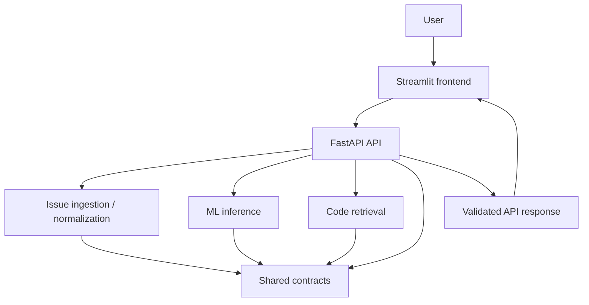
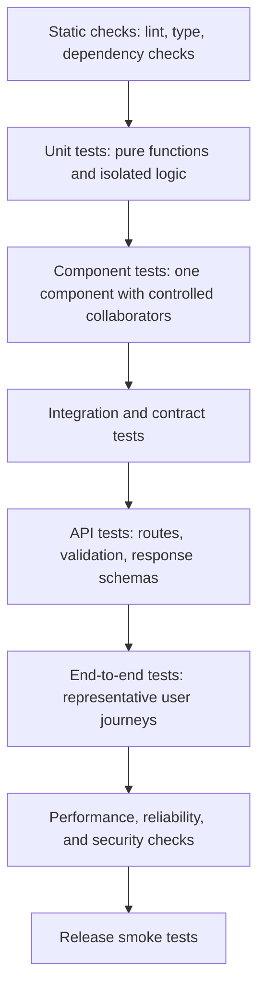

# ORDO QA and Test Automation Engineer Implementation Blueprint

**Project:** ORDO — AI-Powered GitHub Issue Intelligence Platform  
**Document:** `ORDO_QA_Test_Automation_Engineer_Blueprint.md`  
**Status:** Initial implementation blueprint — repository audit pending  
**Audience:** QA Engineer, component engineers, Integration Engineer, DevOps/CI-CD Engineer, Security/Privacy Reviewer, Team Lead

> **Important repository limitation:** The ORDO repository has not been provided in this conversation and was previously reported as not yet created. Therefore, this document does not claim to have inspected production source code, identified real routes or functions, run tests, or measured coverage. Paths, interfaces, commands that depend on project configuration, and test examples marked **proposed**, **conditional**, or **placeholder** must be checked against the repository after it exists. Do not copy proposed tests blindly if their imports or contracts do not match the implemented application.

---

## 1. Document Overview

### 1.1 Purpose

This manual defines how ORDO QA should audit the repository, establish a repeatable test environment, create deterministic tests, validate cross-component contracts, report defects, integrate checks into CI, and provide evidence for release decisions.

It is an implementation manual, not evidence that implementation or tests already exist.

### 1.2 Outcomes

By following this document, the QA Engineer should be able to:

1. Record the actual state of the repository before writing tests.
2. Identify public interfaces and ownership boundaries.
3. Build a test plan based on implemented behavior and approved requirements.
4. Test success, validation, boundary, and failure paths.
5. isolate external services and avoid unreliable network dependencies.
6. produce reproducible test and coverage reports.
7. classify failures correctly and assign them to the right owner.
8. provide a factual release-readiness report.

### 1.3 Evidence labels

Use these labels throughout the project:

- **Confirmed:** directly verified from source, configuration, or a command that was run.
- **Observed failure:** a command or test was run and failed; preserve its output and environment details.
- **Gap:** required behavior or test infrastructure is absent after inspection.
- **Proposed:** recommended future design, not yet approved or implemented.
- **Placeholder:** must be replaced with a verified path, route, field, command, or owner.
- **Not run:** no execution evidence exists.

Never convert a proposed behavior into an acceptance criterion without product/Team Lead approval.

---

## 2. ORDO Project Context

ORDO is intended to provide GitHub issue intelligence. Expected functional areas from the project brief include:

- GitHub issue ingestion and normalization.
- Machine-learning inference and issue intelligence.
- Code retrieval and ranking.
- FastAPI backend endpoints.
- Streamlit frontend interactions.
- Shared schemas and contracts.
- Configuration and supporting infrastructure.

These are project-level expectations, **not confirmation that each component exists**.

### 2.1 Expected request path to verify



This diagram is a hypothesis to validate against the actual architecture. Revise it if the source code uses a different flow.

### 2.2 First principle

Test the public behavior that exists. Do not invent a function, route, schema, ranking algorithm, database, embedding model, or output label simply because it appears in a reference architecture.

---

## 3. QA Responsibilities and Ownership

### 3.1 QA Engineer responsibilities

The QA Engineer owns the test approach and test evidence, including:

- Repository audit and test inventory.
- Test planning and traceability to requirements.
- Unit, component, integration, API, and feasible end-to-end tests.
- Positive, negative, boundary, and failure-path coverage.
- Test fixtures and synthetic test data.
- Mocking and external dependency isolation.
- Regression test design for defects.
- Coverage interpretation and critical-path gap analysis.
- CI test integration in coordination with DevOps.
- Defect reporting, retesting, and release-readiness evidence.
- Maintaining clear commands and reproducible test instructions.

QA does **not** independently redefine product behavior, silently change component contracts, rewrite production code owned by another engineer, or weaken assertions to obtain a green pipeline.

### 3.2 Ownership and collaboration

| Area | Primary implementation owner | QA collaboration |
|---|---|---|
| GitHub ingestion and normalization | Data Engineer | Validate schema, pagination, retries, malformed data, and external failures |
| ML preprocessing and inference | ML Engineer | Validate input/output contract, determinism, invalid inputs, model loading |
| Code retrieval and ranking | Code Retrieval Engineer | Validate query behavior, ordering, path boundaries, missing index/source handling |
| FastAPI routes and service orchestration | Backend Engineer | Validate HTTP contract, status codes, dependency failures, safe errors |
| Streamlit UI and API client | Frontend Engineer | Validate controls, user input, rendering, session state, error states |
| Cross-component integration | Integration Engineer | Validate compatibility and request/response flow |
| CI, containers, test jobs | DevOps/CI-CD Engineer | Define required checks and verify reports |
| Threat model and security controls | Security/Privacy Reviewer | Validate security cases and ensure tests do not expose secrets |
| Scope, acceptance, release decisions | Team Lead / product owner | Obtain decisions on ambiguous requirements and quality gates |

### 3.3 Defect ownership rule

A test failure is not automatically an application defect. Classify it first:

1. Application behavior contradicts an approved contract.
2. Test expectation contradicts the approved contract.
3. Environment or dependency setup is broken.
4. Configuration differs from the documented test environment.
5. An external dependency failed.
6. Two components implement incompatible contracts.

Give the defect to the owner of the failing behavior or contract. QA remains responsible for evidence and retesting.

---

## 4. Repository Inspection

**Run these commands from the repository root after the repository has been created or cloned.** Because the repository is not currently available here, the commands below are a checklist, not evidence of a completed audit.

### 4.1 Establish repository identity and working-tree state

**PowerShell**
```powershell
Get-Location
Get-ChildItem -Force
git rev-parse --show-toplevel
git status --short --branch
git branch --show-current
git log -5 --oneline --decorate
```

**Bash**
```bash
pwd
ls -la
git rev-parse --show-toplevel
git status --short --branch
git branch --show-current
git log -5 --oneline --decorate
```

What to check:
- `git rev-parse` must identify the intended ORDO repository.
- Record the current branch; do not assume `main`, `develop`, or an integration branch.
- Do not discard or overwrite uncommitted changes.
- Ask the Team Lead which base branch and PR convention to use if they are not documented.

### 4.2 Inventory source and configuration files

**PowerShell**
```powershell
Get-ChildItem -Force -Recurse -File |
  Where-Object {
    $_.FullName -notmatch '\\(\.git|\.venv|venv|__pycache__|node_modules)\\'
  } |
  Select-Object -ExpandProperty FullName
```

**Bash**
```bash
find . -type f \
  -not -path './.git/*' \
  -not -path './.venv/*' \
  -not -path './venv/*' \
  -not -path '*/__pycache__/*' \
  -not -path '*/node_modules/*' | sort
```

Review, if present:
- `pyproject.toml`, `requirements*.txt`, lock files, package-manager configuration.
- `pytest.ini`, `tox.ini`, `.coveragerc`, coverage settings in `pyproject.toml`.
- `tests/`, `conftest.py`, fixtures, test utilities.
- `apps/`, `packages/`, `shared/`, or the actual source layout.
- `.github/workflows/`, Docker files, Compose files, README and developer docs.
- `.env.example` or equivalent. Never print the contents of real `.env` files into logs or reports.

### 4.3 Determine Python and dependency tooling

```powershell
python --version
python -c "import sys; print(sys.executable)"
python -m pip --version
Get-Command python, pytest -ErrorAction SilentlyContinue
```

Bash:
```bash
python --version
python -c 'import sys; print(sys.executable)'
python -m pip --version
command -v python
command -v pytest || true
```

Inspect dependency manifests before installing anything. Use the package manager already adopted by the project. Do not add a second dependency manager or overwrite a shared dependency file without review.

### 4.4 Locate test and application entry points

PowerShell:
```powershell
Get-ChildItem -Recurse -File -Include test_*.py,*_test.py,conftest.py,pytest.ini,pyproject.toml
Get-ChildItem -Recurse -File -Include *.py |
  Select-String -Pattern 'FastAPI\(|APIRouter\(|@app\.|@router\.|st\.'
```

Bash:
```bash
find . -type f \( -name 'test_*.py' -o -name '*_test.py' -o -name 'conftest.py' -o -name 'pytest.ini' -o -name 'pyproject.toml' \)
grep -RInE 'FastAPI\(|APIRouter\(|@app\.|@router\.|st\.' \
  --include='*.py' . \
  --exclude-dir=.git --exclude-dir=.venv --exclude-dir=venv
```

These searches are reconnaissance aids, not substitutes for reading the code. Review routers, Pydantic models, dependency injection, HTTP clients, ML loading code, retrieval interfaces, and Streamlit API calls directly.

### 4.5 Audit CI and container setup

PowerShell:
```powershell
Get-ChildItem .github\workflows -File -ErrorAction SilentlyContinue
Get-ChildItem -Force -File -Include Dockerfile,docker-compose.yml,compose.yml,Makefile
```

Bash:
```bash
find .github/workflows -maxdepth 2 -type f 2>/dev/null
find . -maxdepth 3 -type f \( -iname 'Dockerfile' -o -iname 'docker-compose.yml' -o -iname 'compose.yml' -o -iname 'Makefile' \)
```

Read existing workflows before proposing edits. Record Python versions, OS runners, cache strategy, services, secrets usage, test commands, report artifacts, and branch triggers.

### 4.6 Required audit output

Create a tracked audit note such as `docs/qa/repository-audit.md` only after confirming the docs convention and obtaining any required approval. Record:

| Category | Evidence to record |
|---|---|
| Repository identity | Root path, branch, commit, clean/dirty state |
| Runtime | Python version, OS, package manager |
| Components | Actual source paths and public entry points |
| Tests | Existing test files, framework, fixtures, markers |
| Configuration | Discovery, coverage, warnings, environment handling |
| CI | Workflows, jobs, required checks, artifacts |
| Known failures | Exact command, exit code, sanitized output |
| Gaps | Missing tests or infrastructure tied to requirements |
| Decisions | Questions, approver, decision date, resulting change |

---

## 5. Confirmed Facts, Existing Coverage, and Gaps

### 5.1 Current evidence status

At document creation, the only verified project-specific information is what the supplied ORDO brief states. The repository itself was not available for inspection.

| Item | Status | Evidence / next action |
|---|---|---|
| ORDO intended purpose and broad component areas | Confirmed from project brief | Validate implementation against source |
| Repository root and actual directory structure | Not inspected | Run Section 4 commands |
| Python version and dependency manager | Not inspected | Read manifests and run version commands |
| Existing test files and fixtures | Not inspected | Inventory `tests/` and configuration |
| Actual ingestion, ML, and retrieval interfaces | Not inspected | Read production source and contracts |
| Actual FastAPI routes and response models | Not inspected | Inspect router registration and schemas |
| Actual Streamlit structure | Not inspected | Inspect pages, API client, session state |
| Current test results | Not run | Run baseline commands after environment setup |
| Coverage percentage | Not measured | Generate report only after a valid baseline |
| CI behavior | Not inspected | Read workflows and run-equivalent commands locally |

Do not label any item above “passing,” “implemented,” or “covered” without evidence.

### 5.2 Baseline before adding tests

1. Install dependencies using the repository's documented method.
2. Run existing lint/type checks if configured.
3. Run the existing test command unchanged.
4. Save the command, timestamp, commit SHA, environment, exit code, and sanitized output.
5. Separate pre-existing failures from failures introduced by QA changes.
6. Do not change application behavior or test expectations just to make the baseline green.

---

## 6. Testing Pyramid



The diagram communicates the layers; it is not a requirement that every test pipeline execute in this exact sequence.

| Layer | Purpose | Dependencies | Typical frequency | Failure consequence |
|---|---|---|---|---|
| Static checks | Catch syntax, style, type, and dependency issues | Installed tools | Every PR | Block if required by policy |
| Unit | Verify one function/class in isolation | Minimal; fakes/mocks as needed | Every PR | Block PR for regression |
| Component | Verify one package or service boundary | Test doubles and local fixtures | Every PR | Block PR for regression |
| Contract | Verify schemas and compatibility between owners | Actual shared models | Every PR | Block incompatible changes |
| Integration | Verify multiple components cooperate | Local services or deterministic fakes | PR or dedicated CI job | Block merge when required |
| API | Verify actual HTTP behavior and safe errors | FastAPI test client; mocked downstream services | Every PR for core routes | Block merge for API regressions |
| End-to-end | Verify a representative user journey | Running local stack and UI/API test tooling | Scheduled, release, or selected PRs | Block release for critical journey failure |
| Performance/reliability | Measure approved workload and resilience | Controlled environment | Scheduled/release | Compare with approved limits |
| Security | Check selected controls and known risks | Approved test environment | PR and scheduled/release | Follow security policy |
| Release smoke | Confirm deployed build's essential behavior | Release candidate environment | Every release | No release if critical smoke fails |

Avoid repeating identical assertions at every layer. Unit tests explain edge cases; integration tests prove boundaries work together; end-to-end tests prove a small number of user journeys.

---

## 7. Testing Environment Setup

### 7.1 Choose the repository's existing workflow first

Before running install commands, identify the project's package manager and Python version. Use the README and lock file as the source of truth.

If the project uses a standard `requirements.txt` and does not prohibit virtual environments, a Windows PowerShell setup may be:

```powershell
# Run from the repository root
py -0p
py -3.12 -m venv .venv
.\.venv\Scripts\Activate.ps1
python -m pip install --upgrade pip
python -m pip install -r requirements.txt
```

**Conditional example only:** replace `3.12` with the version actually supported by the repository. Do not install a new Python version solely because this example uses it. If test dependencies are in `requirements-dev.txt`, install it only if that file exists and is the project's convention:

```powershell
python -m pip install -r requirements-dev.txt
```

Bash equivalent:
```bash
python3 -m venv .venv
source .venv/bin/activate
python -m pip install --upgrade pip
python -m pip install -r requirements.txt
```

If the project uses uv, Poetry, PDM, or another manager, follow its checked-in lock file and documented commands instead. Do not mix installation approaches.

### 7.2 Verify the environment

```powershell
python --version
python -c "import sys; print(sys.executable)"
python -m pip list
```

Expected: Python and packages resolve from the intended environment. If `sys.executable` points to a global Python or a different project environment, stop and correct the interpreter selection before interpreting test failures.

### 7.3 Environment variables

- Use a test-specific configuration or environment fixture.
- Read the documented `.env.example` or configuration schema, if present.
- Use synthetic test values, never production tokens.
- Do not print environment values to CI logs.
- Ensure unit tests do not require a real GitHub token, cloud credentials, or remote model credentials.
- If configuration is loaded at import time, consider a small ownership-aware refactor to defer loading or allow dependency injection; seek owner approval.

### 7.4 Working directory and imports

Run project test commands from the repository root unless the project documents a package-specific command. Do not solve import errors by inserting arbitrary absolute paths into tests. Prefer the project's packaging configuration and documented editable-install workflow.

---

## 8. Test Directory Structure

First preserve the current conventions. If no structure exists, the following is a **proposed** structure for Team Lead approval:

```text
tests/
├── conftest.py
├── fixtures/
│   ├── issues/
│   └── repositories/
├── unit/
│   ├── test_ingestion_normalization.py
│   ├── test_ml_preprocessing.py
│   └── test_retrieval_ranking.py
├── component/
│   ├── test_ingestion_client.py
│   ├── test_ml_inference.py
│   └── test_retrieval_service.py
├── contracts/
│   └── test_shared_contracts.py
├── api/
│   ├── test_health.py
│   └── test_issue_routes.py
├── integration/
│   ├── test_ingestion_to_intelligence.py
│   └── test_backend_contracts.py
├── e2e/
│   └── test_primary_user_journey.py
├── performance/
└── security/
```

| File/group | Why it exists | Production owner | How to run |
|---|---|---|---|
| `conftest.py` | Shared, genuinely reusable fixtures | QA-owned test infrastructure | `python -m pytest --fixtures` |
| `fixtures/` | Small synthetic records and repository samples | QA with component owner review | Consumed by selected tests |
| `unit/` | Isolated behavior and edge cases | Relevant component owner | `python -m pytest tests/unit` |
| `component/` | Package behavior with controlled collaborators | Relevant component owner | `python -m pytest tests/component` |
| `contracts/` | Cross-component schema compatibility | Integration Engineer + owners | `python -m pytest tests/contracts` |
| `api/` | HTTP status, validation, and response behavior | Backend Engineer | `python -m pytest tests/api` |
| `integration/` | Multi-component local flow | Integration Engineer | `python -m pytest tests/integration` |
| `e2e/` | Small number of full user journeys | QA + Frontend/Backend owners | `python -m pytest tests/e2e` |
| `performance/` | Approved benchmark/load cases | Owner of measured service + DevOps | Run only with documented profile |
| `security/` | Repeatable security regression cases | Security Reviewer + component owner | Run approved safe suite |

Keep synthetic fixtures small, versioned, and free of real private issue text or tokens.

---

## 9. Pytest Configuration and Fixtures

### 9.1 Inspect before editing

Check for existing configuration in `pyproject.toml`, `pytest.ini`, `tox.ini`, `setup.cfg`, and coverage files. Do not replace a shared file wholesale. Merge only after reviewing existing settings and obtaining approval where required.

### 9.2 Proposed minimal pytest configuration

If the repository has no existing pytest configuration and pytest is approved, add a compatible section to the existing `pyproject.toml` rather than creating duplicate configuration files:

```toml
[tool.pytest.ini_options]
testpaths = ["tests"]
python_files = ["test_*.py", "*_test.py"]
python_classes = ["Test*"]
python_functions = ["test_*"]
addopts = "-ra"
markers = [
  "unit: fast isolated unit tests",
  "component: tests of one component with controlled collaborators",
  "contract: shared schema and interface compatibility tests",
  "integration: tests involving multiple components",
  "e2e: end-to-end tests requiring a running local stack",
  "slow: tests that are slower than the default PR suite",
  "external: opt-in tests that contact an external service",
  "security: approved security regression tests",
  "performance: benchmark or load tests"
]
```

This is a proposal, not a claim that it matches the current project configuration. Add a `coverage` configuration only after identifying the actual source packages and existing coverage tooling.

### 9.3 Example shared fixture

The following is generic pytest infrastructure. Add it only if it fits the repository and avoids duplication:

```python
# tests/conftest.py
from __future__ import annotations

import pytest


@pytest.fixture
def sample_issue_payload() -> dict:
    """Synthetic issue-shaped input; align fields with the approved contract."""
    return {
        "id": 1001,
        "number": 17,
        "title": "Synthetic test issue",
        "body": "A deterministic fixture used only by automated tests.",
        "state": "open",
        "html_url": "https://example.invalid/org/repo/issues/17",
    }
```

**Important:** the fields above are illustrative and must be reconciled with the actual approved schema before use. If the contract requires different identifiers or field names, update the fixture with the owning engineer; do not change production contracts merely to match this example.

### 9.4 Fixture rules

- Prefer function-scoped fixtures for mutable state.
- Use `tmp_path` for filesystem tests.
- Use monkeypatch or explicit dependency injection to isolate external services.
- Avoid global mutable fixtures and tests that depend on execution order.
- Use deterministic fake model outputs for interface tests.
- Name fixtures by purpose, not implementation trivia.
- Keep secrets out of fixture files, snapshots, exception text, and test output.

### 9.5 Run discovery and focused tests

```powershell
python -m pytest --collect-only -q
python -m pytest tests/unit -q
python -m pytest -m "not e2e and not external and not performance" -q
```

Use paths and markers that actually exist. An empty collection is a discovery problem to investigate, not a reason to report success.

---

## 10. Data Ingestion Tests

### 10.1 Inspect the real interface

Locate the ingestion client, normalization function, paging loop, retry policy, and output schema. Record exact function/class names and injected HTTP client approach before writing tests.

### 10.2 Test matrix

| Scenario | Input / controlled dependency | Expected assertion |
|---|---|---|
| Valid issue response | Synthetic valid payload | Output matches the approved normalized schema |
| Empty page | Empty list response | Empty result or documented termination behavior |
| Missing optional field | Valid payload without optional field | Default/null behavior follows contract |
| Missing required field | Invalid payload | Documented validation error or rejection |
| Wrong data type | Malformed field type | Controlled error; no silent corruption |
| Timestamp normalization | Fixed timestamp/time zone variants | Normalized representation matches contract |
| Duplicate issue | Same stable issue identifier twice | Behavior follows approved deduplication policy |
| Pagination | Multiple mocked pages | All expected pages consumed once and in order |
| Rate limit | Mocked rate-limit response | Retry/backoff behavior matches policy, if implemented |
| Timeout/network error | Mocked transport exception | Bounded retry or clear failure |
| Authentication failure | Mocked unauthorized response | Error surfaced safely; no secret in message |
| HTTP error | Mocked 4xx/5xx | Defined exception/error mapping |
| Malformed JSON | Response JSON decoder raises | Controlled failure, no unhandled data corruption |
| Partial page failure | One page fails after earlier success | Partial-result policy is explicit and tested |
| Stable schema | Multiple valid records | Output field names and types remain consistent |

Do not assert retries, pagination, deduplication, or partial success unless the feature exists or is approved as required behavior.

### 10.3 Mock external HTTP

Use the HTTP mocking library already adopted by the repository. If none exists, ask the owner to approve either a small `httpx` mock transport or an established mocking dependency. Avoid adding a second HTTP mocking tool without a reason.

The test should intercept the HTTP boundary, not call GitHub. For retry tests, avoid real sleep; inject a sleep/backoff function or use the existing retry abstraction. Assert the number and order of requests, bounded attempts, and final outcome.

### 10.4 Acceptance criteria

- Unit tests do not need network access.
- Synthetic inputs cover normal, malformed, and boundary cases.
- Time-dependent behavior uses fixed timestamps or a controllable clock.
- External errors are translated into stable, documented failures.
- Logs and exceptions do not expose tokens or private payloads.

---

## 11. ML Engine Tests

### 11.1 Inventory actual functionality

Confirm whether the package implements preprocessing, training, evaluation, inference, model loading, serialization, or only a subset. Test only implemented functions and approved contracts.

### 11.2 Test matrix

| Scenario | Strategy | Expected assertion |
|---|---|---|
| Valid input | Approved sample input | Output type and schema match contract |
| Invalid/missing input | Malformed sample | Defined validation behavior |
| Feature preprocessing | Small fixed fixture | Shape, dtype, ordering, and invariant values |
| Output shape | Deterministic fake or tiny fixture | Correct dimensions; no fabricated predictions |
| Prediction type | Controlled fake model | Serializable type expected by caller |
| Missing artifact | Temporary path that does not exist | Clear, safe load error |
| Invalid artifact | Corrupt temporary artifact | Controlled error |
| Feature dimension mismatch | Wrong-size input | Validation failure before unsafe inference |
| Serialization | Representative output | JSON serialization succeeds |
| Reproducibility | Fixed seeds where supported | Stable properties, not unsupported exact values |

### 11.3 Fake model pattern

Use a fake only when testing the integration boundary, not to claim the actual model is correct:

```python
class FakeModel:
    def predict(self, features):
        # Replace this return shape with the real, approved model contract.
        return ["synthetic-label" for _ in features]
```

The example's label and output shape are placeholders. Align them to the real model interface. A passing test with `FakeModel` proves that the caller handles that fake contract; it does not validate model quality or accuracy.

### 11.4 Model-specific safeguards

- Do not download a large model during ordinary unit tests.
- Avoid asserting exact floating-point output unless the model and environment support deterministic results.
- Use tolerances for approved numeric invariants.
- Separate preprocessing tests from model-quality evaluation.
- Do not invent accuracy, F1, confidence thresholds, class names, or production SLAs.
- Track model artifact version and feature schema for any approved evaluation report.

---

## 12. Code Retrieval Tests

### 12.1 Inspect before testing

Determine whether retrieval uses filesystem search, lexical ranking, embeddings, a vector index, a database, or another mechanism. Do not assume a vector database or a particular ranking model.

Record:
- Public query interface.
- Result schema and metadata.
- Ranking/tie-breaking rules.
- Index creation and loading behavior.
- Repository path restrictions.
- Error behavior when source/index data is absent.

### 12.2 Test matrix

| Scenario | Test setup | Expected assertion |
|---|---|---|
| Valid query | Small synthetic repository/index | Results conform to the approved result schema |
| Empty query | Empty string | Defined validation or empty-result behavior |
| Whitespace query | Spaces/tabs only | Same explicit policy every run |
| No matches | Query absent from fixture | Empty list or documented no-match response |
| Multiple results | Controlled files/documents | Ranking order follows documented scoring rules |
| Duplicate results | Duplicate index entries | Deduplication policy is respected, if required |
| Invalid repository context | Invalid identifier/path | Controlled rejection |
| Missing index | Temporary missing index path | Clear initialization/retrieval error |
| Missing source files | Index points to absent files | Safe handling and documented result |
| File-read error | Controlled permission/read failure | Error surfaced without path leakage |
| Malformed index | Invalid test index data | Controlled error, no silent wrong ranking |
| Dependency failure | Fake retrieval backend raises | Service translates error safely |
| Metadata validation | Missing or malformed metadata | Contract validation works |
| Path boundary | Traversal-like path or symlink fixture | No returned/read path escapes approved root |

### 12.3 Temporary repository fixture

Build a tiny repository under `tmp_path` using synthetic source files. Never depend on a developer's home directory, current checkout's private files, or absolute machine-specific paths.

For path containment, resolve candidate paths and verify they remain beneath the approved repository root. Include symlink behavior if the implementation follows symlinks. If path safety is not yet implemented, file a defect rather than making the test silently accept unsafe behavior.

### 12.4 Ranking evaluation

If ranking quality is a product requirement, the Team Lead and retrieval owner must approve:
- A small, versioned query-to-relevant-file dataset.
- The relevance judgment process.
- Metrics such as precision@k, recall@k, or MRR, if suitable.
- Acceptance thresholds and how ties are handled.

Do not invent a threshold or claim retrieval quality based only on a few hand-picked examples.

---

## 13. Shared Contract Tests

### 13.1 Contract inventory

Identify the actual shared models and schemas. For each contract, record:
- Canonical owner and file.
- Required and optional fields.
- Identifier types.
- Nullability.
- Timestamp format/time zone.
- Enum values.
- Serialization behavior.
- Versioning/backward-compatibility expectations.
- Consumers in API, ML, retrieval, ingestion, and UI.

### 13.2 Contract test cases

Test required fields, optional fields, explicit nulls, wrong types, invalid identifiers, timestamps, JSON round-tripping, and compatibility between producer and consumer. Validate error messages without relying on brittle full stack traces.

If duplicate schemas exist, report the exact files and divergent fields. Propose consolidation to one approved contract; do not create a third schema as a workaround.

### 13.3 Generic JSON serialization check

Once an actual model is identified, use its real construction and serialization API. For example, if it is a Pydantic model:

```python
import json

def assert_json_round_trip(model):
    payload = model.model_dump(mode="json")
    encoded = json.dumps(payload)
    decoded = json.loads(encoded)
    assert decoded == payload
```

This helper is only applicable to compatible models and Pydantic versions. Adapt it to the actual contract and project version; do not import a made-up ORDO schema.

---

## 14. FastAPI Tests

### 14.1 Audit the application

Inspect application creation, router registration, dependencies, request/response models, exception handlers, authentication middleware, and startup/lifespan behavior. Record actual HTTP methods, paths, status codes, payloads, and response shapes.

### 14.2 Test each actual endpoint

For each route, maintain a table:

| Field | Required evidence |
|---|---|
| Method and route | Exact registered route |
| Request | Actual model, query parameters, headers |
| Success | Approved status and response schema |
| Validation | Missing/invalid input behavior |
| Empty/not-found | Status and response body |
| Dependencies | Which services/clients are mocked |
| Failure paths | Timeout, external failure, internal exception |
| Security | Authentication/access controls, safe error details |
| Test location | Actual test file and exact command |

### 14.3 TestClient pattern — adapt to actual app

The following is a **template**, not runnable until `create_app` and the import path are verified. Replace the placeholder import with the actual application factory or application object:

```python
# tests/api/test_example_route.py
from fastapi.testclient import TestClient

# PLACEHOLDER: replace with the real import after repository inspection.
# from apps.api.main import app

def test_example_route_returns_expected_contract(app):
    client = TestClient(app)

    # PLACEHOLDER: replace with a real route and approved contract.
    response = client.get("/REPLACE_WITH_REAL_ROUTE")

    assert response.status_code == 200
```

Do not leave placeholder tests in the active test suite. A fixture named `app` must be defined and should use the actual app creation path. Prefer dependency overrides or injected fakes over patching global state. Restore dependency overrides after each test.

### 14.4 Error safety

For unexpected exceptions, assert that the client receives the documented safe error shape. Verify that response bodies do not contain stack traces, filesystem paths, authorization headers, API keys, or environment variable values. Log useful diagnostic details only on the server side and sanitize sensitive data.

### 14.5 Run

Once paths are confirmed:
```powershell
python -m pytest tests\api -q
```

Bash:
```bash
python -m pytest tests/api -q
```

---

## 15. Streamlit Tests

### 15.1 Inspect the frontend

Identify actual Streamlit entry points, pages, API client functions, session-state keys, configuration, and error rendering. Check the installed Streamlit version before choosing test APIs.

### 15.2 Testable behaviors

- Page renders without an exception.
- Required controls exist.
- Input is validated and normalized.
- The API client receives the correct parameters.
- Successful results render correctly.
- Empty results are distinguishable from failures.
- Loading and error states are understandable.
- Timeouts and backend errors are handled.
- Session state persists only where intended.
- Credentials are not displayed or logged.

### 15.3 Testing approach

Prefer Streamlit's supported app-testing utilities when compatible with the installed version. Mock the API client boundary rather than starting a production backend for every UI test. Keep UI tests independent of real cloud credentials.

If UI logic is embedded entirely in the page script, recommend a minimal refactor that moves request/response transformation into a testable function or client module. The Frontend Engineer owns that production refactor; QA should not redesign the interface merely to simplify testing.

### 15.4 Manual verification checklist

When automation cannot reliably cover browser layout or interaction details, perform and record a manual smoke test:
- Page starts using the documented command.
- Main controls are visible and keyboard-accessible.
- Valid input produces the expected response.
- Empty input and backend errors produce clear feedback.
- Long results and empty results remain usable.
- Refresh/new session behavior is as intended.
- Secrets, internal traces, and private configuration are not shown.

Manual checks must be marked **manual**, not reported as automated tests.

---

## 16. End-to-End Tests

### 16.1 Scope

Automate a small number of high-value user journeys. The exact flow must follow the implemented UI and API contract. The expected generic journey is:

1. Start the local backend and any required local dependencies.
2. Wait for readiness using a documented health route, if one exists.
3. Submit a valid user query through the supported client/interface.
4. Verify the request contract.
5. Exercise the intended backend service flow.
6. Verify response schema and safe error behavior.
7. Confirm the UI renders the response, if browser/UI automation is supported.
8. Exercise one controlled failure path.
9. Stop services and clean temporary resources.

### 16.2 Prerequisites and safeguards

- Use an isolated test configuration and synthetic data.
- Do not use production credentials or modify production data.
- Stub GitHub, remote model services, and other external calls unless an approved opt-in smoke test explicitly requires them.
- Start services with documented commands and wait for readiness; do not rely on arbitrary sleeps.
- Capture sanitized logs and retain the exact command/commit used.

### 16.3 API end-to-end vs browser end-to-end

If browser tooling is unavailable or not approved, create a local API flow test and separately document manual Streamlit verification. Do not describe an API-only test as a full UI end-to-end test.

### 16.4 Failure diagnostics

When an E2E test fails, inspect in order:
1. Service startup logs and process exit codes.
2. Readiness check result.
3. Request URL, method, payload shape, and sanitized response.
4. Dependency override/mock activation.
5. Backend logs around the request.
6. Contract differences between API and UI.
7. Cleanup and port conflicts.

---

## 17. External Dependency Isolation

### 17.1 Dependencies to inventory

Potential dependencies include GitHub API, remote inference services, local model processes, retrieval indexes, databases, and other HTTP services. Include only those found in the actual code.

### 17.2 Isolation methods

- Mock HTTP responses at the transport/client boundary.
- Use dependency injection for service clients.
- Use deterministic fake models for orchestration tests.
- Use `tmp_path` for temporary repositories, indexes, and files.
- Use disposable local databases only if the application actually requires one.
- Simulate timeouts, rate limits, authorization errors, and 5xx responses.
- Use explicit opt-in markers for live tests.
- Keep test data synthetic and stable.

### 17.3 Optional live smoke tests

Live tests must be clearly separated from normal CI tests, require explicit opt-in, document required environment variables without printing values, and use read-only or otherwise safe operations. Fail with a clear “configuration required” message when opt-in prerequisites are missing. Never let routine unit tests silently make network requests.

### 17.4 Repeatability

A test should not depend on network availability, wall-clock timing, current GitHub contents, user-specific filesystem paths, remote model versions, or test execution order unless the test is explicitly designed and labeled to measure that dependency.

---

## 18. Coverage and Quality Gates

### 18.1 Establish baseline first

Inspect existing coverage configuration and identify the actual production source packages. Do not report a percentage until a coverage command has run successfully against the intended code.

### 18.2 Conditional pytest-cov commands

If `pytest-cov` is already installed or approved and source package names are known:

```powershell
python -m pytest --cov=REPLACE_WITH_REAL_PACKAGE --cov-branch --cov-report=term-missing --cov-report=html --cov-report=xml
```

Replace the placeholder with a verified import/package name. Do not run it unchanged. Typical outputs are a terminal summary, `htmlcov/`, and `coverage.xml`; confirm the actual configured output paths.

### 18.3 Interpreting coverage

Track:
- Line coverage and branch coverage where supported.
- Critical modules and untested branches.
- Validation/error paths.
- Security boundaries and path handling.
- Contract and serialization behavior.
- Gaps that are intentional, unreachable, generated, or not applicable.

Coverage is a map of executed code, not proof of correctness. Prioritize meaningful assertions over a high percentage.

### 18.4 Thresholds

No existing ORDO threshold has been verified. The Team Lead should approve any new threshold after the baseline and critical-path risks are understood. A threshold must not be reduced simply to pass CI. Exclusions should be narrow, documented, and justified.

### 18.5 Report artifacts

Publish test and coverage reports from CI only after confirming artifact retention policy. Avoid uploading secrets, private issue fixtures, full environment dumps, or sensitive logs.

---

## 19. Performance and Reliability Testing

### 19.1 Requirements first

No ORDO performance SLA or workload profile has been verified. The Team Lead and relevant owners must define:
- Expected request volume and concurrency.
- Representative issue/repository sizes.
- Latency metric and percentile.
- Throughput target, if relevant.
- Resource constraints.
- Test environment and duration.
- Pass/fail thresholds and acceptable error rate.

Do not invent SLAs.

### 19.2 Types of tests

- **Functional:** verifies correct behavior for a defined input.
- **Load:** measures behavior under an expected workload.
- **Stress:** increases load beyond expected conditions to understand failure behavior.
- **Soak:** runs a sustained workload to expose leaks or degradation.
- **Reliability:** tests recovery, retries, timeouts, and behavior under dependency failures.

### 19.3 Candidate measurements

Measure only applicable components: ingestion throughput, API latency, ML inference latency, retrieval latency, memory use, concurrency, startup time, and dependency timeout behavior.

Run lightweight deterministic benchmarks locally when useful. Run controlled load/stress/soak tests only in an approved environment. Never load-test GitHub or another external service without authorization.

---

## 20. Security and Privacy Testing

Coordinate with the Security/Privacy Reviewer. Automated checks are evidence for specific controls, not proof that the application is completely secure.

### 20.1 Candidate test cases

- Missing or invalid authentication, if authentication exists.
- Unauthorized access to protected resources.
- Malformed input and boundary values.
- Secrets absent from responses, logs, tracebacks, and reports.
- Sensitive values redacted in error handling.
- Repository path traversal and symlink boundary cases.
- Safe client-facing errors for unexpected exceptions.
- Dependency vulnerability checks using approved tooling.
- Secure defaults for configuration.
- Access-control enforcement across routes.
- External API errors handled without leaking credentials or private payloads.

### 20.2 Safety constraints

- Use synthetic data and approved test environments.
- Do not test against external systems without authorization.
- Do not run destructive tests or alter production data.
- Keep vulnerability findings access-controlled according to team policy.
- Do not print secret values to confirm that a secret exists; assert only that known sentinel values are absent from outputs.

### 20.3 Security handoff

For each issue, provide the affected component, attack preconditions, reproducible safe test, impact, sanitized evidence, and recommended owner. Let the Security Reviewer decide severity and whether a test requires restricted handling.

---

## 21. CI Integration

### 21.1 Audit before changing workflows

Read the actual CI workflows and ask the DevOps/CI-CD Engineer before changing shared pipeline behavior. Confirm the runner OS, Python version, package manager, cache keys, service containers, secrets policy, and required status checks.

### 21.2 Recommended stages

1. Install dependencies reproducibly from the approved lock/manifests.
2. Run configured static checks.
3. Run fast unit tests.
4. Run contract/component tests.
5. Run integration tests that need only local deterministic dependencies.
6. Generate coverage and test reports.
7. Upload approved artifacts.
8. Run slow, performance, external, or release smoke tests in separate jobs when appropriate.

### 21.3 Illustrative workflow — not a drop-in replacement

The following example is intentionally a **template**. Do not add it as a new workflow until the current CI system, package manager, Python version, and existing workflow behavior are verified. Do not overwrite an existing workflow with this sample.

```yaml
name: QA tests

on:
  pull_request:
  push:
    branches: ["REPLACE_WITH_APPROVED_BRANCH"]

jobs:
  tests:
    runs-on: ubuntu-latest
    steps:
      - uses: actions/checkout@v4

      # Replace with the Python version approved for this repository.
      - uses: actions/setup-python@v5
        with:
          python-version: "REPLACE_WITH_SUPPORTED_PYTHON_VERSION"

      # Replace with the existing dependency-manager workflow.
      - name: Install dependencies
        run: |
          python -m pip install --upgrade pip
          python -m pip install -r requirements.txt
          # Install test dependencies using the repository's existing convention.

      - name: Run tests
        run: python -m pytest -q
```

This sample is incomplete until placeholders are resolved and the project dependencies/configuration are inspected. Add no secrets unless a specific approved test requires them. Prefer no external credentials in PR jobs.

### 21.4 CI acceptance

- Required tests fail the job on nonzero exit.
- Test commands match documented local commands.
- Dependency installation is reproducible.
- Test/coverage reports are published only if configured.
- External tests are opt-in or isolated in a separate job.
- Logs do not print secrets.
- CI and local differences are diagnosable.
- Workflow edits are reviewed by DevOps and the Team Lead.

---

## 22. Defect Reporting and Test Evidence

### 22.1 Defect template

```markdown
## Title
[Component] Concise description of the observed defect

## Classification
Application defect / Test defect / Environment / Configuration /
External dependency / Contract mismatch

## Environment
- Commit:
- Branch:
- OS:
- Python:
- Dependency manager:
- Relevant package versions:

## Prerequisites
List required services, fixture, configuration, and user state.

## Reproduction steps
1.
2.
3.

## Expected result
State the approved requirement or contract.

## Actual result
Describe what happened without speculation.

## Evidence
- Exact command:
- Exit code:
- Sanitized output/logs:
- Related test:
- Screenshot/report, if applicable:

## Severity / Priority
Use the team's approved definitions.

## Suggested owner
Component and responsible role.

## Regression test
Describe the deterministic test that should prevent recurrence.
```

### 22.2 Execution report template

```markdown
# ORDO Test Execution Report

- Date/time and timezone:
- Commit SHA:
- Branch:
- Environment:
- Python version:
- Dependency lock/version:
- Executed by:
- Exact commands:

## Results
- Passed:
- Failed:
- Skipped:
- Blocked:
- Not run:

## Coverage
- Command:
- Line coverage:
- Branch coverage:
- Report artifact:
- Critical uncovered paths:

## Failures and blockers
For each failure: test ID, classification, owner, sanitized evidence, next action.

## Known limitations
List missing services, mocked components, omitted scenarios, and unverified behavior.

## Release recommendation
Ready / Not ready / Conditional — include evidence and outstanding decisions.
```

Fill counts only from actual test output. “Skipped,” “blocked,” and “not run” are different states and must not be conflated.

### 22.3 Evidence preservation

Store the commit SHA, command line, environment, exit code, and sanitized output. A test result without enough context to reproduce it is weak evidence. Do not include tokens, private issue contents, or raw environment dumps.

---

## 23. Troubleshooting

| Symptom | Likely cause | Diagnostic command / check | Resolution | Verification |
|---|---|---|---|---|
| Pytest collects no tests | Wrong working directory, naming mismatch, config excludes tests | `python -m pytest --collect-only -q` | Inspect discovery config and test filenames | Repeat collection and verify expected test IDs |
| Import errors | Wrong interpreter, package not installed, wrong package layout | `python -c "import sys; print(sys.executable)"`; `python -m pip show PACKAGE` | Activate intended environment; use approved package installation | Re-run focused test |
| Fixture not found | Fixture name/scope or `conftest.py` location wrong | `python -m pytest --fixtures tests` | Put shared fixture in an applicable `conftest.py`; correct name | Re-run one dependent test |
| Test passes alone but fails in suite | Shared state, order dependency, leaked overrides | `python -m pytest tests/path.py -q`; then full suite | Reset state; use function scope; restore dependency overrides | Run suite repeatedly |
| Mock does not intercept | Patched definition location differs from import lookup location | Inspect import and patch target | Patch where the code under test looks up the symbol; prefer injection | Re-run with assertion that fake was called |
| Unexpected network request | Client not injected or patch misses transport | Search for HTTP client construction; inspect sanitized logs | Inject/mount mock transport at boundary | Run test with network disabled if feasible |
| Order-dependent test | Shared mutable fixture, global cache, clock/randomness | Run failing test and suite in varying order | Remove shared mutation; fix clock/seed; reset cache | Repeat focused and suite tests |
| Temporary files remain | Manual cleanup or global path used | Inspect fixture and test temp directory | Use `tmp_path`/context manager | Re-run and verify cleanup |
| Time-based flakiness | Direct wall-clock dependence or timezone assumptions | Inspect timestamps and timezone | Freeze/inject clock; use fixed aware timestamps | Repeat around boundary cases |
| Coverage report missing | Coverage plugin absent or wrong source path | `python -m pip show pytest-cov`; inspect command | Use approved plugin and real package name | Confirm terminal and file reports |
| CI dependency not found | Manifest mismatch, wrong working directory, lock drift | Compare install command and lock files | Use canonical install process and lock file | Run same commands in clean environment |
| API schema mismatch | Producer and consumer contracts diverged | Inspect response JSON and actual schema | Assign contract mismatch to owners; update approved contract/test | Re-run contract and API tests |
| Streamlit state unexpected | Wrong session key, state reset, test API mismatch | Inspect actual version and state usage | Use supported test API; isolate state per test | Repeat UI test and manual smoke |
| ML test nondeterministic | Unseeded randomness, external model, numeric variation | Inspect model initialization and dependencies | Seed where valid; use fake for boundary tests; tolerances for numeric invariants | Repeat same test in clean run |
| Retrieval path fails on another machine | Absolute path or current-working-directory dependency | Search fixtures for hard-coded paths | Use `tmp_path` and root-relative path injection | Run on clean checkout |
| E2E service not ready | Startup delay, port conflict, process crash | Inspect process output and readiness result | Wait on health/readiness with timeout; use unique port | Re-run startup and E2E |
| Warning becomes failure | Dependency/runtime warning policy changed | Run focused test with warning output | Determine if warning is actionable; update dependencies/config only with approval | Re-run baseline and suite |
| Tests pass locally but fail CI | OS/version/locale/working-directory differences | Compare environment and exact commands | Make paths/timezones explicit; pin approved versions | Reproduce in CI-like clean environment |

Do not “fix” a failure by skipping the test, lowering assertions, or hiding warnings without understanding the cause.

---

## 24. Git Workflow and Handover

### 24.1 Inspect and obtain approval

```powershell
git status --short --branch
git branch --all
git log -5 --oneline --decorate
```

Ask the Team Lead for the approved base branch, branch naming convention, and PR requirements if unclear. `feature/qa/test-automation` is only a possible branch name, not an assumed standard.

### 24.2 Proposed sequence

```powershell
# Only after confirming the approved base branch and ensuring the working tree is safe.
git switch APPROVED_BASE_BRANCH
git pull --ff-only
git switch -c APPROVED_QA_BRANCH

# Add only reviewed QA-owned files.
git status --short
git diff --check
git diff --stat
git diff

# Run the approved focused and full test commands before committing.
git add tests/ PATHS_CONFIRMED_FOR_QA_FILES
git diff --cached --check
git diff --cached
git commit -m "test: add ORDO component and integration coverage"
git push -u origin APPROVED_QA_BRANCH
```

Replace all placeholders before running. Do not paste the example as-is. If the repository uses a different commit convention, follow it.

### 24.3 Before opening a PR

- Review all staged changes.
- Confirm no `.env`, tokens, private data, or generated artifacts are included.
- Confirm tests fail when the relevant assertion is intentionally broken in a controlled local experiment, where appropriate.
- Run focused tests and the approved full suite.
- Attach real reports and list known failures.
- Request reviews from relevant component owners and DevOps for workflow changes.
- Keep production code changes within the owning engineer's scope.

### 24.4 Handover package

Provide:
- Files added/changed.
- Test commands and environment.
- Actual pass/fail/skip/block counts.
- Coverage report and limitations.
- Defects filed and assigned owners.
- Tests not run and why.
- Contract/Team Lead decisions still pending.
- Exact commit and PR link, once created.

---

## 25. Definition of Done

The QA implementation task is complete only when all applicable points below are evidenced:

1. Repository audit is complete and tied to a commit SHA.
2. Existing tests/configuration were preserved or changes were reviewed.
3. Test scope maps to approved requirements and actual public interfaces.
4. Critical unit/component behavior has meaningful positive and negative assertions.
5. External dependencies are isolated in ordinary tests.
6. Shared contracts are tested against canonical models.
7. Actual API endpoints and error responses are covered.
8. Streamlit behavior is automated where supported, with remaining manual checks documented.
9. Critical end-to-end journey is tested where feasible.
10. Coverage gaps and thresholds are evidence-based and approved.
11. Security and privacy regression tests are coordinated with the Security Reviewer.
12. CI changes are reviewed by DevOps and run reproducibly.
13. Failures are classified and reported without hiding evidence.
14. No secrets or private data are included in tests or reports.
15. Handover includes actual commands, results, limitations, and outstanding decisions.

“Done” does not mean that every conceivable behavior is tested. It means agreed scope is tested with reproducible evidence and remaining risk is explicit.

---

## 26. Final Acceptance Checklist

### Repository audit
- [ ] Existing tests and tooling inspected.
- [ ] Existing failures recorded with exact commands.
- [ ] Actual component contracts and public interfaces verified.
- [ ] Test scope approved by the Team Lead.
- [ ] Branch and PR conventions confirmed.

### Unit and component tests
- [ ] Critical functions are tested.
- [ ] Positive, negative, and boundary cases are represented.
- [ ] Error handling is verified.
- [ ] External dependencies are isolated.
- [ ] Tests are repeatable across clean runs.

### API and integration tests
- [ ] Actual endpoints and methods are tested.
- [ ] Shared schemas are verified.
- [ ] Error status/body contracts are checked.
- [ ] Internal exceptions do not leak sensitive details.
- [ ] Cross-component compatibility is tested.

### End-to-end tests
- [ ] Main user journey is covered where feasible.
- [ ] Startup/readiness prerequisites are documented.
- [ ] Controlled failure states are validated.
- [ ] Test data is synthetic and isolated.
- [ ] Cleanup is performed.

### CI and coverage
- [ ] Tests run in the approved CI pipeline.
- [ ] Reports are available and correspond to a commit.
- [ ] Required failures block the appropriate workflow.
- [ ] Coverage gaps are documented.
- [ ] Thresholds are approved, not arbitrarily invented.

### Security and handover
- [ ] Sensitive values are excluded from test data and logs.
- [ ] Defects are documented and assigned.
- [ ] Outstanding blockers and decisions are explicit.
- [ ] Commands and results are reproducible.
- [ ] No test has been reported as passed unless it was actually run.

---

## 27. Team Lead Questions and Outstanding Decisions

Resolve these before treating this blueprint as repository-specific implementation guidance:

1. **Repository and branch:** What is the canonical repository URL, base branch, integration branch (if any), and branch naming convention?
2. **Python support:** Which Python versions and operating systems are officially supported?
3. **Dependency management:** Which manifest/lock file and package manager are authoritative?
4. **Test framework:** Is pytest approved, and which lint/type-check tools are already required?
5. **Package layout:** What are the actual import paths for ingestion, ML, retrieval, API, frontend, and shared contracts?
6. **API contract:** Which routes, methods, schemas, status codes, authentication requirements, and error shapes are approved?
7. **Data ingestion:** What pagination, retry, deduplication, partial-failure, and rate-limit behavior is required?
8. **ML contract:** What are the canonical input/output schemas, model artifact strategy, and determinism expectations?
9. **Retrieval contract:** What are the ranking rules, path boundaries, metadata schema, and approved relevance dataset?
10. **External services:** Which services can be mocked, and which live smoke tests are required?
11. **E2E tooling:** Is browser automation approved, or should UI verification remain manual initially?
12. **Coverage:** What critical modules need priority, and is there an existing threshold?
13. **Performance:** What workload, latency/throughput targets, environment, and pass/fail thresholds are approved?
14. **Security:** Which automated security tools and test environments are authorized?
15. **CI:** Which workflow is authoritative, which checks are required, and where should reports be retained?
16. **Release policy:** Which test failures block merge or release, and who can approve exceptions?
17. **Test data:** What fixture storage and retention rules apply to synthetic or sanitized data?

Record decisions, approver, date, and affected files in the project's agreed documentation location. Until answered, mark the relevant implementation as pending rather than guessing.

---

## Appendix A. Suggested first-day execution order

1. Confirm repository URL and clone/open the correct repository.
2. Run the identity, status, file inventory, Python, and dependency commands in Section 4.
3. Read the README, dependency manifests, CI workflows, application entry points, and all existing tests.
4. Run the existing baseline suite without changing code.
5. Write the confirmed-facts/gaps audit.
6. Map requirements to actual routes, schemas, functions, and component owners.
7. Ask the Team Lead to resolve contract and quality-gate ambiguities.
8. Add the smallest high-value deterministic tests first.
9. Run focused tests, then the approved full suite.
10. Add CI integration only after local commands and workflow ownership are confirmed.
11. Publish a factual execution report and hand over defects.

## Appendix B. Minimal command reference

Run from the repository root, after confirming the project’s actual setup:

```powershell
# Identity and working tree
git rev-parse --show-toplevel
git status --short --branch

# Python environment
python --version
python -c "import sys; print(sys.executable)"
python -m pip --version

# Test discovery and baseline
python -m pytest --collect-only -q
python -m pytest -q

# Focused suite examples; paths/markers must exist
python -m pytest tests\unit -q
python -m pytest tests\api -q
python -m pytest -m "not e2e and not external and not performance" -q

# Diff hygiene
git diff --check
git status --short
```

If pytest is not installed, do not install it blindly: first inspect the project's dependency convention and obtain approval if adding test dependencies changes a shared manifest.

---

**Final status:** This is a complete initial QA implementation blueprint based on the supplied master prompt. Repository-specific inspection, executable test imports, actual route/function inventories, baseline failures, and coverage evidence remain pending until the ORDO repository is created or made available.
