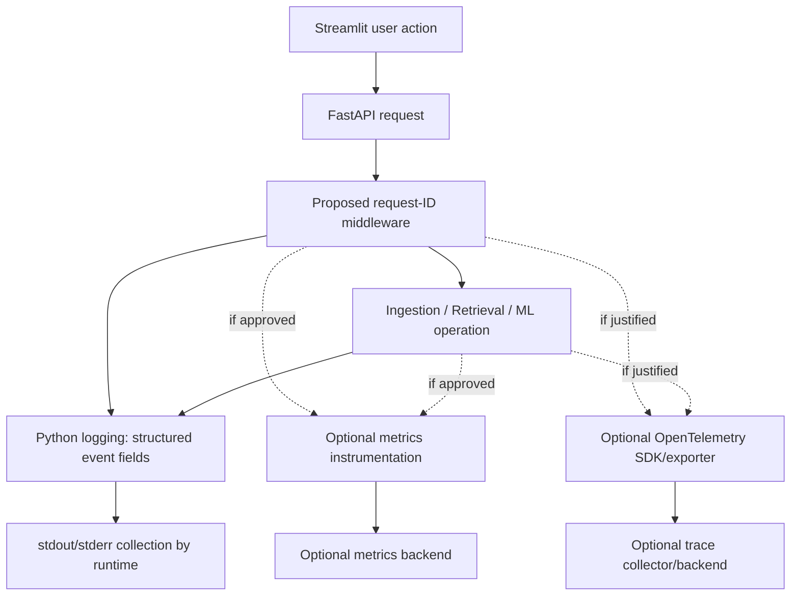

# ORDO Monitoring, Logging, and Observability Blueprint

> **Status:** Implementation blueprint — repository audit pending  
> **Project:** ORDO — AI-Powered GitHub Issue Intelligence Platform  
> **Owner:** Monitoring, Logging, and Observability Engineer  
> **Last updated:** 2026-10-26  
>
> **Evidence rule:** The master prompt was available, but no ORDO source repository, source tree, dependency manifest, test suite, deployment files, or Git metadata were supplied with this task. Consequently, this document does **not** claim that any endpoint, middleware, dependency, metric, test, or integration currently exists. Paths and code below are proposals to reconcile with the actual repository before implementation.

## Table of contents

1. [Executive Summary](#1-executive-summary)
2. [Project Context and Scope](#2-project-context-and-scope)
3. [Repository Audit](#3-repository-audit)
4. [Current Observability Assessment](#4-current-observability-assessment)
5. [Observability Architecture](#5-observability-architecture)
6. [Logging Standards](#6-logging-standards)
7. [Shared Logging Utility](#7-shared-logging-utility)
8. [Request and Correlation IDs](#8-request-and-correlation-ids)
9. [FastAPI Instrumentation](#9-fastapi-instrumentation)
10. [Data Ingestion Instrumentation](#10-data-ingestion-instrumentation)
11. [ML and Retrieval Instrumentation](#11-ml-and-retrieval-instrumentation)
12. [Streamlit Instrumentation](#12-streamlit-instrumentation)
13. [Metrics Strategy](#13-metrics-strategy)
14. [Distributed Tracing](#14-distributed-tracing)
15. [Health and Readiness](#15-health-and-readiness)
16. [Error Reporting](#16-error-reporting)
17. [Dashboards and Alerting](#17-dashboards-and-alerting)
18. [Configuration](#18-configuration)
19. [Security and Privacy](#19-security-and-privacy)
20. [Testing and Verification](#20-testing-and-verification)
21. [Troubleshooting Handbook](#21-troubleshooting-handbook)
22. [Implementation Plan](#22-implementation-plan)
23. [Git and Pull Request Workflow](#23-git-and-pull-request-workflow)
24. [Risks and Unresolved Questions](#24-risks-and-unresolved-questions)
25. [Operational Handover](#25-operational-handover)
26. [Definition of Done](#26-definition-of-done)

---

## 1. Executive Summary

ORDO should be observable without collecting private GitHub issue content, source code, model inputs, credentials, or other sensitive payloads. The initial target should be a low-complexity baseline:

1. Standard-library Python logging with one centrally configured handler.
2. A validated request ID propagated through FastAPI request handling and returned in a response header.
3. Request completion logs containing a route template, method, status, and elapsed time—never a raw query string.
4. Explicit diagnostic events around ingestion, inference, and retrieval, added with the owners of those components.
5. Liveness and readiness semantics that do not restart the service because an optional dependency is temporarily unavailable.
6. Automated tests for correlation, redaction, health behavior, and logging configuration.
7. Metrics and tracing only after the repository audit establishes the deployment model and a concrete operational need.

**Not yet verified:** the repository layout, installed dependencies, current endpoints, current logging behavior, tests, and deployment configuration. No implementation or test execution is claimed by this document.

### Immediate recommendation

Start with structured request logs and correlation IDs. Keep the first implementation dependency-light. Add Prometheus metrics only if a metrics scrape target and access boundary can be operated; add distributed tracing only if cross-component latency cannot be diagnosed adequately from correlated logs and timings.

## 2. Project Context and Scope

ORDO may contain some or all of the following components; actual presence must be confirmed:

- Streamlit user interface.
- FastAPI HTTP backend.
- GitHub issue ingestion.
- ML model loading, preprocessing, and inference.
- Code/document retrieval and ranking.
- Database, vector index, or cache.
- Docker, CI/CD, and production deployment configuration.

### Goals

- Answer: what operation ran, where it failed, how long it took, and whether the service is healthy.
- Correlate one API request across internal operations.
- Detect sustained failures and latency regressions.
- Keep telemetry bounded in cost, cardinality, and privacy exposure.
- Make observability optional integrations fail safely when disabled or unavailable.

### Out of scope until separately approved

- Changing public API response contracts.
- Sending issue content or model inputs to external telemetry vendors.
- Adding a new monitoring stack solely for completeness.
- Changing ingestion, ML, or retrieval business logic outside approved instrumentation changes.
- Defining production SLOs or alert thresholds without an agreed baseline.

## 3. Repository Audit

### 3.1 Current audit status

| Audit item | Status | Evidence required |
|---|---|---|
| Python version | Not inspected | `pyproject.toml`, `.python-version`, runtime/container config |
| Dependency manager and lockfile | Not inspected | `pyproject.toml`, `requirements*.txt`, lockfiles |
| FastAPI entry point and middleware | Not inspected | Application factory/entry module and router registration |
| Logging configuration and levels | Not inspected | Logging setup, logger calls, startup command |
| Exception handlers and response contract | Not inspected | Exception handlers, schemas, API tests |
| Request/correlation IDs | Not inspected | Middleware, context variables, response headers |
| GitHub client and ingestion lifecycle | Not inspected | Client and job modules |
| ML training/inference | Not inspected | Model loading and inference modules |
| Retrieval/ranking | Not inspected | Retrieval pipeline and index integration |
| Streamlit entry point | Not inspected | UI entry module and API client |
| Database/cache | Not inspected | Dependencies, settings, connection lifecycle |
| Health endpoints | Not inspected | Router definitions and tests |
| Metrics/tracing integrations | Not inspected | Dependencies, exporters, middleware, deployment |
| Docker/deployment | Not inspected | Dockerfile, compose, deployment manifests |
| CI/CD | Not inspected | Workflow files and quality gates |
| Existing tests | Not inspected | Test tree and test configuration |
| Secret and privacy controls | Not inspected | Settings, redaction, access policy, logging review |
| Git state/branch/remotes | Not inspected | Command output from the working repository |

### 3.2 Required commands

Run from the actual ORDO repository root. Save outputs in the engineering ticket or audit notes, but redact private remote URLs and other sensitive values before sharing.

```bash
git status
git branch --show-current
git remote -v
git log -5 --oneline
```

Windows PowerShell alternatives for finding likely files:

```powershell
Get-ChildItem -Force
Get-ChildItem -Recurse -File |
  Where-Object {
    $_.Name -match 'pyproject.toml|requirements.*\.txt|Dockerfile|docker-compose.*|pytest.ini|pyproject.toml|\.yml$|\.yaml$'
  } |
  Select-Object -ExpandProperty FullName
```

On macOS/Linux:

```bash
find . -maxdepth 4 -type f \
  \( -name 'pyproject.toml' -o -name 'requirements*.txt' \
     -o -name 'Dockerfile' -o -name 'docker-compose*.yml' \
     -o -name 'pytest.ini' -o -path './.github/workflows/*' \)
```

Search for current observability behavior:

```bash
git grep -n -E 'logging\.|basicConfig|logger\.|print\(|request_id|trace_id|prometheus|opentelemetry|sentry|/health|/ready|/metrics'
```

Use the actual project test command after inspecting its dependency manager. Do not install dependencies or rewrite project configuration before checking existing conventions.

### 3.3 Audit output to complete before coding

For every finding, record:
- **Observed:** exact file and relevant symbol or line range.
- **Gap:** the operational question that cannot currently be answered.
- **Proposed change:** smallest change that closes the gap.
- **Owner:** API/Backend, Data Engineering, ML, Retrieval, Frontend, DevOps, or Security.
- **Verification:** automated test or repeatable command.
- **Decision:** accepted, deferred, or rejected, with approver.

Until these steps are completed, code examples below are **proposed patterns**, not repository-specific patches.

## 4. Current Observability Assessment

Because repository files were not supplied, current maturity cannot be scored as present or absent. Use this initial assessment worksheet:

| Capability | Current finding | Target baseline | Evidence to close |
|---|---|---|---|
| Consistent logs | Unknown | Central configuration and documented levels | Inspect all entry points and handlers |
| Request correlation | Unknown | Validated request ID in logs and response | Middleware and concurrency tests |
| API latency/errors | Unknown | Request duration/status and route template | API tests and sample logs |
| Ingestion diagnostics | Unknown | Start/end/outcome/counts/retries | Job lifecycle inspection |
| ML/retrieval timings | Unknown | Stage durations and bounded dimensions | Pipeline inspection |
| Health/readiness | Unknown | Liveness separate from required dependencies | Deployment contract |
| Metrics | Unknown | Add only with a scrape/collection plan | Deployment and access model |
| Tracing | Unknown | Deferred unless cross-service analysis requires it | Latency investigation evidence |
| Privacy/redaction | Unknown | Allowlisted fields; payloads omitted by default | Security review and tests |
| Alerting | Unknown | SLO/baseline-driven, actionable alerts | Baseline and on-call ownership |

## 5. Observability Architecture

### 5.1 Proposed baseline flow



Every item labelled “Proposed” or “Optional” must be checked against the repository before it is treated as implemented.

### 5.2 Pillars and staging

- **Logs — implement first:** useful events with timestamps, severity, request ID, component, duration, and safe error category.
- **Metrics — next when needed:** counts, error rates, and latency distributions with bounded labels.
- **Traces — defer initially:** add when a request crosses enough components that logs and stage timings are insufficient.

For local development, console logs and automated tests may be sufficient. For a deployed service, establish how logs are collected, retained, searched, and access-controlled before relying on them operationally.

## 6. Logging Standards

### 6.1 Levels

| Level | Use | Example |
|---|---|---|
| `DEBUG` | Detailed local diagnosis; disabled by default in production | Sanitized branch decision |
| `INFO` | Normal lifecycle events and successful operations | API request completed |
| `WARNING` | Recoverable degradation or unexpected input handled safely | Retry scheduled after upstream rate limit |
| `ERROR` | Operation failed and requires investigation | Ingestion job failed |
| `CRITICAL` | Process/service cannot continue safely | Required configuration prevents startup |

Do not log every successful low-level function call at `INFO`. Avoid logging the same exception at every layer.

### 6.2 Conventions

- Use `logging.getLogger(__name__)` in each module.
- Configure logging once at the application entry point; libraries should not add handlers.
- Use UTC timestamps in ISO-8601 form, ideally ending in `Z`.
- Prefer allowlisted structured fields. Do not serialize arbitrary request objects.
- Use `logger.exception(...)` only inside an exception handler when a stack trace is appropriate and safe.
- Never log authorization headers, cookies, tokens, raw request bodies, full issue descriptions, source code, embeddings, or raw model prompts by default.
- Keep metric labels low-cardinality. Request IDs belong in logs/traces, not metric labels.
- Use runtime stdout/stderr collection in containers unless the deployment explicitly requires file logs.
- If file logging is required, define rotation, disk limits, retention, and deletion policy before enabling it.
- Avoid `print()` for application diagnostics; reserve it for intentional CLI output or a documented entry-point contract.

### 6.3 Human-readable versus JSON logs

Start with readable console logs in local development. JSON logs are useful in production when the collector parses fields such as `timestamp`, `level`, `logger`, `message`, `request_id`, `method`, `route`, `status_code`, and `duration_ms`. Do not adopt JSON merely for appearance; verify the collector can parse it and tests can validate redaction.

## 7. Shared Logging Utility

### Change: centralized logging configuration

**Current state:** Not inspected. Reuse existing configuration if it already meets the standards.  
**Problem:** Multiple handlers or inconsistent formats can create duplicate messages and make diagnosis harder.  
**Affected files (proposed):**
- `shared/observability/logging_config.py` — only if the repository has a suitable shared package.
- Existing application entry point — call configuration once.
- `tests/observability/test_logging_config.py` — adapt to current test layout.

If the project has no `shared` package, place this module in an existing common package rather than creating a new package hierarchy solely for logging.

### Proposed implementation

```python
# shared/observability/logging_config.py
from __future__ import annotations

import json
import logging
import os
import sys
from datetime import datetime, timezone
from typing import Any


_STANDARD_RECORD_FIELDS = {
    "name", "msg", "args", "levelname", "levelno", "pathname",
    "filename", "module", "exc_info", "exc_text", "stack_info",
    "lineno", "funcName", "created", "msecs", "relativeCreated",
    "thread", "threadName", "processName", "process", "message",
    "taskName",
}
_SAFE_EXTRA_FIELDS = {
    "request_id", "method", "route", "status_code", "duration_ms",
    "operation", "outcome", "error_type", "records_processed",
    "attempt", "model_version", "candidate_count", "result_count",
}


class SafeJsonFormatter(logging.Formatter):
    """Serialize a small allowlist of fields; never dump the whole record."""

    def format(self, record: logging.LogRecord) -> str:
        timestamp = datetime.fromtimestamp(
            record.created, tz=timezone.utc
        ).isoformat(timespec="milliseconds").replace("+00:00", "Z")

        event: dict[str, Any] = {
            "timestamp": timestamp,
            "level": record.levelname,
            "logger": record.name,
            "message": record.getMessage(),
        }

        for key in _SAFE_EXTRA_FIELDS:
            value = getattr(record, key, None)
            if isinstance(value, (str, int, float, bool)) or value is None:
                if value is not None:
                    event[key] = value

        # Exception text can contain secrets supplied by upstream libraries.
        # Include the exception class, not arbitrary exception text, by default.
        if record.exc_info:
            event["exception_type"] = record.exc_info[0].__name__

        return json.dumps(event, ensure_ascii=False, separators=(",", ":"))


class SafeConsoleFormatter(logging.Formatter):
    def format(self, record: logging.LogRecord) -> str:
        timestamp = datetime.fromtimestamp(
            record.created, tz=timezone.utc
        ).isoformat(timespec="seconds").replace("+00:00", "Z")
        return f"{timestamp} {record.levelname:<8} {record.name}: {record.getMessage()}"


def configure_logging(
    level: str | None = None,
    log_format: str | None = None,
) -> None:
    """Configure the root logger idempotently for a single-process app."""
    resolved_level = (level or os.getenv("ORDO_LOG_LEVEL", "INFO")).upper()
    resolved_format = (log_format or os.getenv("ORDO_LOG_FORMAT", "text")).lower()

    numeric_level = logging.getLevelName(resolved_level)
    if not isinstance(numeric_level, int):
        raise ValueError(
            "ORDO_LOG_LEVEL must be DEBUG, INFO, WARNING, ERROR, or CRITICAL"
        )
    if resolved_format not in {"text", "json"}:
        raise ValueError("ORDO_LOG_FORMAT must be 'text' or 'json'")

    root = logging.getLogger()
    root.setLevel(numeric_level)

    # Replace handlers only when this function owns the root configuration.
    # Audit existing framework/deployment logging before adopting this behavior.
    if not getattr(root, "_ordo_logging_configured", False):
        handler = logging.StreamHandler(sys.stdout)
        root.handlers.clear()
        root.addHandler(handler)
        root._ordo_logging_configured = True
    else:
        handler = root.handlers[0] if root.handlers else logging.StreamHandler(sys.stdout)
        if not root.handlers:
            root.addHandler(handler)

    handler.setLevel(numeric_level)
    handler.setFormatter(
        SafeJsonFormatter() if resolved_format == "json" else SafeConsoleFormatter()
    )
```

**Integration caution:** clearing root handlers can conflict with Uvicorn or test-runner logging. Before using this implementation, inspect current logging setup and decide whether to configure the root logger, use a dedicated handler, or let Uvicorn own the configuration. Do not blindly replace existing configuration. If `root.handlers` can contain handlers owned by the host runtime, adapt the idempotence strategy and test it.

### Example use

```python
import logging

logger = logging.getLogger(__name__)

logger.info(
    "ingestion_completed",
    extra={
        "operation": "github_ingestion",
        "outcome": "success",
        "records_processed": 120,
    },
)
```

The message and extras must contain only approved, non-sensitive values. Do not put payloads into `message` or extras.

## 8. Request and Correlation IDs

### Change: validated request ID middleware

**Current state:** Not inspected. Confirm existing middleware and API contract first.  
**Problem:** Without a stable identifier, logs from the same request cannot be reliably grouped.  
**Affected files (proposed):**
- `shared/observability/request_context.py`
- Existing FastAPI application entry point
- `tests/observability/test_request_context.py`

Use a request ID for log correlation. A future distributed trace has a separate trace ID and span IDs; do not treat them as interchangeable.

### Proposed implementation

```python
# shared/observability/request_context.py
from __future__ import annotations

import re
import time
import uuid
from contextvars import ContextVar

from starlette.middleware.base import BaseHTTPMiddleware
from starlette.requests import Request
from starlette.responses import Response
import logging

request_id_var: ContextVar[str] = ContextVar("ordo_request_id", default="-")
logger = logging.getLogger(__name__)

# Deliberately conservative: only ASCII letters, digits, hyphen, underscore.
_REQUEST_ID_RE = re.compile(r"^[A-Za-z0-9_-]{1,64}$")


def resolve_request_id(candidate: str | None) -> str:
    if candidate and _REQUEST_ID_RE.fullmatch(candidate):
        return candidate
    return uuid.uuid4().hex


class RequestContextMiddleware(BaseHTTPMiddleware):
    async def dispatch(self, request: Request, call_next) -> Response:
        candidate = request.headers.get("X-Request-ID")
        request_id = resolve_request_id(candidate)
        token = request_id_var.set(request_id)
        started = time.perf_counter()
        response: Response | None = None
        status_code = 500

        try:
            response = await call_next(request)
            status_code = response.status_code
            response.headers["X-Request-ID"] = request_id
            return response
        except Exception:
            # The exception is logged once here. Confirm this does not duplicate
            # an existing application-level exception logger.
            logger.exception(
                "request_failed",
                extra={
                    "request_id": request_id,
                    "method": request.method,
                    "route": getattr(request.scope.get("route"), "path", "unmatched"),
                    "status_code": status_code,
                },
            )
            raise
        finally:
            duration_ms = round((time.perf_counter() - started) * 1000, 2)
            route = getattr(request.scope.get("route"), "path", "unmatched")
            logger.info(
                "request_completed",
                extra={
                    "request_id": request_id,
                    "method": request.method,
                    "route": route,
                    "status_code": status_code,
                    "duration_ms": duration_ms,
                },
            )
            request_id_var.reset(token)
```

### Important integration notes

- Validate this middleware against the installed Starlette/FastAPI version and current middleware stack before adoption. `BaseHTTPMiddleware` has known trade-offs; if the application uses pure ASGI middleware, prefer an ASGI implementation compatible with the existing stack.
- A client-supplied valid ID is not proof of identity. It is only a correlation value. If cross-tenant spoofing or audit integrity matters, generate server-side IDs instead.
- Invalid and overlong values are replaced with a generated ID. Add a bounded `request_id_source` field only if useful; do not log the invalid candidate.
- The `finally` block runs even when the request raises. Confirm exception handling returns the established error response and that the response header is included on error responses if required by the API contract.
- `request.scope["route"]` may not be set for unmatched routes or early failures. Use a fixed fallback such as `unmatched`; never use the raw path as a metric label.
- Avoid middleware that reads and logs the request body.

### Propagation

When calling an internal service, pass the request ID explicitly in a header or function argument. Do not rely on hidden global state for cross-process propagation. If OpenTelemetry is later added, propagate W3C trace context independently and retain the request ID only as a searchable log attribute.

## 9. FastAPI Instrumentation

### Change: request lifecycle logs

**Current state:** Not inspected.  
**Affected files:** existing API entry point and existing middleware/error handler files, after repository audit.

The request middleware above provides a baseline, but should be adapted to avoid duplicate exception logs. Prefer one layer to log the stack trace and let higher layers return a safe response. Preserve existing response schemas and status codes.

Recommended events:
- `application_starting` / `application_started`
- `application_shutdown_started` / `application_shutdown_completed`
- `request_completed`
- `request_validation_failed` (count or safe error category; do not log raw bodies)
- `dependency_timeout`
- `dependency_unavailable`
- `operation_completed` / `operation_failed`

For validation failures, log the route template, request ID, and a count/category. Validation errors can echo user-provided values, so do not blindly log the complete validation payload.

### Exception handling rules

- Expected domain errors: convert to the established response contract; log at `WARNING` only when operationally useful.
- Validation errors: return the existing validation response; log a sanitized summary if needed.
- Upstream dependency failures: classify timeout, rate limit, and unavailable separately.
- Unexpected exceptions: log once with correlation ID and safe exception metadata; return the existing generic 5xx response.
- Do not expose stack traces, local paths, connection strings, or upstream response bodies to users.

Do not add a global exception handler until existing handlers and tests are reviewed. If one is needed, the backend owner must approve any response-contract impact.

## 10. Data Ingestion Instrumentation

Coordinate all instrumentation with the Data Engineer. Add events at the ingestion job boundary rather than logging every record.

Recommended event schema:

| Event | Safe fields |
|---|---|
| `ingestion_started` | `job_id` if non-sensitive, `source_type`, `started_at` |
| `ingestion_page_completed` | `page_number`, `records_retrieved`, `duration_ms` |
| `ingestion_retry` | `attempt`, `error_type`, `retry_delay_ms` |
| `ingestion_rate_limited` | `attempt`, `retry_after_seconds` when available |
| `ingestion_completed` | `outcome`, `records_retrieved`, `records_validated`, `records_rejected`, `duplicates`, `duration_ms` |
| `ingestion_failed` | `outcome`, `error_type`, `duration_ms`, `partial` |

Never log complete issue titles, descriptions, comments, repository contents, access tokens, or raw GitHub responses.

Distinguish:
- **Success with zero records:** job completed, `outcome="success"`, count is zero.
- **Failure before records:** `outcome="failure"`, count may be zero, error category recorded.
- **Partial completion:** only use `outcome="partial"` if the job's semantics explicitly support it and checkpoint/resume behavior is understood.

Do not claim checkpoint/resume support unless the ingestion implementation actually has it. Track retry and rate-limit counts using bounded dimensions. A job identifier may be logged, but should not become a metric label if it creates unbounded cardinality.

## 11. ML and Retrieval Instrumentation

Coordinate with the ML Engineer and Code Retrieval Engineer. Instrument stage boundaries using a monotonic clock (`time.perf_counter`) and record duration, not raw inputs.

### Suggested event fields

| Operation | Safe diagnostic fields |
|---|---|
| Model initialization | `model_version`, `duration_ms`, `outcome` |
| Preprocessing | `duration_ms`, `batch_size`, `outcome` |
| Inference | `duration_ms`, `batch_size`, `model_version`, `outcome` |
| Retrieval query | `duration_ms`, `candidate_count`, `result_count`, `outcome` |
| Ranking | `duration_ms`, `candidate_count`, `result_count`, `outcome` |
| Index initialization/rebuild | `duration_ms`, `outcome`, safe index version |

Use a fixed allowlist for model versions and operation names where possible. Do not log prompts, source code, embeddings, issue text, user queries, or model inputs/outputs by default. Do not use arbitrary model names, file names, or user-provided strings as metric labels without a bounded vocabulary.

Example helper pattern:

```python
import logging
import time
from contextlib import contextmanager
from typing import Iterator

logger = logging.getLogger(__name__)


@contextmanager
def observe_operation(operation: str, **safe_fields) -> Iterator[None]:
    """Log duration for an allowlisted operation; pass only reviewed fields."""
    started = time.perf_counter()
    outcome = "success"
    try:
        yield
    except Exception as exc:
        outcome = "failure"
        logger.error(
            "operation_failed",
            extra={
                "operation": operation,
                "outcome": outcome,
                "error_type": type(exc).__name__,
                **safe_fields,
            },
        )
        raise
    finally:
        logger.info(
            "operation_completed",
            extra={
                "operation": operation,
                "outcome": outcome,
                "duration_ms": round((time.perf_counter() - started) * 1000, 2),
                **safe_fields,
            },
        )
```

Use this only if the team accepts the duplication of a failure event plus a completion event. Otherwise, emit a single completion event containing `outcome` and safe error category. Do not pass unreviewed `safe_fields`; the helper cannot make arbitrary values safe by itself.

## 12. Streamlit Instrumentation

Inspect the actual Streamlit entry point and API client before changing it. Streamlit logs should focus on:
- Startup and configuration failures.
- Backend connection errors and request duration.
- Safe user-visible error categories.
- Cache hit/miss only if caching already exists and can be measured reliably.

Display helpful messages such as “The service is temporarily unavailable. Try again shortly. Reference: `<request_id>`.” Do not show exception strings or stack traces in the UI. Keep detailed diagnostics in server logs with redaction controls.

Do not assume browser-side telemetry or a stable browser request ID exists. Do not create a second telemetry system in the UI unless it provides a clear diagnostic benefit.

## 13. Metrics Strategy

### 13.1 Candidate metrics catalogue

These are **proposed metric names**, not verified existing metrics. Confirm naming and implementation after the audit.

| Metric | Type | Meaning | Bounded labels | Owner | Alert relevance |
|---|---|---|---|---|---|
| `ordo_http_requests_total` | Counter | Completed HTTP requests | `method`, `route`, `status_code` | Backend | Error rate / traffic |
| `ordo_http_request_duration_seconds` | Histogram | Request latency | `method`, `route` | Backend | Latency objective |
| `ordo_ingestion_jobs_total` | Counter | Jobs by outcome | `outcome`, `source_type` | Data Eng | Repeated job failures |
| `ordo_ingestion_duration_seconds` | Histogram | Job duration | `source_type`, `outcome` | Data Eng | Slow ingestion |
| `ordo_ingestion_retries_total` | Counter | Retry attempts | `reason` from fixed enum | Data Eng | Upstream instability |
| `ordo_ml_inference_duration_seconds` | Histogram | Inference latency | `model_family`, `outcome` | ML | Latency regression |
| `ordo_retrieval_duration_seconds` | Histogram | Retrieval pipeline latency | `stage`, `outcome` | Retrieval | Retrieval degradation |
| `ordo_retrieval_results` | Histogram | Number of results returned | `outcome` | Retrieval | Empty/low result pattern |
| `ordo_dependency_failures_total` | Counter | Dependency failures | `dependency`, `reason` enum | Backend/DevOps | Dependency outage |
| `ordo_process_memory_bytes` | Gauge | Process memory, if collector supports it | none | DevOps | Resource pressure |

Metric names and labels should be reconciled with the chosen instrumentation library. Do not add every metric automatically; start with the HTTP request counter/duration and the few business-operation timings that answer known operational questions.

### 13.2 Cardinality policy

Never label metrics with:
- Request IDs, trace IDs, user IDs, or job IDs.
- Raw URLs or query strings.
- Repository names if the set is not tightly controlled and approved.
- Issue IDs, issue titles, arbitrary query text, exception messages, or file paths.

Use route templates and finite enums. Establish a maximum label vocabulary and review new labels in code review.

### 13.3 Prometheus decision

Prometheus is a **candidate**, not an assumed dependency. Before adopting it:
1. Confirm the service is deployed in an environment that can scrape metrics.
2. Decide whether the endpoint is private, authenticated, or network-restricted.
3. Confirm the operational team can retain and query metrics.
4. Add dependency pins compatible with the existing Python/FastAPI versions.
5. Add tests for metric values and bounded labels.
6. Confirm the app still starts when metrics are disabled or the exporter is unavailable.

If no backend is justified, keep duration logs and counters in tests first and document the migration path. Do not expose `/metrics` publicly by default.

## 14. Distributed Tracing

**Initial status: defer until evidence shows a need.** If one request routinely crosses API, retrieval, model inference, and external GitHub calls, traces may reveal which span contributes to latency.

If approved, evaluate OpenTelemetry:
- Trace: the end-to-end operation.
- Span: a timed operation within the trace.
- Trace ID: identifies the trace.
- Span ID: identifies one operation.
- Request ID: application-level correlation value; not a replacement for trace context.

Implementation requirements before enabling:
- Instrumentation boundaries and supported libraries are known.
- W3C trace context propagation is configured.
- Sampling is defined and appropriate for traffic volume.
- Exporter endpoint and credentials are supplied via deployment configuration.
- Payload capture is disabled; span attributes use allowlisted, bounded values.
- Export failures do not break user requests.
- Startup remains functional when tracing is disabled.
- Tests cover disabled mode and exporter failure.

Do not claim tracing is operational until a trace has been observed in the configured backend and the end-to-end path has been verified.

## 15. Health and Readiness

Inspect existing endpoints and deployment probes first. If missing and supported by the current API structure, use separate checks:

- **Liveness:** process/event loop can answer. Should not depend on GitHub, a model provider, or a database unless that dependency is fundamental to process survival.
- **Readiness:** the instance can serve the intended workload. Check only required local initialization and critical dependencies.
- **Dependency health:** a diagnostic endpoint or internal check for individual upstream services, protected as appropriate.

Suggested contract, subject to existing API conventions:

| Endpoint | Success | Failure | Meaning |
|---|---|---|---|
| `/health/live` | `200` | `503` only if process is not operational | Process liveness |
| `/health/ready` | `200` | `503` when a required dependency/init is unavailable | Can accept work |

These are proposed paths, not confirmed endpoints. Do not add them if equivalent routes already exist. Keep responses minimal, e.g. `{"status":"ok"}`. Do not return internal hostnames, connection strings, tokens, exception text, or detailed infrastructure inventory.

A dependency that can degrade gracefully should not necessarily make the whole application unready. Agree on this with the Backend and DevOps owners.

## 16. Error Reporting

### 16.1 Single-owner logging policy

- The layer that has enough context to classify the failure should log the diagnostic event.
- The layer that owns the HTTP contract should convert exceptions to a safe response.
- Avoid logging the same stack trace in middleware, router, service, and global handler.
- For re-raised exceptions, lower layers may add safe context without a stack trace; one boundary should log the stack trace.
- Background jobs must record terminal success/failure because no HTTP request may be waiting.

### 16.2 External reporting service

Sentry or a similar service is not assumed to exist. Introduce it only after approval of:
- Cost and usage limits.
- Data processing terms and region.
- Whether stack locals, request bodies, headers, or user content are captured.
- Redaction and scrubbing configuration.
- Access control and retention/deletion.
- Failure behavior when the reporting endpoint is unreachable.

External reporting must not become a reason for a request to fail. Never upload secrets or raw private issue contents.

## 17. Dashboards and Alerting

### 17.1 Dashboard decision

A dashboard is useful once a metrics backend exists and someone owns it. Until then, do not create a dashboard that cannot receive verified data.

Suggested panels:
1. Request rate by route template and status class.
2. p50/p95/p99 latency for important route templates.
3. 5xx rate and dependency failures.
4. Ingestion job outcomes, duration, and retry counts.
5. Retrieval and inference duration.
6. Process CPU/memory when reliably available.

Never include sensitive payloads or high-cardinality identifiers.

### 17.2 Provisional alert catalogue

All thresholds below are **examples only**, not production recommendations. Set real thresholds from agreed SLOs and measured baselines.

| Alert | Provisional condition | Window | Severity | Response | Owner |
|---|---|---|---|---|---|
| API elevated 5xx | 5xx rate above agreed error budget threshold | 5–10 min | High | Check recent deploy, dependency health, logs by request ID | Backend/DevOps |
| API latency regression | p95 above agreed route objective | 10–15 min | Medium/High | Compare route and dependency timings | Backend |
| Ingestion repeatedly failing | Consecutive failures or failure ratio above baseline | Job-dependent | High if ingestion is critical | Inspect error category, rate limits, checkpoint state | Data Eng |
| Dependency unavailable | Required dependency fails health checks persistently | 5 min | High | Verify upstream status and credentials/config | Service owner |
| Resource pressure | CPU/memory sustained above agreed capacity threshold | 10 min | Medium | Inspect load, leaks, batch size, concurrency | DevOps/owner |

Every alert must have a named owner, runbook, deduplication/grouping behavior, and a clear action. Avoid paging for one transient timeout or a successful job that processed zero records.

## 18. Configuration

Do not add environment variables until the current configuration system has been inspected. Candidate settings:

| Setting | Purpose | Proposed default | Required? | Safe example | Used by |
|---|---|---|---|---|---|
| `ORDO_LOG_LEVEL` | Log verbosity | `INFO` | No | `INFO` | Logging config |
| `ORDO_LOG_FORMAT` | Console format | `text` locally; `json` if collector expects it | No | `json` | Logging config |
| `ORDO_METRICS_ENABLED` | Enable optional metrics | `false` until configured | No | `false` | Metrics setup |
| `ORDO_TRACING_ENABLED` | Enable optional tracing | `false` until configured | No | `false` | Tracing setup |
| `OTEL_EXPORTER_OTLP_ENDPOINT` | Approved trace collector endpoint | unset | Only if tracing enabled | `http://localhost:4318` for local test only | OTel exporter |

These names are proposals, not verified current settings. Update `.env.example` only after checking actual settings code. Never commit credentials, tokens, or production endpoints containing secrets. A basic local run must not require optional observability services.

## 19. Security and Privacy

### 19.1 Default deny-list and allowlist

**Never log by default:**
- GitHub tokens, API keys, passwords, or secret values.
- `Authorization`, `Cookie`, or `Set-Cookie` headers.
- Full request/response bodies.
- GitHub issue titles, descriptions, comments, or private repository metadata.
- Source code, embeddings, model prompts, model inputs/outputs, or user queries.
- Database connection strings.
- Arbitrary upstream response text or exception strings that may contain payloads.

**Usually safe after review:**
- Request ID generated/validated by policy.
- HTTP method, route template, status code, duration.
- Fixed operation names and finite outcome/error categories.
- Counts, batch size, candidate/result counts, and approved model version.
- Exception class name; stack traces only where reviewed for leakage risk.

### 19.2 Controls

- Use explicit allowlisted fields instead of dumping request objects.
- Redact headers and settings before telemetry export.
- Restrict log/metrics/trace access using deployment identity and least privilege.
- Define retention and deletion based on actual team policy and applicable requirements.
- Review third-party telemetry data processing with the Security and Privacy Reviewer.
- Add tests with sentinel secrets to ensure they do not appear in rendered logs.
- Treat exception messages as untrusted; do not assume every library's error text is safe.

## 20. Testing and Verification

Adapt test paths and fixtures to the repository's existing test layout. The following is a proposed baseline for a FastAPI app using pytest and HTTPX; check installed versions and test conventions first.

### 20.1 Proposed test file: `tests/observability/test_request_context.py`

```python
import logging

import pytest
from fastapi import FastAPI
from fastapi.testclient import TestClient

from shared.observability.request_context import (
    RequestContextMiddleware,
    request_id_var,
    resolve_request_id,
)


def make_app():
    app = FastAPI()
    app.add_middleware(RequestContextMiddleware)

    @app.get("/probe")
    async def probe():
        return {"request_id": request_id_var.get()}

    @app.get("/fail")
    async def fail():
        raise RuntimeError("internal failure")

    return app


def test_generated_request_id_is_returned():
    client = TestClient(make_app())
    response = client.get("/probe")
    assert response.status_code == 200
    assert response.headers["X-Request-ID"]
    assert response.json()["request_id"] == response.headers["X-Request-ID"]


def test_valid_supplied_request_id_is_preserved():
    client = TestClient(make_app())
    response = client.get("/probe", headers={"X-Request-ID": "test_123-abc"})
    assert response.headers["X-Request-ID"] == "test_123-abc"


@pytest.mark.parametrize("candidate", [
    "bad id", "line\nbreak", "x" * 65, "token/with/slash",
])
def test_invalid_request_id_is_replaced(candidate):
    resolved = resolve_request_id(candidate)
    assert resolved != candidate
    assert 1 <= len(resolved) <= 64


def test_exception_path_has_server_generated_id():
    client = TestClient(make_app(), raise_server_exceptions=False)
    response = client.get("/fail", headers={"X-Request-ID": "valid-id"})
    assert response.status_code == 500
    # Depending on middleware ordering and framework version, verify that the
    # response header is added on errors as part of integration testing.
    # If this assertion fails, use pure ASGI middleware or adjust exception
    # middleware ordering rather than weakening the API contract silently.
```

### 20.2 Proposed test file: `tests/observability/test_logging_config.py`

```python
import json
import logging

from shared.observability.logging_config import SafeJsonFormatter


def test_json_formatter_emits_safe_fields():
    record = logging.LogRecord(
        name="ordo.test",
        level=logging.INFO,
        pathname=__file__,
        lineno=1,
        msg="request_completed",
        args=(),
        exc_info=None,
    )
    record.request_id = "req-123"
    record.status_code = 200
    record.duration_ms = 12.5
    record.authorization = "should-not-appear"

    rendered = SafeJsonFormatter().format(record)
    data = json.loads(rendered)

    assert data["message"] == "request_completed"
    assert data["request_id"] == "req-123"
    assert data["status_code"] == 200
    assert "authorization" not in data
    assert "should-not-appear" not in rendered


def test_json_formatter_does_not_dump_arbitrary_extras():
    record = logging.LogRecord(
        name="ordo.test", level=logging.INFO, pathname=__file__,
        lineno=1, msg="safe", args=(), exc_info=None,
    )
    record.private_issue_body = "PRIVATE_SENTINEL"
    rendered = SafeJsonFormatter().format(record)
    assert "PRIVATE_SENTINEL" not in rendered
```

### 20.3 Known limitations to resolve during implementation

- `TestClient` behavior depends on the installed Starlette/HTTPX versions.
- The example error-path header test is an integration requirement, not proof the proposed middleware already passes it. Middleware ordering may need an ASGI implementation or an exception-handling adjustment.
- The sample logging configuration must be tested against Uvicorn's handlers before replacing any root handlers.
- Add tests for concurrent requests and context cleanup using the chosen middleware implementation.
- Add health tests only after the existing health contract is known.
- Add metrics tests only if metrics are implemented.

### 20.4 Commands

Use the project's actual dependency manager. If pytest is already configured:

```bash
python -m pytest tests/observability -q
```

Then run the existing full suite using the repository's documented command. Do not install a second test framework if one already exists.

Expected result: all relevant tests pass. This is an expected verification outcome, **not an observed result**. Record the exact command, environment, and output in the PR.

## 21. Troubleshooting Handbook

All command outputs below are diagnostic examples, not observed ORDO output.

### 21.1 Missing logs

- **Symptoms:** API works but no application events appear.
- **Diagnose:** inspect startup path, `logging` setup, logger levels, runtime stdout/stderr collection.
- **Interpretation:** configuration may not be called, level may be too high, or collector may not capture stdout.
- **Remediate:** call the agreed configuration once at startup; confirm logger name and handler.
- **Verify:** emit one sanitized test event and confirm it appears exactly once.

### 21.2 Incorrect log level

- **Symptoms:** `INFO` events absent or `DEBUG` events flood output.
- **Diagnose:** print/log the resolved level at startup without revealing secrets; inspect environment precedence.
- **Remediate:** validate `ORDO_LOG_LEVEL` against allowed values and document defaults.
- **Verify:** test one event at each level.

### 21.3 Duplicate log messages

- **Symptoms:** every event appears two or more times.
- **Diagnose:** inspect root and module handlers; check Uvicorn configuration and repeated initialization.
- **Remediate:** assign one handler owner; avoid handlers on both child and root loggers unless propagation is disabled intentionally.
- **Verify:** configure logging twice in a test and assert one emitted line.

### 21.4 Missing request IDs

- **Symptoms:** request completion logs show `-` or responses lack `X-Request-ID`.
- **Diagnose:** verify middleware registration and ordering; inspect both success and exception paths.
- **Remediate:** register middleware in the actual FastAPI app instance and ensure context is reset in `finally`.
- **Verify:** test generated, valid, invalid, concurrent, and exception requests.

### 21.5 Metrics not updating

- **Symptoms:** scrape target is up but counters remain zero or no series exist.
- **Diagnose:** verify instrumentation is called, metric names match queries, and scrape path/network access are correct.
- **Remediate:** trigger a test request, verify registry wiring, and check label values.
- **Verify:** scrape a protected local endpoint and assert a bounded series exists. Never expose the endpoint publicly as a debugging shortcut.

### 21.6 Incorrect latency measurements

- **Symptoms:** durations are negative, implausible, or omit dependency time.
- **Diagnose:** confirm use of `time.perf_counter()` and placement of timers around the intended boundary.
- **Remediate:** use monotonic timing and label the stage being measured.
- **Verify:** test that duration is nonnegative; avoid brittle assertions on exact elapsed time.

### 21.7 High metric cardinality

- **Symptoms:** series count grows rapidly or memory usage increases.
- **Diagnose:** inspect label values for IDs, raw paths, user queries, exception messages, or repository names.
- **Remediate:** replace them with route templates and finite categories; remove unsafe labels.
- **Verify:** review metric definitions and inspect series counts after representative traffic.

### 21.8 Missing traces / exporter failures

- **Symptoms:** spans are absent or exporter errors appear.
- **Diagnose:** verify tracing is enabled, endpoint and protocol match, sampling is nonzero, and collector is reachable.
- **Remediate:** correct configuration; keep export non-blocking and optional.
- **Verify:** send a controlled request and find its trace in the backend. Confirm requests still succeed when the backend is unavailable.

### 21.9 Health checks failing

- **Symptoms:** orchestrator repeatedly restarts the service or marks it unready.
- **Diagnose:** separate liveness from readiness; inspect which dependencies each check requires.
- **Remediate:** remove optional dependencies from liveness and define readiness according to actual workload requirements.
- **Verify:** simulate a noncritical dependency outage and confirm liveness remains healthy.

### 21.10 Startup fails after instrumentation

- **Symptoms:** import errors, missing optional package, or config parsing failure.
- **Diagnose:** inspect stack trace locally; compare lockfile and runtime versions.
- **Remediate:** make optional integrations conditional and validate config early with safe errors.
- **Verify:** run with metrics/tracing disabled and no collector available.

### 21.11 Sensitive data appears in logs

- **Symptoms:** token, issue text, query, or source code appears in a log field.
- **Diagnose:** stop forwarding/exporting affected logs if possible; identify the event and field.
- **Remediate:** remove the field at source, rotate exposed credentials if a secret was leaked, restrict access, and follow the incident process.
- **Verify:** add a sentinel-value regression test and search retained logs according to the team's incident and deletion policy.

### 21.12 Dashboard has no data / alerts are noisy

- **Symptoms:** empty panels, firing alerts on harmless spikes.
- **Diagnose:** verify scrape target, query names, label dimensions, evaluation window, and baseline.
- **Remediate:** fix query/config; use sustained conditions and deduplication; align alerts to an SLO and an owner.
- **Verify:** test with known traffic and a controlled failure before production rollout.

## 22. Implementation Plan

Follow this order; each step is gated on evidence from the real repository.

| Step | Work | Files/commands | Owner / approval | Completion evidence |
|---|---|---|---|---|
| 1 | Audit repository and logging | Git commands, manifests, app entry points | Observability + Backend | Audit table populated with file evidence |
| 2 | Map request/data flow | API, UI, ingestion, ML/retrieval modules | Component owners | Diagram reconciled with actual code |
| 3 | Record gaps and owners | This manual or issue tracker | Project Lead | Gaps accepted and assigned |
| 4 | Agree on operational objectives | Team discussion, current baseline | Project Lead + DevOps | Agreed service objectives |
| 5 | Normalize logging | Existing logging module/entry point | Backend | Tests prove levels/format/one handler |
| 6 | Add request correlation | Middleware/context module | Backend | Header/context/concurrency tests pass |
| 7 | Instrument API operations | Existing middleware/services | Backend | Status and duration observable |
| 8 | Instrument ingestion/ML/retrieval | Existing job and pipeline boundaries | Data/ML/Retrieval owners | Safe lifecycle events and stage timings |
| 9 | Add metrics selectively | Registry/config/deployment | Backend + DevOps | Scrape/auth/cardinality tests pass |
| 10 | Add health/readiness as needed | Existing health router/probes | Backend + DevOps | Probe behavior tested |
| 11 | Evaluate tracing/error reporting | Dependency and deployment config | DevOps + Security | Written decision and approved data policy |
| 12 | Add dashboard/alerts if justified | Monitoring configuration | DevOps/on-call owner | Verified data and runbooks |
| 13 | Security/privacy review | Redaction tests and data flow | Security Reviewer | Approval recorded |
| 14 | Automated tests | Existing test layout | All owners | Relevant and full suite results recorded |
| 15 | Local/deployment validation | Project commands and deployment files | Backend + DevOps | Reproducible verification notes |
| 16 | Review overhead/failure behavior | Load/sample tests; disable exporters | DevOps + component owners | Overhead and degradation recorded |
| 17 | Operational docs | Runbook and handover | Observability owner | On-call-ready procedures |
| 18 | Pull request and handover | Git workflow below | Project Lead + reviewers | Approved PR and checklist complete |

## 23. Git and Pull Request Workflow

Before editing, capture:

```bash
git status
git branch --show-current
git remote -v
```

Do not assume `main` or `develop` is the integration branch. Ask the Project Lead if the target branch is unclear. Create a focused branch according to repository conventions.

After implementation:

```bash
git diff --check
git status
git diff
```

Review every changed file. Confirm no unrelated edits, credentials, raw private issue content, telemetry dumps, or production secrets are included.

### Pull request description template

```markdown
## Summary
- [What observability gap this change addresses]

## Changes
- [Logging/correlation/metrics/health changes]

## Verification
- [Exact test and validation commands]
- [Observed results; do not list unrun tests as passing]

## Configuration and deployment
- [New settings, defaults, and rollout requirements]

## Privacy and security
- [Fields collected, redaction tests, access/retention considerations]
- [Security review status]

## Performance
- [Measured or estimated overhead; label estimates]

## Rollback
- [Exact revert/disable steps]

## Remaining limitations
- [Unresolved decisions and owners]
```

## 24. Risks and Unresolved Questions

The following questions must be answered from repository evidence or by the relevant owner:

1. What is the actual package layout and FastAPI entry point?
2. Which Python and FastAPI/Starlette versions are pinned?
3. Is logging already configured by Uvicorn, the application, or a deployment platform?
4. Does the API already define request IDs or a standard error contract?
5. What route names and background job lifecycle exist?
6. Which dependencies are required for readiness versus optional degradation?
7. Does the ingestion workflow have retries, rate-limit handling, checkpoints, or partial success?
8. What ML and retrieval stages can be timed without exposing inputs?
9. Where will production logs be collected, searched, retained, and deleted?
10. Is there an existing metrics backend and a protected scrape path?
11. Is tracing justified by observed latency issues?
12. Who owns alerts and responds outside normal working hours?
13. What retention/access policy applies to telemetry?
14. Has the Security and Privacy Reviewer approved external telemetry?
15. Which branch and PR process does the Project Lead require?

### Main risks

- Middleware behavior or exception ordering differs from the proposed example.
- Root logger reconfiguration conflicts with Uvicorn or a test harness.
- Exception text leaks upstream data.
- Metric labels grow without bound.
- Health checks trigger restart loops due to optional dependencies.
- New telemetry packages increase install size or startup fragility.
- Third-party exporters send sensitive metadata outside the approved boundary.

Mitigate these risks with a repository audit, minimal changes, tests, privacy review, and staged rollout.

## 25. Operational Handover

The engineer handing off the work must provide:

- Current-state audit with source file references.
- Architecture diagram updated to match the actual implementation.
- Exact environment variables and safe defaults.
- Local run and test commands.
- Sample sanitized log events and their field definitions.
- Request ID behavior and propagation rules.
- Metrics names, types, labels, and endpoint access restrictions if implemented.
- Trace collector details only if approved and configured.
- Health/readiness semantics and deployment probe settings.
- Dashboard links and alert runbooks only if deployed.
- Retention, access, deletion, and privacy decisions.
- Test output, known failures, and untested cases.
- Performance overhead and failure-mode results.
- Rollback steps and named owners for unresolved questions.

### Rollback

1. Disable optional metrics/tracing using the approved feature/config flag, if one exists.
2. Revert only the observability commit or PR; avoid reverting unrelated work.
3. Restore the previous logging configuration from version control.
4. Remove or disable deployment scrape/exporter configuration introduced by the change.
5. Verify the service starts and existing API contracts/tests remain unchanged.
6. If sensitive data was emitted, treat it as a potential incident: restrict access, rotate exposed credentials where applicable, and follow the retention/deletion and incident-response process.

Never invent a feature flag or environment variable during rollback; use only settings actually implemented and documented.

## 26. Definition of Done

Mark each item only when supported by evidence.

- [ ] Repository files, dependencies, Git state, and deployment setup audited.
- [ ] Existing logging and monitoring documented with source references.
- [ ] Architecture reconciled with actual workflows.
- [ ] Logging configuration and levels documented and tested.
- [ ] Request correlation implemented or absence justified.
- [ ] Important API and business operations have safe diagnostic events.
- [ ] Ingestion, ML, and retrieval instrumentation coordinated with owners.
- [ ] Metrics have bounded labels and a justified collection path, or are deferred.
- [ ] Health and readiness reflect actual dependency requirements.
- [ ] Error responses preserve API contracts and do not expose internals.
- [ ] Privacy controls and redaction tests pass.
- [ ] Optional exporters do not unexpectedly prevent local startup.
- [ ] Relevant tests and the full suite have been run; outputs recorded.
- [ ] Deployment and performance overhead reviewed.
- [ ] Dashboards and alerts exist only where justified and have owners/runbooks.
- [ ] Troubleshooting and rollback procedures verified.
- [ ] Unresolved questions and approvals recorded.
- [ ] PR includes scope, tests, configuration, privacy, overhead, and rollback.
- [ ] Operational handover accepted.

## Appendix A — Suggested safe log event

Illustrative JSON only; this is not observed output:

```json
{
  "timestamp": "2026-10-26T12:00:00.000Z",
  "level": "INFO",
  "logger": "ordo.api.middleware",
  "message": "request_completed",
  "request_id": "6a2c8b0b1e1b4d7da1bce4f8f4d98b25",
  "method": "GET",
  "route": "/issues/{issue_id}",
  "status_code": 200,
  "duration_ms": 31.7
}
```

## Appendix B — Repository-specific implementation gate

Before copying any code from this blueprint into ORDO:

1. Inspect the actual repository and its current Git state.
2. Confirm package paths, dependency versions, app factory, and middleware ordering.
3. Compare the proposed code with existing logging and exception handling.
4. Obtain approval from the owner of each affected component.
5. Adapt code and tests to project conventions.
6. Run targeted tests, then the full suite.
7. Inspect `git diff --check`, `git status`, and the complete diff.
8. Record measured evidence; do not mark proposals as implemented without it.

**Final status:** This is a detailed implementation blueprint based on the supplied master prompt. It is not a completed repository audit and does not claim that proposed code has been installed, executed, or tested. The actual ORDO repository must be made available to complete the repository-specific audit and safely finalize exact patches.
