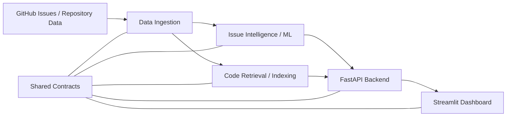
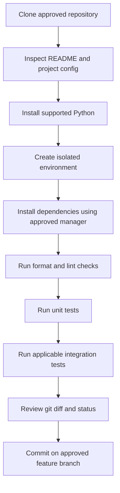
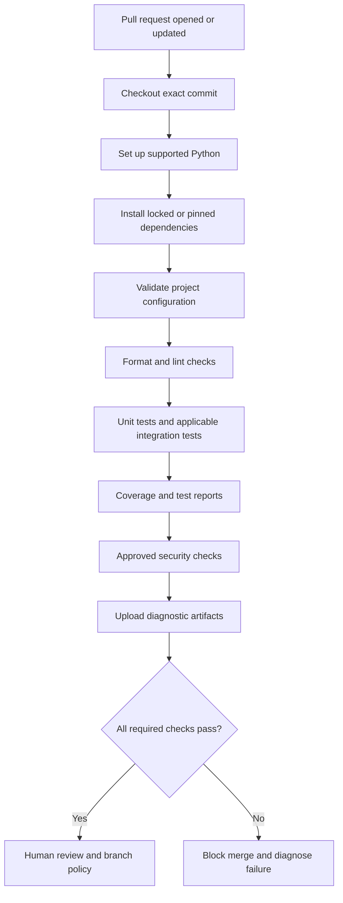
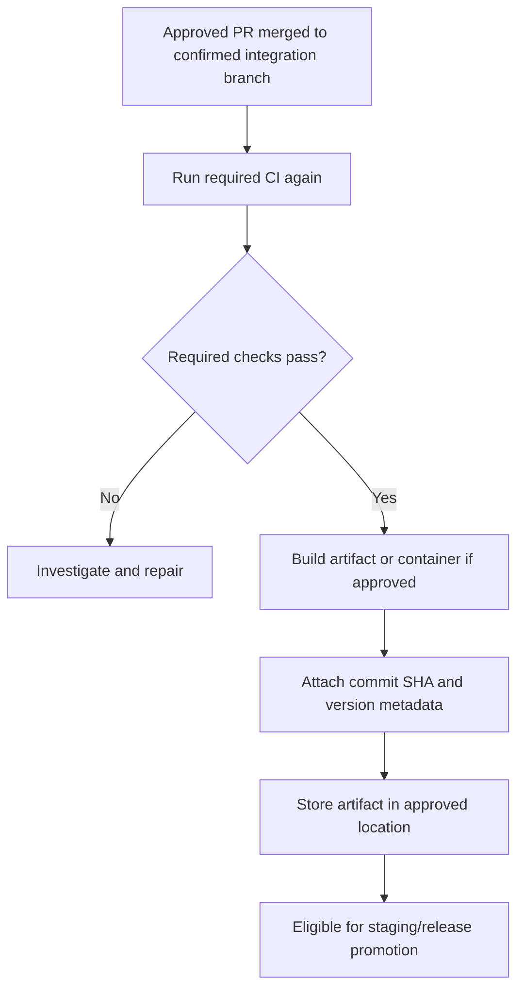
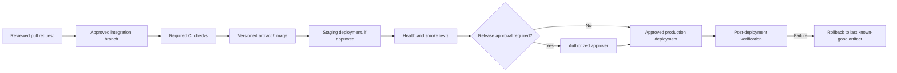
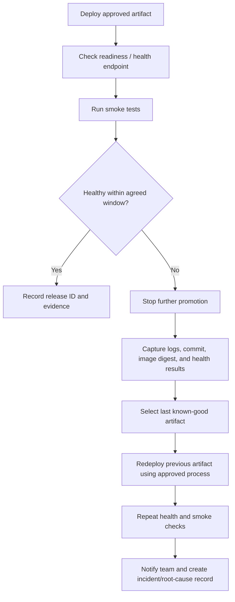
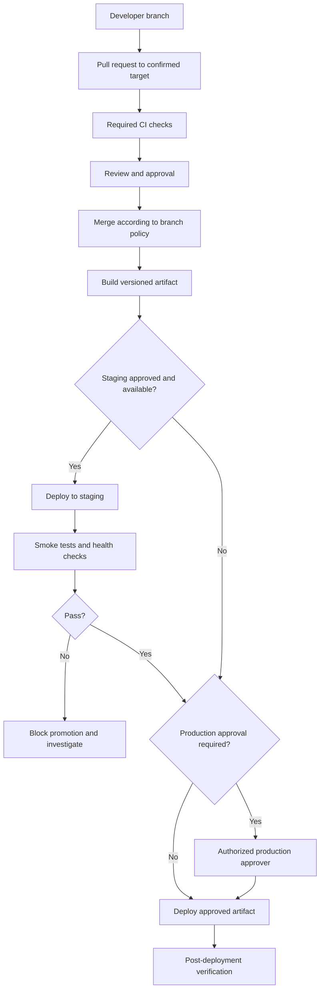
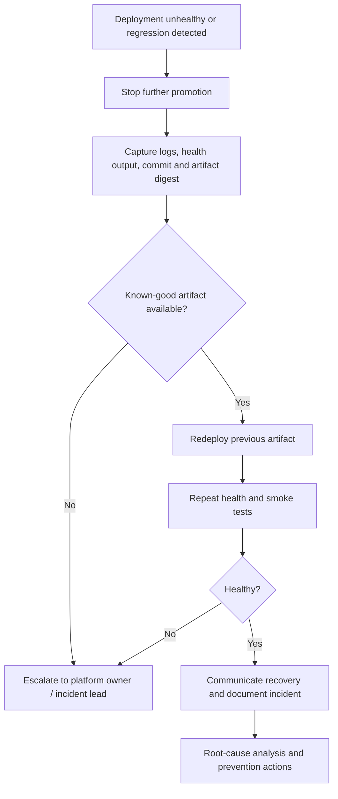

# ORDO DevOps and CI/CD Engineer Implementation Blueprint

**Deliverable:** `ORDO_DevOps_CICD_Engineer_Blueprint.md`  
**Project:** ORDO — AI-Powered GitHub Issue Intelligence Platform  
**Role:** DevOps and CI/CD Engineer  
**Status:** Adaptable implementation manual; repository-specific inspection is pending  
**Audience:** DevOps Engineer, Team Lead, application/package engineers, Security/Privacy Reviewer

> **Important status note:** The ORDO repository has not been provided in this task, and the user has indicated that the repository has not yet been created. Therefore, no repository files, branches, workflows, test results, registry, cloud account, or deployment target can be treated as verified. This manual gives a safe bootstrap and inspection process. Paths and code examples are proposed templates, not claims about existing files. Do not apply the proposed workflow until the Team Lead approves the repository layout, integration branch, ownership boundaries, Python version, and dependency strategy.

---

## 1. Document Overview

### 1.1 Purpose

This manual explains how to establish, validate, operate, and hand over the DevOps and CI/CD foundations for ORDO. It is designed to be followed step by step by a developer using Windows PowerShell or Bash.

The intended outcomes are:

- A documented repository audit before changes are made.
- A repeatable local Python setup.
- A pull-request validation workflow, if GitHub Actions is approved.
- Test, lint, security, and build evidence that is useful to reviewers.
- Containerization only if the application architecture and team decisions justify it.
- Deployment automation only after the deployment target and credentials model are approved.
- Safe release promotion, diagnostics, rollback, and handover procedures.

### 1.2 Evidence labels used throughout

| Label | Meaning |
|---|---|
| **Confirmed** | Directly established by the information available for this task. |
| **Proposed** | A suggested implementation that still needs review or approval. |
| **Assumption** | A working assumption used to explain a procedure; verify it before implementation. |
| **Blocker** | A missing decision or access requirement that prevents safe execution. |
| **Expected result** | What a successful command or workflow should look like; not a claim that it was run. |

### 1.3 Scope

In scope: source-control checks, Python build reproducibility, CI, test reporting, caching, workflow permissions, Docker/Compose assessment, image publishing design, deployment promotion, secrets hygiene, diagnostics, rollback, documentation, and handover.

Out of scope unless explicitly approved: changing application business logic, rewriting shared contracts, changing the root dependency manager, creating cloud resources, selecting a production platform, provisioning a registry, changing protected branch rules, or modifying security-owned workflows.

### 1.4 Starting position

**Confirmed:** ORDO is intended to be an AI-powered GitHub Issue Intelligence Platform. Anticipated components include GitHub data ingestion, machine-learning issue intelligence, code retrieval, a FastAPI backend, a Streamlit dashboard, shared contracts, automated tests, and supporting infrastructure.

**Confirmed:** The repository is not available for inspection in this task, and the repository has not yet been created according to the current project context.

**Not confirmed:** Actual directory layout, package names, Python support range, dependency manager, test framework, branch policy, ownership map, CI provider, container needs, registry, deployment platform, health endpoints, or any successful build/test result.

---

## 2. Role and Responsibilities

### 2.1 DevOps Engineer responsibilities

The DevOps Engineer may own approved changes for:

- Pull-request and integration CI configuration.
- Reproducible build and dependency installation steps.
- Dependency caching and CI execution efficiency.
- Dockerfiles and local development container configuration, if containers are approved.
- Build metadata, test/coverage reports, and artifact retention.
- Deployment automation for an approved target.
- Health checks, deployment verification, rollback instructions, and operational runbooks.
- DevOps documentation and handover evidence.

### 2.2 Collaboration and boundaries

| Collaborator | Coordination required |
|---|---|
| Data Engineer | Ingestion dependencies, data fixtures, integration tests, external API requirements, and data-handling constraints. |
| ML Engineer | Model dependencies, model downloads, CPU/GPU expectations, deterministic tests, and large artifacts. |
| Code Retrieval Engineer | Indexing dependencies, embedding/model downloads, storage requirements, and retrieval integration tests. |
| FastAPI Backend Engineer | API startup command, health endpoint, configuration contract, port, and smoke tests. |
| Streamlit Frontend Engineer | UI startup command, API base URL, environment variables, and container/network configuration. |
| Security/Privacy Reviewer | Workflow permissions, secrets, dependency scanning, image scanning, artifact retention, and deployment identity. |
| Team Lead | Repository URL, integration branch, ownership boundaries, package-manager decision, CI policy, registry, deployment target, and release approval. |

### 2.3 Ownership rules

1. Do not edit another role's application code merely to make a pipeline green.
2. Do not change shared API contracts or root dependency configuration without approval.
3. Inspect workflow ownership before editing anything under `.github/workflows/`.
4. Coordinate with the Security/Privacy Reviewer before adding or changing security-sensitive workflows.
5. Do not push to, merge into, or deploy from a protected branch without authorization.
6. Keep infrastructure changes focused and reviewable; avoid introducing Kubernetes, Terraform, a cloud service, or a monitoring platform without an approved need.
7. Preserve evidence of failures. Do not hide failures by excluding modules, weakening assertions, or silently reducing coverage thresholds.

### 2.4 File ownership classification

| File category | Default treatment before approval |
|---|---|
| New `docs/devops/` documents | Usually safe to propose; follow repository documentation conventions. |
| New local helper script under an approved `scripts/` directory | Propose and review with Team Lead. |
| New `.github/workflows/ci.yml` | Requires confirmation that GitHub Actions and workflow ownership are approved. |
| Existing workflow files | Inspect and obtain owner approval before modifying. |
| `pyproject.toml`, requirements files, lock files | Shared configuration; obtain approval before changing dependency strategy. |
| Application source and shared contracts | Owned by application/package engineers; DevOps should not rewrite them. |
| Dockerfiles and Compose files | Coordinate with API and frontend engineers; approval required if absent. |
| Deployment manifests and production settings | Blocked until target and owner are confirmed. |
| Secrets, environment files, repository rules | Never commit secrets; changes to settings require authorized access and review. |

---

## 3. ORDO Architecture Context

### 3.1 Target-neutral system view

The following diagram is conceptual. It represents expected component boundaries, not verified repository paths or implemented services.



The diagram should be updated after the engineers agree on actual package interfaces and data flow. Do not assume every component runs as a separate service: some may be imported Python packages, scheduled jobs, or optional modules.

### 3.2 Local development workflow



The environment and commands must match the repository's actual package manager. Do not mix pip, Poetry, uv, and other managers without a documented reason.

### 3.3 Pull-request CI workflow



Formatting, linting, and independent test suites may run in parallel after the environment is prepared. Integration tests may depend on services or fixtures and should run only when their requirements are available. The merge gate should be determined by the Team Lead and branch protection settings.

### 3.4 Main-branch integration and build workflow



A successful pull-request run does not automatically authorize deployment. Build and publish permissions should be separate from untrusted pull-request validation.

### 3.5 Development-to-staging-to-production promotion



Promotion should reuse the same built artifact when practical. Rebuilding independently for each environment can cause staging and production to run different bytes even when the source commit is the same.

### 3.6 Health-check and rollback flow



The exact health endpoint, readiness semantics, timeout, and rollback mechanism are blockers until the API and deployment target are known.

---

## 4. Repository Reconnaissance

### 4.1 First rule: do not change files before the audit

At present, no repository is available to inspect. When the Team Lead supplies the repository, run the commands below from the repository root and record the outputs in the pull-request description or an audit note. Redact private URLs and any accidental secrets before sharing output.

### 4.2 Confirm repository root and Git state

**PowerShell (Windows):**

```powershell
Get-Location
git rev-parse --show-toplevel
git status --short --branch
git branch --show-current
git remote -v
git log -5 --oneline --decorate
```

**Bash:**

```bash
pwd
git rev-parse --show-toplevel
git status --short --branch
git branch --show-current
git remote -v
git log -5 --oneline --decorate
```

What to look for:

- `git rev-parse --show-toplevel` must return the repository root.
- `git status` identifies uncommitted changes. Do not overwrite or discard work.
- `git branch --show-current` identifies the current branch.
- `git remote -v` shows configured remotes. Verify the URL with the Team Lead; do not infer that a remote is official merely because it exists.
- `git log` reveals recent commit conventions and may show whether the repository is initialized.

If Git reports that the current directory is not a repository, stop and obtain the approved clone URL. Do not invent one. Use `<TEAM_LEAD_APPROVED_REPOSITORY_URL>` only as a placeholder in documentation.

### 4.3 Inspect the tree

**PowerShell:**

```powershell
Get-ChildItem -Force
Get-ChildItem -Directory -Force
Get-ChildItem -Recurse -File |
  Where-Object { $_.FullName -notmatch '[\\/](\.git|\.venv|venv|__pycache__|node_modules)[\\/]' } |
  Select-Object -ExpandProperty FullName
```

**Bash:**

```bash
find . -maxdepth 3 -type f \
  -not -path './.git/*' \
  -not -path './.venv/*' \
  -not -path './venv/*' \
  -not -path '*/__pycache__/*' | sort
```

Look for actual app/package paths, tests, documentation, workflows, Docker files, scripts, and generated artifacts. The reference layout in the prompt is not proof that those directories exist.

### 4.4 Inspect Python and package-manager configuration

**PowerShell:**

```powershell
python --version
python -c "import sys; print(sys.executable); print(sys.version)"
py -0p
Get-ChildItem -Force -File |
  Where-Object { $_.Name -in @('pyproject.toml','requirements.txt','requirements-dev.txt','uv.lock','poetry.lock','Pipfile','Pipfile.lock','setup.cfg','tox.ini','pytest.ini') } |
  Select-Object Name, FullName
```

**Bash:**

```bash
python --version
python -c 'import sys; print(sys.executable); print(sys.version)'
command -v python
ls -la
```

Inspect the contents of existing project configuration files before selecting installation commands. Check declared Python constraints, dependency groups, test configuration, package discovery, and lock-file policy.

### 4.5 Inspect CI, security, and container files

**PowerShell:**

```powershell
if (Test-Path .github/workflows) {
  Get-ChildItem .github/workflows -File
  Get-ChildItem .github/workflows -File | ForEach-Object {
    "`n===== $($_.FullName) ====="
    Get-Content $_.FullName
  }
}
Get-ChildItem -Recurse -File -Include Dockerfile,Dockerfile.*,docker-compose.yml,docker-compose.yaml,compose.yml,compose.yaml,.dockerignore |
  Select-Object -ExpandProperty FullName
```

**Bash:**

```bash
find .github/workflows -maxdepth 2 -type f -print 2>/dev/null
find . -type f \( -name 'Dockerfile*' -o -name 'docker-compose.yml' \
  -o -name 'docker-compose.yaml' -o -name 'compose.yml' \
  -o -name 'compose.yaml' -o -name '.dockerignore' \) \
  -not -path './.git/*' -print
```

Review workflow triggers, permissions, third-party actions, secret exposure, dependency setup, test commands, artifact retention, and deployment steps. Read all relevant files before proposing replacements.

### 4.6 Inspect tests, linting, formatting, and security tools

**PowerShell:**

```powershell
Get-ChildItem -Recurse -File -Include test_*.py,*_test.py,pytest.ini,tox.ini,ruff.toml,.ruff.toml,.pre-commit-config.yaml,mypy.ini,.coveragerc,bandit.yaml |
  Where-Object { $_.FullName -notmatch '[\\/](\.git|\.venv|venv|__pycache__)[\\/]' } |
  Select-Object -ExpandProperty FullName
```

Search dependency files and workflow YAML for configured tools such as pytest, pytest-cov, Ruff, Black, mypy, Bandit, pip-audit, or other scanners. Do not add a duplicate tool before understanding what already exists.

If a CI run exists, inspect the exact commit and logs. A badge in a README is not sufficient evidence of a current passing build.

### 4.7 Environment variables and deployment documentation

Search for `.env.example`, `.env.template`, configuration modules, deployment manifests, README instructions, and secret names. Never print real `.env` values into a shared report. Use filenames and variable names for reconnaissance, not secret values.

Example safe PowerShell search:

```powershell
Get-ChildItem -Recurse -File -Include .env.example,.env.template,README.md,*.yml,*.yaml,*.toml |
  Where-Object { $_.FullName -notmatch '[\\/](\.git|\.venv|venv|node_modules)[\\/]' } |
  Select-Object -ExpandProperty FullName
```

Do not use a broad command that prints every `.env` file. If a real secret is discovered in Git history, treat it as exposed and follow Section 17.

### 4.8 Reconnaissance table

| Area | Inspection command | Evidence to record | Possible action | Team Lead approval? |
|---|---|---|---|---|
| Repository root | `git rev-parse --show-toplevel` | Actual root path | Run all later commands from this root | No, but repository access is required |
| Working tree | `git status --short --branch` | Branch and modified files | Preserve existing work; resolve ownership | Before touching others' changes |
| Remote and branch policy | `git remote -v`, `git branch -a` | Remote names, available branches | Confirm official remote and integration branch | Yes |
| Project structure | `Get-ChildItem` / `find` | Actual apps, packages, tests | Map checks to real paths | Review required |
| Python version | `python --version`, config files | Runtime constraints | Align local and CI versions | Yes if changing declared support |
| Dependencies | Inspect pyproject/requirements/lock files | Package manager and lock policy | Reuse existing manager | Yes before migration |
| Tests | Find tests and inspect configuration | Test command and fixtures | Run existing suite first | Usually no for execution; approval to change tests |
| Formatting/lint | Inspect configs and CI | Existing tools and rules | Reuse existing checks | Yes before adding a new standard |
| GitHub Actions | Read every workflow | Triggers, permissions, secrets | Amend only with owner approval | Yes |
| Docker | Find Dockerfiles and Compose | Services and build context | Reuse or propose containers | Yes if adding |
| Secrets | Inspect names/config safely | `.env.example`, secret references | Document variables; rotate exposed secrets | Security Reviewer/Team Lead |
| Deployment | Inspect manifests/docs | Actual target and commands | Write target-specific runbook | Yes |
| Observability | Inspect logs/health routes | Existing health and logging | Reuse endpoints and logs | Yes for new platform/tooling |

---

## 5. Confirmed Facts, Assumptions, and Blockers

### 5.1 Confirmed facts

- The product is named **ORDO**.
- It is intended to be an AI-powered GitHub Issue Intelligence Platform.
- The anticipated architecture includes ingestion, ML/issue intelligence, code retrieval, FastAPI, Streamlit, shared contracts, and tests.
- A repository has not yet been supplied for this implementation task, and project context indicates it has not been created.
- No command, workflow, test, container build, or deployment has been executed as part of producing this document.

### 5.2 Working assumptions used by examples

- Git will be used for source control.
- GitHub Actions is a possible CI provider because the project is GitHub-oriented, but it is not confirmed or approved.
- Python is expected for backend and package components, but the supported version and dependency manager are not known.
- Docker may be useful for the API and UI, but containerization is conditional.
- CI should validate pull requests without production secrets.
- A human review and explicit approval will govern protected branch changes and production deployment.

### 5.3 Blocking decisions

| Decision | Why it blocks implementation | Required owner |
|---|---|---|
| Approved repository URL and access | Cannot inspect, branch, or open a PR without it | Team Lead |
| Integration branch and branch protection | Cannot safely select workflow triggers or PR target | Team Lead |
| Actual directory/package layout | Workflow paths and commands must match real files | Team Lead + engineers |
| Supported Python version(s) | Local and CI environments must agree | Team Lead + Python owners |
| Dependency manager and lock-file policy | Reproducible installation depends on one canonical approach | Team Lead + engineers |
| Test/lint/security baseline | CI gates must reflect project standards | Team Lead + Security Reviewer |
| Workflow ownership | Existing CI may be owned by another role | Team Lead |
| Container requirement | Avoid unnecessary complexity and build maintenance | Team Lead + API/UI engineers |
| Registry | Publishing needs an explicitly approved destination | Team Lead + Security Reviewer |
| Deployment platform and environments | Target-specific authentication and rollback cannot be designed accurately without it | Team Lead |
| Health/readiness endpoints | Smoke tests need known semantics | API Engineer |
| Model/data requirements | Some tests may download large assets or need credentials | ML/Data/Retrieval engineers |

**Stop condition:** If the integration branch is not confirmed, do not assume `main`, `master`, or `develop`. Ask the Team Lead before configuring a branch-specific workflow or opening a pull request.

---

## 6. DevOps Architecture Diagrams

The conceptual diagrams in Section 3 form the initial architecture proposal. After repository creation, replace generic component labels with real paths and commands.

### 6.1 CI stage policy proposal

| Stage | Pull request | Integration branch | Scheduled/release | Notes |
|---|---:|---:|---:|---|
| Configuration validation | Required | Required | Required | Fast failure |
| Format check | Required | Required | Required | Must not rewrite files in CI |
| Lint | Required | Required | Required | Reuse configured tool |
| Unit tests | Required | Required | Required | No production credentials |
| Integration tests | Where practical | Required if supported | Required if relevant | External services must be controlled |
| Coverage report | Recommended | Recommended | Recommended | Gate threshold only after baseline approval |
| Dependency audit | Approved baseline | Approved baseline | Full scan may run | Findings triaged by policy |
| Secret scan | Approved tool/policy | Approved tool/policy | Approved tool/policy | Avoid duplicate scanners |
| Container build | If container changes or required | If containers approved | Release build | Never inject secrets into image |
| Publish image | No for untrusted PRs | Only with approved permissions | Approved release only | Separate privileged job |
| Deploy | No | Staging only if approved | Production only if approved | Protected environment/approval |

### 6.2 Monorepo-aware execution

Use the actual repository paths once known. The anticipated areas are:

- `apps/api/`
- `apps/web/`
- `packages/data_ingestion/`
- `packages/ml_engine/`
- `packages/code_retrieval/`
- shared contracts
- root-level tests

A simple full-suite CI run is preferable at first if it is affordable and correct. Path-based filtering can reduce runtime later, but it can silently miss dependencies. If filtering is introduced:

1. Map shared contracts and common utilities to every dependent component.
2. Ensure root configuration and lock-file changes trigger all affected tests.
3. Keep at least one full integration run on the confirmed integration branch or schedule.
4. Add a test for the path-filter rules themselves where practical.
5. Document which checks are skipped and why.

---

## 7. Implementation Roadmap

### Phase 1 — Audit the repository

**Prerequisites:** Approved repository access and permission to read files.

**Deliverables:**
- Repository inventory.
- Current branch and remote recorded.
- Python/dependency strategy identified.
- Existing tests, CI, Docker, security and deployment configuration mapped.
- Ownership and blockers confirmed.

**Commands:** Use Section 4.

**Verification:** A reviewer can reproduce the inventory and identify the exact files that will be touched.

**Failure handling:** If the repository is empty or unavailable, do not pretend it was inspected. Ask the Team Lead to create/provide it and continue only with target-neutral planning.

### Phase 2 — Establish reproducible local validation

**Prerequisites:** Python version and package manager confirmed.

**Deliverables:** A documented clean setup, canonical install command, and local validation commands.

**Procedure:**
1. Use the repository's existing dependency manager.
2. Create an isolated environment unless the project has an approved alternative.
3. Install only documented dependencies.
4. Run existing tests and checks before changing their configuration.
5. Record baseline failures as issues; do not silently “fix” them in DevOps-owned changes.

**Verification:** A clean checkout can install dependencies and run the agreed validation command.

### Phase 3 — Configure pull-request CI

**Prerequisites:** GitHub Actions or another CI provider approved; integration branch confirmed; workflow owner consulted.

**Deliverables:** One minimal CI workflow or a reviewed amendment to an existing workflow.

**Procedure:**
1. Reuse the existing CI provider and naming conventions.
2. Use read-only permissions by default.
3. Avoid secrets in pull-request jobs.
4. Install the project through its canonical dependency manager.
5. Run configuration, format, lint, and test commands.
6. Upload reports only when useful and safe.
7. Verify a successful run and a deliberately failing test on a disposable branch or test PR.

**Verification:** A pull request displays the expected required checks; a failure blocks the merge according to branch policy.

### Phase 4 — Improve reports and caching

**Prerequisites:** CI is functional and baseline runtime is measured.

**Deliverables:** Coverage/test reports and a cache with a lock-file-aware key, if the dependency manager supports it.

**Verification:** A second run can restore the dependency cache when the key matches; changing the lock file changes the key.

### Phase 5 — Add approved security and supply-chain checks

**Prerequisites:** Security/Privacy Reviewer approves tools, severity policy, and workflow ownership.

**Deliverables:** A concise set of non-overlapping dependency, secret, and static/container checks.

**Verification:** A controlled test finding is handled according to policy; logs do not reveal secret values.

### Phase 6 — Containerize services if required

**Prerequisites:** API/UI startup commands, runtime dependencies, and service boundaries are confirmed.

**Deliverables:** Reviewed Dockerfile(s), `.dockerignore`, and optional Compose file.

**Verification:** Image builds, container starts, health/smoke test passes, container runs as non-root where feasible, and no secrets are present in image layers.

### Phase 7 — Automate deployment after target approval

**Prerequisites:** Deployment platform, environment names, identity/authentication, registry, health checks, and rollback method are approved.

**Deliverables:** Deployment workflow and target-specific runbook.

**Verification:** Staging deployment succeeds, smoke tests pass, and rollback to a prior artifact is demonstrated before production use.

### Phase 8 — Operations, rollback, and handover

**Prerequisites:** CI and any approved deployment workflow have been tested.

**Deliverables:** Runbooks, troubleshooting guide, final checklist, evidence, and open-issues list.

**Verification:** A second engineer can reproduce the setup and explain how to diagnose a failure without relying on undocumented knowledge.

---

## 8. Python Environment and Dependency Strategy

### 8.1 Select one canonical approach

Inspect the repository before choosing a command. Use this decision order:

1. If a maintained `pyproject.toml` and lock file already define the project manager, reuse them.
2. If the project uses `requirements.txt` plus a documented pinned Python version, follow that setup and improve it only with approval.
3. If multiple managers or conflicting dependency files exist, document the conflict and ask the Team Lead which file is authoritative.
4. If no project configuration exists, propose one simple setup and obtain approval before committing it.

Do not infer a supported Python version from the developer's installed interpreter. Use the project's declared version or the Team Lead's decision.

### 8.2 Clean environment using an approved Python version

The following is a generic fallback **only if the project approves standard pip and has a root `requirements.txt`**.

**PowerShell from the repository root:**

```powershell
py -0p
py -3.12 -m venv .venv
.\.venv\Scripts\python.exe -m pip install --upgrade pip
.\.venv\Scripts\python.exe -m pip install -r requirements.txt
.\.venv\Scripts\python.exe -m pip check
```

Replace `3.12` with the confirmed supported version. If that interpreter is not installed, install the approved version rather than changing the project version to match whatever is available.

Activation is optional; invoking `.venv\Scripts\python.exe` directly avoids PowerShell execution-policy issues.

**Bash:**

```bash
python3.12 -m venv .venv
. .venv/bin/activate
python -m pip install --upgrade pip
python -m pip install -r requirements.txt
python -m pip check
```

**Expected result:** `pip check` reports no broken requirements. This does not prove that application tests pass.

### 8.3 If `pyproject.toml` or another manager is authoritative

Follow the commands already documented in the repository. Do not paste pip commands into a Poetry/uv-managed project unless that is explicitly the intended workflow. Confirm:

- Whether installation should be editable for local packages.
- Whether optional ML or development dependencies are separate groups.
- Whether lock files are committed.
- Whether CI must use frozen/locked mode.
- Whether model weights or datasets are downloaded separately.
- Whether optional GPU dependencies are required or CPU-only CI is supported.

### 8.4 Monorepo import paths

Avoid relying on a developer's current working directory or a manually modified `PYTHONPATH` that CI does not reproduce. Prefer proper package metadata and editable installs when that matches the repository's package design.

If the monorepo has independently installable packages, document the approved installation order and extras. If the root project is a workspace, use the workspace manager's documented mechanism.

### 8.5 Dependency reproducibility

- Commit the canonical lock file if the chosen tool supports and expects one.
- Update dependencies in reviewed, focused changes.
- Use a consistent Python version in local instructions and CI.
- Avoid unbounded dependency upgrades in deployment workflows.
- Do not cache `.venv` across incompatible operating systems or Python versions.
- Keep large model files and datasets out of Git unless the project explicitly requires versioned assets and has an approved storage strategy.

### 8.6 Development dependencies

Keep lint/test tools in the existing development dependency group or requirements file. Do not create `requirements-dev.txt` if an established group already exists. A proposed dev dependency set might include pytest, pytest-cov, and Ruff, but only if the project approves those tools and they are not already configured.

### 8.7 Verification

From a clean environment, run the documented install command, then:

```powershell
python --version
python -m pip --version
python -m pip check
```

Run from the environment's interpreter, not an unrelated global Python. Expected output includes the approved Python version and no dependency conflicts. If imports fail, capture the complete traceback and verify the active interpreter before changing dependencies.

---

## 9. CI Pipeline Design

### 9.1 Required behavior

A CI workflow should:

- Check out the exact commit under review.
- Use a supported, explicitly selected Python version.
- Install dependencies reproducibly.
- Run the canonical checks.
- Fail when a required check fails.
- Avoid production secrets in untrusted pull-request contexts.
- Preserve useful diagnostic logs and reports.
- Use minimal permissions.
- Avoid deploying or publishing privileged artifacts from untrusted pull requests.

### 9.2 Job ordering

A sensible initial pipeline is:

1. Checkout.
2. Set up Python.
3. Restore dependency cache.
4. Install dependencies.
5. Validate configuration.
6. Run format and lint checks.
7. Run unit tests.
8. Run integration tests if their dependencies are available.
9. Generate coverage and reports.
10. Run approved security checks.
11. Upload reports.
12. Apply the merge gate.

Independent lint and test jobs may run in parallel after installation if duplicated setup cost is acceptable. Start simple; optimize only after measuring actual CI duration.

### 9.3 Monorepo checks

Until path dependencies are understood, running the complete test suite is safer than aggressive path filtering. After the project grows, use a documented component-to-dependency map. Changes to shared contracts, root configuration, lock files, reusable utilities, and workflow files should trigger all affected checks.

### 9.4 CI secrets policy

Pull-request validation should not need production deployment credentials. Forked pull requests must not run privileged code with write permissions or deployment secrets. Publishing/deployment jobs should be separated from untrusted PR validation and restricted to approved branches, tags, and protected environments.

---

## 10. GitHub Actions Implementation, If Applicable

### 10.1 Preconditions

The example below is a **proposed starter workflow**, not a statement that ORDO already uses GitHub Actions. Before adding it:

- Confirm GitHub Actions is approved.
- Confirm the repository's integration branch. Replace the placeholder branch condition only after approval.
- Confirm the Python version and dependency installation command.
- Confirm whether Ruff and pytest are configured.
- Confirm ownership of `.github/workflows/`.
- Review this file with the Team Lead and Security/Privacy Reviewer.

If any precondition is unresolved, keep the file as a proposal and do not enable it on the repository.

### 10.2 Proposed workflow file

**Proposed path:** `.github/workflows/ci.yml`

This template assumes, solely for illustration, that the repository has `requirements.txt`, and that pytest and Ruff are installed by that requirements file. Change the install and check commands to match the real project before use.

```yaml
name: CI

on:
  pull_request:
  push:
    # Replace with the Team Lead-confirmed integration branch.
    branches: ["<CONFIRMED_INTEGRATION_BRANCH>"]
  workflow_dispatch:

permissions:
  contents: read

concurrency:
  group: ci-${{ github.workflow }}-${{ github.ref }}
  cancel-in-progress: true

jobs:
  validate:
    name: Validate Python project
    runs-on: ubuntu-latest
    timeout-minutes: 20

    steps:
      - name: Check out repository
        uses: actions/checkout@v4

      - name: Set up Python
        uses: actions/setup-python@v5
        with:
          # Replace with the project's confirmed supported Python version.
          python-version: "3.12"
          cache: "pip"
          cache-dependency-path: requirements.txt

      - name: Install dependencies
        run: |
          python -m pip install --upgrade pip
          python -m pip install -r requirements.txt

      - name: Check dependency consistency
        run: python -m pip check

      - name: Check formatting
        run: python -m ruff format --check .

      - name: Lint
        run: python -m ruff check .

      - name: Run tests with coverage
        run: python -m pytest --cov --cov-report=term-missing --junitxml=test-results.xml

      - name: Upload test report
        if: always()
        uses: actions/upload-artifact@v4
        with:
          name: test-results-${{ github.run_id }}
          path: test-results.xml
          if-no-files-found: warn
          retention-days: 14
```

**Important template caveats:**

- The literal `"<CONFIRMED_INTEGRATION_BRANCH>"` is intentionally a placeholder and is not a valid final branch choice. Replace it before enabling the workflow.
- `actions/checkout@v4`, `actions/setup-python@v5`, and `actions/upload-artifact@v4` are readable version tags, not immutable commit SHA pins. If ORDO's security policy requires SHA pinning, use reviewed immutable commit SHAs and document the update process.
- The template assumes Ruff and pytest are installed. It will fail if they are not.
- `pytest --cov` requires pytest-cov. Confirm the plugin exists and that the coverage source configuration is appropriate.
- A project may use `pyproject.toml`, uv, Poetry, a workspace, multiple package installs, or different paths. Adapt the commands rather than forcing this template onto the project.
- The workflow intentionally has no deployment or publishing credentials and grants only `contents: read`.

### 10.3 Validate the workflow before merging

Run YAML validation with an approved YAML parser or workflow linter if available. A YAML parser checks syntax but not every GitHub Actions semantic rule. Review trigger behavior, branch names, permissions, action versions, path filters, artifact contents, and untrusted PR behavior.

Expected result: the workflow parses, each command exists in the repository's dependency configuration, and a test PR produces visible check results. No result is claimed until an actual run is inspected.

### 10.4 Failure behavior

A required step must fail the job when a required check fails. Do not append `|| true` to required checks. Use `if: always()` only for diagnostic cleanup or artifact upload, not to turn a failed validation into a passing workflow.

### 10.5 Workflow permissions and forks

The default `contents: read` permission is intentionally narrow. Add permissions only to the specific job that needs them. Do not expose secrets to untrusted pull requests. If a workflow uses `pull_request_target`, review it with the Security/Privacy Reviewer before use; checking out or executing untrusted PR code in a privileged context can expose credentials.

---

## 11. Formatting, Linting, Type Checking, and Testing

### 11.1 Understand the checks

| Check | Purpose | What a failure means |
|---|---|---|
| Formatting | Enforces consistent source layout | Files do not match the formatter's rules |
| Linting | Detects likely bugs, suspicious patterns, and style issues | Code violates configured lint rules |
| Type checking | Checks static type consistency | Declared types and usage are inconsistent |
| Unit tests | Tests small units in isolation | Expected behavior is not met or test setup is broken |
| Integration tests | Tests interactions between components/services | An interface, dependency, fixture, or environment may be wrong |
| Coverage | Measures executed code paths | Shows test reach, not correctness by itself |
| Dependency audit | Finds known vulnerable package versions | A dependency may require triage/update/mitigation |
| Static security analysis | Searches source for risky patterns | Findings require review; false positives are possible |

### 11.2 Reuse existing configuration

Before adding tools, search `pyproject.toml`, `setup.cfg`, `.ruff.toml`, `ruff.toml`, `pytest.ini`, `tox.ini`, `.coveragerc`, and workflows. Use the already selected tool where possible.

### 11.3 Example local commands (only if configured)

```powershell
python -m ruff format --check .
python -m ruff check .
python -m pytest
python -m pytest --cov --cov-report=term-missing
```

These commands are examples, not guaranteed to work until the corresponding tools and configuration are present.

### 11.4 Example configuration proposal

If the repository has no lint/format configuration and the Team Lead approves Ruff, a minimal configuration could be added to `pyproject.toml`. Do not replace an existing `pyproject.toml`; merge settings carefully.

```toml
[tool.ruff]
line-length = 100
target-version = "py312"

[tool.ruff.lint]
select = ["E", "F", "I", "UP"]
```

The `target-version` must match the approved Python support baseline. The selected rule set must be reviewed against existing code before making it a required gate.

### 11.5 Type checking

Introduce mypy or another type checker only if the project has a clear benefit and the Team Lead approves the initial baseline. Start with owned modules or newly written code if the existing codebase has many legacy findings; do not pretend a partial check covers the entire project. Record scope explicitly.

### 11.6 Test design

- Keep unit tests independent of live GitHub APIs and production credentials.
- Mock network calls and external service boundaries where appropriate.
- Use small, deterministic fixtures.
- Avoid downloading model weights in every unit test.
- Separate tests that require credentials, network access, large models, or GPU resources.
- Ensure integration tests have explicit prerequisites and timeouts.
- Preserve failing test output and the commit SHA.

### 11.7 Coverage policy

Do not invent a coverage threshold. Measure the baseline first, discuss the target with the Team Lead, and add a threshold only after the team agrees on what is measured. Do not exclude failing modules merely to raise the reported percentage.

### 11.8 Common failures

- **Tool not found:** The tool is not installed in the selected environment or is absent from dev dependencies.
- **Imports fail only in CI:** Package installation or working-directory assumptions are wrong.
- **Tests require network:** Replace external dependencies with fixtures/mocks for unit tests, or classify the test as integration.
- **Coverage reports zero or omit code:** Configure the actual package/source path.
- **Formatter changes files:** Run the formatter locally, inspect the diff, and commit intentional changes; CI should normally use `--check`.

---

## 12. Dependency Caching and Build Optimization

### 12.1 Principles

- Cache downloaded packages, not secrets.
- Include lock-file or dependency-file hashes in cache keys.
- Include OS and Python version where relevant.
- Avoid caching a virtual environment across incompatible runtimes.
- Do not use caching as a substitute for lock files or pinned dependencies.
- Measure before adding complex path-based matrices.

### 12.2 GitHub Actions pip cache

The workflow template uses `actions/setup-python` with:

```yaml
with:
  python-version: "3.12"
  cache: "pip"
  cache-dependency-path: requirements.txt
```

This is suitable only if pip and the specified dependency file are authoritative. For multiple requirements files, configure all authoritative dependency paths using the action's documented syntax. For Poetry or uv, use that tool's supported cache mechanism and lock file instead.

### 12.3 How to verify caching

Inspect the CI logs for cache restore/save messages. The first run may miss and populate the cache; a later run with the same dependency key should be able to restore it. Change the dependency/lock file in a test branch and verify that the cache key changes.

### 12.4 Cache troubleshooting

- **Repeated cache miss:** Verify the cache dependency path and whether the lock file is committed.
- **Stale or incompatible packages:** Rebuild from the lock file; do not rely on cached environments.
- **Slow job despite cache hit:** Package installation may be only a small portion of runtime; profile tests and model setup.
- **Different behavior across OS/Python:** Use separate keys and compatible runners.
- **Sensitive files in cache:** Remove them from the cache path and review the exposure. Rotate any secrets that were cached.

---

## 13. Docker and Containerization

### 13.1 Decide whether containers are required

First inspect existing Dockerfiles and the actual API/UI startup commands. Containers may help with reproducibility and deployment, but they introduce image maintenance, security updates, networking, storage, and operational responsibilities.

Do not containerize until the Team Lead and API/UI engineers confirm:
- Service boundaries and entry points.
- Runtime Python version.
- Dependency installation method.
- Required files and model/data assets.
- Environment variables.
- Ports and health checks.
- Whether services are deployed together or independently.

### 13.2 Proposed API Dockerfile template

The following is a **template only**. It assumes the API can be installed from root `requirements.txt` and started as `uvicorn app.main:app`. Those assumptions are not verified. Replace the startup command, paths, and installation steps with the actual backend structure.

**Proposed path:** `apps/api/Dockerfile`

```dockerfile
# Replace the tag with the Python version approved for ORDO.
FROM python:3.12-slim

ENV PYTHONDONTWRITEBYTECODE=1 \
    PYTHONUNBUFFERED=1 \
    PIP_NO_CACHE_DIR=1

WORKDIR /app

# This copy assumes a root requirements file is included in the build context.
COPY requirements.txt /app/requirements.txt
RUN python -m pip install --upgrade pip \
    && python -m pip install -r /app/requirements.txt

# Replace with the real API source and package layout.
COPY apps/api/ /app/

# Use a non-root runtime account.
RUN useradd --create-home --uid 10001 appuser \
    && chown -R appuser:appuser /app
USER appuser

EXPOSE 8000

# Replace with the actual ASGI import path after confirming it.
CMD ["python", "-m", "uvicorn", "app.main:app", "--host", "0.0.0.0", "--port", "8000"]
```

This Dockerfile may not work for a monorepo where the API imports local packages outside `apps/api/`. In that case, use the repository root as the build context and copy/install the required packages using the approved workspace configuration. Do not duplicate application code into the API folder to work around a bad build context.

### 13.3 Proposed Streamlit Dockerfile template

**Proposed path:** `apps/web/Dockerfile`

```dockerfile
FROM python:3.12-slim

ENV PYTHONDONTWRITEBYTECODE=1 \
    PYTHONUNBUFFERED=1 \
    PIP_NO_CACHE_DIR=1

WORKDIR /app

# Replace with the actual UI dependency file.
COPY apps/web/requirements.txt /app/requirements.txt
RUN python -m pip install --upgrade pip \
    && python -m pip install -r /app/requirements.txt

COPY apps/web/ /app/

RUN useradd --create-home --uid 10001 appuser \
    && chown -R appuser:appuser /app
USER appuser

EXPOSE 8501

# Replace with the actual Streamlit entry-point filename.
CMD ["python", "-m", "streamlit", "run", "streamlit_app.py", "--server.address=0.0.0.0", "--server.port=8501"]
```

This assumes a separate UI requirements file and an entry point called `streamlit_app.py`. Neither is confirmed. If the project has one root dependency file or shared packages, revise the build context and installation instructions.

### 13.4 `.dockerignore`

A proposed root `.dockerignore` (merge with any existing file):

```dockerignore
.git
.github
.venv
venv
__pycache__
*.py[cod]
.pytest_cache
.mypy_cache
.ruff_cache
.coverage
htmlcov
.env
.env.*
!.env.example
*.pem
*.key
secrets/
data/private/
models/cache/
```

Review the ignore rules against actual runtime needs. Do not accidentally exclude source files, package metadata, lock files, or model assets required by the image. Do not assume the listed data/model paths exist.

### 13.5 Build and run (after adaptation)

Run from the repository root, using the actual approved build context:

```powershell
docker build -f apps/api/Dockerfile -t ordo-api:local .
docker image inspect ordo-api:local
docker run --rm --name ordo-api-local -p 8000:8000 --env-file .env ordo-api:local
```

The commands are examples only and require Docker, an adapted Dockerfile, and a valid local environment file. Do not use `.env` if it contains production secrets; use safe local credentials or fake values.

Inspect logs:

```powershell
docker logs ordo-api-local
docker inspect ordo-api-local
```

Stop a detached container with:

```powershell
docker stop ordo-api-local
```

The sample `docker run` runs in the foreground unless `-d` is added. If it is foregrounded, use Ctrl+C to stop it. Do not use a health endpoint until the API engineer confirms one exists.

### 13.6 Image security and efficiency

- Use a supported, reviewed base image.
- Pin the runtime version intentionally and update it through a reviewed maintenance process.
- Run as a non-root user where feasible.
- Keep `.env` and secrets out of the build context.
- Use `.dockerignore`.
- Avoid copying the entire repository if it includes private data, credentials, caches, or unrelated projects.
- Use multi-stage builds only when they measurably reduce image size or exclude build tools.
- Record the source commit and image digest for releases.
- Scan images using the approved tool and triage findings; a clean scan is not a guarantee of security.

---

## 14. Docker Compose, If Applicable

### 14.1 Preconditions

Compose is useful for local development when API and UI need to run together. It should not be added merely to appear production-ready. Confirm actual service commands, ports, shared packages, and network needs first.

### 14.2 Illustrative Compose template

This template assumes the adapted Dockerfiles above are valid and that the UI can reach the API at `http://api:8000` from inside the Compose network. The environment-variable name is illustrative and must match the actual UI configuration.

**Proposed path:** `compose.yaml`

```yaml
services:
  api:
    build:
      context: .
      dockerfile: apps/api/Dockerfile
    environment:
      APP_ENV: development
      LOG_LEVEL: INFO
    ports:
      - "8000:8000"
    restart: unless-stopped

  web:
    build:
      context: .
      dockerfile: apps/web/Dockerfile
    environment:
      # Replace with the actual variable expected by the UI.
      ORDO_API_BASE_URL: http://api:8000
    ports:
      - "8501:8501"
    depends_on:
      - api
    restart: unless-stopped
```

Do not include databases, vector stores, caches, or model services unless ORDO actually requires them. `depends_on` controls startup ordering but does not by itself guarantee that the API is ready. Add a health check only after the API has a verified health endpoint.

### 14.3 Commands

```powershell
docker compose config
docker compose up --build
docker compose ps
docker compose logs --tail 100 api
docker compose logs --tail 100 web
docker compose down
```

Expected outcomes: `docker compose config` renders a valid resolved configuration; `up --build` builds and starts the services; `ps` lists service states; logs show startup output. These are expected outcomes, not observed results. `docker compose down` stops and removes the Compose containers/network. Avoid `down -v` unless deleting volumes is intended and approved.

---

## 15. Container Registry and Publishing

### 15.1 Registry decision is blocked

No registry is confirmed. Do not assume Docker Hub, GitHub Container Registry, AWS ECR, Azure Container Registry, or another provider. The Team Lead and Security/Privacy Reviewer must approve the registry, access model, retention policy, and image-scanning requirements.

### 15.2 Naming and traceability proposal

After approval, define a convention such as:

- Human-readable release tag: `vX.Y.Z` only if the team adopts semantic versioning.
- Commit tag: a short or full Git SHA.
- Immutable digest: the registry's content digest where available.
- Metadata: repository, commit SHA, build workflow run, and release identifier.

Do not use `latest` as the only production reference because it is mutable and makes rollback less precise.

### 15.3 Publishing workflow safeguards

- Never publish from untrusted fork pull requests.
- Grant registry write access only to the publish job.
- Use the approved CI secret or short-lived identity federation mechanism.
- Do not echo credentials into logs or pass them as Docker build arguments.
- Scan the image before promotion if required by policy.
- Record the digest and source commit.
- Protect release tags and production environments according to team policy.

### 15.4 Verification

After an authorized publish run, verify that the image exists in the approved registry, the digest/tag matches the workflow output, the image can be pulled by an authorized identity, and the source commit is traceable. Do not claim publication before checking the registry.

---

## 16. Deployment Automation

### 16.1 Target-neutral design

**Blocker:** No deployment platform or environment has been confirmed. Do not create a target-specific deployment workflow yet.

The intended release path is:

1. Build and test the source commit.
2. Produce an identifiable artifact or image.
3. Publish only to an approved location.
4. Deploy to a non-production environment if one exists.
5. Run health and smoke tests.
6. Obtain required approval.
7. Promote the same artifact to production if approved.
8. Verify service behavior and record the release ID.
9. Roll back to the last known-good artifact if health checks fail.

### 16.2 Required deployment inputs

Before implementation, record:

- Platform and account/project/subscription.
- Development, staging, and production environment names.
- Registry and artifact retention.
- Network/port requirements.
- Environment variables and secret storage.
- Identity and authorization mechanism.
- Application start command.
- Health/readiness endpoints and timeout.
- Logging location and access.
- Resource limits and scaling expectations.
- Database migration strategy, if any.
- Rollback mechanism and responsible approver.
- Change window and production approval rules.

### 16.3 Separate environments

- **Local development:** Developer-controlled environment and non-production data.
- **CI/test:** Ephemeral or controlled test environment; no production credentials.
- **Staging:** Production-like environment for release verification, if approved.
- **Production:** Protected environment with least-privilege deployment access, auditable approval, and a documented rollback path.

### 16.4 Health checks and smoke tests

A health endpoint must be defined by the API owner. A TCP port accepting connections is not proof that the application is ready. A smoke test should validate the minimum safe request/response path without modifying production data.

Example only, if `/health` is confirmed:

```powershell
Invoke-WebRequest -Uri "http://localhost:8000/health" -Method Get
```

Expected result: an HTTP success status and the documented health payload. Do not create a health endpoint from the DevOps layer without coordinating with the backend owner.

---

## 17. Environment Variables and Secrets

### 17.1 Safe configuration model

- `.env.example`: committed documentation containing variable names and fake/non-sensitive examples only.
- `.env`: local-only configuration; ignored by Git.
- CI secrets/variables: stored in the approved repository or environment settings, with minimal scope.
- Deployment secrets: stored in the platform's approved secret manager or protected environment configuration.
- Production secrets: never copied into local development files, logs, image layers, test artifacts, or pull-request environments.

### 17.2 Example variable documentation table

The following names are illustrative, not a claim that ORDO already uses them.

| Variable | Purpose | Required | Example |
|---|---|---|---|
| `APP_ENV` | Selects application environment | Depends on app configuration | `development` |
| `LOG_LEVEL` | Logging verbosity | Depends on app configuration | `INFO` |
| `ORDO_API_BASE_URL` | UI base URL for API requests | If UI uses this name | `http://localhost:8000` |
| `GITHUB_TOKEN` | Authenticates approved GitHub API operations | Only if required by the implementation | `REPLACE_WITH_LOCAL_TEST_TOKEN` |
| `PORT` | Runtime listen port, if configurable | Depends on service | `8000` |

Never use a real token as the example. The exact variable names must come from the application configuration, not from this illustrative table.

### 17.3 `.gitignore` review

Confirm that `.env`, `.env.*` (with a deliberate exception for `.env.example`), virtual environments, caches, local datasets, model caches, coverage outputs, and secrets are excluded as appropriate. Do not replace an existing `.gitignore` without reviewing it.

Illustrative entries:

```gitignore
.env
.env.*
!.env.example
.venv/
venv/
__pycache__/
.pytest_cache/
.ruff_cache/
.coverage
htmlcov/
```

Merge carefully with existing rules and project conventions.

### 17.4 Secret exposure response

If a real secret is committed or printed into logs:

1. Treat it as compromised immediately.
2. Revoke or rotate it at the issuing service; removing it from the latest commit is not enough.
3. Notify the Security/Privacy Reviewer and Team Lead through the approved channel.
4. Identify affected commits, logs, artifacts, caches, and environments.
5. Follow the team's approved history-cleanup process if required; coordinate because rewriting Git history affects collaborators.
6. Add a regression check or process improvement.
7. Record the incident and verify that the old credential no longer works.

Do not paste the secret into an issue, chat, or incident report.

---

## 18. Release and Promotion Strategy

### 18.1 Proposed promotion process



### 18.2 Branch and version policy

The repository's actual branch policy is unknown. Confirm:

- Integration branch.
- Required reviews and status checks.
- Whether squash, merge commits, or rebase is preferred.
- Release tag format.
- Semantic versioning or another version scheme.
- Who may create release tags.
- Whether staging deploys on merge or by manual dispatch.
- Whether production requires approval.

Do not impose `main`, `develop`, semantic versioning, or a release-branch strategy without approval.

### 18.3 Small development project vs production service

For an early development project, a PR workflow with tests and a manually triggered build may be sufficient. Production deployment warrants stronger separation of permissions, immutable artifact identification, protected environments, explicit approval, health verification, audit records, and tested rollback. The level of control should match actual risk and operational requirements.

---

## 19. Rollback and Recovery

### 19.1 Rollback procedure

1. **Stop promotion:** Prevent further deployment or release promotion.
2. **Identify the release:** Record environment, release/version, commit SHA, image digest, deployment time, and operator.
3. **Capture evidence:** Save relevant application/deployment logs, health results, and CI run links.
4. **Assess impact:** Determine whether the issue is application code, configuration, dependency, infrastructure, or an external service.
5. **Select the last known-good artifact:** Use the recorded immutable artifact/image digest where possible.
6. **Redeploy using the approved mechanism:** Do not improvise platform commands without the target-specific runbook.
7. **Verify health:** Repeat readiness checks and safe smoke tests.
8. **Communicate:** Notify the Team Lead and affected engineers; record time and outcome.
9. **Investigate:** Create a root-cause record and corrective actions.
10. **Preserve evidence:** Keep logs and release metadata according to the retention policy.

### 19.2 Rollback flowchart



### 19.3 Git revert vs deployment rollback

- **Git revert** creates a new source-control commit that reverses a prior change. It changes the source branch after review and merge.
- **Deployment rollback** restores a previously built artifact or image in a runtime environment. It may restore service quickly without rewriting the source branch.
- These operations are related but not interchangeable. Reverting source code does not automatically redeploy anything, and redeploying an old image does not remove a bad commit from the repository.

### 19.4 Database migrations

Do not run destructive rollback SQL or reverse a migration automatically without a verified migration strategy and explicit approval. Some schema changes are not safely reversible. Prefer backward-compatible expand/migrate/contract patterns where the database owner approves them.

### 19.5 Post-rollback checklist

- [ ] Correct environment and release identified.
- [ ] Last known-good artifact/digest verified.
- [ ] Logs and health failures captured.
- [ ] Rollback authorized according to policy.
- [ ] Previous artifact redeployed.
- [ ] Health/readiness checks pass.
- [ ] Safe smoke tests pass.
- [ ] User/team communication sent.
- [ ] Incident/root-cause record created.
- [ ] Follow-up actions assigned.
- [ ] No destructive database operation was run without approval.

---

## 20. Security and Supply Chain

### 20.1 Security review requirements

Coordinate with the Security/Privacy Reviewer before adding or changing security-sensitive workflows. Select tools based on the threat model and existing controls; avoid overlapping scanners without a clear purpose.

### 20.2 Areas to check

- Vulnerable dependencies.
- Accidental secrets in commits and artifacts.
- Excessive workflow permissions.
- Untrusted fork pull requests executing in privileged contexts.
- Unreviewed third-party actions.
- Unsafe container users, packages, or image contents.
- Registry write access.
- Deployment identity and credential lifetime.
- Artifact retention and sensitive test outputs.
- Provenance/attestation where supported and required.

### 20.3 Finding triage

The Security Reviewer and Team Lead should define severity thresholds and release-blocking rules. At minimum, document the finding, affected component, exploitability/context, available fix, compensating control, owner, and due date. Do not mark a finding resolved solely because a scanner was disabled.

A scanner can miss issues and produce false positives. Passing a scan does not guarantee that ORDO is secure.

### 20.4 Dependency scanning

If approved, choose a dependency audit tool compatible with the authoritative package manager and lock file. Run it on the dependency graph used in builds. Pin the tool version where practical, preserve reports, and define how exceptions are documented. Avoid automatically upgrading production dependencies without review and tests.

### 20.5 Action pinning

If policy requires immutable GitHub Action references, pin actions to reviewed full commit SHAs and keep the human-readable action version in a comment. Establish an update cadence and review updates. Do not copy arbitrary SHAs from an untrusted source.

### 20.6 Secrets and artifacts

- Do not upload `.env`, token files, private datasets, model credentials, or unrestricted debug dumps as artifacts.
- Check test reports and logs for sensitive input.
- Use minimum retention that still supports debugging and audit needs.
- Masking is not a substitute for avoiding secret output in the first place.

---

## 21. Observability and Diagnostics

### 21.1 CI diagnostics

Record or preserve:

- Workflow name, run ID, commit SHA, branch/ref, and runner OS.
- Python version and package-manager version.
- Dependency installation errors.
- Test output and JUnit XML when available.
- Coverage report when configured.
- Artifact/image digest for build jobs.
- Deployment target/environment and release identifier for authorized deploys.

Do not print environment variables wholesale. They may contain credentials.

### 21.2 Application diagnostics

Use existing application logging and health endpoints. Do not add a monitoring platform until requirements and ownership are approved. Coordinate with the API and frontend engineers about request IDs, error response structure, log levels, and health/readiness semantics.

### 21.3 Useful local commands

```powershell
# Git and source changes
git status --short --branch
git diff --check
git diff --stat

# Python runtime and dependencies
python --version
python -m pip --version
python -m pip check

# Docker, if installed and used
docker version
docker compose version
docker ps -a
docker images
```

Expected output should identify the installed tool versions and current containers/images. If Docker is not installed or running, container commands cannot be verified locally; that is an environment limitation, not proof of an application defect.

### 21.4 Health checks

Only use the actual health endpoint documented by the backend. A successful health endpoint should have a defined contract: what dependencies it checks, what HTTP status means healthy, and whether it is liveness or readiness. Avoid making readiness depend on slow external operations unless the service design explicitly requires that behavior.

### 21.5 Error classification

- **Application failure:** A validly configured process starts but application logic or an interface fails.
- **Dependency/build failure:** Package resolution, wheel build, or missing system library prevents installation.
- **CI configuration failure:** Incorrect trigger, permission, path, action input, or environment setup.
- **Infrastructure failure:** Runner, network, registry, DNS, or deployment platform unavailable.
- **Test design failure:** Test assumes external state, is nondeterministic, or has invalid fixtures.

Use logs and reproducible commands to classify before changing code.

---

## 22. Verification and Acceptance Tests

Run only the steps that apply to the approved project configuration. Record the actual command, commit SHA, result, and any known limitation.

### 22.1 Local environment

- [ ] Start from a clean checkout.
- [ ] Install the approved Python version.
- [ ] Follow the canonical dependency installation instructions.
- [ ] Confirm `python --version` and active interpreter path.
- [ ] Run `python -m pip check` if pip is the approved installer.
- [ ] Run the documented formatting, lint, and test commands.
- [ ] Confirm the working tree contains no unintended generated files.

**Expected:** The setup is repeatable and documented. Do not mark complete based only on a previously configured local environment.

### 22.2 Workflow validation

- [ ] Validate YAML syntax.
- [ ] Review branch triggers and permissions.
- [ ] Confirm all invoked commands and dependencies exist.
- [ ] Open a test PR on an authorized branch.
- [ ] Confirm expected checks appear.
- [ ] Confirm a controlled failure is visible and blocks required checks.
- [ ] Confirm artifacts do not contain secrets.
- [ ] Confirm fork PRs cannot access privileged credentials.

### 22.3 Docker verification (if approved)

- [ ] Build image from a clean checkout.
- [ ] Inspect image configuration.
- [ ] Confirm non-root execution where feasible.
- [ ] Start container with safe local configuration.
- [ ] Verify logs and health endpoint.
- [ ] Stop container cleanly.
- [ ] Inspect image/layers and build context for secrets.
- [ ] Run approved image scan.

### 22.4 Registry verification (if approved)

- [ ] Registry and namespace are approved.
- [ ] CI identity has minimum required permissions.
- [ ] Image tag and digest are recorded.
- [ ] Image can be pulled by an authorized identity.
- [ ] Image source commit is traceable.
- [ ] No credentials appear in logs or image layers.

### 22.5 Deployment verification (if approved)

- [ ] Deployment target and environment are approved.
- [ ] Environment variables/secrets are configured safely.
- [ ] Deploy uses the intended immutable artifact.
- [ ] Health checks pass.
- [ ] Smoke tests pass.
- [ ] Logs identify the release.
- [ ] Rollback to a prior artifact is tested in a safe environment.
- [ ] Production approval requirements are satisfied.

### 22.6 Local versus remote requirements

| Check | Local machine | GitHub/CI permissions | Registry/deployment access |
|---|---:|---:|---:|
| Repository audit | Yes | Read access may be needed | No |
| Unit tests/lint | Yes | No | No |
| Workflow syntax review | Yes | No | No |
| Actual GitHub Actions run | No, unless locally simulated | Yes | No |
| Protected branch behavior | No | Repository admin/settings access may be needed | No |
| Container build | Docker required | CI runner if remote | No |
| Image publishing | Optional local test | CI credentials/identity | Registry write access |
| Deployment smoke test | Only for local target | CI/deploy workflow access | Target access |
| Production rollback | No | Approved workflow access | Authorized production access |

---

## 23. Troubleshooting

| Symptom | Likely cause | Diagnostic command/action | Resolution | Verification |
|---|---|---|---|---|
| CI passes locally but fails on runner | Different Python/OS, missing file, undeclared dependency, environment assumption | Compare Python version, install logs, working directory, and exact commit | Reproduce from clean environment; declare dependencies; remove implicit local state | Re-run same commit in CI |
| Dependency resolution fails | Conflicting pins, unsupported Python, unavailable wheel, private package access | `python --version`; inspect resolver output and lock file | Align approved Python version; update dependencies through review; provide approved package access | Clean install succeeds |
| Wrong Python version | PATH or runner config selects different interpreter | `python -c "import sys; print(sys.executable, sys.version)"`; `py -0p` on Windows | Select installed, approved interpreter explicitly | Version matches project policy |
| Monorepo import error | Package not installed, wrong build context, implicit `PYTHONPATH` | Run test from repository root; inspect package metadata | Install local package/workspace correctly; fix build context with owner approval | Import and tests pass in clean environment |
| Missing test dependency | Test tools not in dev dependency group or CI install command | `python -m pytest --version`; inspect dependency file | Add to approved dev dependencies and canonical CI install | Test command runs in clean environment |
| Cache misses every run | Wrong dependency path or changing key | Inspect setup/cache logs and dependency-file path | Point cache at authoritative lock/requirements file | Subsequent identical run restores cache |
| Cache causes inconsistent behavior | Caching mutable environment or wrong OS/Python key | Compare cache keys and environment | Cache downloaded packages only; include runtime dimensions | Clean install and cached install behave consistently |
| Workflow never triggers | Incorrect branch/event/path filter or workflow file path | Inspect workflow triggers and PR target branch | Correct only after branch policy is confirmed | Test PR produces expected run |
| YAML parse error | Indentation, quoting, invalid scalar | Use approved YAML/workflow linter | Fix syntax and revalidate | Workflow is accepted by GitHub |
| CI permission denied | Missing permission or wrong token scope | Inspect failed API operation and job permissions | Grant the minimum permission to the specific job after review | Operation succeeds without broad write access |
| Secret unavailable in workflow | Secret scope/environment approval/fork restriction | Check secret name and environment rules without printing its value | Configure through approved settings; do not expose to fork PRs | Authorized workflow succeeds and logs remain redacted |
| Docker build fails | Wrong build context, missing requirements/source, package needs OS libraries | `docker build ...`; inspect first failing layer | Correct context/dependencies and keep changes with owner approval | Clean image build succeeds |
| Container exits immediately | Invalid entry point, import error, missing configuration | `docker logs <container>`; `docker inspect <container>` | Fix startup command/config based on actual traceback | Container stays running and health check passes |
| Port conflict | Port already bound by another process/container | `docker ps`; inspect local port usage | Stop only the known conflicting process or map a different local port | Service reachable on selected port |
| Health check fails | App not ready, wrong URL/port, dependency failure, invalid health contract | Inspect logs and endpoint response | Confirm endpoint and readiness semantics with API owner | Health and smoke checks pass |
| Registry authentication fails | Wrong registry, expired credential, missing scope, denied identity | Inspect registry error without printing token | Use approved identity/secret and minimum scope | Authorized pull/push succeeds |
| Deployment fails | Wrong target/config, permissions, unavailable dependency, invalid artifact | Inspect deployment logs, release ID, environment | Follow platform-specific runbook; avoid ad hoc production changes | Deployment verification succeeds |
| Rollback fails | Previous artifact unavailable, incompatible schema, insufficient permission | Verify artifact digest and platform logs | Escalate to platform owner; follow recovery plan | Service health restored or incident escalated |
| Tests are flaky | Time dependence, random state, external API, shared fixtures | Repeat isolated test and inspect failure history | Make test deterministic; isolate external services | Repeated runs pass consistently |
| Coverage is unexpectedly low | Wrong source path, tests not discovering modules, configuration mismatch | Inspect coverage report and pytest collection | Correct config; do not exclude modules just to inflate score | Report matches intended source scope |
| Image unexpectedly large | Unneeded files, caches, model/data assets copied into image | Inspect build context and image layers | Improve `.dockerignore`; use appropriate dependency/install stages | Image contents and size are acceptable |
| Scanner flags dependency | Known CVE or incompatible transitive version | Review package, version, advisory, and dependency tree | Upgrade/mitigate through reviewed change; document exception if allowed | Rescan and rerun tests |
| CI succeeds while important tests are skipped | Bad path filters or permissive conditions | Inspect job summary and changed-file rules | Correct dependency map; retain full integration run | Representative shared change triggers all required tests |

### 23.1 Diagnose before modifying code

1. Reproduce the failure with the same commit and supported environment.
2. Identify the earliest meaningful error, not just the final summary line.
3. Determine whether the failure is application, dependency, test, workflow, or infrastructure related.
4. Check recent changes and ownership.
5. Make the smallest reviewed fix.
6. Run the relevant local check and complete CI.
7. Document the root cause if it can recur.

Do not routinely skip required checks, suppress errors, or make production changes directly to bypass CI.

---

## 24. Documentation Updates

Create or update documentation only after reviewing the existing README and documentation structure. The following is a proposed set, not a claim that `docs/devops/` already exists.

| Proposed file | Purpose | Audience |
|---|---|---|
| `docs/devops/architecture.md` | DevOps boundaries, build/deploy flow, environment overview | All engineers, Team Lead |
| `docs/devops/local-development.md` | Clean setup, dependency install, local validation | New developers |
| `docs/devops/ci-cd-pipeline.md` | Workflow triggers, required checks, permissions, artifacts | Engineers and reviewers |
| `docs/devops/docker-guide.md` | Image builds, Compose, networking, local debugging | API/UI/DevOps engineers |
| `docs/devops/deployment-guide.md` | Approved platform, configuration, deploy and verify | Release operators |
| `docs/devops/secrets-management.md` | Variable names, secret scopes, rotation and incident response | All engineers, Security Reviewer |
| `docs/devops/release-and-rollback.md` | Release promotion, artifact identification, recovery | Team Lead and operators |
| `docs/devops/troubleshooting.md` | Common symptoms, diagnostic commands, fixes | All engineers |

### 24.1 Root README

Update the root README only after reviewing its current content and the team's documentation conventions. Add links to the setup guide and CI status only when the destination and badge are correct. Do not overwrite existing project overview, architecture, or contributor instructions.

### 24.2 Documentation quality

Every runbook should state:
- Prerequisites and permissions.
- Working directory.
- Exact command.
- Expected result.
- Common failure and resolution.
- Whether the step is local or requires remote access.
- Owner and last-reviewed date, if the team uses such metadata.

---

## 25. Git Workflow and Pull Request Handover

### 25.1 Preconditions

Confirm the official remote, integration branch, feature-branch naming, and commit-message convention. Do not assume a branch name. The following example uses placeholders where required.

### 25.2 Start safely

```powershell
git status --short --branch
git remote -v
git branch --show-current
```

If the working tree has changes, inspect and preserve them before switching branches. Do not use `git reset --hard`, `git clean -fd`, or force-push as routine cleanup.

After confirming the target branch and naming convention, create a feature branch using the team's approved pattern. Example only:

```powershell
git switch -c feature/devops/ci-cd-pipeline
```

If the branch name already exists, do not overwrite it; inspect it and choose an approved alternative.

### 25.3 Review changes

```powershell
git status --short
git diff --check
git diff --stat
git diff
```

Check that only intended DevOps files are included. Inspect for secrets, generated reports, local virtual environments, downloaded models, large datasets, and unrelated application edits.

### 25.4 Run validation

Run the documented local setup and checks. Record commands and outcomes accurately. Do not state that CI passed until the actual CI run for the pushed commit has been reviewed.

### 25.5 Commit and push

Use the team's commit convention. Example only:

```powershell
git add docs/devops .github/workflows/ci.yml
git diff --cached --check
git diff --cached --stat
git commit -m "ci: add ORDO CI workflow and DevOps guide"
git push -u origin feature/devops/ci-cd-pipeline
```

Adjust the staged paths to the actual approved changes. Do not stage a file just because it appears in this example. If `origin` is not the approved remote, stop and confirm the remote with the Team Lead.

### 25.6 Pull request handover content

Include:
- Purpose and scope.
- Files created/modified.
- Repository facts verified.
- Commands run and actual results.
- CI run link/ID, if available.
- Security/permission changes.
- Known limitations and unverified assumptions.
- Required Team Lead/Security Reviewer decisions.
- Rollback/revert instructions.
- Confirmation that no secrets or unrelated changes are included.

Do not merge, push to protected branches, or deploy without authorization.

---

## 26. Definition of Done

The DevOps task is complete only when the applicable items below are verified:

1. Repository facts and ownership boundaries have been documented.
2. The integration branch and CI provider are confirmed.
3. Local setup uses the approved Python version and package manager.
4. Dependency installation is reproducible from a clean checkout.
5. Required CI checks match the real repository and fail on genuine failures.
6. Workflow permissions and untrusted PR behavior have been reviewed.
7. Test/coverage artifacts are useful and contain no sensitive data.
8. Caching is correct and does not hide dependency drift.
9. Containerization, registry, and deployment are implemented only if approved.
10. Images and artifacts are traceable to a commit and version/digest.
11. Environment variables and secrets are documented safely.
12. Deployment health checks and rollback are validated where deployment exists.
13. Troubleshooting and operational runbooks are complete.
14. Team Lead blockers and unresolved decisions are listed.
15. The pull request has a clear handover summary and evidence.

Do not mark an item complete merely because a template exists. Mark it complete only after the relevant evidence is available.

---

## 27. Final Checklist

### Repository and configuration
- [ ] Existing repository configuration inspected.
- [ ] Actual paths and package boundaries confirmed.
- [ ] Ownership boundaries respected.
- [ ] Proposed files reviewed before editing.
- [ ] Python version and package manager approved.
- [ ] Dependencies are reproducible.

### CI and tests
- [ ] CI provider and integration branch confirmed.
- [ ] Required checks are configured.
- [ ] Test commands and prerequisites are documented.
- [ ] Workflow permissions are reviewed.
- [ ] Untrusted PRs cannot access privileged credentials.
- [ ] Reports and artifacts are useful and safe.
- [ ] Failures are visible and actionable.

### Containers and deployment
- [ ] Docker configuration validated, if applicable.
- [ ] Compose services match actual application needs, if applicable.
- [ ] No secrets are embedded in images.
- [ ] Health checks work where supported.
- [ ] Registry is approved, if publishing is needed.
- [ ] Deployment target is approved.
- [ ] Release artifact is identifiable and traceable.
- [ ] Rollback procedure is documented and validated.

### Security
- [ ] Secrets are excluded from version control.
- [ ] CI permissions follow least privilege.
- [ ] Third-party actions follow project policy.
- [ ] Dependency and image findings are triaged.
- [ ] Sensitive artifacts have appropriate retention.
- [ ] Security checks are documented and owned.

### Documentation and handover
- [ ] Clean setup and commands are documented.
- [ ] Troubleshooting guidance is included.
- [ ] Expected outcomes are clearly distinguished from observed outcomes.
- [ ] Team Lead blockers are listed.
- [ ] Pull request contains a clear summary and test evidence.
- [ ] No secrets, generated artifacts, virtual environments, or unrelated changes are included.

---

## 28. Team Lead Questions and Outstanding Decisions

Resolve these before enabling CI or implementing deployment:

1. What is the approved repository URL, and who has access?
2. Has the repository been initialized, and which files already exist?
3. What is the confirmed integration branch? What are the branch protection and required-review rules?
4. Is GitHub Actions the approved CI provider?
5. Which Python versions must be supported?
6. Which dependency manager is authoritative: pip/requirements, uv, Poetry, or another tool?
7. Which lock files are committed and required in CI?
8. What is the actual monorepo layout and package installation strategy?
9. Which test, formatting, linting, type-checking, coverage, and security tools are already configured?
10. Which checks are merge-blocking, and what coverage/security thresholds are approved?
11. Who owns existing `.github/workflows/` files?
12. Are Docker and Docker Compose required for local development or deployment?
13. What are the confirmed API and Streamlit entry points and ports?
14. Which health/readiness endpoint and smoke test should deployment use?
15. Is a container registry required? If so, which registry and namespace are approved?
16. What deployment platform and environments are approved?
17. How should CI authenticate to the registry and deployment platform? Is short-lived identity federation supported?
18. Which secrets are required, where are they stored, and who owns rotation?
19. Are external GitHub APIs, model downloads, databases, vector stores, or other services required by integration tests?
20. What is the release/versioning policy, and who approves production releases?
21. What is the rollback mechanism, and are database migrations involved?
22. What are artifact/log retention requirements and data privacy constraints?
23. Which security findings block merge or release, and who approves exceptions?
24. Which documentation and operational handover format does the team require?

### Safe next action

Because the repository has not been supplied, the immediate next action is **not** to create or enable a workflow with guessed paths. The Team Lead should provide or initialize the approved repository, confirm the integration branch, and identify the owners of root configuration and workflows. Then execute Section 4, replace illustrative paths and commands with verified facts, and implement the roadmap one phase at a time.

---

## Appendix A. Initial implementation evidence log

Use this template after repository access is granted. Fill it with observed results only.

| Item | Observed value | Evidence location | Status |
|---|---|---|---|
| Repository root | Pending | Command output | Blocked |
| Official remote | Pending | Redacted `git remote -v` | Blocked |
| Integration branch | Pending | Team Lead confirmation | Blocked |
| Python version | Pending | Project config / runtime command | Blocked |
| Dependency manager | Pending | Config and lock files | Blocked |
| Existing CI provider/workflows | Pending | Workflow files/settings | Blocked |
| Existing tests and commands | Pending | Test config/CI logs | Blocked |
| Docker/Compose status | Pending | Repository files | Blocked |
| Registry | Pending | Team Lead approval | Blocked |
| Deployment target | Pending | Team Lead approval | Blocked |
| Health endpoint | Pending | Backend contract/docs | Blocked |
| Security review | Pending | Reviewer sign-off | Blocked |

## Appendix B. Handover summary template

```text
ORDO DevOps / CI-CD Handover

Repository:
Branch / PR:
Integration branch confirmed by:
Scope:
Files created:
Files modified:
Existing files deliberately left unchanged:
Python version / dependency manager:
Local commands run:
Local results:
CI run ID / link:
CI results:
Security review status:
Docker/image status:
Deployment status:
Rollback verification:
Known limitations:
Team Lead decisions still required:
Follow-up owners and due dates:
Confirmation: no secrets or unrelated files included.
```

## Appendix C. Operating principles

- Inspect before changing.
- Use verified repository paths.
- Prefer one canonical dependency strategy.
- Keep PR validation unprivileged.
- Do not put secrets in source, logs, artifacts, or image layers.
- Build once and promote the same artifact where practical.
- Record commit SHA, release identity, and image digest.
- Keep required checks meaningful and actionable.
- Do not claim tests, scans, builds, or deployments passed without evidence.
- Escalate unresolved architecture and ownership decisions instead of guessing.
