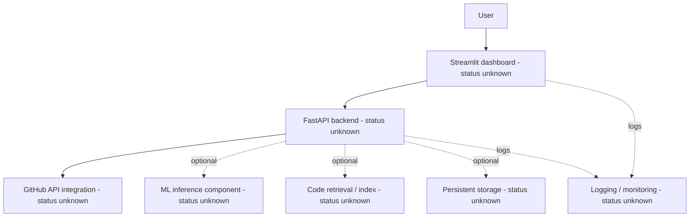
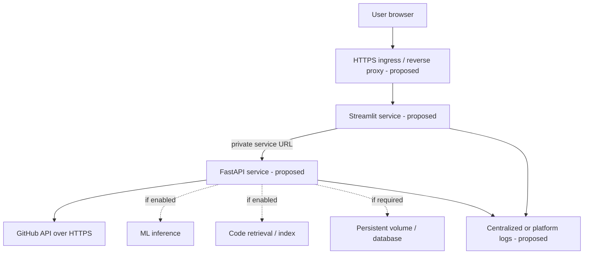

# ORDO Deployment and Release Engineer Implementation Blueprint

**Document type:** Implementation manual  
**Project:** ORDO — AI-powered GitHub Issue Intelligence Platform  
**Owner:** Deployment and Release Engineer  
**Status:** Repository-specific audit pending; examples are proposed templates, not verified implementation  
**Version:** 0.1.0-draft  
**Last updated:** 2026-10-26

> **Important audit limitation:** The available input was the Deployment and Release Engineer master prompt, not the ORDO source repository. Therefore, no application files, workflows, endpoints, dependencies, Git branches, hosting targets, database, or successful test/deployment results could be inspected. This manual explicitly separates known project intent from proposed examples. Before adopting a command or file, compare it with the actual repository and obtain the approvals identified below. Do not treat example health endpoints, paths, ports, environment variables, or workflows as existing functionality.

## Table of contents

1. [Document Purpose and Audience](#1-document-purpose-and-audience)
2. [Project and Repository Audit](#2-project-and-repository-audit)
3. [Confirmed Facts, Assumptions, and Open Questions](#3-confirmed-facts-assumptions-and-open-questions)
4. [Deployment Engineer Responsibilities](#4-deployment-engineer-responsibilities)
5. [Current Deployment Architecture](#5-current-deployment-architecture)
6. [Proposed Deployment Architecture](#6-proposed-deployment-architecture)
7. [Deployment Target Decision](#7-deployment-target-decision)
8. [Environment and Configuration Strategy](#8-environment-and-configuration-strategy)
9. [Dependency and Build Reproducibility](#9-dependency-and-build-reproducibility)
10. [Containerization](#10-containerization)
11. [FastAPI Deployment](#11-fastapi-deployment)
12. [Streamlit Deployment](#12-streamlit-deployment)
13. [Database and Persistent Storage](#13-database-and-persistent-storage)
14. [GitHub API and External Services](#14-github-api-and-external-services)
15. [CI/CD Integration](#15-cicd-integration)
16. [Branching and Release Versioning](#16-branching-and-release-versioning)
17. [Deployment Procedure](#17-deployment-procedure)
18. [Smoke Testing and Verification](#18-smoke-testing-and-verification)
19. [Security and Privacy Checklist](#19-security-and-privacy-checklist)
20. [Rollback and Recovery](#20-rollback-and-recovery)
21. [Monitoring and Operational Handover](#21-monitoring-and-operational-handover)
22. [Troubleshooting Runbook](#22-troubleshooting-runbook)
23. [Deployment and Release Checklists](#23-deployment-and-release-checklists)
24. [Complete Implementation Examples](#24-complete-implementation-examples)
25. [Testing and Validation](#25-testing-and-validation)
26. [Git Workflow and Handover](#26-git-workflow-and-handover)
27. [Definition of Done](#27-definition-of-done)
28. [Risks, Decisions Required, and Future Improvements](#28-risks-decisions-required-and-future-improvements)
29. [Final Deployment Readiness Checklist](#29-final-deployment-readiness-checklist)

---

## 1. Document Purpose and Audience

This manual describes how the ORDO team should prepare, package, deploy, verify, release, operate, and roll back a version of the application. It is intended for the Deployment and Release Engineer and the engineers responsible for backend, frontend, CI/CD, security, QA, observability, and project decisions.

### Goals

- Make releases repeatable and traceable to an exact source commit and artifact.
- Keep development, test, staging, and production configuration separate.
- Verify backend, dashboard, GitHub integration, and any enabled ML/code-retrieval capabilities before declaring a release healthy.
- Prevent secret exposure and unsafe production changes.
- Establish a known-good rollback target and a clear decision owner.
- Report unverified steps honestly rather than implying they passed.

### Evidence labels used in this manual

| Label | Meaning |
|---|---|
| **Confirmed from supplied prompt** | The user-supplied prompt names the project or requirement. It does not prove the feature exists in code. |
| **Proposed** | A recommended implementation pattern that must be reviewed and adapted. |
| **Unknown / verify** | Requires inspection of the repository or confirmation from an owner. |
| **Verified** | May only be applied after an engineer records reproducible evidence, such as command output, test results, or a reviewed diff. No repository-specific item is marked verified in this draft. |

## 2. Project and Repository Audit

### 2.1 Audit status

**Repository audit: blocked / not performed.** No repository archive, checkout, source tree, Git metadata, or application files were supplied with the prompt. Do not infer that the repository has any particular layout or implementation.

### 2.2 Required audit before changing files

Run the following from the actual repository root. These are inspection commands; they do not modify the working tree.

| Check | Command (PowerShell) | What to record |
|---|---|---|
| Root and files | `Get-Location; Get-ChildItem -Force` | Confirm root, hidden files, and folder structure |
| Git state | `git status --short --branch` | Current branch and uncommitted changes |
| Remotes | `git remote -v` | Configured remotes; redact credentials if a remote URL embeds them |
| Branches/tags | `git branch -a; git tag --list` | Actual branching and release history |
| Recent commits | `git log -10 --oneline --decorate` | Recent change conventions |
| Python metadata | `Get-ChildItem -Force pyproject.toml,requirements*.txt,uv.lock,poetry.lock,Pipfile.lock -ErrorAction SilentlyContinue` | Existing dependency manager and lock files |
| Runtime/container files | `Get-ChildItem -Recurse -File -Include Dockerfile, docker-compose.yml,compose.yaml,.dockerignore` | Existing container configuration (review scope if tree is large) |
| Workflows | `Get-ChildItem .github/workflows -File -ErrorAction SilentlyContinue` | Existing CI/CD workflows |
| Environment templates | `Get-ChildItem -Force -Name .env*` | Template names only; do not print real `.env` contents into logs or chat |
| Tests | `Get-ChildItem -Recurse -Directory -Filter tests -ErrorAction SilentlyContinue` | Test structure and test framework |
| Deployment docs | `Get-ChildItem -Recurse -File -Include README*,*deploy*,*release*,*runbook*` | Existing instructions and avoid duplicate docs |

For a large repository, use targeted `git ls-files` rather than printing every generated file:

```powershell
# Run from repository root. Lists tracked files only.
git ls-files
```

Search source for entry points and configuration names only after confirming the project language and layout. Avoid dumping secrets or private issue data while auditing.

### 2.3 Audit worksheet

Complete this worksheet from evidence. Use `Unknown` until checked.

| Item | Status | Evidence / owner |
|---|---|---|
| Repository root and monorepo ownership boundaries | Unknown | Record checkout path and ownership docs |
| Python version requirement | Unknown | `pyproject.toml`, `.python-version`, CI configuration, or documented runtime |
| Dependency manager and lock file | Unknown | Inspect tracked dependency files |
| FastAPI import path and startup command | Unknown | Inspect application module and README |
| Streamlit entry point and port | Unknown | Inspect UI module/configuration |
| Existing Docker/Compose files | Unknown | Inspect tracked container files |
| CI/CD workflows | Unknown | Inspect `.github/workflows/` and other automation |
| Environment variable names | Unknown | Inspect settings definitions and `.env.example`; never expose values |
| GitHub API library/authentication method | Unknown | Inspect integration code and dependency declarations |
| ML inference and model artifact requirements | Unknown | Inspect model-loading and inference modules |
| Code retrieval/index/cache requirements | Unknown | Inspect retrieval code and storage paths |
| Database and migrations | Unknown | Inspect dependencies, settings, migration directories |
| Health/readiness endpoints | Unknown | Inspect API routes and deployment probes |
| Logging/metrics/tracing | Unknown | Inspect logging configuration and instrumentation |
| Tests and validation commands | Unknown | Inspect test configuration and workflow commands |
| Hosting provider and production environment | Unknown | Project Lead decision / infrastructure evidence |
| Branch, tag, and release conventions | Unknown | Git history and team policy |

## 3. Confirmed Facts, Assumptions, and Open Questions

### 3.1 Confirmed from the supplied project brief

- The project is named **ORDO** and is described as an AI-powered GitHub Issue Intelligence Platform.
- The intended architecture may include a Streamlit dashboard, FastAPI backend, GitHub API integration, ML inference, code retrieval, and logging/monitoring. Their implementation status is **not verified**.
- Deployment must coordinate with DevOps/CI/CD, backend, frontend, security/privacy, QA, monitoring/observability, and the Project Lead.
- Production deployment, infrastructure changes, releases, credential publication, and destructive operations require appropriate authorization.

### 3.2 Proposed working assumptions (must be validated)

- Backend and UI may be independently runnable processes. If the actual project is a single process or uses a different frontend, adapt the design.
- Docker can be evaluated as a repeatable packaging option, but it is not assumed to exist or be mandatory.
- A staging environment is desirable before production if the team has the resources to operate one.
- Health endpoints, CI gates, immutable artifacts, and an explicit rollback target should be implemented if absent.

### 3.3 Open questions requiring answers

1. What is the canonical repository URL and root directory?
2. Which branch is the approved integration branch? Who may authorize a production release?
3. What Python version and dependency manager does the repository support?
4. What are the actual FastAPI import path, Streamlit entry point, ports, and health endpoints?
5. Does ORDO persist data, build an index, download model artifacts, or write generated reports?
6. Which GitHub authentication model is used, and what permissions are required?
7. What environments exist, and what hosting constraints, region, budget, and data-residency requirements apply?
8. Are user authentication/authorization and private repository access implemented?
9. Which automated tests and CI workflows already run?
10. Who owns on-call response, production access, secrets, backups, and release approvals?

## 4. Deployment Engineer Responsibilities

The Deployment and Release Engineer owns the **release process and operational deployment plan**, not every application or infrastructure implementation detail.

| Role | Owns | Must coordinate on |
|---|---|---|
| Deployment and Release Engineer | Release readiness, release record, environment promotion, deployment/rollback runbook, post-deploy verification, operational handover | All shared configuration and release scope |
| DevOps and CI/CD Engineer | Workflow implementation, infrastructure-as-code, build/publish/deploy automation, runners and deployment credentials | Artifact format, gates, target environment, permissions |
| FastAPI Backend Engineer | API startup/import path, configuration validation, health/readiness endpoints, graceful shutdown and compatibility | API contract, backend secrets, timeouts, dependencies |
| Streamlit Frontend Engineer | UI startup, frontend configuration, server-side API URL, UI readiness and restart behavior | API URL, network topology, user-facing errors |
| Security and Privacy Reviewer | Secret handling, access controls, transport security, data minimization, security review | Token scopes, logs, image contents, exposure risks |
| QA Engineer | Unit/integration/regression/smoke tests and release quality gates | Test environments and acceptance criteria |
| Monitoring and Observability Engineer | Logs, metrics, traces where used, alerts and dashboards | Release identifiers, health signals, alert validation |
| Project Lead | Scope, shared decisions, integration branch, production-release authorization and risk acceptance | Target selection and exceptions to gates |

### Approval-required decisions

Do not make these decisions unilaterally: production hosting/provider, public exposure, credential scopes, changes to authentication, destructive migrations, data deletion/retention changes, branch-policy changes, production traffic cutover, disabling quality gates, or accepting a known critical security defect. Record approver, date, scope, and rationale in the release record.

## 5. Current Deployment Architecture

**Current architecture is unknown because the repository was not supplied.** The following is a conceptual component inventory, not a statement that these components already exist.



Before using this diagram as the “current” architecture, verify each arrow and component in code and configuration. Record whether the dashboard calls the backend server-side or from the browser; that distinction changes network exposure and API URL configuration.

### Questions to answer from the actual code

- Does Streamlit call FastAPI from the Streamlit server, or does browser-side JavaScript call the API?
- Is GitHub access made directly by FastAPI, by a worker, or by another service?
- Are ML inference and code retrieval in-process, separate services, or optional modules?
- Are indexes, caches, model files, or reports stored on disk? Are they regenerable?
- Which services must start first, and what should happen when GitHub or a model is unavailable?

## 6. Proposed Deployment Architecture

### 6.1 Minimal proposed production shape

For an initial deployment, prefer the fewest services that meet actual functional and security needs. If the verified repository has separate Streamlit and FastAPI applications, a reasonable proposal is two application services on a private network, with an HTTPS ingress/reverse proxy in front of the user-facing dashboard. Expose the API publicly only if the product contract requires it.



### 6.2 Request and configuration flow

1. The browser loads the Streamlit interface through the approved HTTPS endpoint.
2. Streamlit server-side code should call FastAPI using an internal service DNS name when both run on the same private container network. `localhost` inside the UI container refers to that UI container, not the API container.
3. FastAPI calls GitHub over HTTPS using a least-privilege credential provided at runtime.
4. ML/retrieval/storage components are included only if confirmed by the application. Persistent state must not be assumed to survive container replacement unless explicitly mounted or externally managed.
5. Configuration is injected at runtime by the environment or approved secret manager; it is not baked into the image.
6. Logs should carry a release identifier and omit credentials and unnecessary private issue content.

### 6.3 Deployment constraints

- Use a private service network for internal traffic; publish only required ports.
- If the API is exposed to browsers on another origin, assess authentication and CORS requirements. Do not enable `allow_origins=["*"]` by default.
- Add health/readiness checks only after confirming or implementing endpoints with stable semantics.
- Avoid introducing a database, queue, orchestrator, or monitoring vendor without a demonstrated requirement and owner approval.

## 7. Deployment Target Decision

The target is **not selected**. Evaluate options against actual traffic, security, budget, operational skills, data policy, and hosting constraints.

| Option | Complexity / operations | Repeatability | Security controls | Scaling | Cost considerations | Current-stage suitability |
|---|---|---|---|---|---|---|
| Local development | Lowest; manual operation | Low to moderate | Depends on local machine | Single machine | Low direct cost; poor shared availability | Development and debugging only |
| Docker on one host | Low to moderate; host patching and backups remain | High when images/config are versioned | Good if networking, secrets, TLS, and host access are configured | Mostly vertical/manual | Often economical at small scale; host and ops time remain | Strong candidate for a small pilot, subject to review |
| VPS / cloud VM without containers | Moderate; OS/runtime drift risk | Moderate | Requires careful host hardening | Mostly vertical/manual | Predictable VM cost | Possible if Docker is unsuitable, but less reproducible |
| Managed application platform | Moderate; platform-specific configuration | High | Depends on provider controls and configuration | Often built-in scaling | May cost more as usage grows; simpler operations | Candidate if runtime and networking fit |
| Managed container service | Moderate; image registry, IAM, network setup | High | Strong controls available, require correct setup | Good horizontal options | Usage-based; platform learning required | Candidate if separate services or scaling needs justify it |
| Kubernetes / advanced orchestration | High; cluster, policies, upgrades, observability | High after mature platform engineering | Powerful but configuration-sensitive | Strong | Higher baseline and staffing burden | Not recommended without scale/operational justification |

### Selection process

1. Project Lead confirms deployment environment, data sensitivity, budget, region, availability target, and support ownership.
2. DevOps compares at least two feasible options using those constraints.
3. Security reviews network exposure, secret delivery, identity, backups, and data location.
4. QA and Monitoring confirm testability and operational visibility.
5. Project Lead records the decision and the reasons. Until then, examples below remain generic templates.

## 8. Environment and Configuration Strategy

### 8.1 Environment separation

| Environment | Purpose | Data and credentials |
|---|---|---|
| Local development | Engineer iteration | Personal/test credentials with minimal permissions; synthetic or approved data |
| Automated test | Repeatable CI checks | Mocked GitHub calls or dedicated test credential where essential; no production secrets by default |
| Staging / pre-production | Release candidate verification | Isolated non-production credentials and data; production-like configuration without production secrets |
| Production | Real users and repositories | Approved secret store/runtime injection, least privilege, restricted access, audited changes |

Use the same configuration names across environments where possible, but different values and credentials. Do not commit `.env` files containing secrets. Commit only a sanitized `.env.example` with names, descriptions, and obvious placeholders.

### 8.2 Configuration inventory

The actual environment variables must be discovered in the settings code and `.env.example`. The following names are **illustrative placeholders only** and must not be treated as confirmed ORDO variable names.

| Example name | Purpose | Requirement |
|---|---|---|
| `ORDO_ENV` | Environment identifier | Proposed; validate allowed values |
| `LOG_LEVEL` | Application log verbosity | Proposed; use conservative production level |
| `API_HOST`, `API_PORT` | Backend bind address/port | Proposed; confirm actual server and platform |
| `STREAMLIT_PORT` | Dashboard port | Proposed; confirm Streamlit configuration |
| `ORDO_API_BASE_URL` | URL used by Streamlit server to reach FastAPI | Proposed; use internal URL for server-to-server calls |
| `GITHUB_TOKEN` | GitHub credential, if token-based auth is used | Only if confirmed; secret; never log |
| `GITHUB_APP_ID`, `GITHUB_PRIVATE_KEY` | Alternative GitHub App auth fields | Only if GitHub App is used; secrets must use secure injection |
| `MODEL_PATH` / `MODEL_ID` | Model artifact or provider selection | Only if required by implementation |
| `DATABASE_URL` | Database connection | Only if a database exists; secret if it embeds credentials |

### 8.3 Proposed `.env.example` template

**File:** `.env.example` — proposed only if the repository does not already have a suitable template. Merge with the verified settings rather than replacing existing configuration.

```dotenv
# EXAMPLE ONLY — replace names with the variables actually read by ORDO.
ORDO_ENV=development
LOG_LEVEL=INFO
API_HOST=0.0.0.0
API_PORT=8000
STREAMLIT_PORT=8501
ORDO_API_BASE_URL=http://localhost:8000

# Configure only if the verified GitHub integration uses a token.
GITHUB_TOKEN=<set-locally-never-commit>

# Configure only if required by the actual application.
# MODEL_PATH=<local-model-path>
# DATABASE_URL=<database-connection-string>
```

Do not copy this file unchanged into production. The placeholder value is intentionally not a credential. For container-to-container traffic, `ORDO_API_BASE_URL` would usually be a private service name such as `http://api:8000`, but only if the service is actually named `api` in the selected deployment configuration.

### 8.4 Startup validation

The backend should fail fast with a clear, non-secret error when a required setting is missing or invalid. It must not print the value of a token or connection string. Optional integrations should either be explicitly disabled or report a safe degraded state. The Backend Engineer owns settings behavior; Security reviews secret handling.

## 9. Dependency and Build Reproducibility

### 9.1 Determine the package manager first

Use the package manager and supported Python version already declared by the repository. Do not introduce a second lock file or switch package managers as part of a deployment-only change without approval.

**PowerShell, from the verified repository root:**

```powershell
# Inspect supported runtime and dependency files; no files are changed.
Get-ChildItem -Force pyproject.toml,requirements*.txt,uv.lock,poetry.lock,Pipfile.lock,.python-version -ErrorAction SilentlyContinue
```

If `pyproject.toml` exists, inspect its `requires-python` and dependency sections. If only `requirements.txt` exists, inspect constraints and how CI installs it. Confirm the version against CI and local developer documentation; do not infer it from the installed interpreter alone.

### 9.2 Generic virtual environment path (only if compatible with the repo)

```powershell
# From repository root. Replace 3.XX with a supported version confirmed from project metadata.
py -3.XX -m venv .venv
.\.venv\Scripts\python.exe -m pip install --upgrade pip
```

- First command creates an isolated environment; expected result is a `.venv` directory.
- Second command updates pip inside that environment.
- If the requested Python runtime is not installed, install a supported version or use the project's documented version manager. Do not silently use a newer unsupported interpreter.
- If execution policy blocks activation, use the environment's explicit executable as above rather than changing machine-wide policy unnecessarily.

Install dependencies using the repository's actual mechanism. Examples, not simultaneous instructions:

```powershell
# Only if requirements.txt is the repository's authoritative dependency file:
.\.venv\Scripts\python.exe -m pip install -r requirements.txt

# Only if the repository uses a committed uv.lock and documents uv:
uv sync --frozen
```

### 9.3 Reproducibility and validation

- Pin or constrain direct and transitive dependencies using the project's established lock strategy.
- Update dependency locks in a reviewed dependency-change PR, not opportunistically during production release.
- Run the same install and test commands in CI and in the release candidate environment.
- Check dependency conflicts using the package manager's supported command (for pip, `python -m pip check`).
- Run an approved vulnerability scan (for example, the tool already used by the team). Choose the tool with the Security and DevOps owners; do not claim a clean scan without saved output.
- Build from a clean checkout to catch undeclared local dependencies and missing files.

Expected success: the documented install completes from a clean environment, dependency checks pass, and the test suite runs with recorded versions. A successful local install alone is not proof of a reproducible production build.

## 10. Containerization

Containerization is a **proposal**, pending audit of existing Dockerfiles and the chosen target. If Docker files already exist, improve them in place rather than creating conflicting alternatives.

### 10.1 Proposed file inventory

| File | Status | Purpose |
|---|---|---|
| `Dockerfile.api` | Proposed only if API is a separate service | Package FastAPI |
| `Dockerfile.ui` | Proposed only if Streamlit is a separate service | Package dashboard |
| `.dockerignore` | Proposed if absent | Keep secrets, virtual environments, caches, and local data out of build context |
| `compose.yaml` | Proposed for local multi-service development if useful | Run API and UI on a private network |

The examples in Section 24 require a verified source layout and dependency strategy before use. Do not copy them into the repository until entry points, package imports, and dependencies are known.

### 10.2 Container rules

- Use a small supported base image and pin the base image by a controlled version or digest according to team policy.
- Install only required runtime dependencies; use multi-stage builds when build tools or assets can be excluded from the final image.
- Run as a non-root user where practical.
- Never use `COPY .env ...`; exclude `.env*` except a sanitized template from build context.
- Do not store GitHub tokens, private keys, or production configuration in image layers or build arguments.
- Bind the application to `0.0.0.0` inside the container, while controlling external exposure at the network/host layer.
- Send logs to stdout/stderr so the runtime can collect them.
- Use graceful shutdown and ensure health checks reflect actual readiness.
- Set CPU/memory limits only after collecting resource measurements and confirming the target supports them.
- Tag images with immutable identifiers (commit SHA and release version); avoid using `latest` as the only release reference.

### 10.3 Container networking

In a Compose network, the UI container should call the API by its service DNS name, not `localhost`. The API port can remain internal. Publish the Streamlit port locally only for development; production exposure should use the approved ingress/TLS configuration.

## 11. FastAPI Deployment

### 11.1 Entry point and startup

The exact ASGI import path is **unknown**. A generic Uvicorn pattern is:

```powershell
# Template only: run from the repository root and replace package.module:app
# with the actual FastAPI object import path.
python -m uvicorn <package.module>:app --host 0.0.0.0 --port 8000
```

Do not include angle-bracket placeholders literally. Confirm the module import path from source and README. `--reload` is a development convenience and should not be used in production. Worker count must be chosen from measurements and the hosting model; do not blindly multiply workers when ML models consume substantial memory.

### 11.2 Health and readiness

Inspect existing routes before using `/health`, `/ready`, or `/healthz`. If none exists, Backend Engineer should propose and implement a minimal health endpoint with clear semantics, and QA should test it. Liveness should indicate the process is alive; readiness should indicate the service can safely accept requests. Avoid making health checks depend on GitHub availability unless that is intentionally part of readiness policy.

Example check **only if `/health` exists and returns 200**:

```powershell
curl.exe -i http://127.0.0.1:8000/health
```

Expected result is an HTTP success response with the documented body. A 404 means the example path is not implemented; do not infer the whole service is down.

### 11.3 Production concerns

- Validate required configuration before accepting traffic.
- Use request timeouts for external calls and bound payload sizes where appropriate.
- Return safe client errors and avoid tracebacks, tokens, file paths, or private issue content in public responses.
- Ensure startup and shutdown handle model/index loading and cleanup predictably.
- Document any slow startup due to model loading; readiness must not pass prematurely.
- Confirm reverse-proxy headers and trusted-host settings if applicable.

## 12. Streamlit Deployment

### 12.1 Entry point and startup

The actual Streamlit file path is **unknown**. Generic template:

```powershell
# Run from the repository root after confirming the real UI file path.
python -m streamlit run <path-to-streamlit-app.py> --server.address 0.0.0.0 --server.port 8501
```

Do not include the placeholder literally. Production restart behavior should be owned by the process manager/container platform, not an engineer's terminal session.

### 12.2 API URL configuration

- For server-side Python requests from Streamlit to FastAPI, configure an internal service URL in the Streamlit runtime environment.
- A browser-facing API URL must be reachable from the user's browser and protected appropriately. Never give browser code an internal-only hostname and assume it will resolve.
- Do not expose GitHub credentials or backend-only secrets through Streamlit widgets, page source, client-visible state, or error messages.
- Use explicit connect/read timeouts and present safe messages for backend failures.

### 12.3 Verification

1. Open the dashboard through the intended URL.
2. Confirm the initial page loads without a blank screen or stack trace.
3. Trigger a harmless API-backed action in staging.
4. Confirm the UI reaches the configured API and handles 4xx/5xx/timeouts gracefully.
5. Check server logs for connectivity errors without printing secrets or private repository data.

CORS is relevant only if browser-origin requests cross origins. It is not a fix for server-to-server connectivity failures.

## 13. Database and Persistent Storage

Database use is **unknown**. Audit dependencies, settings, migrations, and file writes before deciding this section applies.

If no database exists, record that explicitly after inspection. Storage may still include model files, retrieval indexes, cache files, uploaded content, or generated reports. Determine which are durable, regenerable, sensitive, and safe to delete.

If a database is present:

1. Identify the database engine, schema migration tool, migration owner, and compatibility policy.
2. Back up using the database's supported procedure and verify the backup is restorable before a risky release.
3. Run migrations once in the intended order, with credentials limited to the operation.
4. Test both the new application against the migrated schema and the rollback application against the resulting schema when rollback is expected.
5. Prefer expand-and-contract migrations: add compatible schema first, deploy compatible code, migrate data, and remove obsolete schema in a later release.
6. Record retention, restore-point objectives, backup encryption/access, and recovery owner.

Never assume rolling back code reverses a schema migration or restores deleted data. Do not run destructive migration or cleanup commands without explicit approval and a tested recovery plan.

## 14. GitHub API and External Services

### 14.1 Credential controls

- Use the repository's existing authentication mechanism; confirm whether it uses a fine-grained token, GitHub App, OAuth flow, or another method.
- Grant access only to required repositories and operations. Prefer short-lived or rotatable credentials where supported by the selected method.
- Inject credentials through an approved secret manager or protected runtime environment.
- Never commit credentials, place them in a Docker image, pass them as visible command-line arguments, or log request headers.
- Rotate credentials through a documented procedure and verify the old credential is revoked after safe cutover.

### 14.2 Rate limits and failures

The integration should distinguish authentication/authorization failures, rate limiting, transient network errors, and invalid requests. Use bounded retries with backoff for retryable failures, respect GitHub-provided rate-limit/reset guidance, and avoid retrying indefinitely. Set explicit network timeouts. Do not retry non-idempotent operations without confirming semantics.

### 14.3 Safe data handling

GitHub issue descriptions, comments, repository names, and code snippets can contain private information or prompt-injection content. Treat fetched content as untrusted data. Limit data collection to the product's purpose, avoid logging full payloads by default, and define retention/deletion behavior with the Security and Privacy Reviewer.

### 14.4 Deployment validation

In staging, use an approved test repository and credential. Verify a read-only operation first, then the minimum required workflow. Do not test against private or production repositories without authorization. Confirm that missing/expired credentials produce a safe error and never expose the token.

## 15. CI/CD Integration

Inspect existing workflows before adding or changing any pipeline. The DevOps and CI/CD Engineer owns workflow implementation; the Deployment and Release Engineer defines release needs and verifies outcomes.

### 15.1 Recommended pipeline stages

| Stage | Expected gate | Owner |
|---|---|---|
| Source/metadata validation | Supported runtime and required files are present | DevOps + backend |
| Dependency installation | Clean, reproducible install from lock/constraints | DevOps |
| Format/lint/type checks | Existing agreed checks pass | Code owners |
| Unit tests | All required unit tests pass | QA + engineers |
| Integration tests | API, external integration mocks, storage where relevant | QA + engineers |
| Security/dependency scan | No unaccepted critical findings; exceptions documented | Security |
| Artifact/image build | Build succeeds and artifact is traceable to commit | DevOps |
| Artifact validation | Entrypoints/config contract and image contents checked | Deployment + DevOps |
| Staging deployment | Release candidate deployed to isolated environment | DevOps + Deployment |
| Smoke tests | Critical user journeys and health checks pass | QA + Deployment |
| Production approval | Explicit authorized approval and release record | Project Lead |
| Production deployment | Approved artifact promoted; no unreviewed rebuild | DevOps |
| Post-deployment verification | Health, core actions, logs, and alerts verified | Deployment + QA + Monitoring |

### 15.2 Failure behavior

A failed required quality gate blocks promotion. Do not bypass tests or security checks merely to meet a release date. Any emergency exception must have an approver, scope, risk explanation, expiry/remediation plan, and audit record.

### 15.3 Avoid conflicting automation

Before adding a workflow, check existing workflow names, triggers, permissions, reusable workflows, environment protection rules, and deployment mechanisms. Coordinate with the DevOps owner; do not create a second production deploy workflow without agreement. Use least-privilege CI permissions and protected deployment environments.

## 16. Branching and Release Versioning

Actual branches, tags, and versioning conventions are **unknown**. Confirm with the Project Lead before creating branches or tags.

### 16.1 Suggested convention if no standard exists

- Feature/fix work happens in short-lived branches following the team's approved naming convention.
- Pull requests target the approved integration branch and require relevant tests/review.
- A release candidate is built from a reviewed commit and deployed to staging.
- A stable release is identified with a Git tag and release notes.
- Use Semantic Versioning (`MAJOR.MINOR.PATCH`) only if the team can define what constitutes a public compatibility contract. Pre-release suffixes such as `-rc.1` may identify candidates.

This is a proposal, not an assertion that the repository uses `main`, `develop`, or Semantic Versioning today.

### 16.2 Safe Git inspection commands

Run from the repository root:

```powershell
# Current branch and dirty files
git status --short --branch

# Recent commits and tags
git log -10 --oneline --decorate

# Existing local and remote branches
git branch -a

# Existing tags
git tag --list --sort=-version:refname

# Details of a candidate commit (replace <commit>)
git show --stat --oneline <commit>
```

These commands inspect state. Before a release, preserve uncommitted work and require a clean release checkout or an explicitly documented process that builds from an immutable commit.

### 16.3 Tagging a release (only after approval)

```powershell
# Example only; replace version and commit after approval.
git tag -a vX.Y.Z <approved-commit> -m "ORDO vX.Y.Z"
git show vX.Y.Z
```

Creating a tag changes local Git metadata. Pushing a tag publishes it to the configured remote and may trigger automation; do not push until the release approver confirms the version and commit. Use the configured remote, never an invented URL.

Release notes should include version, commit SHA, user-visible changes, migration/config changes, known issues, verification evidence, and rollback target. Never include secrets or private issue payloads.

## 17. Deployment Procedure

This is a generic controlled release sequence. Adapt commands to the actual hosting platform and existing automation.

### Phase A — Prepare

1. Confirm release scope, approver, environment, deployment window, and communication channel.
2. Inspect Git status, branch, commit, tags, and the final diff. Ensure no unrelated or uncommitted changes are included.
3. Confirm CI gates and required tests passed for the exact release commit.
4. Identify the immutable artifact/image digest to deploy. Do not rebuild different code after approval without repeating the required validation.
5. Review configuration differences and secret availability without displaying secret values.
6. Review migrations and storage changes. Back up required persistent state and verify the restore process if the release risk warrants it.
7. Confirm monitoring, alert routes, access to logs, and the rollback artifact.
8. Obtain explicit production authorization.

### Phase B — Deploy

1. Promote the approved artifact to the target environment.
2. Apply only reviewed configuration changes through the approved mechanism.
3. Run migrations, if any, in the approved order and record results.
4. Start/restart services using the platform's supported process; avoid ad hoc background commands in production.
5. Wait for readiness according to documented checks. Do not route user traffic to an unready service.
6. If health checks fail or a critical smoke test fails, stop rollout and follow the rollback decision tree.

### Phase C — Verify and close

1. Run the basic smoke suite in Section 18.
2. Confirm logs include the expected release identifier and do not contain secrets.
3. Verify monitoring/alerts are functioning and no new severe error/resource pattern is visible.
4. Record pass/fail results, timestamps, artifact digest, commit SHA, configuration change references, known issues, and rollback target.
5. Announce release completion only after acceptance criteria pass. If a non-critical check remains open, state it and obtain approval rather than implying full success.

### Release acceptance criteria

- Exact approved artifact is deployed.
- API and dashboard start and respond as documented.
- Critical user journey works, including GitHub access in the approved test scope.
- Required ML/retrieval/storage functions work if enabled in this release.
- No critical security/privacy regression is known.
- Monitoring and logs are available.
- Rollback target and responsible owner are known.

## 18. Smoke Testing and Verification

Use existing endpoint paths and actual feature behavior. The commands below are templates; replace URLs and paths with verified values. Do not treat a suggested endpoint as existing unless confirmed.

### 18.1 Basic service checks

```powershell
# Check a confirmed health endpoint. Replace URL/path as needed.
curl.exe -i https://<approved-host>/<confirmed-health-path>

# Check that the dashboard responds. Replace with the approved URL.
curl.exe -I https://<approved-dashboard-host>/
```

Expected behavior: documented success status and no secret-bearing error output. A dashboard `HEAD` request may be handled differently by some proxies; if so, test with a normal browser `GET` rather than declaring failure from `HEAD` alone.

### 18.2 Functional smoke checklist

- [ ] API health/readiness endpoint returns the documented result.
- [ ] Streamlit dashboard loads over the approved URL and HTTPS where required.
- [ ] Dashboard reaches FastAPI using the correct server-side or browser-facing URL model.
- [ ] A harmless, authorized GitHub issue/repository retrieval succeeds in staging.
- [ ] GitHub authentication failure is handled safely and does not expose credentials.
- [ ] Rate-limit and timeout behavior is bounded and understandable.
- [ ] ML inference runs if enabled and model artifacts/configuration are available.
- [ ] Code retrieval/index lookup runs if enabled and index/model dependencies are available.
- [ ] Error cases return safe responses without stack traces or sensitive data.
- [ ] Authentication/authorization works if implemented; do not assume it exists.
- [ ] Logs are available and contain release metadata without tokens or unnecessary private payloads.
- [ ] Persistent state is present and valid if the app uses it.
- [ ] Response times and CPU/memory usage are within thresholds established from measurements.
- [ ] Alerting/health monitoring is verified after deployment.

### 18.3 Smoke tests versus regression tests

Smoke tests are short checks that answer “is the deployed release basically usable?” They do not replace full unit, integration, security, or regression tests. QA owns the test suite; Deployment coordinates execution and records evidence. Test only against authorized repositories and non-sensitive data.

## 19. Security and Privacy Checklist

Review with the Security and Privacy Reviewer before production exposure.

- [ ] HTTPS/TLS is configured for user-facing traffic; certificate renewal is owned.
- [ ] Secrets are injected at runtime through an approved mechanism and are not in Git, images, logs, screenshots, or build artifacts.
- [ ] GitHub credentials have minimum required permissions and a rotation/revocation procedure.
- [ ] Public ports and routes are limited to required surfaces; internal services use private networking where possible.
- [ ] Authentication/authorization requirements are explicit; sensitive repository data is not accidentally public.
- [ ] Production debug/reload modes are disabled.
- [ ] Error responses do not expose tracebacks, tokens, environment values, private issue text, or local file paths.
- [ ] Container processes run non-root where practical; writable paths are minimized.
- [ ] Dependencies and base images are scanned according to the agreed policy; findings and exceptions are recorded.
- [ ] CI deployment permissions and environment secrets are least-privilege and protected.
- [ ] Logs minimize private GitHub content and redact credentials/authorization headers.
- [ ] Retention and cleanup behavior for cached issue/code content is defined.
- [ ] Backups, if any, are encrypted and access-controlled; restore is tested.
- [ ] Artifacts are traceable to reviewed source and protected from unauthorized replacement.
- [ ] Infrastructure changes are reviewed and auditable.
- [ ] Security incidents have an owner and a credential-revocation path.

### Exposure verification

Use a staging test with synthetic or authorized data. Inspect representative API errors, dashboard output, container logs, CI artifacts, and image contents. Search logs for known test markers and ensure credentials are not printed. Do not paste real tokens into search commands or reports. The Security Reviewer should define approved secret-scanning methods and response steps.

No security certification or compliance status is asserted by this manual.

## 20. Rollback and Recovery

### 20.1 Rollback principles

- Roll back to a **known-good immutable artifact**, not an unreviewed branch tip.
- Keep the previous artifact and release metadata accessible for the agreed retention period.
- Decide whether the issue is code, configuration, infrastructure, data, or a security exposure before choosing recovery actions.
- Code rollback does not automatically reverse schema changes or recover deleted data.
- For suspected credential exposure, restrict access and rotate/revoke the affected credential; rolling back code alone is insufficient.
- Do not run destructive production commands without explicit approval and a tested recovery plan.

### 20.2 Decision table

| Failure | Immediate action | Recovery path | Owner(s) |
|---|---|---|---|
| Application fails to start | Stop rollout; retain logs | Restore prior artifact/config; fix startup validation in a new candidate | Deployment + relevant app engineer |
| API endpoint regression | Stop traffic promotion if possible | Roll back API artifact or use approved compatible fix; rerun smoke tests | Backend + QA + Deployment |
| Streamlit cannot reach API | Check service DNS, URL, port, network, and config | Restore known-good UI/API configuration pair; redeploy validated artifact | Frontend + DevOps |
| Incorrect configuration | Do not print secrets; compare secret names and config versions | Restore last known-good config through approved secret/config mechanism | DevOps + relevant owner |
| Migration failure | Stop subsequent deployment steps; preserve logs/backup | Follow database-specific recovery plan; never blindly reverse a partial migration | DB owner + Backend + Project Lead |
| Severe latency/resource exhaustion | Stop rollout; reduce traffic or scale only within approved controls | Restore prior artifact; revert resource-heavy feature/config; investigate measurements | Deployment + Monitoring + app owner |
| Security-related release issue | Restrict exposure and assess incident severity | Revoke/rotate credentials as needed; roll back or disable affected capability with approval; follow incident plan | Security + Project Lead + DevOps |
| Rollback fails | Avoid repeated destructive attempts | Preserve evidence, use documented host/platform recovery, restore data from verified backup if necessary | DevOps + Project Lead |

### 20.3 Generic rollback sequence

1. Declare the incident/release hold and identify the decision owner.
2. Record current version, commit, artifact digest, configuration revision, timestamps, symptoms, and relevant logs.
3. Select the previous known-good artifact from the release record.
4. Check database/schema and persistent-data compatibility before switching application versions.
5. Restore the prior artifact and last known-good non-secret configuration using the hosting platform's approved procedure.
6. Verify API readiness, dashboard access, core smoke path, logs, and monitoring.
7. If rollback does not restore service, invoke the platform/data recovery plan and escalate; do not delete volumes or recreate data stores as an experiment.
8. Communicate current status, user impact, mitigations, and next update time.
9. Open a post-incident review and prevent recurrence before the next release.

## 21. Monitoring and Operational Handover

Monitoring implementation is unknown. Coordinate signal definitions and dashboards with the Monitoring and Observability Engineer; do not invent existing alert systems.

### Signals to consider

- Service availability and readiness failures.
- HTTP error rates and latency percentiles, by route where safe.
- Process/container restarts and startup duration.
- CPU, memory, disk, and network saturation.
- GitHub API errors, rate-limit responses, and external-call duration.
- ML inference duration/failures and model-loading errors, if enabled.
- Retrieval/index lookup errors and index freshness, if enabled.
- Persistent storage/DB connectivity and capacity, if applicable.
- Authentication/authorization failures and suspicious access patterns, if implemented.
- Release version, commit SHA, and deployment events.

Set thresholds from baseline measurements and service objectives rather than invented benchmark numbers. Avoid high-cardinality labels and sensitive issue content in metrics.

### Post-deployment monitoring verification

- [ ] Confirm logs are arriving for the new release.
- [ ] Confirm the release identifier is visible in the agreed operational view.
- [ ] Trigger or observe a safe health check and confirm the expected signal.
- [ ] Confirm alert routes/ownership are correct using the team's approved test procedure.
- [ ] Review error and resource signals for an agreed observation window.
- [ ] Record whether any alert or dashboard is unavailable; do not claim monitoring is healthy without evidence.

### Operational handover template

```text
ORDO Release Handover
Release/version:
Commit SHA:
Artifact/image digest:
Environment:
Deployment timestamp and timezone:
Deployed by:
Approver:
Summary of changes:
Configuration changes (references only; no secret values):
Migration / persistent-data actions:
Smoke tests and results:
Monitoring/log verification:
Known issues / accepted risks:
Rollback target (version + artifact digest):
Relevant dashboards/log locations (verified links):
Responsible team / on-call contact (if established):
Follow-up actions, owners, due dates:
```

## 22. Troubleshooting Runbook

Commands and paths in this table are generic. Run them in the actual repository or target environment, adapt to the verified platform, and avoid printing secrets.

| Symptom | Likely causes | Diagnostic commands or checks | Corrective action | Escalation owner |
|---|---|---|---|---|
| Container exits immediately | Bad entrypoint/import path, missing config, dependency error, permission issue | `docker ps -a`; `docker logs <container>`; inspect exit code and sanitized logs | Fix entrypoint/config/dependencies; rebuild and test candidate; do not embed secrets | DevOps + relevant app engineer |
| Dependencies fail to install | Unsupported Python version, incompatible pins, missing system library, package index/network issue | Check declared Python version; rerun install in clean environment; `python -m pip check` if pip is used | Align runtime and lock file; document required OS packages; avoid unbounded upgrades | DevOps + Backend |
| API cannot start | Wrong import path, missing env setting, incompatible dependency, startup exception | Run documented command in clean environment; inspect sanitized traceback and settings validation | Correct module/config; ensure errors do not print secrets; rerun tests | Backend |
| Streamlit cannot reach FastAPI | Wrong API URL, `localhost` confusion, port/network/DNS issue, API not ready | Check runtime URL name, service DNS, listening port, container network, API logs | Use correct server-side URL; expose only required network paths; wait for readiness | Frontend + DevOps |
| Missing environment variable | Template drift or secret/config not injected | Compare required variable names to deployment configuration; never print values | Add the correct variable via approved secret/config path; validate at startup | App owner + DevOps |
| GitHub authentication failure | Expired token, wrong installation/repository permissions, incorrect auth flow | Inspect status/error category and credential metadata without printing credential | Renew/rotate credential; reduce scope to required permissions; verify test repository access | Backend + Security |
| GitHub rate-limit errors | Excess requests, shared token quota, retry storm | Inspect response status/headers and request volume; correlate timestamps | Respect reset guidance, bounded backoff, caching where appropriate, user-facing retry message | Backend + Monitoring |
| Model artifact unavailable | Wrong path/ID, missing mount/download, permissions, incompatible artifact | Check configured path/identifier and mount metadata; do not dump private model data | Provision approved artifact; verify checksum/version and permissions; rerun inference test | ML owner + DevOps |
| Database connection failure (if applicable) | Incorrect URL, network/security group, unavailable DB, credential rotation | Check service status, DNS, connectivity and sanitized DB error | Restore approved config/network; rotate secret if needed; do not reset/drop DB | Backend + DB owner |
| Health check fails | Wrong health path/port, startup delay, service unhealthy | Check configured probe path and port; compare logs/startup timing | Align probe with actual endpoint; fix service issue; avoid weakening probe to hide failure | Backend + DevOps |
| Incorrect port binding | App binds only to loopback inside container or wrong port is published | Inspect startup args, listener and port mapping | Bind to container interface as required; align internal/external port mapping | DevOps + app owner |
| Permission errors | Non-root user cannot read model or write cache/temp path | Inspect file ownership/mount permissions without exposing data | Grant least-required directory permissions; do not default to privileged/root execution | DevOps + ML/Backend |
| Unexpected memory use | Model duplicated across workers, unbounded payload/cache, leak, oversized concurrency | Inspect process/container metrics and recent changes; reproduce with representative workload | Roll back if severe; tune workers/concurrency/cache after measurement; set justified limits | Monitoring + app owner |
| Release regression | Behavior changed, incompatible config/schema, missed tests | Compare release diff, smoke results, error rates and prior release | Roll back to known-good artifact; add regression test before redeploy | QA + app owner + Deployment |
| Rollback failure | Prior artifact unavailable, schema incompatibility, config drift | Inspect release records, artifact registry, schema and config revisions | Follow recovery plan; preserve data/logs; escalate rather than destructive improvisation | DevOps + Project Lead |

## 23. Deployment and Release Checklists

### Before release

- [ ] Repository and working tree reviewed; unrelated changes preserved.
- [ ] Approved branch, commit, version, and scope confirmed.
- [ ] Required CI gates passed for the exact commit.
- [ ] Artifact is immutable and identified by digest/version.
- [ ] Configuration differences reviewed without exposing secret values.
- [ ] GitHub credential scope and availability verified in the target environment.
- [ ] Migrations and persistent-data implications reviewed, if applicable.
- [ ] Backup/restore requirement addressed for stateful changes.
- [ ] Staging smoke tests passed.
- [ ] Security and privacy review completed for material changes.
- [ ] Monitoring and rollback target available.
- [ ] Project Lead/authorized release approver approved production release.

### During release

- [ ] Deployment uses the approved artifact and method.
- [ ] No unapproved destructive command or infrastructure change was run.
- [ ] Migration results recorded, if applicable.
- [ ] Health/readiness passes before routing traffic.
- [ ] Failure criteria and rollback decision owner are clear.

### After release

- [ ] API and dashboard smoke tests pass.
- [ ] Critical GitHub workflow succeeds with authorized test scope.
- [ ] ML/retrieval/storage checks pass if enabled.
- [ ] Logs, metrics, and alerting are verified.
- [ ] No sensitive values appear in responses, logs, or artifacts.
- [ ] Release record and operational handover are complete.
- [ ] Release completion announced with known issues disclosed.

## 24. Complete Implementation Examples

These examples are **templates, not repository-ready replacements**. The source tree and runtime contract must be inspected before using them. Do not overwrite existing application files to match them.

### 24.1 Proposed `.dockerignore`

**Path:** `.dockerignore` — add only if absent or merge with the existing file.

```dockerignore
.git
.git/**
.venv/
venv/
__pycache__/
**/__pycache__/
*.py[cod]
.pytest_cache/
.mypy_cache/
.ruff_cache/
.coverage
htmlcov/
.env
.env.*
!.env.example
*.log
.DS_Store
Thumbs.db
```

Review the exceptions carefully: if the repository's build process needs a file that is excluded, adjust the rule intentionally. Do not include local datasets, generated private issue exports, model secrets, or production data in the build context.

### 24.2 Proposed API Dockerfile skeleton

**Path:** `Dockerfile.api` — proposed only if the actual API is independently packaged. The module name, requirements path, and package layout below are placeholders.

```dockerfile
# TEMPLATE ONLY: choose a supported Python base version and pin it per team policy.
FROM python:3.XX-slim

ENV PYTHONDONTWRITEBYTECODE=1 \
    PYTHONUNBUFFERED=1
WORKDIR /app

# Replace with the repository's authoritative dependency file.
COPY requirements.txt ./requirements.txt
RUN python -m pip install --no-cache-dir --upgrade pip \
    && python -m pip install --no-cache-dir -r requirements.txt

# Copy only required application files after confirming package layout.
COPY <api-source-path>/ ./<api-source-path>/

# Run without root privileges. Confirm required writable paths before enabling read-only FS.
RUN useradd --create-home --uid 10001 appuser
USER 10001

EXPOSE 8000
# Replace <package.module>:app with the verified ASGI import path.
CMD ["python", "-m", "uvicorn", "<package.module>:app", "--host", "0.0.0.0", "--port", "8000"]
```

**Important:** This is not a buildable file while placeholders remain. Do not commit it until the actual runtime, dependency file, source copy paths, and import path are known. For a production build, consider installing from a lock file and using a multi-stage build if build-time dependencies can be excluded.

### 24.3 Proposed Streamlit Dockerfile skeleton

**Path:** `Dockerfile.ui` — proposed only if UI is a separate service. Replace all placeholders based on the actual repository.

```dockerfile
FROM python:3.XX-slim
ENV PYTHONDONTWRITEBYTECODE=1 \
    PYTHONUNBUFFERED=1
WORKDIR /app

COPY requirements-ui.txt ./requirements-ui.txt
RUN python -m pip install --no-cache-dir --upgrade pip \
    && python -m pip install --no-cache-dir -r requirements-ui.txt
COPY <verified-ui-source-path>/ ./<verified-ui-source-path>/
RUN useradd --create-home --uid 10001 appuser
USER 10001
EXPOSE 8501
CMD ["python", "-m", "streamlit", "run", "<verified-ui-entrypoint>", "--server.address=0.0.0.0", "--server.port=8501"]
```

Do not create a separate `requirements-ui.txt` if the project uses one shared lock/dependency strategy. The actual entry point and dependencies must be confirmed first.

### 24.4 Proposed Compose skeleton for local development

**Path:** `compose.yaml` — proposed if a multi-service local setup is useful and no equivalent exists.

```yaml
# TEMPLATE ONLY. Replace image build paths, entrypoints and environment variables
# after auditing the real repository. Do not use as production config unchanged.
services:
  api:
    build:
      context: .
      dockerfile: Dockerfile.api
    env_file:
      - .env
    expose:
      - "8000"
    restart: unless-stopped

  ui:
    build:
      context: .
      dockerfile: Dockerfile.ui
    environment:
      # Example only; application must actually read this variable.
      ORDO_API_BASE_URL: http://api:8000
    ports:
      - "127.0.0.1:8501:8501"
    depends_on:
      - api
    restart: unless-stopped
```

This skeleton is not production-hardened and may need a real health check, explicit network, secret management, and resource constraints. Compose `depends_on` alone does not guarantee the API is ready to serve requests. The API should be private by default; only the UI port is published to the local host in this example. Do not use `env_file: .env` in a hosted production deployment unless that is the explicitly approved secret-delivery mechanism.

### 24.5 Proposed CI workflow outline

**Path:** `.github/workflows/ci.yml` — do not add if an existing workflow already covers these gates; coordinate with DevOps first.

The exact Python version, install command, lint/test commands, and permissions are unknown, so a complete workflow cannot be responsibly specified without repository inspection. The intended stages are:

```text
checkout reviewed commit
set up repository-supported Python version
install locked dependencies using the repository's package manager
run format/lint/type checks already adopted by the project
run unit and integration tests
run approved dependency/security checks
build application artifact/container image
publish only to approved registry using least-privilege credentials
```

Once the audit is complete, implement these stages in the existing workflow or an agreed new workflow. Avoid adding guessed commands that make CI appear green while skipping real tests.

### 24.6 Proposed health endpoint contract

**Status:** Required implementation only if no suitable endpoint exists. **Owner:** FastAPI Backend Engineer. **Reviewer:** QA + Monitoring.

Suggested contract, subject to API conventions:

- `GET /healthz`: process is alive; returns a small non-sensitive success response when the event loop can respond.
- `GET /readyz`: service has completed required startup work and can accept requests. Dependency checks should be intentional and bounded.
- Do not return environment values, secret presence details beyond a safe status, model filesystem paths, or private repository data.
- Add tests for success and failure conditions; update deployment probes to match the final chosen paths.

Do not run the sample `curl` checks until the endpoints are implemented and documented.

### 24.7 Proposed release record

Store the release record in the team's approved ticketing/release system or repository documentation location. Do not invent a release system if none exists.

```text
Release version:
Commit SHA:
Artifact digest:
Environment:
Approver:
Deployment operator:
Start/end timestamps:
CI run reference:
Test and smoke-test evidence:
Configuration revision reference (no values):
Migration / backup / restore notes:
Known issues and accepted risks:
Rollback version and artifact:
Monitoring verification:
Communication / handover reference:
```

## 25. Testing and Validation

### 25.1 Validation layers

1. **Static validation:** formatting, lint, type checks, configuration/schema validation, dependency checks as already adopted.
2. **Unit tests:** individual modules and error paths.
3. **Integration tests:** API routes, GitHub client behavior with mocks or approved test credentials, storage and model loading where relevant.
4. **Build validation:** build from a clean checkout; inspect artifact contents and ensure secrets/data are absent.
5. **Deployment validation:** services start in a clean staging-like environment with runtime configuration injected.
6. **Smoke tests:** critical deployed paths work.
7. **Regression/security tests:** required suite passes; security exceptions are approved and documented.

### 25.2 Command examples

Run only commands supported by the repository's configured tools. Generic examples:

```powershell
# Inspect the working tree
git status --short --branch

# If pip is the active package manager, check installed dependency consistency
python -m pip check

# If pytest is installed and used by this repository
python -m pytest
```

Expected output is a zero exit status and a truthful test summary. If a command or framework is not part of the project, do not install it merely to follow this example; first confirm the project test strategy. Save test reports in the approved CI/release record and redact sensitive data.

### 25.3 Release validation record

For each gate, record: command/workflow run, commit SHA, start time, result, report link/path, failure details, owner, and any approved exception. “Not run” is not equivalent to “passed.”

## 26. Git Workflow and Handover

### 26.1 Before editing

1. Run `git status --short --branch` and preserve all existing changes.
2. Confirm repository root and monorepo ownership boundaries.
3. Confirm the approved integration branch with the Project Lead.
4. Read the existing deployment documentation and workflows.
5. Ask the owner before changing shared Docker, workflow, environment, or deployment files.

### 26.2 Review and handover

Before proposing a commit:

```powershell
# Review changed files and whitespace errors
git diff --stat
git diff --check

# Inspect the actual patch
git diff
```

Do not commit secrets, local datasets, generated private issue data, production logs, or artifacts that should live in a registry. The engineer making the change should document modified files, rationale, validation results, remaining placeholders, and rollback instructions in the pull request.

### 26.3 Release handover

The receiving operator should be able to identify the artifact, environment, required configuration names, health checks, expected smoke-test outcomes, rollback target, and escalation owner without relying on undocumented knowledge. Any unverified or blocked step must be explicitly listed.

## 27. Definition of Done

Deployment documentation and implementation are complete only when each applicable criterion has evidence. Since the repository was not supplied, **none of these repository-specific criteria is marked passed in this draft**.

- [ ] Actual repository structure and current deployment mechanisms are audited.
- [ ] Existing versus proposed functionality is clearly distinguished.
- [ ] Deployment target is approved, or unresolved decision is recorded with an owner and due date.
- [ ] Environment variables are inventoried from code and documented without secret values.
- [ ] Dependency installation/build steps work from a clean environment.
- [ ] Deployment instructions match actual FastAPI/Streamlit entry points and ports.
- [ ] Container files, if used, build and run in a clean test environment.
- [ ] Existing CI gates are preserved and required new gates are reviewed by DevOps.
- [ ] Health/readiness paths exist, are tested, and match deployment probes.
- [ ] Smoke tests are documented and executed in the target staging environment where available.
- [ ] Security review covers credentials, network exposure, logs, and private GitHub data.
- [ ] Persistent storage/migration/backup needs are resolved if applicable.
- [ ] Rollback target is identified and rollback steps are validated to the extent practical.
- [ ] Monitoring and operational handover are complete.
- [ ] Known issues, assumptions, and unverified steps are disclosed.
- [ ] Final manual is saved in the agreed documentation path and reviewed by owners.

## 28. Risks, Decisions Required, and Future Improvements

### Key risks while repository details remain unknown

- Incorrect entrypoint or dependency commands may prevent startup.
- An assumed endpoint may not exist, producing false smoke-test failures.
- Misconfigured internal URLs can break Streamlit-to-FastAPI communication.
- An unverified storage design may lose indexes, caches, reports, or user data on container replacement.
- GitHub credential scopes may be excessive or insufficient.
- Uncoordinated workflow changes can create competing deployment paths.
- Rolling back code after an incompatible migration can make the service less healthy.
- Public exposure without confirmed authentication and access controls may reveal private repository/issue content.

### Decisions log

| Decision | Required owner(s) | Current state | Evidence needed |
|---|---|---|---|
| Canonical repository and docs path | Project Lead | Open | Repository URL/tree and existing docs conventions |
| Approved integration branch and release policy | Project Lead | Open | Team Git policy and branch/tag evidence |
| Runtime and dependency manager | Backend + DevOps | Open | Project metadata and CI config |
| Deployment target/provider | Project Lead + DevOps + Security | Open | Budget, traffic, data policy, support capacity |
| Public/private API exposure | Backend + Security + Project Lead | Open | API contract, auth model, network diagram |
| GitHub authentication mechanism/scopes | Backend + Security | Open | Integration code and required operations |
| Persistent storage/backup policy | Backend + Project Lead + Security | Open | Code audit and retention requirements |
| Health/readiness endpoint contract | Backend + QA + Monitoring | Open | Existing route audit and operational requirements |
| Required CI quality gates | DevOps + QA + Security | Open | Existing workflows and risk policy |
| Monitoring/alert owner | Monitoring + Project Lead | Open | Existing tooling and support model |

### Future improvements (after evidence-based prioritization)

- Immutable, signed or otherwise integrity-verified release artifacts where supported.
- Automated staging deployment and smoke tests.
- Automated rollback triggers only after reliable health signals and safe platform support exist.
- Progressive rollout (canary/blue-green) only if traffic volume and infrastructure justify complexity.
- Disaster-recovery exercises for persistent data if the application becomes stateful.
- Capacity tests for realistic issue payloads, model inference, retrieval, and concurrent usage.

## 29. Final Deployment Readiness Checklist

A release is **not ready** until the authorized owner confirms the applicable items below.

### Repository and build
- [ ] Source tree and ownership boundaries audited.
- [ ] Supported Python/runtime and dependency strategy confirmed.
- [ ] Clean install/build and tests pass for the exact commit.
- [ ] Final diff reviewed; no unrelated changes or secrets included.

### Architecture and configuration
- [ ] Actual service topology and network paths documented.
- [ ] Environment variables validated against code; production values are injected securely.
- [ ] API and dashboard URLs/ports are correct for the target network.
- [ ] Required storage/model/index behavior is documented and preserved.

### Security and external dependencies
- [ ] GitHub authentication and least-privilege permissions verified.
- [ ] HTTPS and access controls reviewed for exposed endpoints.
- [ ] Logs/errors/artifacts checked for secrets and sensitive issue data.
- [ ] Security and dependency checks reviewed; exceptions approved.

### Release and recovery
- [ ] Staging verification and smoke tests passed.
- [ ] Production approval recorded.
- [ ] Immutable artifact, version, and commit are recorded.
- [ ] Backup/migration plan validated where applicable.
- [ ] Previous known-good release is available and rollback steps are understood.

### Operations
- [ ] API and dashboard are healthy after deployment.
- [ ] GitHub and optional ML/retrieval/storage flows verified.
- [ ] Logs, health signals, and alerting verified.
- [ ] Handover includes known issues, rollback target, and responsible owner.
- [ ] Release completion communicated accurately.

**Current status:** This manual is a detailed deployment blueprint based on the supplied prompt, but it is not a verified deployment runbook for a specific checkout. Complete the repository audit in Section 2 and resolve the decisions in Section 28 before executing proposed configuration or production steps.
