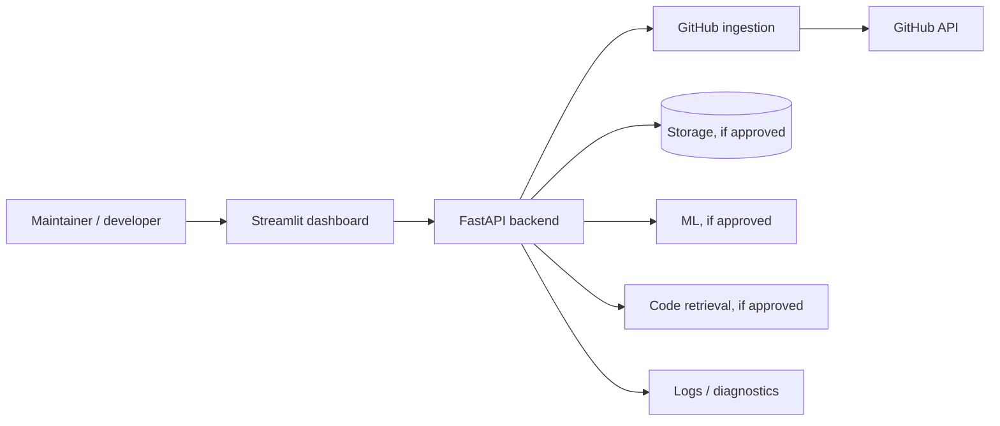
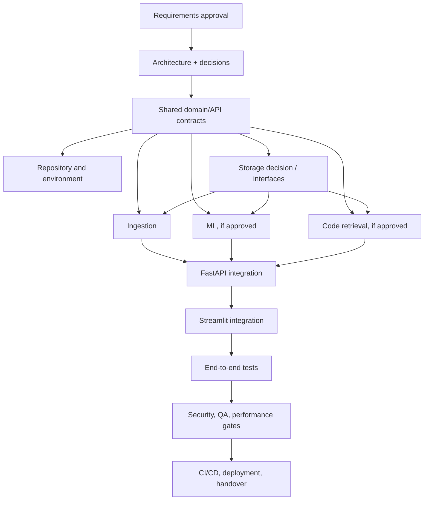
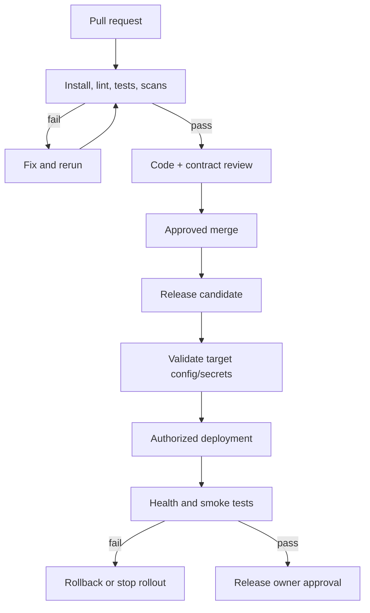

# ORDO Master Implementation Runbook

**Project:** ORDO — AI-powered GitHub Issue Intelligence Platform  
**Document:** `docs/implementation/ORDO_Master_Implementation_Runbook.md`  
**Status:** Initial execution plan; scope and architecture approvals pending  
**Date:** 2026-10-27  
**Repository status:** The project owner previously stated that the repository has not yet been created. This runbook does not claim that any source files, branches, tests, deployments, approvals, or team assignments exist.

> **Operating rule:** Planning documents are not implementation evidence. Mark a task `COMPLETE` only after its acceptance criteria have been verified and the actual commands/results are recorded. Never invent command output, tests, repository URLs, credentials, approvals, or team-member assignments.

## Table of Contents
1. [Purpose and Scope](#1-purpose-and-scope)
2. [Project Context and Confirmed Decisions](#2-project-context-and-confirmed-decisions)
3. [Manual Inventory](#3-manual-inventory)
4. [Roles and Ownership](#4-roles-and-ownership)
5. [Architecture and Dependency Overview](#5-architecture-and-dependency-overview)
6. [Decision Register](#6-decision-register)
7. [Risk and Blocker Registers](#7-risk-and-blocker-registers)
8. [Repository and Environment Setup](#8-repository-and-environment-setup)
9. [Implementation Dependency Graph](#9-implementation-dependency-graph)
10. [Phase-by-Phase Implementation Plan](#10-phase-by-phase-implementation-plan)
11. [File-by-File Implementation Protocol](#11-file-by-file-implementation-protocol)
12. [Shared Contract and Change Control](#12-shared-contract-and-change-control)
13. [Testing Strategy and Quality Gates](#13-testing-strategy-and-quality-gates)
14. [Security and Privacy Gates](#14-security-and-privacy-gates)
15. [Git and Collaboration Workflow](#15-git-and-collaboration-workflow)
16. [CI/CD and Deployment Process](#16-cicd-and-deployment-process)
17. [Observability and Operational Readiness](#17-observability-and-operational-readiness)
18. [Phase Handover Templates](#18-phase-handover-templates)
19. [Final Acceptance Checklist](#19-final-acceptance-checklist)
20. [Known Limitations and Open Questions](#20-known-limitations-and-open-questions)
21. [Glossary and References](#21-glossary-and-references)

## 1. Purpose and Scope

This runbook is the cross-cutting execution plan for creating ORDO in small, verifiable increments. It coordinates the specialist manuals rather than replacing them. It defines prerequisites, ownership, files/artifacts, validation, exit gates, failure handling, and handovers.

### Rules of execution
1. Audit available documents and approve scope before implementing application behavior.
2. Use the approved repository; do not invent a repository URL or create a competing repository.
3. Keep a single authoritative source for domain models, API schemas, errors, configuration, migrations, and component interfaces.
4. Implement only approved capabilities. ML, code retrieval, persistence, background jobs, vector storage, and deployment infrastructure may be deferred.
5. Do not advance through a failed gate. Fix the root cause, rerun checks, and record evidence.
6. Never commit `.env`, tokens, private source content, credentials, or sensitive datasets.
7. Never overwrite unrelated user changes or run destructive Git commands without explicit approval.
8. Use `NOT RUN` when a command has not actually been executed.
9. Keep tests isolated from production credentials/data.
10. Require a handover report at each phase boundary.

## 2. Project Context and Confirmed Decisions

ORDO is intended to be an AI-powered GitHub Issue Intelligence Platform. Planning manuals repeatedly describe GitHub issue ingestion, normalization, a FastAPI backend, a Streamlit dashboard, ML analysis, code retrieval, storage, testing, security, observability, CI/CD, and release management. These are candidate/architectural areas, not all automatically approved first-release features.

### Current known facts
- The repository has not yet been created, based on the project context supplied by the user.
- The user has supplied a set of role-specific implementation manuals in the Library.
- FastAPI and Streamlit are repeatedly planned technologies.
- The Data Engineer manual proposes Python 3.12+, GitHub REST API, Pydantic, SQLAlchemy and SQLite; the database and architecture decisions still require reconciliation and approval.
- No real test, build, deployment, benchmark, or external integration result is verified in this runbook.

### Must not be assumed
- Repository URL, branch names, Git remote, cloud account, deployment target, credentials, package manager, database, model provider, vector store, production workload, team-member names, or approvals.
- Every candidate capability is in initial release.
- A mocked integration proves live GitHub connectivity.
- Code written proves the requirement is complete.

## 3. Manual Inventory

The following inventory reflects relevant Library items found during document review. Presence means a planning artifact was available to review, not that its instructions are approved or its implementation exists. Before execution, inspect the current versions and record their version/date.

| # | Expected manual | Status at runbook creation | Review action |
|---:|---|---|---|
| 1 | `ORDO_Project_Requirements_and_Scope_Blueprint.md` | Draft generated in this deliverable set | Obtain project-owner approval |
| 2 | `ORDO_System_Architecture_Technical_Design_Blueprint.md` | Draft generated in this deliverable set | Resolve ADRs and approve architecture |
| 3 | `ORDO_Project_Lead_Technical_Coordinator_Blueprint.md` | Present in Library | Review ownership and governance alignment |
| 4 | `ORDO_API_Contract_Integration_Standards_Blueprint.md` | Present in Library | Confirm endpoint/schema/error contract is authoritative |
| 5 | `ORDO_Data_Engineer_Blueprint.md` | Present in Library | Reconcile ingestion/storage assumptions |
| 6 | `ORDO_Database_Data_Storage_Engineer_Blueprint.md` | Draft generated in this deliverable set | Approve persistence decision and data lifecycle |
| 7 | `ORDO_ML_Engineer_Blueprint.md` | Present in Library | Confirm which ML features are in scope |
| 8 | `ORDO_Code_Retrieval_Engineer_Blueprint.md` | Present in Library | Confirm retrieval scope, access model and evaluation |
| 9 | `ORDO_FastAPI_Backend_Engineer_Blueprint.md` | Present in Library | Reconcile routes/services with API contract |
| 10 | `ORDO_Streamlit_Frontend_Engineer_Blueprint.md` | Present in Library | Reconcile UI scope and API client |
| 11 | `ORDO_Integration_Engineer_Blueprint.md` | Present in Library | Confirm integration gates |
| 12 | `ORDO_Security_Privacy_Reviewer_Blueprint.md` | Present in Library | Review data/credential threat model |
| 13 | `ORDO_QA_Test_Automation_Blueprint.md` | Present in Library | Align test matrix and gate definitions |
| 14 | `ORDO_Performance_Reliability_Engineer_Blueprint.md` | Present in Library | Establish workload and performance method |
| 15 | `ORDO_Monitoring_Logging_Observability_Blueprint.md` | Present in Library | Establish minimum telemetry and redaction |
| 16 | `ORDO_DevOps_CICD_Engineer_Blueprint.md` | Present in Library | Approve reproducible setup and pipeline |
| 17 | `ORDO_Deployment_Release_Engineer_Blueprint.md` | Present in Library | Confirm release/rollback/operations requirements |
| 18 | `ORDO_Documentation_Developer_Experience_Blueprint.md` | Present in Library | Confirm onboarding and documentation ownership |
| 19 | `ORDO_Master_Implementation_Runbook.md` | This document | Update as decisions and actual evidence emerge |

### Manual reconciliation procedure
1. Compare each manual's status, date, filenames, technology assumptions, and scope.
2. Extract conflicting statements into the blocker register; do not silently pick one.
3. Requirements manual owns product scope and acceptance intent.
4. Architecture manual owns component boundaries and architecture decisions.
5. API contract manual owns public routes, request/response schemas, error formats, and compatibility.
6. Storage manual owns schema/migrations/repository details after persistence is approved.
7. Specialist manuals own implementation within their module boundaries.
8. Project Lead / designated architecture owner resolves cross-manual conflicts; product owner approves scope and business decisions.
9. Re-run this inventory when manuals are revised.

## 4. Roles and Ownership

Use role names until actual people are assigned.

| Role | Primary ownership | Must not independently decide |
|---|---|---|
| Project Lead / Technical Coordinator | Scope coordination, dependencies, task assignment, approvals tracking, cross-module blockers | Product decisions outside delegated authority |
| Data Engineer | GitHub ingestion, pagination, normalization, data quality | API route definitions, unrelated root config |
| Database/Storage Engineer | Persistence decision implementation, schema, migrations, repository layer, retention | Persisting unapproved data categories |
| ML Engineer | Approved ML feature implementation and evaluation | Product taxonomy/quality target without approval |
| Code Retrieval Engineer | Repository indexing/search, ranking, retrieval tests | Access policy without Security review |
| FastAPI Backend Engineer | API app, routes, service orchestration, validation/error mapping | Conflicting public schemas |
| Streamlit Frontend Engineer | Pages, API client, UI/session state, UI smoke tests | Direct database access or duplicate business logic |
| API Contract/Integration Standards Engineer | Public API and shared contract governance | Unreviewed breaking changes |
| Integration Engineer | Cross-module wiring and end-to-end defects | Reimplementing specialist logic |
| Security/Privacy Reviewer | Threat model, credentials, data access, retention review | Approving business scope on behalf of owner |
| QA/Test Automation Engineer | Test strategy, fixtures, regression, quality gate evidence | Marking unrun tests as passed |
| Performance/Reliability Engineer | Workload definition, latency/resource/reliability tests | Inventing targets or benchmark claims |
| Observability Engineer | Structured logging, diagnostics, metrics and redaction checks | Adding unapproved telemetry vendors |
| DevOps/CI-CD Engineer | Environment reproducibility, CI, approved build artifacts | Choosing production platform without approval |
| Deployment/Release Engineer | Deployment, rollback, release readiness and handover | Deploying without authorization |
| Documentation/Developer Experience Engineer | Setup, troubleshooting, API/operations documentation | Documenting proposals as implemented facts |
| Project owner | Scope, targets, risk acceptance, final acceptance | N/A |

### Work-item contract
Every task must record owner, input documents, prerequisites, exact files, outputs, interfaces affected, commands, tests, acceptance criteria, risk/security implications, and handover artifact.

## 5. Architecture and Dependency Overview

Proposed logical flow:



Start with a modular monolith. Use separate processes for API and Streamlit if operationally convenient, but do not add microservices, a broker, Redis, or vector infrastructure without a justified ADR.

### Dependency graph



Contracts and decisions precede dependent implementation. Documentation templates, synthetic fixture design, and threat modelling can proceed in parallel. Frontend layout can be prototyped, but final API calls must wait for the approved contract.

## 6. Decision Register

Statuses: `PROPOSED`, `APPROVED`, `REJECTED`, `BLOCKED`. No item should be marked `APPROVED` without evidence and approver.

| ID | Topic | Current status | Options / recommendation | Dependencies | Owner |
|---|---|---|---|---|---|
| DEC-001 | Initial P0 feature scope | BLOCKED | Approve minimal read-only issue retrieval/display; defer optional ML/retrieval unless explicitly included | All phases | Project owner |
| DEC-002 | GitHub access and permissions | BLOCKED | Read-only access; decide token vs GitHub App and public/private support | Ingestion/security | Owner + Security |
| DEC-003 | Runtime and package management | BLOCKED | Verify Python/dependency compatibility; choose one package manager/manifest | Repository bootstrap | Architect/DevOps |
| DEC-004 | Storage persistence | BLOCKED | No DB if on-demand flow is enough; otherwise evaluate SQLite/PostgreSQL | Data/ML/API | Owner + Storage |
| DEC-005 | Database/migrations | BLOCKED | SQLAlchemy/Alembic only if approved after DB decision | Storage | Storage |
| DEC-006 | API schemas/error convention | BLOCKED | Use API contract manual as single source; approve before routes/UI client | Backend/frontend | API owner |
| DEC-007 | ML scope/model/provider | BLOCKED | Defer or baseline + evaluation dataset; review privacy before external inference | ML | Product + ML + Security |
| DEC-008 | Retrieval approach | BLOCKED | Benchmark keyword/hybrid/semantic; no vector DB by default | Retrieval/storage | Architect + Retrieval |
| DEC-009 | AuthN/AuthZ | BLOCKED | No invented user system; decide based on private repository and deployment access | API/security | Owner + Security |
| DEC-010 | Deployment target | BLOCKED | Decide only after workload, budget, ownership and access needs known | Release/DevOps | Owner |
| DEC-011 | Logging and retention | BLOCKED | Structured, minimized, redacted logs; retention needs approval | Observability/security | Owner + Security |
| DEC-012 | Quality/performance targets | BLOCKED | Define workload and evaluation protocol, then approve measurable targets | QA/performance | Owner |
| DEC-013 | Branch and review workflow | BLOCKED | Inspect repository and choose branch convention; do not assume `main`/`develop` | Git setup | Project Lead |
| DEC-014 | CI provider and deploy artifact | BLOCKED | Select after repository host/platform confirmed | CI/CD | Owner + DevOps |

Decision record template:

```markdown
## DEC-XXX — <topic>
- Status: PROPOSED / APPROVED / REJECTED / BLOCKED
- Owner:
- Approver:
- Date/evidence:
- Context:
- Options:
- Recommendation:
- Dependencies:
- Consequences/security impact:
- Validation plan:
```

## 7. Risk and Blocker Registers

### Risk register

| ID | Risk | Likelihood | Impact | Mitigation | Owner | Status |
|---|---|---|---|---|---|---|
| R-001 | Scope ambiguity creates rework | High | High | Approve P0 scope before feature coding | Project Lead/owner | Open |
| R-002 | Manual conflicts create incompatible modules | Medium | High | Reconcile contracts; use ADR and change control | Architect | Open |
| R-003 | GitHub rate limits block ingestion | Medium | High | Pagination, bounded retry, rate-limit-aware errors | Data | Open |
| R-004 | Private issue/code content leaks | Medium | High | Least privilege, data minimization, redaction, security tests | Security | Open |
| R-005 | Model/retrieval quality is not useful | Medium | High | Evaluation set, baseline, explicit acceptance threshold | ML/Retrieval | Open |
| R-006 | Overengineering increases maintenance | Medium | Medium | Modular monolith; add infrastructure only via ADR | Architect | Open |
| R-007 | Storage choice mismatches deployment | Medium | High | Decide using concurrency/backup/workload evidence | Storage/DevOps | Open |
| R-008 | Tests depend on live secrets/services | Medium | High | Mock adapters; opt-in live integration tests | QA | Open |
| R-009 | Deployment secrets or configuration are mishandled | Medium | High | Secret manager/environment config, secret scans | DevOps/Security | Open |

### Blocker register

| ID | Blocker | Affected phases | Evidence needed | Approver/owner | Status |
|---|---|---|---|---|---|
| B-001 | Initial release scope not approved | 0 onward | Signed scope/decision record | Project owner | BLOCKED |
| B-002 | Public/private repo support not decided | 2–6 | Access/permission requirements | Owner + Security | BLOCKED |
| B-003 | Storage requirement not decided | 2–6 | Workflow, history and workload needs | Architect + owner | BLOCKED |
| B-004 | API contract approval pending | 2, 7–9 | Reviewed schemas/routes/errors | API owner | BLOCKED |
| B-005 | Runtime/dependency manager not approved | 1 | Compatibility review | Architect/DevOps | BLOCKED |
| B-006 | Deployment target and credentials unavailable | 15 | Authorized target/config | Owner/Release | BLOCKED |

## 8. Repository and Environment Setup

This phase begins only after repository location and workflow are approved. The following commands are inspection/bootstrap guidance, not commands already executed.

### 8.1 Inspect before changing anything
**PowerShell — run from the proposed repository directory only if it exists:**
```powershell
Get-Location
Get-ChildItem -Force
git status --short --branch
git remote -v
git branch --show-current
```
Purpose: establish the real directory, files, working tree, remotes and branch. If the directory is absent, do not infer repository details; obtain the approved location first.

**Bash equivalent:**
```bash
pwd
ls -la
git status --short --branch
git remote -v
git branch --show-current
```

Expected validation: output is inspected and recorded; if it is not a Git repository, record that fact and proceed only with an approved initialization plan. Do not run `git reset --hard`, `git clean`, force-push, or history-rewriting commands.

### 8.2 Repository scaffold
After approval:
1. Confirm repository URL/ownership and whether to create a new repository or clone an existing one.
2. Confirm default/integration branch and PR policy.
3. Create the agreed directory tree from the architecture manual.
4. Add `.gitignore` before creating local secrets.
5. Add `.env.example` with placeholders only.
6. Choose one dependency manifest/package tool.
7. Add README with clean setup, test, and run instructions.
8. Configure formatter/linter/test commands.
9. Add CI only after the provider and required checks are approved.
10. Commit a small baseline checkpoint only if the Git workflow is approved.

### 8.3 Runtime and dependencies
The Data Engineer manual proposes Python 3.12+, but compatibility must be verified before pinning the runtime. Select a supported Python minor version and package manager, then pin compatible dependency ranges/lockfile according to the chosen tool. Avoid duplicate root dependency manifests with conflicting package sets.

### 8.4 Baseline quality commands
Exact commands depend on approved tooling. The runbook should be updated after selection. Example categories:
- install dependencies in a clean environment;
- run formatter check;
- run linter;
- run unit/contract tests;
- run type checking if selected;
- run dependency/secret scans if approved.

Do not report `PASS` until the command actually ran and its exit status/result was reviewed.

## 9. Implementation Dependency Graph

The high-level graph in Section 5 is the default. Before each phase, check whether prerequisites were actually completed. A phase may be partially complete while a specific feature is deferred; record that distinction explicitly.

## 10. Phase-by-Phase Implementation Plan

### Phase 0 — Documentation audit and scope approval
**Objective:** create a consistent, approved baseline before coding.  
**Inputs:** 19 manuals inventory, project owner decisions.  
**Tasks:**
1. Review requirements and architecture drafts.
2. Review all available role manuals.
3. Compare API paths/schema/error conventions and data models.
4. Compare technology and storage proposals.
5. Record conflicts, assumptions, and blockers.
6. Confirm P0/P1/future scope.
7. Approve access, privacy, success measures and release criteria.
8. Create ADR and risk registers.
**Artifacts:** approved requirements, approved architecture/ADRs, manual inventory, blocker list.  
**Verification:** owner review; all critical decisions have a status and owner.  
**Exit gate:** no critical scope/architecture question is silently treated as approved.  
**If failed:** stop dependent coding; only independent documentation or fixture work may continue.

### Phase 1 — Repository, environment, and engineering standards
**Objective:** establish reproducible development.  
**Prerequisites:** approved repository location, runtime, package manager, Git workflow.  
**Tasks:** inspect state; establish tree; `.gitignore`; `.env.example`; dependency lock; formatting/lint/test tools; README; baseline CI if approved.  
**Files:** root config/docs and `.github/workflows/` only as approved.  
**Tests:** clean install, baseline commands, secret scan.  
**Exit gate:** a new developer can follow setup from a clean checkout; actual command results recorded.  
**Failure:** fix setup/tooling root cause before feature work.

### Phase 2 — Shared contracts and core interfaces
**Objective:** prevent incompatible module implementations.  
**Prerequisites:** scope and architecture decisions.  
**Tasks in order:**
1. Define canonical repository/issue identity.
2. Define domain models and UTC timestamp convention.
3. Approve public request/response schemas.
4. Define error taxonomy and correlation ID rules.
5. Define ingestion interface.
6. Define storage interface only if persistence is approved.
7. Define ML and retrieval interfaces only for approved features.
8. Define frontend API client expectations.
9. Add contract tests and compatibility rules.
**Artifacts:** shared schemas, API contract, interface examples.  
**Exit gate:** producers and consumers agree; contract tests pass.  
**Failure:** resolve contract conflict with API owner; do not let each module invent its own schema.

### Phase 3 — Database and persistence foundation (conditional)
**Objective:** implement the approved storage design.  
**Prerequisites:** persistence decision, canonical models, retention policy, migration tool if applicable.  
**Tasks:** implement connection/session lifecycle; schema/migrations; constraints/indexes justified by query patterns; repository interface; transaction/error behavior; retention/deletion procedures; isolated tests.  
**Files:** exact paths from approved storage manual.  
**Tests:** schema/migration, CRUD, uniqueness, upsert, rollback, invalid data, concurrency if required.  
**Exit gate:** migrations and repository tests pass in isolated storage.  
**If no DB approved:** document storage-light limitations and verify request-local behavior instead; do not create an unused database package.

### Phase 4 — Data ingestion and normalization
**Objective:** retrieve approved GitHub data safely and consistently.  
**Prerequisites:** GitHub access decision, canonical models, API/timeouts/retry policy, storage interface if applicable.  
**Tasks:** build GitHub adapter; paginate; validate; normalize; handle timeouts/rate limits/permissions; produce diagnostics; add idempotent persistence if approved; test repeated and partial runs.  
**Files:** `packages/data_ingestion/` per approved tree.  
**Tests:** mocked HTTP pagination, rate-limit handling, invalid payloads, duplicate fixtures, opt-in live integration test.  
**Exit gate:** representative fixtures and approved integration tests demonstrate correct repeatable ingestion.  
**Failure:** do not call partial pagination a successful complete sync; fix and retest.

### Phase 5 — Machine learning and classification (conditional)
**Objective:** implement only approved ML capabilities.  
**Prerequisites:** feature approval, input/output contract, evaluation data, privacy review.  
**Tasks:** baseline first; preprocessing; inference adapter; typed output; model/version tracking where needed; invalid-input/failure handling; evaluation; model limitations documentation.  
**Tests:** deterministic unit tests, evaluation suite, malformed inputs, provider/local model failure, privacy checks.  
**Exit gate:** approved metric threshold is met, or limitation is explicitly accepted. No invented scores.

### Phase 6 — Code retrieval and repository context (conditional)
**Objective:** retrieve relevant source context within approved repository boundaries.  
**Prerequisites:** retrieval scope, source access permissions, index strategy ADR, canonical issue/repository contracts.  
**Tasks:** repository file acquisition; exclusion/size policy; chunk/index metadata; query interface; ranking; revision tracking; stale index behavior; no-match/failure distinction; access-scope tests.  
**Tests:** curated issue-to-code queries, irrelevant/no-match cases, inaccessible repository, stale index and large repository cases.  
**Exit gate:** relevance and access tests meet approved criteria. If retrieval is deferred, mark not applicable for initial release.

### Phase 7 — FastAPI backend
**Objective:** expose the approved contract and orchestrate services.  
**Prerequisites:** API contract, settings model, service interfaces.  
**Tasks:** app startup/config validation; route handlers; service layer; request/response schemas; exception mapping; health/readiness if required; CORS/network policy if needed; OpenAPI review; request IDs/logging; timeouts; auth integration if approved.  
**Tests:** unit service tests, contract tests, API tests, configuration failures, upstream/storage/model failures.  
**Exit gate:** reproducible startup and contract-compliant API with tested errors.  
**Do not:** invent routes, query storage in route handlers, or swallow exceptions.

### Phase 8 — Streamlit frontend
**Objective:** provide a usable dashboard on top of the API.  
**Prerequisites:** approved UI scope, stable API contract, API client settings.  
**Tasks:** navigation/page structure; repository input/selection; API client; issue list/detail; loading/empty/error/retry states; derived-result provenance if applicable; safe display of content; configuration and session state.  
**Tests:** API client tests, smoke tests, mocked failure/empty/success workflows.  
**Exit gate:** UI communicates with API and presents states accurately.  
**Do not:** connect directly to storage or duplicate backend business logic.

### Phase 9 — Cross-module integration
**Objective:** prove the approved end-to-end workflow.  
**Prerequisites:** producer/consumer contracts and individual component gates.  
**Tasks:** run synthetic fixture through ingestion; validate canonical record; persist/retrieve if approved; run ML/retrieval if approved; return API response; display in Streamlit; test external failure paths; record defects.  
**Tests:** controlled E2E suite.  
**Exit gate:** critical approved workflows pass. A mock proves only the mocked boundary, not live GitHub connectivity.

### Phase 10 — Security and privacy verification
**Objective:** perform formal threat and implementation review.  
**Tasks:** credential scopes; secret scan; input validation; safe errors; private repository isolation; prompt-injection risk if LLM used; data minimization/retention; dependency scan; log redaction; auth boundaries; deployment secrets.  
**Owner:** Security reviewer, with remediation by component owners.  
**Exit gate:** no critical/high finding silently accepted. Any exception requires explicit authorized acceptance, mitigation, and review/expiry date.

### Phase 11 — QA and regression
**Objective:** verify requirements and negative paths systematically.  
**Tasks:** unit, contract, integration, E2E, regression, schema/migration, UI smoke, security tests; map tests to requirements; inspect test flakiness; document unrun checks.  
**Exit gate:** required checks pass; all exceptions are documented and accepted by authorized owner. Coverage percentage alone is not proof of quality.

### Phase 12 — Performance and reliability
**Objective:** measure the actual workload against approved targets.  
**Tasks:** define representative repository size and concurrency; measure API, ingestion and retrieval latency; resource use; timeout/retry behavior; bounded memory/batches; failure isolation.  
**Exit gate:** approved targets met or remediation/explicit risk acceptance recorded. No benchmark figures may be invented.

### Phase 13 — Monitoring and observability
**Objective:** diagnose operational failures without leaking data.  
**Tasks:** structured logs; correlation IDs; health checks; useful counters/timings; redaction tests; diagnostics guide; alerts only if approved.  
**Exit gate:** controlled failures can be diagnosed from available telemetry and documented procedures.

### Phase 14 — CI/CD and infrastructure
**Objective:** make quality gates reproducible and enforceable.  
**Tasks:** install/build checks; format/lint/tests; approved security scan; build artifact; environment-specific config; secret references; least-privilege pipeline permissions; protected release process.  
**Exit gate:** approved pipeline passes and blocks releases on required-check failures. Do not add unapproved deployment providers or infrastructure.

### Phase 15 — Deployment and release readiness
**Objective:** deploy only to an authorized target and verify it.  
**Tasks:** confirm target/owner; configure secrets; apply migrations if any; execute deployment procedure; health and smoke tests; validate logs/monitoring; backup/restore checks where applicable; rollback procedure; release notes/known limitations.  
**Exit gate:** authorized environment passes verification and release owner approves. If no target/credentials exist, mark deployment `BLOCKED` or `NOT RUN`.

### Phase 16 — Documentation and handover
**Objective:** make setup and operation reproducible by another engineer.  
**Tasks:** finalize README; setup/config; architecture and data flow; API usage; testing; troubleshooting; deployment/rollback; privacy/retention; known limitations; ownership.  
**Exit gate:** new developer can follow the documented process without relying on undocumented assumptions.

### Phase 17 — Final acceptance
**Objective:** assemble evidence for project-owner decision.  
**Acceptance report includes:** approved scope; delivered/not-delivered requirements; commands actually run; test outcomes; security status; performance/reliability evidence; deployment status; limitations; accepted risks; documentation status; blockers; owner decision.  
**Exit gate:** explicit project-owner acceptance. Code completion alone is not acceptance.

## 11. File-by-File Implementation Protocol

For every file or tightly related file group, the coding assistant must provide:
1. Phase/task ID and exact path.
2. Purpose and owning module.
3. Dependencies/imports and contract version.
4. Complete implementation, not unintegratable fragments.
5. Important design choices and trade-offs.
6. Command(s) to run and working directory.
7. Tests to execute and expected assertions.
8. Actual result or `NOT RUN`.
9. Common failure modes and corrective action.
10. Downstream consumers/files.
11. Security/privacy implications.
12. Commit/checkpoint suggestion only if consistent with approved Git workflow.

Before editing, inspect the existing file. Preserve unrelated changes. After each coherent unit, run relevant checks, diagnose failures, fix the root cause, rerun checks, and record the result. If execution is unavailable, state that it was not run and provide exact user-run instructions.

### Example task card
```markdown
## TASK-<phase>-<number> — <short title>
- Status: NOT STARTED / IN PROGRESS / BLOCKED / IN REVIEW / PASS / FAIL / COMPLETE
- Owner:
- Prerequisites:
- Files:
- Contract affected:
- Implementation:
- Commands (actual working directory):
- Expected validation:
- Actual result:
- Security/privacy checks:
- Acceptance criteria:
- Handover / next task:
```

## 12. Shared Contract and Change Control

Single source of truth is required for:
- Domain models and stable identifiers.
- API paths, request/response schemas and error format.
- Configuration variable names.
- Storage schemas and migrations.
- Service interfaces and optional job formats.
- Logging/redaction conventions.

Any cross-module change must include:
1. Reason and requirement ID.
2. Contracts affected.
3. Producers, consumers and files affected.
4. Backward-compatibility assessment.
5. Tests to add/update.
6. Documentation to update.
7. Required approval.
8. Migration/rollout/rollback plan where applicable.

Do not permit a frontend, API, data pipeline, ML package and retrieval package to independently define incompatible versions of the same entity. If manuals conflict, stop dependent work, record exact conflict, propose options, and obtain approval from the designated owner.

## 13. Testing Strategy and Quality Gates

| Test category | Requirement/risk | Typical location | Command | Status |
|---|---|---|---|---|
| Unit | Mapping, validation, business rules | Package-local `tests/` | To be set after tooling approval | NOT RUN |
| Schema/contract | Stable DTOs and compatibility | `tests/contract/` | To be set | NOT RUN |
| GitHub adapter | Pagination/rate limits/auth errors | Ingestion tests | To be set | NOT RUN |
| Storage/migrations | Integrity/idempotency/rollback | Storage tests if applicable | To be set | NOT RUN |
| ML evaluation | Approved quality target | ML evaluation tests/data | To be set | NOT RUN |
| Retrieval evaluation | Relevance and access boundaries | Retrieval tests/data | To be set | NOT RUN |
| API integration | Status, schema, error mapping | API tests | To be set | NOT RUN |
| Frontend smoke | Loading/empty/error/success | UI tests/smoke procedure | To be set | NOT RUN |
| E2E | Approved user workflow | `tests/e2e/` | To be set | NOT RUN |
| Security | Secrets, permissions, safe errors | Security tests/scans | To be set | NOT RUN |
| Performance | Approved workload/targets | Performance suite | To be set | NOT RUN |
| Deployment smoke | Config/health/rollback assumptions | Release checks | To be set | NOT RUN |

### Test result record
```markdown
- Test ID:
- Requirement/risk:
- Environment and fixture:
- Command:
- Expected result:
- Actual result:
- Status: NOT RUN / PASS / FAIL / BLOCKED
- Evidence:
- Defect/follow-up:
- Owner:
```

Ordinary tests use synthetic or sanitized fixtures and mocks. Live GitHub tests are opt-in, bounded, and must use explicitly authorized test credentials. A mock integration is never reported as a live integration success.

## 14. Security and Privacy Gates

Security is continuous, with a formal gate in Phase 10:
- Tokens are least-privilege and not committed.
- `.env` is ignored; `.env.example` uses placeholders only.
- No secrets in logs, exceptions, screenshots, fixtures or test reports.
- Public error responses are safe and do not contain stack traces.
- Repository and issue inputs are validated.
- Private issue/code content is scoped to authorized repositories.
- Any external model provider is reviewed for data handling before sensitive content is sent.
- Data retention/deletion and backup access are documented.
- Dependencies are reviewed/scanned under approved policy.
- High/critical findings are fixed or explicitly accepted by an authorized owner with mitigation and review date.

## 15. Git and Collaboration Workflow

Before any Git change, inspect:
```bash
git status --short --branch
git remote -v
git branch --show-current
```
Run only from the confirmed repository root. If the repository is not initialized, get approval for its URL/owner, default branch, integration branch, branch naming, and review rules.

Rules:
- Never invent a remote URL or branch name.
- Never overwrite uncommitted work.
- Do not run destructive reset/clean/force-push/history-rewrite commands without explicit authorization.
- Never commit `.env`, access tokens, passwords, private keys, private repository dumps, or sensitive issue datasets.
- Keep commits small and related.
- Require the relevant checks before merge.
- Shared contract, migration, or configuration changes require owner review.
- Avoid simultaneous uncoordinated edits to shared schemas.

## 16. CI/CD and Deployment Process

### CI minimum (after provider approval)
1. Check out the approved revision.
2. Install from the single dependency source.
3. Validate formatting and lint.
4. Run unit and contract tests.
5. Run integration tests that do not require production credentials.
6. Run approved secret/dependency checks.
7. Build/package artifact if needed.
8. Publish test/scan results.
9. Block merge/release when required checks fail.

### Release flow



Do not deploy to an external environment without authorization and credentials. If target infrastructure is unavailable, complete local checks and mark deployment verification `BLOCKED` or `NOT RUN`.

### Release record
- Version/commit:
- Approved scope:
- Migration state:
- CI results:
- Security findings:
- Configuration verified:
- Deployment target and authorization:
- Smoke tests:
- Rollback plan:
- Known limitations:
- Release owner decision:

## 17. Observability and Operational Readiness

Minimum proposal:
- Structured logs with timestamp, level, component, request/correlation ID, event and outcome.
- Ingestion counts, invalid-record counts, pagination completion, retry and rate-limit categories.
- API request duration/error categories.
- ML/retrieval timing and failure categories if those capabilities exist.
- Health/readiness checks where required.
- Redaction checks preventing token/header/body leakage.
- Troubleshooting steps for GitHub auth, rate limits, storage, model, retrieval and UI/API connectivity.

No telemetry vendor, dashboard, or alerting integration is assumed present. Define operational targets and alert thresholds after workload and ownership are approved.

## 18. Phase Handover Templates

### Phase handover report
```markdown
# Phase <N> Handover
- Phase/status:
- Work completed:
- Files created/changed:
- Decisions made and approvers:
- Contracts changed:
- Commands actually run:
- Test results (PASS/FAIL/BLOCKED/NOT RUN):
- Security/privacy findings:
- Known defects:
- Risks/blockers:
- Documentation updated:
- Artifacts handed to next phase:
- Next-phase prerequisites:
- Required sign-off:
```

### Progress tracker
| Phase/task | Owner | Status | Prerequisites | Test status | Artifact/evidence | Next action |
|---|---|---|---|---|---|---|
| Phase 0 scope approval | Project Lead/owner | BLOCKED | Owner review | NOT RUN | Decision record | Approve P0 scope |

### Blocker template
```markdown
- Blocker ID:
- Decision/dependency missing:
- Affected phases/components:
- Why work cannot safely proceed:
- Options:
- Evidence needed:
- Owner/approver:
- Status:
- Resolution/date:
```

### Risk template
```markdown
| ID | Description | Likelihood | Impact | Mitigation | Owner | Status | Review date |
|---|---|---|---|---|---|---|---|
```

### Status semantics
- `NOT STARTED`: no work begun.
- `IN PROGRESS`: work started, incomplete.
- `BLOCKED`: cannot safely proceed due to dependency.
- `IN REVIEW`: awaiting review.
- `PASS`: a specific check passed.
- `FAIL`: a specific check failed.
- `COMPLETE`: acceptance criteria satisfied and evidence recorded.
- `NOT RUN`: check has not been executed.

## 19. Final Acceptance Checklist

- [ ] Requirements and first-release scope approved.
- [ ] Architecture and relevant ADRs approved.
- [ ] Shared contracts are authoritative and tests pass.
- [ ] All delivered requirements map to evidence.
- [ ] GitHub integration has controlled test evidence and clearly separated live-test evidence.
- [ ] Data integrity, idempotency and retention are verified where applicable.
- [ ] ML evaluation criteria/results are recorded if ML is included.
- [ ] Retrieval relevance and permission tests are recorded if retrieval is included.
- [ ] API contract and dashboard workflow tests pass.
- [ ] Security/privacy review is complete; critical/high findings are resolved or explicitly accepted.
- [ ] Performance/reliability tests use approved workload and targets.
- [ ] Logs/diagnostics are useful and redacted.
- [ ] CI/CD checks pass on the approved branch/workflow.
- [ ] Deployment and rollback are verified if deployment was authorized; otherwise clearly marked not run/blocked.
- [ ] README, setup, API, troubleshooting, operations and known limitations are current.
- [ ] Handover is accepted by the operational owner.
- [ ] Project owner records acceptance or rejection.

## 20. Known Limitations and Open Questions

1. No application repository was available to inspect during creation of this runbook.
2. Scope and architecture are proposed until approved by the project owner.
3. Existing specialist manuals may contain assumptions that conflict; reconcile before coding.
4. GitHub permissions, public/private repository support, and authentication method are undecided.
5. Storage is undecided; SQLite/SQLAlchemy appears in the Data Engineer proposal but must be reconciled with deployment and concurrency.
6. ML, code retrieval, summaries, prioritization, vector storage and background jobs are optional until approved.
7. API endpoints and schemas must come from the API Contract manual; this runbook does not invent them.
8. Runtime, package manager, CI provider, deployment target, and performance targets need approval.
9. No test, build, benchmark, or deployment result has been generated by this planning document.

## 21. Glossary and References

- **ADR:** Architecture Decision Record.
- **Canonical model:** internal validated representation of source data.
- **Contract test:** verifies producer and consumer agree on schemas/behavior.
- **Idempotency:** repeating an operation does not create unintended duplicate effects.
- **P0/P1/P2:** proposed priority levels; require scope approval.
- **RPO/RTO:** recovery point and recovery time objectives.
- **Source of truth:** authoritative owner of a data field or interface.
- **Quality gate:** a check that must pass before dependent work proceeds.

### Reference manuals
- `ORDO_Project_Requirements_and_Scope_Blueprint.md`
- `ORDO_System_Architecture_Technical_Design_Blueprint.md`
- `ORDO_Project_Lead_Technical_Coordinator_Blueprint.md`
- `ORDO_API_Contract_Integration_Standards_Blueprint.md`
- `ORDO_Data_Engineer_Blueprint.md`
- `ORDO_Database_Data_Storage_Engineer_Blueprint.md`
- `ORDO_ML_Engineer_Blueprint.md`
- `ORDO_Code_Retrieval_Engineer_Blueprint.md`
- `ORDO_FastAPI_Backend_Engineer_Blueprint.md`
- `ORDO_Streamlit_Frontend_Engineer_Blueprint.md`
- `ORDO_Integration_Engineer_Blueprint.md`
- `ORDO_Security_Privacy_Reviewer_Blueprint.md`
- `ORDO_QA_Test_Automation_Blueprint.md`
- `ORDO_Performance_Reliability_Engineer_Blueprint.md`
- `ORDO_Monitoring_Logging_Observability_Blueprint.md`
- `ORDO_DevOps_CICD_Engineer_Blueprint.md`
- `ORDO_Deployment_Release_Engineer_Blueprint.md`
- `ORDO_Documentation_Developer_Experience_Blueprint.md`

### Recommended next action
Review and approve the initial P0 scope, GitHub access model, API contract, and persistence decision. Only then create the repository scaffold and begin Phase 1.
